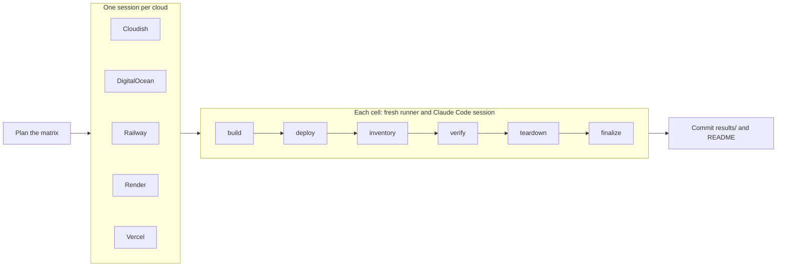

# ai-deploy-bench

A benchmark of what it takes for an AI coding agent to build a web app and deploy it to a cloud.
Claude Code builds five kinds of app from a written spec and deploys each one to
[Cloudish](https://cloudish.ai), [DigitalOcean](https://www.digitalocean.com),
[Railway](https://railway.com), [Render](https://render.com) and [Vercel](https://vercel.com). An
independent verifier then tests the live deployment. Everything runs in GitHub Actions, and each run
opens a pull request adding its results to [`results/`](results) for review before they're merged.

Browse the results at **[aideploybench.com](https://aideploybench.com)**: every run, each app's
checks, security review, costs and screenshots, and how each metric changes over runs. The site is
generated from `results/` and redeployed after every run ([`website/`](website)).

## Latest results

<!-- results:start -->
Latest full run: [2026-10-27 · #17](results/runs/2026-10-27_17-1/summary.md) · [Benchmark v3](CHANGES.md) · Claude Code 2.1.296 · Opus 5.5 · medium effort · HIPAA organization

Reran clouds: cloudish, railway, vercel; the other cells are copied unchanged from [2026-10-26 · #16](results/runs/2026-10-26_16-1/summary.md).

| Cloud | Success | Deploys without human | Human steps | Human time | Security & compliance | Stack fit | Checks passed | Avg build | Avg deploy | Tokens | Agent cost | Hosting, light use | Hosting, busy |
|---|---|---|---|---|---|---|---|---|---|---|---|---|---|
| [Cloudish](https://cloudish.ai) | 5/5 | 5/5 | 0 | 0 min | 81/100 | 91/100 | 100% | 2m 07s | 2m 43s | 6.49M | $4.55 | $0.55 | $39.20 |
| [DigitalOcean](https://www.digitalocean.com) | 5/5 | 0/5 | 3 | 7 min | 84/100 | 85/100 | 100% | 2m 03s | 4m 30s | 5.64M | $4.52 | $39.00 | $39.00 |
| [Railway](https://railway.com) | 5/5 | 0/5 | 3 | 7 min | 79/100 | 88/100 | 100% | 1m 56s | 3m 40s | 7.71M | $4.65 | $36.99 | $188.19 |
| [Render](https://render.com) | 5/5 | 0/5 | 2 | 5 min | 70/100 | 80/100 | 100% | 2m 03s | 3m 52s | 7.00M | $4.97 | $0.00 | $35.65 |
| [Vercel](https://vercel.com) | 3/5 | 0/5 | 3 | 8 min | 76/100 | 77/100 | 81% | 2m 15s | 4m 57s | 16.25M | $8.18 | $60.00 | $100.00 |

| Cloud | Static site | CRUD app | API | Dashboard | Realtime chat |
|---|---|---|---|---|---|
| Cloudish | [✅](results/runs/2026-10-27_17-1/cells/opus-5-5/cloudish/static-t1.md) | [✅](results/runs/2026-10-27_17-1/cells/opus-5-5/cloudish/crud-t1.md) | [✅](results/runs/2026-10-27_17-1/cells/opus-5-5/cloudish/api-t1.md) | [✅](results/runs/2026-10-27_17-1/cells/opus-5-5/cloudish/dataviz-t1.md) | [✅](results/runs/2026-10-27_17-1/cells/opus-5-5/cloudish/realtime-t1.md) |
| DigitalOcean | [✅](results/runs/2026-10-27_17-1/cells/opus-5-5/digitalocean/static-t1.md) | [✅](results/runs/2026-10-27_17-1/cells/opus-5-5/digitalocean/crud-t1.md) | [✅](results/runs/2026-10-27_17-1/cells/opus-5-5/digitalocean/api-t1.md) | [✅](results/runs/2026-10-27_17-1/cells/opus-5-5/digitalocean/dataviz-t1.md) | [✅](results/runs/2026-10-27_17-1/cells/opus-5-5/digitalocean/realtime-t1.md) |
| Railway | [✅](results/runs/2026-10-27_17-1/cells/opus-5-5/railway/static-t1.md) | [✅](results/runs/2026-10-27_17-1/cells/opus-5-5/railway/crud-t1.md) | [✅](results/runs/2026-10-27_17-1/cells/opus-5-5/railway/api-t1.md) | [✅](results/runs/2026-10-27_17-1/cells/opus-5-5/railway/dataviz-t1.md) | [✅](results/runs/2026-10-27_17-1/cells/opus-5-5/railway/realtime-t1.md) |
| Render | [✅](results/runs/2026-10-27_17-1/cells/opus-5-5/render/static-t1.md) | [✅](results/runs/2026-10-27_17-1/cells/opus-5-5/render/crud-t1.md) | [✅](results/runs/2026-10-27_17-1/cells/opus-5-5/render/api-t1.md) | [✅](results/runs/2026-10-27_17-1/cells/opus-5-5/render/dataviz-t1.md) | [✅](results/runs/2026-10-27_17-1/cells/opus-5-5/render/realtime-t1.md) |
| Vercel | [✅](results/runs/2026-10-27_17-1/cells/opus-5-5/vercel/static-t1.md) | [🙋 needs a person](results/runs/2026-10-27_17-1/cells/opus-5-5/vercel/crud-t1.md) | [✅](results/runs/2026-10-27_17-1/cells/opus-5-5/vercel/api-t1.md) | [✅](results/runs/2026-10-27_17-1/cells/opus-5-5/vercel/dataviz-t1.md) | [🙋 needs a person](results/runs/2026-10-27_17-1/cells/opus-5-5/vercel/realtime-t1.md) |

Success counts deployments that passed every required check. *Human steps* and *human time* are what a person had to do, or would have to do, for the agent to deploy all the apps: distinct steps and estimated minutes. *Security & compliance* is the average score of an independent review of each deployment's security and of whether its hosting plan fits the app's use, and *stack fit* the same review's rating of the stack the agent chose for each app, against the app's requirements. Times are averages per app; tokens, agent cost and hosting are totals across the apps (averaged over trials). Hosting is a month's cost with *light use* (a few visits a week) and when *busy* (hit around the clock). [All 9 run(s)](results/README.md) · [Methodology](docs/methodology.md)
<!-- results:end -->

## What it measures

For every cloud × model × app (a *cell*):

| | |
|---|---|
| **Completion success** | Whether the live deployment passes every required black-box check for its app, plus a score over all checks |
| **Time to build** | Wall-clock time of the agent's build phase, with the app working locally |
| **Time to deploy** | Wall-clock time of the agent's deploy phase, including cloud builds and rollouts, and how much longer the app took to answer afterwards |
| **Tokens used** | Input, output and cache tokens per phase, as reported by Claude Code |
| **Agent cost** | API cost per phase, as reported by Claude Code |
| **Human steps** | How many distinct things a person had to do, or would have to do, for the agent to deploy (sign up, payment method, API token, accepting integration terms, Git hosting). A deploy that can't finish without one fails at the `human` stage |
| **Human time** | Estimated minutes those human steps take |
| **Security & compliance** | A 0–100 score from an independent Claude Code review of how the app was built and deployed, whether its hosting plan fits how the app is used, and what is live, against a fixed rubric (secrets, provenance, terms compliance, least privilege, transport, attack surface, application security) |
| **Expected monthly cost** | The deployed resources priced from provider APIs and dated pricing tables for a month of *light use* (a few visits a week) and a *busy* month (hit around the clock), next to the agent's own estimate |
| **What it took** | Turns, tool calls, the shell commands run during deploy, doc lookups, lines of code, dependencies and deploy config files |
| **Stack fit** | A 0–100 rating, by the same independent review, of the stack the agent chose for each app: whether it fits the job, is as simple as the requirements allow, and uses what the cloud does well. Judged against the app's requirements, not a preferred stack |
| **Technologies** | What each app was built and run with: runtime, frameworks, data stores, libraries, packaging and the cloud services it used |

Definitions and caveats are in [docs/methodology.md](docs/methodology.md).

## How it works



1. **Plan**: [`benchmark.yml`](.github/workflows/benchmark.yml) expands
   [`benchmark.yaml`](benchmark.yaml) into one session per cloud
   ([`cloud.yml`](.github/workflows/cloud.yml)), each a matrix of cells.
2. **Build**: Claude Code weighs the stacks that could suit the app, records its choice in
   `STACK.md`, then builds the app in an empty workspace and tests it locally. The step
   holds only the model API key, so nothing can be deployed early.
3. **Deploy**: the same session resumes with the cloud's credentials, deploys under a unique
   resource prefix and writes `deployment.json`.
4. **Inventory, verify, review, tear down**: the harness lists and prices what was created, runs
   the app's checks against the public URL (HTTP, WebSocket/SSE and a headless browser), has a
   separate Claude Code session review the deployment's security and compliance and rate its
   stack, then deletes everything.
5. **Collect**: per-cell results go to `results/runs/<run>/` and the summary table above is
   refreshed.

## The apps

Five categories from [docs/apps.md](docs/apps.md), each specified as a contract the verifier can
test whatever stack the agent picks:

| App | Spec | What the verifier exercises |
|---|---|---|
| Static content site | [TASK.md](apps/static/TASK.md) | Three pages, a contact form endpoint, a browser form submission without reload |
| Database-backed CRUD app | [TASK.md](apps/crud/TASK.md) | Signup and login, a todo lifecycle, user isolation, persistence |
| API / backend service | [TASK.md](apps/api/TASK.md) | API keys, per-key data, OpenAPI, per-key rate limiting |
| Data / visualization app | [TASK.md](apps/dataviz/TASK.md) | Aggregates checked against the bundled CSV, charts rendering in a browser |
| Real-time collaborative app | [TASK.md](apps/realtime/TASK.md) | WebSocket or SSE delivery, room isolation, five concurrent users, history |

## Running the benchmark

1. **Set up the accounts** as described in [docs/setup.md](docs/setup.md): only each cloud's
   prerequisites (an account and an API token; Cloudish needs nothing). Everything else an agent
   needs from a person is measured, not set up in advance.
2. **Store the keys** as GitHub Actions secrets:
   ```sh
   cp .env.example .env    # fill in the keys; .env is gitignored
   scripts/set-secrets.sh  # uses the gh CLI
   ```
3. **Smoke test** the setup. A stub replaces Claude Code, so no model credits are spent, while
   every other step runs, including the inventory and teardown calls to each cloud's API with
   your credentials. Results are shown on the run page and not committed:
   ```sh
   gh workflow run benchmark.yml -f smoke_test=true
   ```
4. **Run** it from the Actions tab, or:
   ```sh
   gh workflow run benchmark.yml                                         # everything
   gh workflow run benchmark.yml -f clouds=vercel -f apps=static,api     # a subset
   gh workflow run benchmark.yml -f trials=3                             # repeated trials
   gh workflow run benchmark.yml -f clouds=railway -f base_run=2026-10-14_13-1  # rerun one cloud
   ```
   After a fix that only affects some cells, such as a bug in one cloud's adapter, `base_run` reruns
   just those cells and copies the rest from that full run, so the result is a full run again
   ([when that's valid](docs/methodology.md#rerunning-part-of-a-run)).
5. **Read the results**: when the run finishes, the collect job opens a pull request adding
   `results/runs/<date>_<run>/` (a summary with a screenshot gallery, `summary.json`, and per cell a
   JSON record, a report and screenshots of the live app)
   and `results/index.json`, and updating the table above. Review and merge it. The JSON layout is described in
   [docs/methodology.md](docs/methodology.md#result-files). Full agent transcripts and the generated source code are attached
   to the workflow run as artifacts for 30 days.

Each cell's phases are capped by time and by `--max-budget-usd`. Deployments are torn down after
verification unless `keep_deployments` is checked. If anything is left behind, the
[Cleanup](.github/workflows/cleanup.yml) workflow finds `adb-*` resources and deletes them.

## Changing the benchmark

Changes that make results incomparable with earlier runs, such as a different prompt, rubric, app or
check, raise `version` in [`benchmark.yaml`](benchmark.yaml) and are described in
[CHANGES.md](CHANGES.md).

- **Models**: add an entry under `models` in [`benchmark.yaml`](benchmark.yaml), with its prices
  under `model_prices`, and list it in [docs/models.md](docs/models.md).
- **Clouds**: add an entry in `benchmark.yaml`, an adapter in [`bench/clouds/`](bench/clouds) that
  lists, prices and deletes resources, a pricing table in `bench/clouds/pricing/`, its secrets in
  `cloud.yml` and `cleanup.yml`, and a line in [docs/clouds.md](docs/clouds.md).
- **Apps**: add `apps/<id>/TASK.md` (plus optional `DEPLOY.md` and `fixtures/`), a verifier in
  [`bench/verify/`](bench/verify), and a reference implementation in
  [`tests/reference_apps.py`](tests/reference_apps.py).

`tests/test_config.py` fails if `benchmark.yaml` and the lists in `docs/` drift apart.

## Development

```sh
python3 -m venv .venv && . .venv/bin/activate
pip install -r requirements.txt -r requirements-dev.txt
python -m playwright install chromium
pytest                                                  # harness tests, no credentials needed
python -m bench verify --app crud --url https://...     # run an app's checks against any URL
python -m bench plan --clouds vercel --apps static      # preview a matrix
```

| Path | Contents |
|---|---|
| [`benchmark.yaml`](benchmark.yaml) | Clouds, models, apps, limits and prices |
| [`apps/`](apps) | Task specs and fixtures given to the agent |
| [`bench/`](bench) | The harness: agent runner, cell steps, verifiers, cloud adapters, reports |
| [`bench/templates/`](bench/templates) | Build and deploy prompts |
| [`.github/workflows/`](.github/workflows) | Benchmark, per-cloud, cleanup and CI workflows |
| [`results/`](results) | Committed results, one folder per run |
| [`tests/`](tests) | Harness tests with reference apps, recorded agent streams and mocked cloud APIs |
