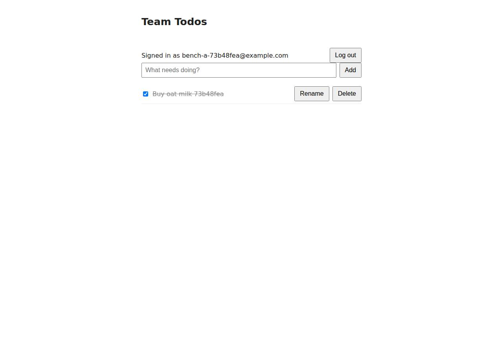

# ✅ Database-Backed CRUD App on Cloudish with Opus 5.5 (trial 1)

**success**: 19/19 checks passed (100%).

- URL: https://adb-w1uix-crud-web.on.do.cloudish.ai (from deployment.json)
- Estimated hosting: Light use: $0.11/month, Busy: $7.84/month (the agent estimated $7.84)
- Agent: Claude Code 2.1.296, model `claude-opus-5-5`, effort medium, HIPAA organization
- Resource prefix: `adb-w1uix-crud`

| | Build | Deploy | Total |
|---|---|---|---|
| Status | completed | completed | |
| Time | 1m 51s | 4m 09s | 6m 00s |
| Turns | 10 | 10 | |
| Tokens | 394.9K | 585.3K | 980.1K |
| Agent cost | $0.41 | $0.32 | $0.73 |
| Shell commands | 9 | 9 | |

App answered 0s after the agent finished deploying.

## Screenshots

**The web app before signing in** (https://adb-w1uix-crud-web.on.do.cloudish.ai/)

**The todo list after signing in through the web UI as the test user** (https://adb-w1uix-crud-web.on.do.cloudish.ai/)

## What was built

- Stack: `bcryptjs`, `express`
- Code: 377 lines in 11 files (JavaScript 254, HTML 112, JSON 29, Docker 11, Markdown 7)
- Dependencies: 2 npm, 0 Python
- Deploy config: `Dockerfile`, `.dockerignore`

## Human steps

None: the agent needed no human setup at all.

Reported but not needed, since the deployment worked without them: Claim the Cloudish key 'adb-w1uix-crud' and add credits: mint a fresh claim link with `GET https://cloudish.ai/api/v1/cr

## Security and compliance review

**76/100**, from an independent Claude Code review (`claude-opus-5-5`, high effort, HIPAA organization, $0.44) of the process, the code, the hosting plan and the live app.

The todo app was built and deployed carefully: the Cloudish key never left .env or reached the build context, the app runs the owner's own lockfile-installed code, the SQLite data sits on a private volume, and the code uses parameterized, owner-scoped queries over HTTPS with HSTS. The biggest problem is commercial fitness: the business app runs on an unclaimed free 0.1-credit grant that the agent estimates will run out in about 9 hours. Smaller issues are a root container, an unpinned base image, no rate limiting on login and signup, missing security headers, and platform CORS that reflects any origin with credentials, made worse by an auth cookie the app doesn't need.

| Criterion | Weight | Score | Rationale |
|---|---|---|---|
| Secrets handling | 25 | 10/10 | The Cloudish API key was written straight to .env without being printed, .env was excluded from git, the Docker context and the uploaded tarball, and the app needs no runtime secrets (session tokens are random and stored only as SHA-256 hashes). |
| Deployment provenance | 20 | 7/10 | The live image is the server-side build of the agent's own tarball, with dependencies installed by `npm ci` from a lockfile. The base image `node:24-slim` is a mutable tag with no digest, and the account is an unclaimed agent-minted key that the owner doesn't control yet. |
| Terms compliance | 15 | 4/10 | This is a commercial app running on a free 0.1-credit grant on an unclaimed key. By the agent's own estimate that covers about 9 hours, after which the URL returns 402/503, yet the agent marked the top-up step as non-blocking. I know of no Cloudish term that rules out commercial use (I couldn't find published terms), so the main problem is that the hosting won't stay up. |
| Least privilege | 15 | 7/10 | The SQLite database sits on a private attached volume and the only public resource is the web app itself. The container runs as root because the Dockerfile has no USER directive. |
| Transport security | 10 | 8/10 | HTTPS works with a valid Let's Encrypt certificate, HTTP gets a 308 redirect and the platform adds HSTS. The app sets no X-Content-Type-Options, frame protection or CSP, and the platform documents these as the image's job. |
| Attack surface | 10 | 9/10 | No source files, .env, .git or directory listings are reachable, and errors return generic JSON. Unknown paths get Express's default 'Cannot GET' HTML page, and /healthz is a harmless public endpoint. |
| Application security | 5 | 6/10 | Queries are parameterized, every todo query is scoped to the owner, input is validated, the UI renders text with textContent and passwords use bcrypt. However, login and signup have no rate limiting, and the app accepts an unneeded auth cookie while the platform reflects any Origin with credentialed CORS. |

Findings:

- **medium** · deployment · Commercial app left on a free credit grant that runs out in hours: process/deployment.json human_steps: 'The key only has the free 0.1-credit grant (about 0.095 left after deploying), which pays for roughly 9 hours of container runtime. After that the public URL returns 402/503', marked "blocking": false; process/context.json use=commercial, balance_usd 0.094748. Fix: Have the business owner claim the key, attach it to their account and fund it (or set up auto top-up) before treating the app as live, and flag this as a blocking step.
- **medium** · platform · Ingress reflects any Origin with Access-Control-Allow-Credentials: curl -I -H 'Origin: https://evil.example' https://adb-w1uix-crud-web.on.do.cloudish.ai/api/todos -> 'access-control-allow-origin: https://evil.example', 'access-control-allow-credentials: true'; OPTIONS preflight allows PATCH/DELETE with authorization headers. The app has no CORS code (app/src/app.js). Fix: The platform should not add permissive credentialed CORS by default. The app should set its own restrictive CORS policy or reject cross-origin requests, if the platform lets it.
- **low** · app · Unneeded cookie authentication increases CSRF/CORS exposure: app/src/app.js:35 sets an httpOnly SameSite=Lax 'todo_token' cookie and :45-51 accepts it for auth, but public/index.html:46-52 authenticates only with a Bearer token from localStorage. Combined with the platform's reflected credentialed CORS, sibling sites on the same registrable domain (*.on.do.cloudish.ai, if it isn't on the public-suffix list) could make authenticated requests. Fix: Drop cookie auth (the UI doesn't use it), or set SameSite=Strict and check the Origin header on requests that change state.
- **low** · app · No rate limiting on login and signup: Six consecutive POST /api/auth/login requests with wrong credentials all returned 401, with no throttling or Retry-After; app/src/app.js:70-98 has no limiter. Fix: Add per-IP and per-account rate limiting (e.g. express-rate-limit) to the auth endpoints.
- **low** · deployment · Container runs as root: app/Dockerfile has no USER directive, so the node:24-slim default (root) runs the server. Fix: Add `USER node` (after chowning /data) so the process runs without root privileges.
- **low** · deployment · Base image not pinned by digest: app/Dockerfile:1 `FROM node:24-slim`, a mutable tag. Fix: Pin the base image to a digest (node:24-slim@sha256:...) and update it on purpose.
- **low** · deployment · Deployment account is an unclaimed, agent-minted key: process/deploy.md: key created via unauthenticated POST /api/v1/keys and stored only in the agent workspace's .env; the claim step is left to a human. Fix: Claim the key into the owner's Cloudish account and rotate it, so that only the owner controls the deployment.
- **low** · app · Missing security headers: curl -I https://adb-w1uix-crud-web.on.do.cloudish.ai/ returns only strict-transport-security (added by the platform): no X-Content-Type-Options, X-Frame-Options/frame-ancestors or Content-Security-Policy. The platform's skill.md says headers are the image's job. Fix: Set these headers in the app, e.g. with helmet().
- **info** · app · Default Express 404 page: GET /.env -> 404 with HTML '<pre>Cannot GET /.env</pre>'. No content leaks. Fix: Return a uniform JSON or custom 404 page.
- **info** · app · Login timing allows account enumeration: app/src/app.js:95 skips bcrypt.compare when the email doesn't exist, so responses for unknown emails are faster. Fix: Compare against a dummy hash when the user doesn't exist.
- **info** · platform · HTTPS correctly enforced: curl -I http://... -> 308 Permanent Redirect; certificate CN=adb-w1uix-crud-web.on.do.cloudish.ai, issued by Let's Encrypt, valid until Jan 11 2027; HSTS max-age=31536000; includeSubDomains. Fix: None.

## Checks

| Check | Required | Result | Detail |
|---|---|---|---|
| GET / answers 2xx within 1 min | yes | passed |  |
| The app is served over HTTPS with a valid certificate | yes | passed |  |
| The app is public: no redirect to another host such as a login page | yes | passed |  |
| GET / serves the web app as HTML | yes | passed |  |
| POST /api/auth/signup creates an account and returns a token | yes | passed |  |
| Signup rejects an invalid email and a short password with 400 | yes | passed |  |
| Signing up twice with the same email returns 409 | yes | passed |  |
| POST /api/auth/login returns a token | yes | passed |  |
| Login with a wrong password returns 401 | yes | passed |  |
| /api/todos requires a valid token (401) | yes | passed |  |
| POST /api/todos creates a todo | yes | passed |  |
| An empty title is rejected with 400 | yes | passed |  |
| GET /api/todos lists the caller's todos | yes | passed |  |
| Todos are listed oldest first | no | passed |  |
| PATCH /api/todos/{id} renames and completes a todo | yes | passed |  |
| Users can't see or modify each other's todos (404) | yes | passed |  |
| DELETE /api/todos/{id} removes a todo | yes | passed |  |
| Data is still there a minute later, with a fresh login | yes | passed |  |
| The web UI renders a login or signup form | no | passed |  |

## Cloud resources

| Traffic | $/month | How it was priced |
|---|---|---|
| Light use | $0.11 | containers awake 10 h at their size's hourly rate; no bandwidth charges |
| Busy | $7.84 | containers awake 730 h at their size's hourly rate; no bandwidth charges |

Each resource's list price, at the size it was provisioned and always on:

| Kind | Name | Plan | $/month | How it was priced |
|---|---|---|---|---|
| project | adb-w1uix-crud-web | shared | $7.84 | 0.1 CPU / 0.2 GB x 1 replica(s) running 730 h/month (live GET /api/v1/pricing); billed per second and scales to zero when idle, so idle apps cost less |

Teardown: 1 deleted

## Agent's deploy summary

> The todo app is live at **https://adb-w1uix-crud-web.on.do.cloudish.ai**, and every requirement in `TASK.md` works through that URL. The catch is money: the free credits only cover about 9 hours of running time.
>
> **What's deployed**
> - **API key `adb-w1uix-crud`:** created myself with one unauthenticated call and saved in `.env`. I never printed it, and it isn't in the deployed code.
> - **App `adb-w1uix-crud-web`:** Cloudish built it from the Dockerfile on its own servers. It runs on the cheapest size (`shared`) as a single container, and shuts down after 15 minutes without traffic.
> - **1 GB disk at `/data`:** this holds the SQLite database. Disks aren't billed.
>
> **What I tested through the public URL**
> - `/` returns the web page.
> - Signup returns 201, and 400 for a bad email, a password under 8 characters, or an empty todo title.
> - Signup with an email that's already registered returns 409.
> - Login returns 200, and 401 for a wrong password; the response contains only the token.
> - Todo requests without a token return 401.
> - Creating, listing (oldest first), renaming, completing, uncompleting and deleting todos all work.
> - A second user can't see the first user's todos, and gets 404 when trying to change or delete them.
> - I redeployed a new build, and the earlier todos were still there afterwards, so the data survives redeploys.
>
> **Cost**
> - Up to $7.84/month if the app runs all month. With scale-to-zero it costs less, depending on traffic.
> - The first request after an idle period takes a few seconds while the app starts.
>
> **Human step (listed in `deployment.json`, not blocking yet)**
> - The key has about 0.095 credits left.
> - Once that runs out, the URL returns a 402/503 error until someone adds credits.
> - To add credits, a person needs to request a claim link with `GET /api/v1/credits/claim`, using the key in `.env`. The link expires after 30 minutes. They then open it in a browser, sign in and buy credits.

## Shell commands during deploy

- `2s` `curl -sL https://cloudish.ai/skill.md; echo ====; curl -sL https://cloudish.ai/instances.md`
- `7s` `ls -a; grep -q CLOUDISH_API_KEY .env 2>/dev/null && echo HAVE || {`
- `11s` `set -a && . ./.env && set +a && tar --exclude='.env*' --exclude='./node_modules' --exclude='./.git' --exclude='./test' --exclude='./TASK.md' -czf /tmp/context.tar.gz . && tar tzf /tmp/context.tar.gz &`
- `14s` `. ./.env && for i in $(seq 40); do S=$(curl -s https://cloudish.ai/api/v1/images/builds/229 -H "Authorization: Bearer $CLOUDISH_API_KEY"); st=$(echo "$S" | jq -r .build.status); [ "$st" = succeeded -o`
- `1m 28s` `. ./.env && curl -s https://cloudish.ai/api/v1/projects/adb-w1uix-crud/adb-w1uix-crud-web -H "Authorization: Bearer $CLOUDISH_API_KEY" | jq 'del(.project.owner)'`
- `1m 32s` `. ./.env && curl -s -X PUT https://cloudish.ai/api/v1/projects/adb-w1uix-crud/adb-w1uix-crud-web/subdomain -H "Authorization: Bearer $CLOUDISH_API_KEY" -H "content-type: application/json" -d '{"label"`
- `2m 18s` `B=https://adb-w1uix-crud-web.on.do.cloudish.ai; J='content-type: application/json'; E="u$RANDOM@ex.com"; E2="v$RANDOM@ex.com"`
- `2m 27s` `. ./.env && BID=$(curl -s -X POST https://cloudish.ai/api/v1/projects -H "Authorization: Bearer $CLOUDISH_API_KEY" -F name=adb-w1uix-crud-web -F port=8080 -F volumeEnabled=true -F volumeSizeGb=1 -F vo`
- `4m 01s` `cat > deployment.json <<'EOF'`
