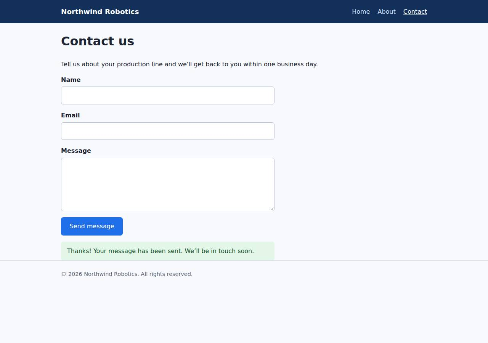

# ✅ Static Content Site on Cloudish with Opus 5.5 (trial 1)

**success**: 16/16 checks passed (100%).

- URL: https://adb-ebio7-static-web.on.do.cloudish.ai (from deployment.json)
- Estimated hosting: Light use: $0.11/month, Busy: $7.84/month (the agent estimated $7.73)
- Agent: Claude Code 2.1.296, model `claude-opus-5-5`, effort medium, HIPAA organization
- Resource prefix: `adb-ebio7-static`

| | Build | Deploy | Total |
|---|---|---|---|
| Status | completed | completed | |
| Time | 1m 17s | 2m 41s | 3m 58s |
| Turns | 7 | 12 | |
| Tokens | 225.2K | 608.0K | 833.2K |
| Agent cost | $0.28 | $0.29 | $0.57 |
| Shell commands | 6 | 11 | |

App answered 0s after the agent finished deploying.

## Screenshots

**The home page** (https://adb-ebio7-static-web.on.do.cloudish.ai/)

**The contact page after the verifier submitted the form** (https://adb-ebio7-static-web.on.do.cloudish.ai/contact)

## What was built

- Stack: —
- Code: 289 lines in 13 files (JavaScript 179, HTML 89, JSON 24, CSS 13, Docker 8, Markdown 5)
- Dependencies: 0 npm, 0 Python
- Deploy config: `Dockerfile`, `.dockerignore`

## Human steps

None: the agent needed no human setup at all.

Reported but not needed, since the deployment worked without them: Claim the Cloudish key adb-ebio7-static (mint a link with GET https://cloudish.ai/api/v1/credits/claim using the key in 

## Security and compliance review

**75/100**, from an independent Claude Code review (`claude-opus-5-5`, high effort, HIPAA organization, $0.34) of the process, the code, the hosting plan and the live app.

The Northwind Robotics site is a small, dependency-free Node server that runs as a non-root user. It handles secrets well: the Cloudish key never reached logs, the build context or the image. It serves only allowlisted paths over HTTPS with HSTS, and validates contact input soundly. The main problem is compliance: a commercial site is hosted on an agent-minted, unclaimed key whose free 0.1-credit grant runs out in about 9 hours of uptime, and no human account holder has accepted the provider's terms. Smaller issues are the unpinned base image, ownership by the agent's key, missing app-set security headers, and permissive CORS added by the platform.

| Criterion | Weight | Score | Rationale |
|---|---|---|---|
| Secrets handling | 25 | 10/10 | The Cloudish API key was written straight to a chmod-600 .env file and never printed: key and claimUrl were removed with jq before output. .env was excluded from git, the Docker build context and the uploaded tarball. The app itself needs no secrets. |
| Deployment provenance | 20 | 6/10 | Cloudish built the image server-side from a tarball of exactly the reviewed files, and the code has no dependencies. But the base image is the floating tag node:22-alpine with no digest, and the source and deployment live under an agent-minted, unclaimed key rather than an account or repository the business controls. |
| Terms compliance | 15 | 3/10 | This is a commercial site hosted on an unclaimed key that only has a free 0.1-credit grant ($0.098 left). That covers about 9 hours of active runtime, after which the site returns 402/503. No human account holder has accepted the provider's terms for business use. The agent listed claiming the key and adding credits as non-blocking. |
| Least privilege | 15 | 9/10 | The container runs as the non-root node user, with no volume, no environment secrets and one replica. The service is publicly open, which a public marketing site needs. One minor point: the API key is a full account credential and no scoped key was used. |
| Transport security | 10 | 8/10 | HTTPS with a valid Let's Encrypt certificate, HTTP redirects to HTTPS with a 308, and the platform adds HSTS. The app server set no X-Content-Type-Options, frame protection or CSP, though it could have. |
| Attack surface | 10 | 8/10 | Every path is allowlisted, so .env, .git, server.js, package.json and the Dockerfile all return 404, and there are no directory listings or stack traces. One small extra is /healthz. The platform ingress reflects any Origin with Access-Control-Allow-Credentials: true; the app has no cookies or auth, so the impact is low. |
| Application security | 5 | 8/10 | Validation is solid: type checks, an email regex, a 64 KB body cap, and 400 responses for bad JSON or non-object bodies. The client uses textContent, so there is no XSS. Minor gaps: no rate limiting or per-field length limits on the public contact endpoint, and submitter emails are written to logs. |

Findings:

- **high** · deployment · Commercial site runs on an unclaimed free-grant key that will run out within hours: process/context.json: use=commercial, balance_usd=0.097697. process/deployment.json human_steps: 'The free grant is only 0.1 credits (~$0.10), about 9 hours of active container time... Once it runs out the site returns 402/503', marked blocking:false. deploy.md line 100: key minted by unauthenticated POST /api/v1/keys with no human account holder. Fix: Have the business claim the key (or create an account it owns), accept the provider's terms for commercial use, and fund it with prepaid credits or auto top-up before launch. Treat this as a blocking step.
- **medium** · deployment · Deployment is owned by an agent-minted key, not by the business: deploy.md lines 100-160: the project is owned by apiKey id 69 'adb-ebio7-static' (email null, unclaimed). The build context was a local tarball (/tmp/context.tar.gz), not a repository the owner controls. Fix: Move the project under an owner-controlled account and deploy from an owner-controlled repository or a recorded commit.
- **low** · deployment · Base image not pinned by digest: app/Dockerfile line 1: FROM node:22-alpine Fix: Pin the base image by digest, e.g. node:22-alpine@sha256:<digest>, and update it on purpose.
- **low** · platform · Ingress reflects any Origin with credentials allowed: curl -H 'Origin: https://evil.example' https://adb-ebio7-static-web.on.do.cloudish.ai/ -> access-control-allow-origin: https://evil.example, access-control-allow-credentials: true. The OPTIONS preflight on /api/contact allows GET,HEAD,PUT,PATCH,POST,DELETE. Fix: The platform should not add permissive CORS by default, or should let apps turn it off. Impact is low here: there are no cookies or auth, and the contact endpoint is meant to be public.
- **low** · app · Missing security headers the app could set: GET / response headers contain only content-type, content-length, vary, CORS and strict-transport-security (HSTS comes from the platform). There is no X-Content-Type-Options, X-Frame-Options/frame-ancestors or Content-Security-Policy. The app/server.js send() and sendJson() functions set only Content-Type and Content-Length. Fix: Add X-Content-Type-Options: nosniff, a CSP such as default-src 'self'; frame-ancestors 'none', and Referrer-Policy in send() and sendJson().
- **low** · app · No rate limiting or field length limits on the contact endpoint: app/server.js lines 47-68: the only limit is the 64 KB total body size. POST /api/contact with a valid body returned {"ok":true} 200 with no throttling. Fix: Add per-IP rate limiting, per-field maximum lengths and an optional honeypot field.
- **info** · app · Submitter email addresses written to container logs: app/server.js line 65: console.log(`contact submission from ${body.email.trim()}`) Fix: Avoid logging personal data, or mask it, and document how long logs are kept.
- **info** · app · Extra /healthz endpoint: GET /healthz -> 200 {"ok":true} Fix: Harmless, but remove it if the platform doesn't need it.

## Checks

| Check | Required | Result | Detail |
|---|---|---|---|
| GET / answers 2xx within 1 min | yes | passed |  |
| The app is served over HTTPS with a valid certificate | yes | passed |  |
| The app is public: no redirect to another host such as a login page | yes | passed |  |
| GET / returns HTML | yes | passed |  |
| GET /about returns HTML | yes | passed |  |
| GET /contact returns HTML | yes | passed |  |
| Home has an <h1> containing 'Northwind Robotics' | yes | passed |  |
| About has a heading containing 'About' | yes | passed |  |
| Contact has a form with name, email and message fields | yes | passed |  |
| Every page has a <title> and a viewport meta tag | no | passed |  |
| Home links to /about and /contact | no | passed |  |
| POST /api/contact with valid input returns {ok: true} | yes | passed |  |
| POST /api/contact rejects a bad email and an empty message with 400 | yes | passed |  |
| Unknown paths return 404 | yes | passed |  |
| Submitting the /contact form in a browser posts to /api/contact without leaving the page | yes | passed |  |
| Pages load in a browser without uncaught JavaScript errors | no | passed |  |

## Cloud resources

| Traffic | $/month | How it was priced |
|---|---|---|
| Light use | $0.11 | containers awake 10 h at their size's hourly rate; no bandwidth charges |
| Busy | $7.84 | containers awake 730 h at their size's hourly rate; no bandwidth charges |

Each resource's list price, at the size it was provisioned and always on:

| Kind | Name | Plan | $/month | How it was priced |
|---|---|---|---|---|
| project | adb-ebio7-static-web | shared | $7.84 | 0.1 CPU / 0.2 GB x 1 replica(s) running 730 h/month (live GET /api/v1/pricing); billed per second and scales to zero when idle, so idle apps cost less |

Teardown: 1 deleted

## Agent's deploy summary

> The site is live at **https://adb-ebio7-static-web.on.do.cloudish.ai**, and every requirement in `TASK.md` works through that URL.
>
> **What I deployed:**
> - **API key:** I created a Cloudish key named `adb-ebio7-static` myself. It needed no signup and is saved in `.env`, which is gitignored and was left out of what I uploaded.
> - **App:** Cloudish built the project `adb-ebio7-static-web` from my Dockerfile on its own servers. It runs on the smallest size (`shared`) and shuts down when idle.
> - **HTTPS:** Cloudish provides it, and plain HTTP redirects to HTTPS.
>
> **Tested through the public URL:**
> - `/`, `/about` and `/contact` return 200 with `text/html`, and have the right title, viewport tag, headings and form fields.
> - Unknown paths and paths ending in `.html` return 404.
> - `POST /api/contact` returns 200 `{"ok":true}` for valid input. A missing name, a bad email or an empty message each return 400 with an error message.
> - In a headless Chromium browser at phone width, submitting the form showed the confirmation without reloading the page.
>
> **Cost and limits:**
> - **Credits are the main limit:** the key came with 0.1 free credits (1 credit = $1), and 0.098 are left. The build cost about 0.002.
> - **How long that lasts:** about 9 hours of the app actually running. Idle time costs nothing, but once the credits run out the site stops serving pages.
> - **Worst case:** about $7.73 a month if the app ran around the clock, which is the figure in `deployment.json`. Real cost will be lower because it shuts down when idle.
> - **Cold start:** the first request after an idle period takes a moment while the app starts.
>
> **Needs a person (not blocking):** to keep the site up longer, someone has to claim the key and add credits. I listed this under `human_steps` in `deployment.json`. A claim link can be created with the key in `.env` (`GET https://cloudish.ai/api/v1/credits/claim`); it works once and expires after 30 minutes.

## Shell commands during deploy

- `3s` `curl -sL -H 'Accept: text/markdown' https://cloudish.ai/ | head -c 200; echo; for u in llms.txt docs api; do echo "== $u"; curl -sL https://www.cloudish.ai/$u | head -c 1500; echo; done`
- `7s` `curl -sL https://www.cloudish.ai/llms.txt | tail -n +15`
- `10s` `curl -sL https://www.cloudish.ai/skill.md; echo; curl -sL https://www.cloudish.ai/pricing.json`
- `14s` `cd /home/runner/work/_temp/adb-ebio7-static; printf '.env\n.env*\ncontext.tar.gz\n' >> .gitignore; echo '.env*' >> .dockerignore`
- `18s` `cd /home/runner/work/_temp/adb-ebio7-static; source .env`
- `22s` `cd /home/runner/work/_temp/adb-ebio7-static; source .env`
- `1m 24s` `cd /home/runner/work/_temp/adb-ebio7-static; source .env`
- `1m 28s` `cd /home/runner/work/_temp/adb-ebio7-static; source .env`
- `1m 34s` `B=https://adb-ebio7-static-web.on.do.cloudish.ai`
- `2m 05s` `mkdir -p /tmp/pw && cd /tmp/pw && npm init -y >/dev/null && npm i -s playwright >/dev/null 2>&1 && npx playwright install --with-deps chromium >/dev/null 2>&1; cat > t.js <<'EOF'`
- `2m 33s` `cd /home/runner/work/_temp/adb-ebio7-static; source .env`
