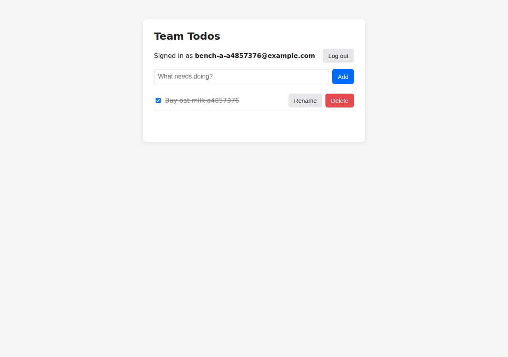

# ✅ Database-Backed CRUD App on DigitalOcean with Opus 5.5 (trial 1)

**success**: 19/19 checks passed (100%).

- URL: https://adb-jqmj7-crud-sgdds.ondigitalocean.app (from deployment.json)
- Estimated hosting: Light use: $12.00/month, Busy: $12.00/month (the agent estimated $12.00)
- Agent: Claude Code 2.1.296, model `claude-opus-5-5`, effort medium, HIPAA organization
- Resource prefix: `adb-jqmj7-crud`

| | Build | Deploy | Total |
|---|---|---|---|
| Status | completed | completed | |
| Time | 2m 20s | 11m 57s | 14m 17s |
| Turns | 10 | 9 | |
| Tokens | 406.4K | 458.0K | 864.4K |
| Agent cost | $0.46 | $0.36 | $0.81 |
| Shell commands | 9 | 8 | |

App answered 0s after the agent finished deploying.

## Screenshots

**The web app before signing in** (https://adb-jqmj7-crud-sgdds.ondigitalocean.app/)

**The todo list after signing in through the web UI as the test user** (https://adb-jqmj7-crud-sgdds.ondigitalocean.app/)

## What was built

- Stack: `bcryptjs`, `express`, `pg`
- Code: 458 lines in 12 files (JavaScript 305, HTML 143, JSON 29, YAML 25, Markdown 19, Docker 10)
- Dependencies: 3 npm, 0 Python
- Deploy config: `Dockerfile`, `.dockerignore`, `.do/app.yaml`

## Human steps

3 step(s), about 7 min of a person's time.

- **Sign up for an account and verify the email address** (~3 min): prerequisite: account setup
- **Add a payment method to the account** (~2 min): prerequisite: account setup
- **Create an API token and hand it to the agent** (~2 min): prerequisite: account setup

## Security and compliance review

**78/100**, from an independent Claude Code review (`claude-opus-5-5`, high effort, HIPAA organization, $0.32) of the process, the code, the hosting plan and the live app.

The app was built carefully: secrets come from App Platform bindable variables, the container runs as non-root, queries are parameterized, passwords use bcrypt, per-user ownership is enforced, and probes found no exposed files or stack traces. The main weakness is provenance: the image was built locally from a base image not pinned by digest and deployed by a mutable tag with no source-control link. Smaller issues are missing security headers, no auth rate limiting, sessions that never expire, and a development-tier database with no backups behind a business app.

| Criterion | Weight | Score | Rationale |
|---|---|---|---|
| Secrets handling | 25 | 9/10 | No credentials in source, image or spec: DATABASE_URL and the CA cert come from App Platform bindable variables (${adb-jqmj7-crud-db.DATABASE_URL}) scoped to RUN_TIME. The only small issues are a 30-day registry login left on the build host and test-account tokens partly echoed in transcript output. |
| Deployment provenance | 20 | 6/10 | The image was built on the agent's machine and pushed to the owner's private DOCR, and npm ci with a lockfile pins dependencies. But the base image (node:22-alpine) isn't pinned by digest, the app points at a mutable tag (v1) instead of a digest, no source repo or CI ties the image to a commit, and doctl was downloaded without a checksum check. |
| Terms compliance | 15 | 8/10 | A business app on paid App Platform Basic plus a paid dev database fits DigitalOcean's standard commercial terms. However, DigitalOcean positions dev databases for development (no backups, no HA), which is a weak fit for a business's production data. The agent said so itself. |
| Least privilege | 15 | 8/10 | The container runs as the non-root node user, the registry is private, and only the web service is routed publicly. The dev database can't be restricted with trusted sources or a private network (as I understand App Platform dev DBs), and the app connects as the database's owner user. |
| Transport security | 10 | 7/10 | HTTPS works with a valid Google Trust Services certificate, and HTTP gets a 301 to HTTPS. The DB connection uses TLS and verifies the CA. The app sets no HSTS, CSP, X-Content-Type-Options or frame-protection headers, though it could easily have (e.g. helmet). |
| Attack surface | 10 | 9/10 | Probes of /.env, /.git/config, /package.json, /src/app.js, /Dockerfile and /.do/app.yaml all return 404. Errors return generic JSON without stack traces, and x-powered-by is disabled. Express's default 'Cannot GET' 404 page slightly reveals the framework. |
| Application security | 5 | 7/10 | All queries are parameterized, passwords use bcrypt with cost 12, ownership is enforced in every todo query, input types and lengths are checked, and the UI renders with textContent. There's no rate limiting on login or signup, session tokens never expire, and the UI keeps the bearer token in localStorage. |

Findings:

- **medium** · deployment · Locally built image deployed by mutable tag with unpinned base image: app/Dockerfile:1 `FROM node:22-alpine`; process/deploy.md: `docker build -q -t registry.digitalocean.com/adb-jqmj7-crud/adb-jqmj7-crud-web:v1 . && docker push`; app/.do/app.yaml `tag: v1` (no digest); no git remote or CI build Fix: Pin the base image by digest. Build in CI from a repository the owner controls, and deploy by image digest (or via App Platform's GitHub source) so production can be traced to a commit.
- **low** · deployment · doctl CLI downloaded without checksum verification: process/deploy.md: `curl -sL https://github.com/digitalocean/doctl/releases/download/v1.146.0/doctl-1.146.0-linux-amd64.tar.gz | tar xz && sudo mv doctl /usr/local/bin/` Fix: Check the release's published sha256 checksum before installing.
- **low** · deployment · Business app uses a development-tier database with no backups: app/.do/app.yaml `databases: - engine: PG, production: false`; process/deployment.json notes 'The dev database has no backups, high availability or scaling' Fix: Use a managed PostgreSQL cluster (production: true) with backups for commercial use.
- **low** · platform · Dev database can't be locked down with trusted sources or private networking: app/.do/app.yaml dev database component; the app uses the single owner credential from ${adb-jqmj7-crud-db.DATABASE_URL} Fix: Move to a managed cluster, restrict trusted sources to the app, and use a least-privilege DB user for the app.
- **low** · app · No security headers set: curl -sI https://adb-jqmj7-crud-sgdds.ondigitalocean.app/ returns no strict-transport-security, content-security-policy, x-content-type-options or x-frame-options Fix: Add helmet (or set these headers manually) in src/app.js, including HSTS and a restrictive CSP.
- **low** · app · No rate limiting on authentication endpoints: app/src/app.js POST /api/auth/login and /signup have no limiter; 6 rapid wrong-password logins all returned 401 with no throttling Fix: Add per-IP and per-account rate limiting (e.g. express-rate-limit) on login and signup.
- **low** · app · Session tokens never expire; UI stores token in localStorage: app/src/db.js sessions table has no expiry and auth() in app/src/app.js never checks created_at; app/public/index.html:50,66 localStorage.getItem/setItem('token') Fix: Expire sessions (e.g. after 30 days idle) and consider an HttpOnly, Secure, SameSite cookie for the web UI.
- **info** · deployment · Registry login credential left on build host for 30 days: process/deploy.md: `doctl registry login` -> 'Login valid for 30 days' Fix: Use `--expiry-seconds` with a short lifetime, or log out after pushing.
- **info** · app · Default Express 404 page reveals framework: GET /.env -> 404 HTML '<pre>Cannot GET /.env' Fix: Add a custom 404 handler for non-API paths.

## Checks

| Check | Required | Result | Detail |
|---|---|---|---|
| GET / answers 2xx within 1 min | yes | passed |  |
| The app is served over HTTPS with a valid certificate | yes | passed |  |
| The app is public: no redirect to another host such as a login page | yes | passed |  |
| GET / serves the web app as HTML | yes | passed |  |
| POST /api/auth/signup creates an account and returns a token | yes | passed |  |
| Signup rejects an invalid email and a short password with 400 | yes | passed |  |
| Signing up twice with the same email returns 409 | yes | passed |  |
| POST /api/auth/login returns a token | yes | passed |  |
| Login with a wrong password returns 401 | yes | passed |  |
| /api/todos requires a valid token (401) | yes | passed |  |
| POST /api/todos creates a todo | yes | passed |  |
| An empty title is rejected with 400 | yes | passed |  |
| GET /api/todos lists the caller's todos | yes | passed |  |
| Todos are listed oldest first | no | passed |  |
| PATCH /api/todos/{id} renames and completes a todo | yes | passed |  |
| Users can't see or modify each other's todos (404) | yes | passed |  |
| DELETE /api/todos/{id} removes a todo | yes | passed |  |
| Data is still there a minute later, with a fresh login | yes | passed |  |
| The web UI renders a login or signup form | no | passed |  |

## Cloud resources

| Traffic | $/month | How it was priced |
|---|---|---|
| Light use | $12.00 | fixed monthly prices; 0.0373 GiB out of a 50 GiB allowance |
| Busy | $12.00 | fixed monthly prices; 49 GiB out of a 50 GiB allowance |

Each resource's list price, at the size it was provisioned and always on:

| Kind | Name | Plan | $/month | How it was priced |
|---|---|---|---|---|
| app | adb-jqmj7-crud | adb-jqmj7-crud-web: apps-s-1vcpu-0.5gb x 1, adb-jqmj7-crud-db: dev database | $12.00 | adb-jqmj7-crud-web: apps-s-1vcpu-0.5gb x 1; adb-jqmj7-crud-db: dev database |
| registry | adb-jqmj7-crud | starter | $0.00 | Container Registry starter tier (one per account) |

Teardown: 2 deleted

## Agent's deploy summary

> The app is live at **https://adb-jqmj7-crud-sgdds.ondigitalocean.app**, and every requirement in `TASK.md` passed when I tested it through that URL.
>
> **What's running (about $12/month):**
> - **Container registry** `adb-jqmj7-crud` on the free starter plan. It holds the app's Docker image, `adb-jqmj7-crud-web:v1`.
> - **App Platform app** `adb-jqmj7-crud` (id `c4ae8ac2-bd2c-475d-a1d9-17af841ad0ed`) in New York: one web service, `adb-jqmj7-crud-web`, on the smallest Basic size ($5/month). DigitalOcean provides the HTTPS on its default `ondigitalocean.app` address.
> - **PostgreSQL** `adb-jqmj7-crud-db`, an App Platform dev database ($7/month). The connection is encrypted and the app checks the database's certificate.
>
> **Tested through the public URL:**
> - The web page loads.
> - Signup gives `201` with a token, and `400` for a bad email or a password under 8 characters.
> - Signing up twice with the same email gives `409`; a wrong password at login gives `401`.
> - Todos: create (`400` for an empty title), list oldest first, rename and complete, then delete (`204`, and `404` for a second delete). Calls without a token get `401`.
> - A second user sees an empty list and gets `404` when trying to change or delete the first user's todo.
> - I triggered two redeploys and the data was still there afterwards.
>
> **Limitation:** the dev database has no backups, failover or scaling. For real use, switch it to a managed PostgreSQL cluster, which starts at about $15/month.
>
> Nothing needed a person, so `human_steps` is empty. I didn't create any separate credentials, so there's no `.env`; the registry and app run off the existing access token. `deployment.json` is written, and the updated `.do/app.yaml` (now pointing at the image in the registry) is committed. To redeploy, push a new image tag, update `.do/app.yaml`, then run `doctl apps update c4ae8ac2-bd2c-475d-a1d9-17af841ad0ed --spec .do/app.yaml`.

## Shell commands during deploy

- `6s` `which doctl || (cd /tmp && curl -sL https://github.com/digitalocean/doctl/releases/download/v1.146.0/doctl-1.146.0-linux-amd64.tar.gz | tar xz && sudo mv doctl /usr/local/bin/); doctl version; doctl a`
- `16s` `doctl registry create adb-jqmj7-crud --subscription-tier starter --region nyc3 && doctl registry login && docker build -q -t registry.digitalocean.com/adb-jqmj7-crud/adb-jqmj7-crud-web:v1 . && docker `
- `51s` `cat > .do/app.yaml <<'EOF'`
- `9m 34s` `U=https://adb-jqmj7-crud-sgdds.ondigitalocean.app; E="t$RANDOM$RANDOM@example.com"; j='content-type: application/json'`
- `9m 47s` `doctl apps create-deployment c4ae8ac2-bd2c-475d-a1d9-17af841ad0ed --force-rebuild --wait >/dev/null 2>&1; doctl apps list-deployments c4ae8ac2-bd2c-475d-a1d9-17af841ad0ed --format ID,Phase | head -3; `
- `10m 39s` `U=https://adb-jqmj7-crud-sgdds.ondigitalocean.app; j='content-type: application/json'`
- `11m 39s` `doctl databases list --format ID,Name,Size 2>&1 | head; doctl apps get c4ae8ac2-bd2c-475d-a1d9-17af841ad0ed -o json | node -e 'const a=JSON.parse(require("fs").readFileSync(0))[0];console.log(a.tier_s`
- `11m 49s` `cat > deployment.json <<'EOF'`
