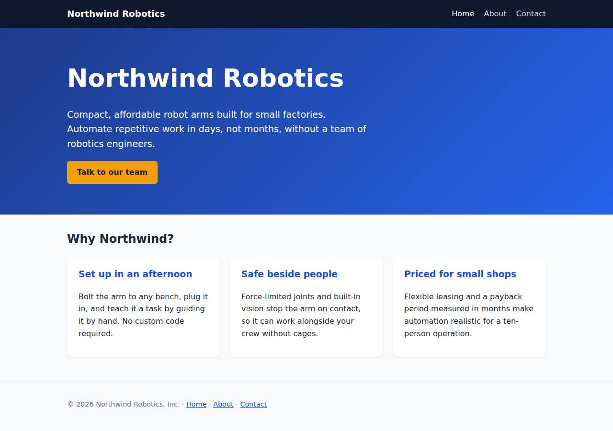
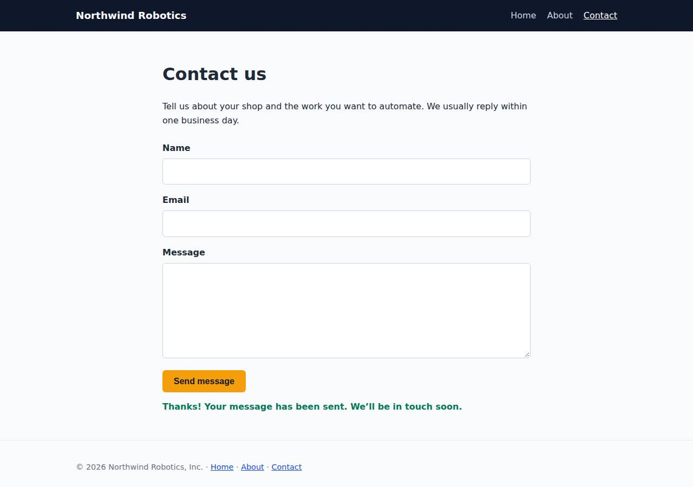

# ✅ Static Content Site on DigitalOcean with Opus 5.5 (trial 1)

**success**: 16/16 checks passed (100%).

- URL: https://adb-v5ocj-static-wvfsx.ondigitalocean.app (from deployment.json)
- Estimated hosting: Light use: $5.00/month, Busy: $5.00/month (the agent estimated $5.00)
- Agent: Claude Code 2.1.296, model `claude-opus-5-5`, effort medium, HIPAA organization
- Resource prefix: `adb-v5ocj-static`

| | Build | Deploy | Total |
|---|---|---|---|
| Status | completed | completed | |
| Time | 1m 28s | 1m 38s | 3m 06s |
| Turns | 8 | 8 | |
| Tokens | 297.8K | 353.1K | 650.9K |
| Agent cost | $0.45 | $0.17 | $0.61 |
| Shell commands | 7 | 7 | |

App answered 0s after the agent finished deploying.

## Screenshots

**The home page** (https://adb-v5ocj-static-wvfsx.ondigitalocean.app/)

**The contact page after the verifier submitted the form** (https://adb-v5ocj-static-wvfsx.ondigitalocean.app/contact)

## What was built

- Stack: —
- Code: 425 lines in 15 files (JavaScript 211, HTML 173, CSS 33, JSON 24, YAML 15, Docker 8, Markdown 8)
- Dependencies: 0 npm, 0 Python
- Deploy config: `Dockerfile`, `.dockerignore`, `app.yaml`

## Human steps

3 step(s), about 7 min of a person's time.

- **Sign up for an account and verify the email address** (~3 min): prerequisite: account setup
- **Add a payment method to the account** (~2 min): prerequisite: account setup
- **Create an API token and hand it to the agent** (~2 min): prerequisite: account setup

## Security and compliance review

**89/100**, from an independent Claude Code review (`claude-opus-5-5`, high effort, HIPAA organization, $0.27) of the process, the code, the hosting plan and the live app.

The Northwind Robotics site is a zero-dependency Node.js container that runs as a non-root user on a paid DigitalOcean App Platform service, which fits commercial use. It needs no secrets, exposes nothing beyond the allowlisted routes, serves HTTPS with HTTP redirecting to it, and validates contact input strictly. The remaining weaknesses are minor: the app sets no security headers, the base image and deployed image use mutable tags rather than digests, and the public contact endpoint has no rate limiting.

| Criterion | Weight | Score | Rationale |
|---|---|---|---|
| Secrets handling | 25 | 10/10 | The app needs no secrets, and none appear in the source, Dockerfile, image or transcripts. The registry login used doctl's short-lived credential (`--expiry-seconds 3600`) with its output discarded. |
| Deployment provenance | 20 | 7/10 | The image was built locally from the reviewed sources and pushed to the owner's own DOCR registry, and it has no npm dependencies. But the base image `node:22-alpine` is a floating tag, the app deploys the mutable tag `v1` rather than a digest, and doctl was downloaded without a checksum check. |
| Terms compliance | 15 | 10/10 | This is a commercial app on a paid App Platform Basic service ($5/mo, always on) plus the free DOCR starter tier. DigitalOcean's standard terms allow commercial use on these plans, and nothing relies on an expiring or sleeping free tier. |
| Least privilege | 15 | 10/10 | There is one public web service running as the non-root `node` user, a private registry, no data stores and no extra components or credentials. |
| Transport security | 10 | 7/10 | HTTPS is served with a valid Google Trust Services certificate, and HTTP returns 301 to HTTPS. However, the responses carry no HSTS, X-Content-Type-Options, frame-protection or CSP headers, and the app's own server could easily have set them. |
| Attack surface | 10 | 9/10 | Only allowlisted routes are served. Probes for .env, .git, the source, package.json, the Dockerfile and path traversal all return 404 or 400, with no stack traces. The only extra endpoint is a harmless /healthz. |
| Application security | 5 | 8/10 | Input validation is strict (type checks, an email regex, length limits, a 64 KB body cap, JSON-object check), and output goes through textContent with no XSS sinks. The public contact endpoint has no rate limiting, and it logs submitters' email addresses. |

Findings:

- **low** · app · No security headers (HSTS, nosniff, frame protection, CSP): curl -I https://adb-v5ocj-static-wvfsx.ondigitalocean.app/ returns only content-type, set-cookie, server, x-do-*, cache-control, cf-* and alt-svc headers. sendHtml/sendJson in app/server.js (around lines 39-55) set no security headers. Fix: Set Strict-Transport-Security, X-Content-Type-Options: nosniff, X-Frame-Options: DENY (or CSP frame-ancestors 'none'), and a restrictive Content-Security-Policy such as default-src 'self' in the server's response helpers.
- **low** · deployment · Base image and deployed image referenced by mutable tags: app/Dockerfile line 1: `FROM node:22-alpine`. app/app.yaml deploys `tag: v1`, not the pushed digest sha256:177b77af... Fix: Pin the base image by digest (node:22-alpine@sha256:...) and deploy the image by digest, or use immutable unique tags.
- **low** · deployment · doctl CLI installed without checksum verification: process/deploy.md first command: `curl -sL https://github.com/digitalocean/doctl/releases/download/v1.146.0/doctl-1.146.0-linux-amd64.tar.gz | tar xz && sudo mv doctl /usr/local/bin/` (version pinned, no sha256 check). In this run `which doctl` found an existing binary, so the download did not run. Fix: Verify the release checksum file before installing deploy tooling.
- **low** · app · No rate limiting on public contact endpoint: app/server.js handleContact accepts unlimited POST /api/contact requests. Each valid submission writes a log line. Fix: Add per-IP rate limiting in the app, or put the endpoint behind a platform or CDN rate limit (e.g. a Cloudflare rule on a custom domain).
- **info** · app · Submitter email addresses written to logs: app/server.js handleContact: console.log(`Contact submission from ${body.email.trim()}`). Fix: Avoid logging personal data, or mask it and set a log retention policy.
- **info** · app · Health endpoint publicly reachable: GET /healthz -> 200 application/json {"ok":true} Fix: Acceptable as is. It reveals nothing beyond liveness.
- **info** · platform · Platform sets a Cloudflare bot cookie on every response: set-cookie: __cf_bm=...; HttpOnly; SameSite=None; Secure; Domain=ondigitalocean.app Fix: No action needed. This is DigitalOcean/Cloudflare edge behavior.

## Checks

| Check | Required | Result | Detail |
|---|---|---|---|
| GET / answers 2xx within 1 min | yes | passed |  |
| The app is served over HTTPS with a valid certificate | yes | passed |  |
| The app is public: no redirect to another host such as a login page | yes | passed |  |
| GET / returns HTML | yes | passed |  |
| GET /about returns HTML | yes | passed |  |
| GET /contact returns HTML | yes | passed |  |
| Home has an <h1> containing 'Northwind Robotics' | yes | passed |  |
| About has a heading containing 'About' | yes | passed |  |
| Contact has a form with name, email and message fields | yes | passed |  |
| Every page has a <title> and a viewport meta tag | no | passed |  |
| Home links to /about and /contact | no | passed |  |
| POST /api/contact with valid input returns {ok: true} | yes | passed |  |
| POST /api/contact rejects a bad email and an empty message with 400 | yes | passed |  |
| Unknown paths return 404 | yes | passed |  |
| Submitting the /contact form in a browser posts to /api/contact without leaving the page | yes | passed |  |
| Pages load in a browser without uncaught JavaScript errors | no | passed |  |

## Cloud resources

| Traffic | $/month | How it was priced |
|---|---|---|
| Light use | $5.00 | fixed monthly prices; 0.0373 GiB out of a 50 GiB allowance |
| Busy | $5.00 | fixed monthly prices; 49 GiB out of a 50 GiB allowance |

Each resource's list price, at the size it was provisioned and always on:

| Kind | Name | Plan | $/month | How it was priced |
|---|---|---|---|---|
| app | adb-v5ocj-static | adb-v5ocj-static-web: apps-s-1vcpu-0.5gb x 1 | $5.00 | adb-v5ocj-static-web: apps-s-1vcpu-0.5gb x 1 |
| registry | adb-v5ocj-static | starter | $0.00 | Container Registry starter tier (one per account) |

Teardown: 2 deleted

## Agent's deploy summary

> The site is live at **https://adb-v5ocj-static-wvfsx.ondigitalocean.app**, and every requirement in `TASK.md` worked when I tested it through that URL.
>
> **What's running:**
> - **Container Registry** `adb-v5ocj-static` (free starter tier, region nyc3). It holds the Docker image built from the existing Dockerfile, as `adb-v5ocj-static-web:v1`.
> - **App Platform app** `adb-v5ocj-static` (ID `788d691f-88ff-4216-8bf4-f36d0c1b947f`). It runs that image as one service, `adb-v5ocj-static-web`, on the smallest paid size (1 vCPU, 0.5 GB) in the nyc region. HTTPS comes from DigitalOcean's default `ondigitalocean.app` domain. The app's configuration is saved in `app.yaml`.
> - **Estimated cost: about $5/month**, all of it the App Platform service.
>
> **Why this setup:** App Platform's free static-site option can't handle `POST /api/contact`, so one small service runs the whole site. I deployed from a container image rather than from a git repository because no GitHub account is connected to DigitalOcean.
>
> **Checks through the public URL:**
> - `/`, `/about` and `/contact` return 200 as `text/html`, with the required headings and form fields.
> - Unknown paths and paths with `.html` (like `/about.html`) return 404.
> - `POST /api/contact` returns 200 with `{"ok":true}` for valid input. It returns 400 with an error message for a missing name, a bad email, or an empty message.
> - In a headless Chrome browser, filling in and submitting the form showed the confirmation message without reloading the page. That closes the gap I flagged in step 1.
>
> Nothing needed a person, so `human_steps` in `deployment.json` is empty, and I didn't create any credentials, so there's no `.env`. To ship a new version, push a new image tag, update the tag in `app.yaml`, then run `doctl apps update 788d691f-88ff-4216-8bf4-f36d0c1b947f --spec app.yaml`.

## Shell commands during deploy

- `6s` `which doctl || (cd /tmp && curl -sL https://github.com/digitalocean/doctl/releases/download/v1.146.0/doctl-1.146.0-linux-amd64.tar.gz | tar xz && sudo mv doctl /usr/local/bin/); doctl version | head -`
- `10s` `doctl registry create adb-v5ocj-static --subscription-tier starter --region nyc3 && doctl registry login --expiry-seconds 3600 >/dev/null && docker build -q -t registry.digitalocean.com/adb-v5ocj-stat`
- `32s` `cat > app.yaml <<'EOF'`
- `56s` `doctl apps list --format ID,Spec.Name,DefaultIngress,ActiveDeployment.ID,InProgressDeployment.ID`
- `1m 00s` `U=https://adb-v5ocj-static-wvfsx.ondigitalocean.app`
- `1m 07s` `mkdir -p /tmp/pw && cd /tmp/pw && npm init -y >/dev/null && npm i -s playwright@1 >/dev/null 2>&1 && npx playwright install chromium >/dev/null 2>&1 && cat > t.js <<'EOF'`
- `1m 30s` `cat > deployment.json <<'EOF'`
