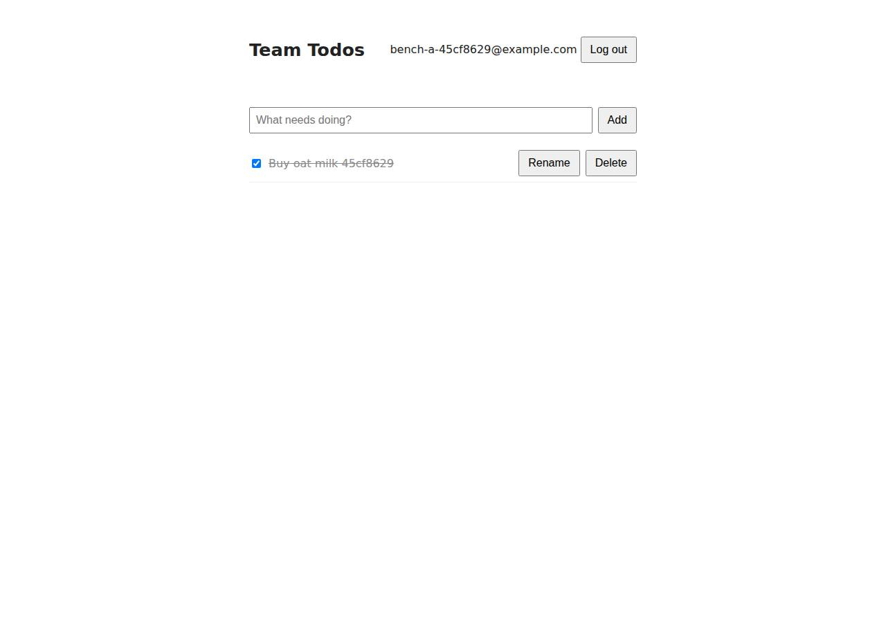

# ✅ Database-Backed CRUD App on Render with Opus 5.5 (trial 1)

**success**: 19/19 checks passed (100%).

- URL: https://adb-4f010-crud-web.onrender.com (from deployment.json)
- Estimated hosting: Light use: $0.00/month, Busy: $7.13/month (the agent estimated $0.00)
- Agent: Claude Code 2.1.296, model `claude-opus-5-5`, effort medium, HIPAA organization
- Resource prefix: `adb-4f010-crud`

| | Build | Deploy | Total |
|---|---|---|---|
| Status | completed | completed | |
| Time | 2m 06s | 7m 07s | 9m 13s |
| Turns | 10 | 16 | |
| Tokens | 395.1K | 889.1K | 1.28M |
| Agent cost | $0.42 | $0.47 | $0.89 |
| Shell commands | 9 | 14 | |

App answered 0s after the agent finished deploying.

## Screenshots

**The web app before signing in** (https://adb-4f010-crud-web.onrender.com/)

**The todo list after signing in through the web UI as the test user** (https://adb-4f010-crud-web.onrender.com/)

## What was built

- Stack: `bcryptjs`, `express`, `pg`
- Code: 373 lines in 10 files (JavaScript 249, HTML 124, JSON 28, YAML 20, Markdown 18)
- Dependencies: 3 npm, 0 Python
- Deploy config: `render.yaml`

## Human steps

2 step(s), about 5 min of a person's time.

- **Sign up for an account and verify the email address** (~3 min): prerequisite: account setup
- **Create an API token and hand it to the agent** (~2 min): prerequisite: account setup

Reported but not needed, since the deployment worked without them: Optionally push this repo to GitHub/GitLab and connect it to Render (or deploy render.yaml as a Blueprint) (No Git provi

## Security and compliance review

**60/100**, from an independent Claude Code review (`claude-opus-5-5`, high effort, HIPAA organization, $0.50) of the process, the code, the hosting plan and the live app.

The app code is solid: parameterized SQL, bcrypt, hashed opaque tokens, correct per-user authorization, and nothing sensitive exposed over a properly redirected HTTPS endpoint. The deployment is the weak point. The code is smuggled in as a base64 env var, eval'd at boot on an unpinned node:22-alpine image, and runs `npm ci` on every start, so it has no traceable provenance. The container runs as root, and the database's external access was left open. Most significantly, this commercial app runs entirely on Render's free tier, where the web service sleeps and the free Postgres holding the business's data expires on 2026-11-12.

| Criterion | Weight | Score | Rationale |
|---|---|---|---|
| Secrets handling | 25 | 8/10 | The Render API key stayed in the environment and was never printed. DATABASE_URL (the internal connection string) was injected through Render service env vars, and the DB URLs written to a local .env (chmod 600, gitignored) were kept out of the source tarball. Minor issues: a hardcoded fallback dev credential in db.js, and the agent saved the external DB connection string when it didn't need it. |
| Deployment provenance | 20 | 4/10 | Production code is not built from a source the owner controls. A base64 tarball is stuffed into an env var, then unpacked and eval'd at boot via `node -e eval(process.env.BOOT_JS)` on the mutable `node:22-alpine` tag, and `npm ci` runs against the public registry on every start. The lockfile pins dependency integrity, but there is no traceable commit or immutable artifact, and render.yaml does not match what was deployed. |
| Terms compliance | 15 | 3/10 | This is a commercial team app hosted entirely on Render's free tier. Free web services spin down when idle, and the free Postgres the app relies on for persistence expires on 2026-11-12, about 30 days after creation, which will take the business's data and app offline. To my knowledge Render doesn't explicitly forbid commercial use on the free plan, but it positions the plan for hobby and testing, not production. |
| Least privilege | 15 | 5/10 | The app reaches Postgres over Render's internal network, but the agent never restricted the database's external access (the default IP allow list is open; its external hostname was reachable from the agent's runner). The container runs as root in the stock node image. |
| Transport security | 10 | 7/10 | HTTPS uses a valid Google Trust Services certificate and HTTP 301-redirects to HTTPS. HTML responses lack HSTS, CSP, X-Content-Type-Options and frame protection, which the app could have set (e.g. with helmet). |
| Attack surface | 10 | 9/10 | Only public/ is served statically. Probes of .env, .git, package.json, src files and directory paths all returned 404, and the error handler hides stack traces. Only a benign /healthz endpoint is extra. |
| Application security | 5 | 7/10 | Queries are parameterized, passwords use bcrypt with cost 12, and tokens are random 32-byte values stored as SHA-256 hashes. Ownership checks return 404 and the UI renders text with textContent. Minor gaps: no rate limiting on login/signup (brute force and bcrypt CPU abuse), sessions never expire, and the token is kept in localStorage. |

Findings:

- **high** · deployment · Commercial app's database is on Render free Postgres, which expires: process/resources.json: postgres adb-4f010-crud-db plan 'free', expires_at '2026-11-12T23:02:02Z'; process/context.json use 'commercial'; deployment.json notes 'Render free Postgres expires 30 days after creation unless upgraded' Fix: Use a paid Postgres plan (e.g. basic-256mb) with backups before the business relies on the app, and make the upgrade a blocking step.
- **medium** · deployment · Business app on free web instance that sleeps: process/resources.json: service plan 'free'; deployment.json notes 'The free web service spins down when idle, so the first request after idle takes roughly 30-60 s' Fix: Use a paid instance type (Starter or above) for a commercial team app.
- **medium** · deployment · Code delivered as a base64 env var and eval'd at boot: process/deploy.md: env var APP_TGZ_B64 = base64 tarball; dockerCommand patched to 'node -e eval(process.env.BOOT_JS)', which runs 'printenv APP_TGZ_B64 | base64 -d | tar xz && npm ci --omit=dev' Fix: Deploy from an owner-controlled Git repo (render.yaml Blueprint) or a prebuilt image in an owner-controlled registry, pinned by digest, so production traces back to a commit.
- **medium** · deployment · Unpinned base image and dependencies installed at runtime: process/deploy.md service create: imagePath 'docker.io/library/node:22-alpine' (tag, no digest); boot logs show 'added 80 packages in 13s' on each start Fix: Pin the base image by digest and install dependencies at build time into an immutable image, rather than fetching from npm on every boot.
- **medium** · deployment · Postgres external access left open: process/deploy.md: agent fetched externalConnectionString and ran psql from the CI runner to dpg-db7bgqlg1s2s739sqq0g-a.oregon-postgres.render.com:5432 (35.227.164.209); no ipAllowList restriction set in POST /v1/postgres Fix: Set the database's IP allow list to empty (internal-only), since the app uses the internal URL.
- **low** · deployment · render.yaml in the repo doesn't match the deployment: app/render.yaml defines 'team-todos' with runtime node and database 'team-todos-db'; what runs is image-runtime 'adb-4f010-crud-web' with database 'adb-4f010-crud-db' Fix: Keep infrastructure-as-code in sync with what was deployed, or deploy from the Blueprint.
- **low** · deployment · Container runs as root: process/deploy.md: stock docker.io/library/node:22-alpine with dockerCommand 'node -e eval(...)', which writes to /app (mkdir -p /app) with no user switch Fix: Run as the image's 'node' user (USER node in a Dockerfile) with app files owned appropriately.
- **low** · deployment · External DB connection string saved locally without need: process/deploy.md: connection-info written to .env as RENDER_DB_INTERNAL_URL and RENDER_DB_EXTERNAL_URL (chmod 600, gitignored, not in tarball) Fix: Fetch only the internal connection string for wiring, and use Render's fromDatabase reference so credentials never leave the platform.
- **low** · app · No HSTS, CSP or frame protection on HTML responses: curl -D - https://adb-4f010-crud-web.onrender.com/ returned only content-type, cache-control, etag, server: cloudflare (no strict-transport-security, content-security-policy, x-frame-options, x-content-type-options) Fix: Add security headers (e.g. helmet) with HSTS, a restrictive CSP, frame-ancestors 'none' and nosniff.
- **low** · app · No rate limiting on auth endpoints: app/src/app.js:56-89 signup/login have no throttling; each call runs bcrypt with cost 12 (BCRYPT_ROUNDS=12, line 8) Fix: Add per-IP/per-account rate limiting (e.g. express-rate-limit) on /api/auth/*.
- **low** · app · Session tokens never expire; token kept in localStorage: app/src/db.js sessions table has no expiry and app/src/app.js:35-42 requireAuth does no age check; app/public/index.html:45,63 stores the token in localStorage Fix: Add session expiry/rotation, and consider HttpOnly SameSite cookies for the web UI.
- **info** · app · Hardcoded fallback DB credential: app/src/db.js:3 `process.env.DATABASE_URL || 'postgres://postgres:pw@localhost:5432/todos'` Fix: Fail fast when DATABASE_URL is missing in production instead of falling back to a default credential.
- **info** · app · 413 error returns a generic 'Internal server error' message: POST /api/auth/login with a 200 KB body returned 413 {"error":"Internal server error"}; no stack trace Fix: Return a specific 'Payload too large' message for 4xx errors.
- **info** · app · No sensitive files exposed: GET /.env, /.git/config, /.git/HEAD, /package.json, /package-lock.json, /src/app.js, /server.js, /src/ all returned 404 Fix: None.

## Checks

| Check | Required | Result | Detail |
|---|---|---|---|
| GET / answers 2xx within 1 min | yes | passed |  |
| The app is served over HTTPS with a valid certificate | yes | passed |  |
| The app is public: no redirect to another host such as a login page | yes | passed |  |
| GET / serves the web app as HTML | yes | passed |  |
| POST /api/auth/signup creates an account and returns a token | yes | passed |  |
| Signup rejects an invalid email and a short password with 400 | yes | passed |  |
| Signing up twice with the same email returns 409 | yes | passed |  |
| POST /api/auth/login returns a token | yes | passed |  |
| Login with a wrong password returns 401 | yes | passed |  |
| /api/todos requires a valid token (401) | yes | passed |  |
| POST /api/todos creates a todo | yes | passed |  |
| An empty title is rejected with 400 | yes | passed |  |
| GET /api/todos lists the caller's todos | yes | passed |  |
| Todos are listed oldest first | no | passed |  |
| PATCH /api/todos/{id} renames and completes a todo | yes | passed |  |
| Users can't see or modify each other's todos (404) | yes | passed |  |
| DELETE /api/todos/{id} removes a todo | yes | passed |  |
| Data is still there a minute later, with a fresh login | yes | passed |  |
| The web UI renders a login or signup form | no | passed |  |

## Cloud resources

| Traffic | $/month | How it was priced |
|---|---|---|
| Light use | $0.00 | fixed monthly prices; 0.04 GB out of the Hobby workspace's 5 GB; free instances awake 10 h of 750 free hours |
| Busy | $7.13 | fixed monthly prices; 52.6 GB out of the Hobby workspace's 5 GB, 47.6 GB billed (with a payment method on file; without one Render suspends the services instead); free instances awake 730 h of 750 free hours |

Each resource's list price, at the size it was provisioned and always on:

| Kind | Name | Plan | $/month | How it was priced |
|---|---|---|---|---|
| service | adb-4f010-crud-web | free | $0.00 | free x 1 instance(s) |
| postgres | adb-4f010-crud-db | free | $0.00 | Postgres free |

Teardown: 2 deleted

## Agent's deploy summary

> The app is live at **https://adb-4f010-crud-web.onrender.com**, and every requirement in `TASK.md` works through that URL.
>
> **What's deployed (both on Render's free plan, $0/month):**
> - **`adb-4f010-crud-db`:** a Render-managed PostgreSQL 16 database. The app connects to it over Render's internal network. Both connection strings are saved in `.env` only.
> - **`adb-4f010-crud-web`:** the web service, with a health check at `/healthz`.
>
> **How the code got there:** there were no GitHub credentials, so Render had no repo to build from. Instead the service runs the public `node:22-alpine` image, and the app source is passed in as a base64 tarball in an environment variable (`APP_TGZ_B64`). Each time it starts, it unpacks the code, runs `npm ci` and starts the server. Updating the code means rebuilding that tarball and redeploying. Hooking up a Git repo would give normal builds instead; I listed that in `deployment.json` as an optional human step, not a blocking one.
>
> **What I tested on the public URL:**
> - **API:** every endpoint and every error code (400, 401, 404, 409).
> - **Isolation:** another user's todo returns 404 for both edit and delete.
> - **Persistence:** a todo I created was still there after restarting the service.
> - **Web UI:** a headless-browser run of signup, create, rename, complete and uncomplete, delete, and logout.
>
> **Limitations:**
> - **Database expiry:** Render's free Postgres expires 30 days after creation unless it's upgraded to a paid plan (for example basic-256mb, about $6/month).
> - **Slow first request:** the free web service sleeps when idle, so the first request afterwards takes about 30–60 seconds.
> - **Slower starts:** each start spends about 15 seconds installing dependencies.
>
> My first deploy attempt failed because Render didn't run the shell-style start command as I'd written it. The second attempt used a different start command and worked.
>
> `deployment.json` has the resource IDs, costs and these notes.

## Shell commands during deploy

- `5s` `env | grep -iE 'github|gh_|render' | sed 's/=.*/=***/'; gh auth status 2>&1 | head -5; curl -s -H "Authorization: Bearer $RENDER_API_KEY" https://api.render.com/v1/owners | python3 -m json.tool | head`
- `30s` `tar czf /tmp/app.tgz package.json package-lock.json src public && wc -c /tmp/app.tgz && base64 -w0 /tmp/app.tgz | wc -c`
- `34s` `H=(-H "Authorization: Bearer $RENDER_API_KEY" -H "Content-Type: application/json")`
- `39s` `H=(-H "Authorization: Bearer $RENDER_API_KEY")`
- `1m 26s` `set -a && . ./.env && set +a && python3 - <<'EOF' > /tmp/svc.json`
- `1m 31s` `H=(-H "Authorization: Bearer $RENDER_API_KEY")`
- `2m 45s` `H=(-H "Authorization: Bearer $RENDER_API_KEY")`
- `2m 59s` `python3 - <<'EOF' > /tmp/patch.json`
- `3m 04s` `H=(-H "Authorization: Bearer $RENDER_API_KEY")`
- `3m 34s` `B=https://adb-4f010-crud-web.onrender.com; J='content-type: application/json'`
- `3m 54s` `H=(-H "Authorization: Bearer $RENDER_API_KEY"); S=https://api.render.com/v1/services/srv-db7bh7navr4c73fja9dg`
- `5m 02s` `H=(-H "Authorization: Bearer $RENDER_API_KEY"); S=https://api.render.com/v1/services/srv-db7bh7navr4c73fja9dg; B=https://adb-4f010-crud-web.onrender.com; J='content-type: application/json'`
- `6m 29s` `mkdir -p /tmp/uitest && cd /tmp/uitest && npm init -y >/dev/null && npm i playwright@1 >/dev/null 2>&1 && npx playwright install chromium >/dev/null 2>&1 && cat > t.js <<'EOF'`
- `6m 59s` `cat > deployment.json <<'EOF'`
