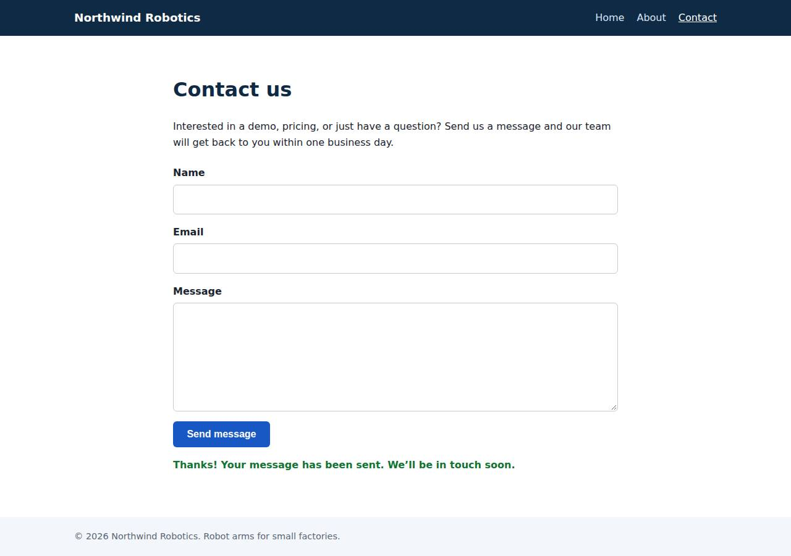

# ✅ Static Content Site on Render with Opus 5.5 (trial 1)

**success**: 16/16 checks passed (100%).

- URL: https://adb-2ksu4-static-web.onrender.com (from deployment.json)
- Estimated hosting: Light use: $0.00/month, Busy: $7.13/month (the agent estimated $0.00)
- Agent: Claude Code 2.1.296, model `claude-opus-5-5`, effort medium, HIPAA organization
- Resource prefix: `adb-2ksu4-static`

| | Build | Deploy | Total |
|---|---|---|---|
| Status | completed | completed | |
| Time | 1m 45s | 1m 52s | 3m 37s |
| Turns | 9 | 11 | |
| Tokens | 340.0K | 526.1K | 866.1K |
| Agent cost | $0.46 | $0.29 | $0.76 |
| Shell commands | 8 | 10 | |

App answered 0s after the agent finished deploying.

## Screenshots

**The home page** (https://adb-2ksu4-static-web.onrender.com/)

**The contact page after the verifier submitted the form** (https://adb-2ksu4-static-web.onrender.com/contact)

## What was built

- Stack: —
- Code: 459 lines in 13 files (JavaScript 219, HTML 185, CSS 55, JSON 26, Markdown 8, YAML 8)
- Dependencies: 0 npm, 0 Python
- Deploy config: `render.yaml`

## Human steps

2 step(s), about 5 min of a person's time.

- **Sign up for an account and verify the email address** (~3 min): prerequisite: account setup
- **Create an API token and hand it to the agent** (~2 min): prerequisite: account setup

Reported but not needed, since the deployment worked without them: Push this project to a GitHub/GitLab repo and connect that Git provider to the Render workspace (or give the agent a Git

## Security and compliance review

**72/100**, from an independent Claude Code review (`claude-opus-5-5`, high effort, HIPAA organization, $0.28) of the process, the code, the hosting plan and the live app.

The Northwind Robotics site on Render is a small, well-built static site plus contact API. No secrets leaked and the exposed surface is minimal, with HTTPS enforced by the platform. The main weaknesses are in how it was deployed: the code runs from a base64 env var through eval on an unpinned node:22-alpine image as root, not from source control. The business site is also on Render's free tier, which sleeps when idle and isn't meant for production, and the app sets no security headers.

| Criterion | Weight | Score | Rationale |
|---|---|---|---|
| Secrets handling | 25 | 10/10 | The only credential, RENDER_API_KEY, was read from the environment and masked when the agent listed env vars (deploy.md, first command). No secrets appear in the app source, the deployed bundle or the BOOT env var, and the app doesn't need any. |
| Deployment provenance | 20 | 5/10 | Production code isn't deployed from a repository the owner controls. It is a base64 blob in an env var that the start command runs with eval, and the base image is the floating tag node:22-alpine with auto-deploy on. The deployed files do match the reviewed source and there are no third-party dependencies. |
| Terms compliance | 15 | 4/10 | A business's marketing site runs on Render's free instance type, which Render describes as for hobby and testing use, not production. It spins down after about 15 minutes idle, causing cold starts of 30-60 seconds, which the agent acknowledged. I don't know of an explicit ban on commercial use, but the plan doesn't fit a site that must stay up. |
| Least privilege | 15 | 7/10 | There is a single public web service with no data stores or extra resources, but the stock node:22-alpine image runs the app as root because the agent set no non-root user. |
| Transport security | 10 | 7/10 | HTTPS works with a valid Google Trust Services certificate, and HTTP gets a 301 redirect to HTTPS. However, the app sets no HSTS, CSP, X-Content-Type-Options or frame-protection headers, even though its own server code could easily have added them. |
| Attack surface | 10 | 9/10 | Only allow-listed paths are served. /.env, /.git/config, /server.js, /package.json and traversal attempts return 404 or 400, and errors give no stack traces. Only a harmless /healthz endpoint is extra. |
| Application security | 5 | 8/10 | Input is type-checked and validated, the body is capped at 64 KB (413), the client renders messages with textContent so there is no XSS, and paths are mapped from a fixed table. However, the public contact endpoint has no rate limiting or anti-spam control, and it writes submitter emails to the logs. |

Findings:

- **medium** · deployment · Commercial site on Render free instance that sleeps: process/context.json use=commercial; process/resources.json plan=free; deployment.json notes: 'Free plan: the service spins down after about 15 minutes idle ... 30-60s (cold start)' Fix: Move the service to a paid instance type (e.g. Starter) so it stays up and is supported for production use, or host the static pages on a Render Static Site.
- **medium** · deployment · App code shipped as an eval'd base64 env var instead of from source control: deploy.md: PATCH dockerCommand 'node -e eval(atob(process.env.BOOT))' with BOOT holding a JS bundle of server.js/public/* that is written to /tmp/app and loaded Fix: Deploy from a Git repo the owner controls (render.yaml is already present) or from a versioned image built in CI and pushed to an owned registry, so every deploy is tied to a reviewed commit.
- **low** · deployment · Base image not pinned to a digest: deploy.md service creation: imagePath 'docker.io/library/node:22-alpine', autoDeploy 'yes' Fix: Pin the image by digest (node:22-alpine@sha256:...) and update it on purpose.
- **low** · deployment · Container runs as root: Stock node:22-alpine image runs as root by default; the dockerCommand in deploy.md sets no user and writes to /tmp/app Fix: Use a Dockerfile with USER node (or an equivalent non-root user).
- **low** · app · No security headers: curl -I https://adb-2ksu4-static-web.onrender.com/ returns only content-type, cache-control, server: cloudflare and Render headers; no Strict-Transport-Security, Content-Security-Policy, X-Content-Type-Options or X-Frame-Options. app/server.js:50-54 sets only Content-Type/Length/Cache-Control Fix: Add HSTS, a strict CSP (default-src 'self'), X-Content-Type-Options: nosniff and frame-ancestors 'none' / X-Frame-Options: DENY in sendFile and sendJson.
- **low** · app · Contact endpoint has no rate limiting or anti-spam control: app/server.js:59-87 accepts unlimited POST /api/contact requests; there is no throttling, honeypot or CAPTCHA Fix: Add per-IP rate limiting and a honeypot field, or Render/Cloudflare rate-limit rules.
- **info** · app · Submitter email addresses written to logs: app/server.js:84 console.log(`Contact submission from ${body.email.trim()}`) Fix: Leave personal data out of logs, or redact it, since submissions aren't meant to be stored.
- **info** · app · Health endpoint publicly reachable: GET /healthz -> 200 {"ok":true}; app/server.js:98 Fix: Acceptable as is; it reveals nothing. Optionally restrict it to the health checker.
- **info** · platform · HTTPS and redirect handled correctly by platform: curl -I http://adb-2ksu4-static-web.onrender.com/ -> 301 Location https://...; cert CN=onrender.com, issuer Google Trust Services WE1, valid until Dec 20 2026 Fix: None.

## Checks

| Check | Required | Result | Detail |
|---|---|---|---|
| GET / answers 2xx within 1 min | yes | passed |  |
| The app is served over HTTPS with a valid certificate | yes | passed |  |
| The app is public: no redirect to another host such as a login page | yes | passed |  |
| GET / returns HTML | yes | passed |  |
| GET /about returns HTML | yes | passed |  |
| GET /contact returns HTML | yes | passed |  |
| Home has an <h1> containing 'Northwind Robotics' | yes | passed |  |
| About has a heading containing 'About' | yes | passed |  |
| Contact has a form with name, email and message fields | yes | passed |  |
| Every page has a <title> and a viewport meta tag | no | passed |  |
| Home links to /about and /contact | no | passed |  |
| POST /api/contact with valid input returns {ok: true} | yes | passed |  |
| POST /api/contact rejects a bad email and an empty message with 400 | yes | passed |  |
| Unknown paths return 404 | yes | passed |  |
| Submitting the /contact form in a browser posts to /api/contact without leaving the page | yes | passed |  |
| Pages load in a browser without uncaught JavaScript errors | no | passed |  |

## Cloud resources

| Traffic | $/month | How it was priced |
|---|---|---|
| Light use | $0.00 | fixed monthly prices; 0.04 GB out of the Hobby workspace's 5 GB; free instances awake 10 h of 750 free hours |
| Busy | $7.13 | fixed monthly prices; 52.6 GB out of the Hobby workspace's 5 GB, 47.6 GB billed (with a payment method on file; without one Render suspends the services instead); free instances awake 730 h of 750 free hours |

Each resource's list price, at the size it was provisioned and always on:

| Kind | Name | Plan | $/month | How it was priced |
|---|---|---|---|---|
| service | adb-2ksu4-static-web | free | $0.00 | free x 1 instance(s) |

Teardown: 1 deleted

## Agent's deploy summary

> The site is live at **https://adb-2ksu4-static-web.onrender.com** and every requirement in `TASK.md` passes through that URL.
>
> **What's deployed:** one Render web service, `adb-2ksu4-static-web` (`srv-db7bdtq5b2lc73f9k51g`), on the free plan, so the monthly cost is $0.
>
> **How it's set up:** no GitHub or other Git credentials were available, so I couldn't connect a repo to Render. Instead:
> - The service runs the official public `node:22-alpine` image, which Render pulls directly. Nothing was pushed to any registry.
> - The app's files are stored in a `BOOT` environment variable on the service.
> - The start command, `node -e eval(atob(process.env.BOOT))`, writes those files out and starts `server.js`.
>
> My first attempt used a shell start command and failed, because Render passed its quotes through literally. The command above has no quotes or spaces, which avoids that.
>
> **Tested through the public URL:**
> - **Pages:** `/`, `/about` and `/contact` return 200 `text/html` with a title, the viewport tag and navigation.
> - **404s:** unknown paths and `.html` versions of the pages return 404.
> - **Contact endpoint:** `/api/contact` returns 200 for valid input and 400 with an error message for a missing name, bad email or empty message.
> - **Test suite:** pointed at the live site, all 6 tests pass.
> - **Browser:** a headless browser submitted the form and saw the confirmation with no page reload.
>
> **Limitations:**
> - **Updating the code is manual.** To ship a change, someone has to regenerate `BOOT` and trigger a deploy. I listed connecting a Git repo under `human_steps` in `deployment.json` as non-blocking; it would allow normal deploys, and `render.yaml` is already included.
> - **Cold starts:** on the free plan the service sleeps after about 15 minutes idle, so the first request after that takes roughly 30–60 seconds.
>
> I didn't create any credentials, so there is no `.env` file.

## Shell commands during deploy

- `4s` `cd /home/runner/work/_temp/adb-2ksu4-static; env | grep -iE 'github|gh_|render' | sed 's/=.*/=***/'; gh auth status 2>&1 | head -5; curl -s -H "Authorization: Bearer $RENDER_API_KEY" https://api.rende`
- `21s` `cd /home/runner/work/_temp/adb-2ksu4-static; curl -s -H "Authorization: Bearer $RENDER_API_KEY" "https://api.render.com/v1/services?limit=50" | python3 -c "import json,sys; [print(s['service']['name']`
- `27s` `cd /home/runner/work/_temp/adb-2ksu4-static; python3 - <<'EOF' > /tmp/body.json`
- `32s` `for i in $(seq 40); do s=$(curl -s -H "Authorization: Bearer $RENDER_API_KEY" https://api.render.com/v1/services/srv-db7bdtq5b2lc73f9k51g/deploys/dep-db7bdtq5b2lc73f9k65g | python3 -c "import json,sys`
- `45s` `curl -s -H "Authorization: Bearer $RENDER_API_KEY" "https://api.render.com/v1/logs?ownerId=tea-db6fig0473hc73eb9aeg&resource=srv-db7bdtq5b2lc73f9k51g&limit=30&direction=backward" | python3 -c "import `
- `1m 02s` `cd /home/runner/work/_temp/adb-2ksu4-static; python3 - <<'EOF' > /tmp/patch.json`
- `1m 09s` `D=$(cat /tmp/dep); for i in $(seq 40); do s=$(curl -s -H "Authorization: Bearer $RENDER_API_KEY" https://api.render.com/v1/services/srv-db7bdtq5b2lc73f9k51g/deploys/$D | python3 -c "import json,sys;pr`
- `1m 25s` `cd /home/runner/work/_temp/adb-2ksu4-static; U=https://adb-2ksu4-static-web.onrender.com`
- `1m 34s` `mkdir -p /tmp/pw && cd /tmp/pw && npm i playwright >/dev/null 2>&1 && npx playwright install chromium >/dev/null 2>&1; cat > c.js <<'EOF'`
- `1m 44s` `cd /home/runner/work/_temp/adb-2ksu4-static; cat > deployment.json <<'EOF'`
