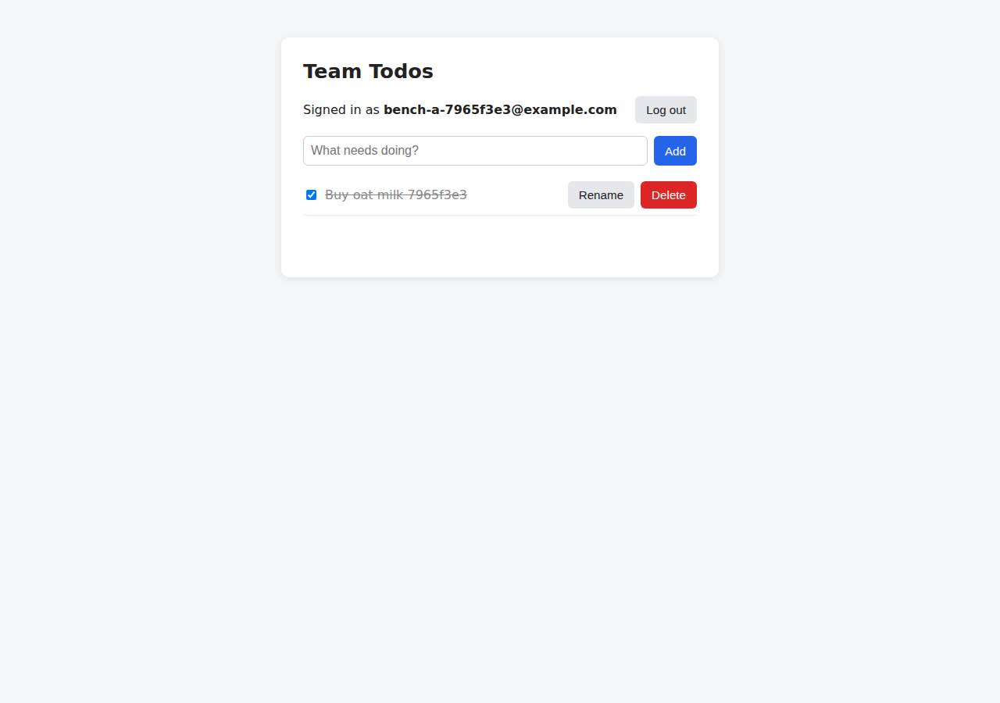

# ✅ Database-Backed CRUD App on Vercel with Opus 5.5 (trial 1)

**success**: 19/19 checks passed (100%).

- URL: https://adb-zwy7n-crud-web.vercel.app (from deployment.json)
- Estimated hosting: Light use: $20.00/month, Busy: $20.00/month (the agent estimated $0.00)
- Agent: Claude Code 2.1.296, model `claude-opus-5-5`, effort medium, HIPAA organization
- Resource prefix: `adb-zwy7n-crud`

| | Build | Deploy | Total |
|---|---|---|---|
| Status | completed | completed | |
| Time | 2m 04s | 4m 56s | 7m 00s |
| Turns | 10 | 25 | |
| Tokens | 407.5K | 1.53M | 1.94M |
| Agent cost | $0.43 | $0.79 | $1.22 |
| Shell commands | 8 | 24 | |

App answered 0s after the agent finished deploying.

## Screenshots

**The web app before signing in** (https://adb-zwy7n-crud-web.vercel.app/)

**The todo list after signing in through the web UI as the test user** (https://adb-zwy7n-crud-web.vercel.app/)

## What was built

- Stack: `@vercel/blob`, `bcryptjs`, `express`, `pg`
- Code: 561 lines in 14 files (JavaScript 561, JSON 38, Markdown 19)
- Dependencies: 4 npm, 0 Python
- Deploy config: `vercel.json`

## Human steps

2 step(s), about 5 min of a person's time.

- **Sign up for an account and verify the email address** (~3 min): prerequisite: account setup
- **Create an API token and hand it to the agent** (~2 min): prerequisite: account setup

Reported but not needed, since the deployment worked without them: In a browser, accept the Vercel Marketplace terms for Neon at https://vercel.com/ai-deploy-bench/~/integrations/accept-t; 21.0) > Installing Neon by Neon under ai-deploy-bench { "status": "action_required", "reason": "integration_terms_accept

## Security and compliance review

**66/100**, from an independent Claude Code review (`claude-opus-5-5`, high effort, HIPAA organization, $0.52) of the process, the code, the hosting plan and the live app.

Secrets were handled well: the Blob token was injected through Vercel's store connection, .env was kept out of the upload and logs, and the app has sound auth, hashing and per-user data isolation. The biggest problem is compliance: a commercial app is hosted on a Vercel Hobby plan, which is for personal, non-commercial use only. The deployment also serves its server-side source files (lib/*.js, server.js) publicly and was pushed from a local directory with an unpinned CLI and no source control.

| Criterion | Weight | Score | Rationale |
|---|---|---|---|
| Secrets handling | 25 | 9/10 | The Blob token was injected by connecting the store to the project, so it lives in Vercel env vars. The app reads it from process.env, and the local .env was excluded by both .gitignore and .vercelignore, with its values never printed. One minor point: the Vercel API token was passed as a --token command-line argument. |
| Deployment provenance | 20 | 6/10 | The CLI uploaded the code straight from the agent's working directory, so there is no git repository or CI recording what was built. The CLI ran through an unpinned `npx vercel@latest`, and the Node engine range is floating. Dependencies are pinned by an uploaded package-lock.json, and Vercel built the uploaded source itself. |
| Terms compliance | 15 | 2/10 | The app is for a business (use: commercial), but it runs on a Vercel Hobby team. Vercel's Hobby terms limit that plan to personal, non-commercial use, so this hosting breaks the plan's terms. The agent checked the plan (`plan: hobby`) and went ahead anyway. |
| Least privilege | 15 | 8/10 | The Blob store was created with private access and data is only reachable through the function. There are no containers or extra public resources. The store-wide read/write token was connected to the production, preview and development environments when only production needs it. |
| Transport security | 10 | 8/10 | HTTP returns a 308 redirect to HTTPS, the certificate is valid, and the platform adds HSTS with preload. The app sets no CSP, X-Content-Type-Options or frame-protection headers, although Express or vercel.json could easily have added them. |
| Attack surface | 10 | 5/10 | Server-side source files (server.js and every lib/*.js) are publicly downloadable as static files. They contain no secrets, but they reveal the storage layout and backend logic. .env, .git, package.json and test files return 404, and errors return generic messages with no stack trace. |
| Application security | 5 | 8/10 | Input is validated, passwords use bcrypt (cost 10), session tokens are random and stored only as SHA-256 hashes, todos are kept per user under the session's user ID, and the UI renders with textContent so it avoids XSS. The app itself has no rate limiting on signup or login, though Vercel's bot challenge offers some platform-level protection. |

Findings:

- **high** · deployment · Commercial app hosted on a Vercel Hobby (personal, non-commercial) plan: process/context.json: use=commercial, team plan 'hobby'; deploy.md line ~494: curl /v2/teams -> {"plan":"hobby"}; deployment.json lists both resources as 'Hobby'. Fix: Move the project and Blob store to a Vercel Pro (or Enterprise) team before using the app for business.
- **medium** · deployment · Server-side source code served as public static files: GET https://adb-zwy7n-crud-web.vercel.app/lib/app.js -> 200 application/javascript (full Express source); likewise /server.js, /lib/store.js, /lib/store-blob.js, /lib/store-pg.js, /lib/html.js. vercel.json only rewrites paths with no filesystem match, and .vercelignore does not exclude lib/ or server.js. Fix: Move the shared code under api/ (e.g. api/_lib) or into a non-public directory, exclude server.js in .vercelignore, or set an explicit outputDirectory so only intended assets are served statically.
- **low** · deployment · Deployed from a local directory with an unpinned CLI and no source control: deploy.md: `npx -y vercel@latest --version`, `npx vercel --token $VERCEL_TOKEN ... deploy --prod --yes` run from the working directory. There is no git repository or connected Git integration, and the build log warns about the floating engines "node": ">=20". Fix: Deploy from a Git repository the owner controls through the Vercel Git integration or CI, pin the Vercel CLI version, and pin a Node major version (e.g. "20.x").
- **low** · app · Missing CSP, X-Content-Type-Options and frame-protection headers: curl -sI https://adb-zwy7n-crud-web.vercel.app/ returns only cache-control, content-type, etag, server, strict-transport-security and x-vercel-* headers. lib/app.js sets no security headers. Fix: Add helmet (or a headers block in vercel.json) for Content-Security-Policy, X-Content-Type-Options: nosniff and frame-ancestors / X-Frame-Options.
- **low** · deployment · Blob read/write token exposed to the preview and development environments: deploy.md line ~305: POST /v1/storage/stores/store_RitHDPfNiGSUbqbg/connections with envVarEnvironments ["production","preview","development"]. The token was then pulled into the local .env. Fix: Connect the production store only to the production environment, and use a separate store for preview and development.
- **low** · app · No application-level rate limiting on auth endpoints: lib/app.js lines 65-86: /api/auth/signup and /api/auth/login have no throttling or lockout, and each request runs bcrypt. Vercel's platform challenge (403 x-vercel-mitigated: challenge) did kick in during probing. Fix: Add per-IP/per-account rate limiting (e.g. Vercel WAF rate-limit rules or an Upstash-based limiter) on login and signup.
- **low** · deployment · Vercel API token passed on the command line: deploy.md: commands such as `npx vercel --token $VERCEL_TOKEN --scope $VERCEL_TEAM_ID deploy --prod --yes` put the token in the process argument list. The agent filtered 'token' from the output, and no value appears in the logs. Fix: Provide the token through the VERCEL_TOKEN environment variable instead of the --token flag.
- **info** · app · Postgres backend disables TLS certificate verification: lib/store-pg.js line 14: ssl: { rejectUnauthorized: false } for non-local connections. It is not active in production, which uses Blob (GET /api/health -> {"ok":true,"storage":"blob"}). Fix: Verify the server certificate (rejectUnauthorized: true with the provider's CA) when the Postgres integration is enabled.
- **info** · app · Health endpoint discloses the storage backend: GET /api/health -> 200 {"ok":true,"storage":"blob"} Fix: Return only {"ok":true} publicly, or protect the endpoint.

## Checks

| Check | Required | Result | Detail |
|---|---|---|---|
| GET / answers 2xx within 1 min | yes | passed |  |
| The app is served over HTTPS with a valid certificate | yes | passed |  |
| The app is public: no redirect to another host such as a login page | yes | passed |  |
| GET / serves the web app as HTML | yes | passed |  |
| POST /api/auth/signup creates an account and returns a token | yes | passed |  |
| Signup rejects an invalid email and a short password with 400 | yes | passed |  |
| Signing up twice with the same email returns 409 | yes | passed |  |
| POST /api/auth/login returns a token | yes | passed |  |
| Login with a wrong password returns 401 | yes | passed |  |
| /api/todos requires a valid token (401) | yes | passed |  |
| POST /api/todos creates a todo | yes | passed |  |
| An empty title is rejected with 400 | yes | passed |  |
| GET /api/todos lists the caller's todos | yes | passed |  |
| Todos are listed oldest first | no | passed |  |
| PATCH /api/todos/{id} renames and completes a todo | yes | passed |  |
| Users can't see or modify each other's todos (404) | yes | passed |  |
| DELETE /api/todos/{id} removes a todo | yes | passed |  |
| Data is still there a minute later, with a fresh login | yes | passed |  |
| The web UI renders a login or signup form | no | passed |  |

## Cloud resources

| Traffic | $/month | How it was priced |
|---|---|---|
| Light use | $20.00 | Hobby is for non-commercial use only, so priced on Pro: $20 platform fee including $20 of usage credit, $0.00 of usage |
| Busy | $20.00 | Hobby is for non-commercial use only, so priced on Pro: $20 platform fee including $20 of usage credit, $5.75 of usage |

Each resource's list price, at the size it was provisioned and always on:

| Kind | Name | Plan | $/month | How it was priced |
|---|---|---|---|---|
| project | adb-zwy7n-crud-web | — | $0.00 | no fixed fee; usage within the plan's included allowance |
| blob_store | adb-zwy7n-crud-blob | — | $0.00 | usage-billed; free within plan allowance |

Teardown: 2 deleted

## Agent's deploy summary

> The app is live at **https://adb-zwy7n-crud-web.vercel.app**, and every requirement in `TASK.md` works through that URL. It isn't using a Postgres database yet, though: no Postgres option on Vercel could be added without someone accepting terms in a browser, so for now the data is stored in Vercel Blob.
>
> **What's deployed (Hobby plan, $0/month)**
> - **Web app:** Vercel project `adb-zwy7n-crud-web`, running the Express app as one serverless function.
> - **Storage:** a private Vercel Blob store, `adb-zwy7n-crud-blob`. Neon, Supabase, Prisma Postgres and Turso on the Vercel Marketplace all stopped with `integration_terms_acceptance_required`, which an access token can't get past. Blob is Vercel's own product and needed no terms, so I added a second storage option to the code:
>   - Each user's todo list is saved as one file. Reads bypass the cache so they always see the latest version. Writes only succeed if the file hasn't changed since it was read, and retry otherwise, so simultaneous saves don't overwrite each other.
>   - A duplicate email is rejected because a second account record for the same email can't be created.
>   - The app uses Postgres instead as soon as `DATABASE_URL` or `POSTGRES_URL` is set, and creates its tables itself. `GET /api/health` shows which storage is in use (currently `blob`).
>
> **Tested on the public URL**
> - **Test suite:** all 3 tests pass. They cover signup and login errors (`400`, `401`, `409`), add, list oldest-first, rename, complete/uncomplete, delete, the `404` when touching another user's todos, and 6 simultaneous creates with none lost.
> - **By hand:** the page loads as HTML. Cookie login, logout and the `401` afterwards all work over HTTPS. A todo created before a forced redeploy was still there afterwards.
> - The Postgres version also passes the same tests against a local database.
>
> **Limitations**
> - Blob isn't a relational database. A user saving many changes at the same moment will see slower responses from the retries, and heavy traffic could use up the free plan's Blob quota.
> - After switching to Postgres, anything already saved in Blob won't be copied across.
>
> **One optional step for a person** (listed in `deployment.json`): accept the Neon terms at https://vercel.com/ai-deploy-bench/~/integrations/accept-terms/neon?source=cli, then run `vercel integration add neon --name adb-zwy7n-crud-db` in this directory and redeploy. The app then switches to Postgres with no code changes.
>
> The Blob access token is saved in `.env`, which is never committed or deployed, and no secret values were printed.

## Shell commands during deploy

- `4s` `npx -y vercel@latest --version 2>&1 | tail -1; npx vercel whoami --token "$VERCEL_TOKEN" 2>&1 | tail -1`
- `36s` `V="npx vercel --token $VERCEL_TOKEN --scope $VERCEL_TEAM_ID"; $V project add adb-zwy7n-crud-web 2>&1 | tail -2; $V link --yes --project adb-zwy7n-crud-web 2>&1 | tail -2; $V integration add --help 2>&`
- `44s` `V="npx vercel --token $VERCEL_TOKEN --scope $VERCEL_TEAM_ID"; timeout 120 $V integration add neon --name adb-zwy7n-crud-db --no-env-pull < /dev/null 2>&1 | grep -v -iE 'postgres(ql)?://' | tail -30`
- `49s` `V="npx vercel --token $VERCEL_TOKEN --scope $VERCEL_TEAM_ID"; $V integration list --all 2>&1 | tail -15; for i in prisma supabase aws-aurora-postgres upstash turso; do echo "== $i"; timeout 60 $V inte`
- `1m 02s` `curl -s -H "Authorization: Bearer $VERCEL_TOKEN" "https://api.vercel.com/v1/storage/stores?teamId=$VERCEL_TEAM_ID" | head -c 600; echo; curl -s -H "Authorization: Bearer $VERCEL_TOKEN" "https://api.ve`
- `1m 11s` `curl -s -X POST -H "Authorization: Bearer $VERCEL_TOKEN" -H 'content-type: application/json' "https://api.vercel.com/v1/storage/stores/blob?teamId=$VERCEL_TEAM_ID" -d '{"name":"adb-zwy7n-crud-blob","a`
- `1m 32s` ❌ `npm i @vercel/blob --silent && node -p 'require("@vercel/blob/package.json").version' && grep -n "allowOverwrite\|access\b\|useCache\|export declare function\|declare function" node_modules/@vercel/bl`
- `1m 35s` `cd /home/runner/work/_temp/adb-zwy7n-crud/node_modules/@vercel/blob && grep '"version"' package.json; ls dist | head; grep -n "allowOverwrite\|declare function list\|declare function put\|declare func`
- `1m 37s` `sed -n 330,400p dist/index.d.ts; grep -n "interface GetCommandOptions" -A30 dist/*.d.ts | head -50`
- `1m 44s` `cd /home/runner/work/_temp/adb-zwy7n-crud && cat lib/db.js | sed -n 1,5p; grep -n "get(" -A3 node_modules/@vercel/blob/dist/index.d.ts | grep -n "declare function get" ; grep -n "declare function get"`
- `2m 23s` ❌ `git mv 2>/dev/null; mv lib/db.js lib/store-pg.js && python3 - <<'EOF'`
- `2m 33s` `docker run -d --name todo-pg -e POSTGRES_PASSWORD=pg -p 5432:5432 postgres:16-alpine >/dev/null && sleep 5 && DATABASE_URL=postgres://postgres:pg@localhost:5432/postgres npm test 2>&1 | grep -E "^ℹ (p`
- `2m 42s` `PID=$(node -p 'require("./.vercel/project.json").projectId') && curl -s -X POST -H "Authorization: Bearer $VERCEL_TOKEN" -H 'content-type: application/json' "https://api.vercel.com/v1/storage/stores/s`
- `2m 47s` `PID=$(node -p 'require("./.vercel/project.json").projectId') && curl -s -X POST -H "Authorization: Bearer $VERCEL_TOKEN" -H 'content-type: application/json' "https://api.vercel.com/v1/storage/stores/s`
- `2m 50s` `npx vercel --token $VERCEL_TOKEN --scope $VERCEL_TEAM_ID env pull .env --yes 2>&1 | tail -1; cut -d= -f1 .env | grep -v '^#'; rm -f .env.local; set -a; . ./.env; set +a; unset VERCEL_OIDC_TOKEN; time `
- `3m 00s` `cat >> test/api.test.js <<'EOF'`
- `3m 11s` `python3 - <<'EOF'`
- `3m 21s` `printf 'node_modules\n.env\n.env*\ntest\nTASK.md\ndeployment.json\n' > .vercelignore && npx vercel --token $VERCEL_TOKEN --scope $VERCEL_TEAM_ID deploy --prod --yes 2>&1 | grep -vi "token" | tail -6`
- `3m 37s` `npx vercel --token $VERCEL_TOKEN --scope $VERCEL_TEAM_ID deploy --prod --yes > /tmp/dep.log 2>&1; grep -vi "token" /tmp/dep.log | head -40`
- `3m 57s` `python3 - <<'EOF'`
- `4m 11s` `U=https://adb-zwy7n-crud-web.vercel.app; E="persist$(date +%s)@example.com"`
- `4m 31s` `node -p 'require("./.vercel/project.json").projectId'; curl -s -H "Authorization: Bearer $VERCEL_TOKEN" "https://api.vercel.com/v2/teams/$VERCEL_TEAM_ID" | node -pe 'const d=JSON.parse(require("fs").r`
- `4m 43s` `cat > deployment.json <<'EOF'`
- `4m 46s` `sed -i 's#^- 'lib/db.js' – 'pg' pool; schema is auto-created on first request.#- 'lib/store.js' – picks the storage backend; the Postgres schema is auto-created on first request.#' README.md && grep -`
