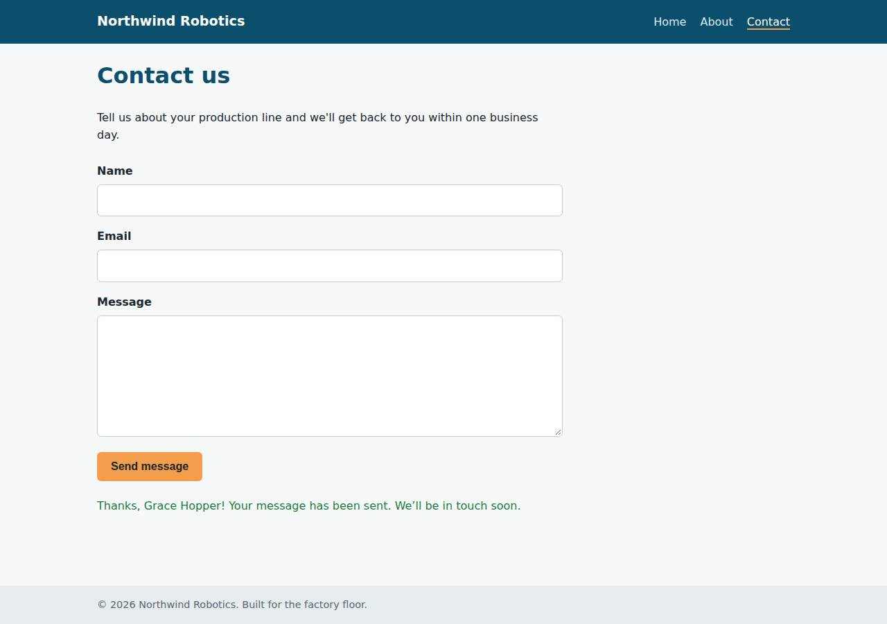

# ✅ Static Content Site on Vercel with Opus 5.5 (trial 1)

**success**: 16/16 checks passed (100%).

- URL: https://adb-1s2g1-static-web.vercel.app (from deployment.json)
- Estimated hosting: Light use: $20.00/month, Busy: $20.00/month (the agent estimated $0.00)
- Agent: Claude Code 2.1.296, model `claude-opus-5-5`, effort medium, HIPAA organization
- Resource prefix: `adb-1s2g1-static`

| | Build | Deploy | Total |
|---|---|---|---|
| Status | completed | completed | |
| Time | 1m 22s | 1m 04s | 2m 26s |
| Turns | 7 | 4 | |
| Tokens | 254.8K | 167.0K | 421.7K |
| Agent cost | $0.41 | $0.08 | $0.49 |
| Shell commands | 6 | 3 | |

App answered 0s after the agent finished deploying.

## Screenshots

**The home page** (https://adb-1s2g1-static-web.vercel.app/)

**The contact page after the verifier submitted the form** (https://adb-1s2g1-static-web.vercel.app/contact)

## What was built

- Stack: —
- Code: 365 lines in 14 files (JavaScript 175, HTML 160, CSS 30, JSON 26)
- Dependencies: 0 npm, 0 Python
- Deploy config: `vercel.json`

## Human steps

2 step(s), about 5 min of a person's time.

- **Sign up for an account and verify the email address** (~3 min): prerequisite: account setup
- **Create an API token and hand it to the agent** (~2 min): prerequisite: account setup

## Security and compliance review

**74/100**, from an independent Claude Code review (`claude-opus-5-5`, high effort, HIPAA organization, $0.29) of the process, the code, the hosting plan and the live app.

The Northwind Robotics site is a clean, dependency-free static site with one well-validated serverless function. It uses no secrets, exposes no files, and serves only HTTPS with HSTS. The main problem is compliance: a commercial business site runs on a Vercel Hobby plan, whose terms rule out commercial use. Smaller issues are an unpinned `vercel@latest` CLI, deploying from a local directory without git, and missing nosniff, frame protection and CSP headers.

| Criterion | Weight | Score | Rationale |
|---|---|---|---|
| Secrets handling | 25 | 9/10 | The app needs no secrets and none appear in source, logs or deployed files. The Vercel token came from an environment variable, but the agent passed it as a `--token` command-line argument instead of letting the CLI read VERCEL_TOKEN, which is a small hygiene slip. |
| Deployment provenance | 20 | 7/10 | There are no npm dependencies and no build step, and the deployed files match the reviewed source. But the agent deployed straight from a local directory with no git source of record, and fetched the CLI as an unpinned `npx -y vercel@latest`. |
| Terms compliance | 15 | 2/10 | This is a business's marketing site (use: commercial), but it runs on a Vercel Hobby team. Vercel's Hobby plan is limited to personal, non-commercial use. The agent recorded the Hobby plan without flagging the conflict or recommending Pro. |
| Least privilege | 15 | 9/10 | The app is static files plus one stateless function, with no data stores, no extra resources and no credentials attached. The only gap is that there is no .vercelignore, so tests, the dev server and TASK.md were uploaded to the deployment even though they aren't served. |
| Transport security | 10 | 7/10 | Only HTTPS is served, with a valid certificate. HTTP redirects to HTTPS with a 308, and HSTS with preload is present. X-Content-Type-Options, frame protection and CSP are missing, and the agent could have added them in vercel.json. |
| Attack surface | 10 | 10/10 | Probes for .env, .git, package.json, vercel.json, function source, lib/, tests and .vercel all returned 404 or redirected to the route. Errors return clean JSON or the custom 404 page, with no stack traces. /_src redirects to a Vercel page that requires login. |
| Application security | 5 | 8/10 | Input is type-checked and validated on the server, malformed JSON returns 400 and other methods return 405. The client uses textContent, so there is no XSS. The endpoint has no length limits and no rate limiting, but it stores and sends nothing, so abuse has little impact. |

Findings:

- **high** · deployment · Commercial site hosted on Vercel Hobby (non-commercial) plan: process/context.json: "use": "commercial", team_plans: {"team_U2tHOV4fpUx18nl9EpcRQ4hO": "hobby"}. process/deployment.json: "plan": "Hobby/free usage tier (existing team plan unchanged)". Vercel's Hobby terms limit use to personal, non-commercial projects. Fix: Deploy the business's site to a Vercel Pro (or Enterprise) team, or flag the plan conflict as a human step before going live.
- **low** · deployment · Unpinned deploy CLI and no git source of record: process/deploy.md: `npx -y vercel@latest --version ... && npx vercel deploy --prod --yes ...` deployed from the local working directory. deployment.json notes say "without git integration". Fix: Pin the Vercel CLI version (e.g. vercel@64.0.2) and deploy from a git repository the owner controls, so each production build traces to a commit.
- **low** · deployment · Missing security headers (nosniff, frame protection, CSP): `curl -sI https://adb-1s2g1-static-web.vercel.app/` returns strict-transport-security but no x-content-type-options, x-frame-options or content-security-policy. app/vercel.json has no `headers` block. Fix: Add a `headers` rule in vercel.json that sets X-Content-Type-Options: nosniff, X-Frame-Options: DENY (or CSP frame-ancestors 'none') and a restrictive Content-Security-Policy such as default-src 'self'.
- **low** · deployment · Deploy token passed as a command-line argument: process/deploy.md: `npx vercel deploy --prod --yes ... --token "$VERCEL_TOKEN"`. The token is expanded into the process arguments, where other local processes can see it in the process list. Fix: Leave VERCEL_TOKEN in the environment and drop the --token flag. The Vercel CLI reads the variable on its own.
- **low** · app · No input length limits or rate limiting on /api/contact: app/lib/validate.js checks only type, non-empty and an email regex, with no maximum length. app/api/contact.js has no throttling. A POST with valid input to /api/contact returned 200 {"ok":true} with no limits applied. Fix: Cap the field lengths (e.g. name 200, email 254, message 5000 characters). Add rate limiting (Vercel Firewall rules or a simple per-IP limiter) before wiring submissions to email or storage.
- **info** · deployment · No .vercelignore: non-runtime files uploaded with the deployment: The app/ directory has test/, dev-server.js, TASK.md and deployment.json, and there is no .vercelignore. They aren't served (requests to /dev-server.js, /TASK.md and /test/site.test.js return 404), but they are part of the uploaded deployment source. Fix: Add a .vercelignore that excludes test/, dev-server.js, TASK.md and other files the app doesn't need at runtime.
- **info** · platform · Static assets served with Access-Control-Allow-Origin: *: `curl -sI https://adb-1s2g1-static-web.vercel.app/` returns `access-control-allow-origin: *`, which Vercel adds to static files by default. The /api/contact function doesn't return it. Fix: This is harmless for public marketing content. It can be overridden with a headers rule if needed.
- **info** · app · Form without JavaScript posts urlencoded data and gets a JSON 400: public/contact.html: `<form ... action="/api/contact" method="post" novalidate>`. A body that isn't JSON (Content-Type: text/plain) returns {"ok":false,"error":"Invalid JSON body"} with 400. Fix: Accept application/x-www-form-urlencoded as a fallback, or remove the action attribute so a non-JS submission can't reach a raw JSON error.

## Checks

| Check | Required | Result | Detail |
|---|---|---|---|
| GET / answers 2xx within 1 min | yes | passed |  |
| The app is served over HTTPS with a valid certificate | yes | passed |  |
| The app is public: no redirect to another host such as a login page | yes | passed |  |
| GET / returns HTML | yes | passed |  |
| GET /about returns HTML | yes | passed |  |
| GET /contact returns HTML | yes | passed |  |
| Home has an <h1> containing 'Northwind Robotics' | yes | passed |  |
| About has a heading containing 'About' | yes | passed |  |
| Contact has a form with name, email and message fields | yes | passed |  |
| Every page has a <title> and a viewport meta tag | no | passed |  |
| Home links to /about and /contact | no | passed |  |
| POST /api/contact with valid input returns {ok: true} | yes | passed |  |
| POST /api/contact rejects a bad email and an empty message with 400 | yes | passed |  |
| Unknown paths return 404 | yes | passed |  |
| Submitting the /contact form in a browser posts to /api/contact without leaving the page | yes | passed |  |
| Pages load in a browser without uncaught JavaScript errors | no | passed |  |

## Cloud resources

| Traffic | $/month | How it was priced |
|---|---|---|
| Light use | $20.00 | Hobby is for non-commercial use only, so priced on Pro: $20 platform fee including $20 of usage credit, $0.00 of usage |
| Busy | $20.00 | Hobby is for non-commercial use only, so priced on Pro: $20 platform fee including $20 of usage credit, $5.75 of usage |

Each resource's list price, at the size it was provisioned and always on:

| Kind | Name | Plan | $/month | How it was priced |
|---|---|---|---|---|
| project | adb-1s2g1-static-web | — | $0.00 | no fixed fee; usage within the plan's included allowance |

Teardown: 1 deleted

## Agent's deploy summary

> The site is live at **https://adb-1s2g1-static-web.vercel.app**, and the requirements I checked work through that public URL.
>
> I deployed it with the Vercel CLI to a new Vercel project, `adb-1s2g1-static-web` (`prj_WMTq9fSDDADAZg9GoyjVNduusW7l`). It uses the free tier, so the estimated cost is $0 a month. No git connection, extra services or credentials were needed.
>
> **Checked with curl against the public URL:**
> - `/`, `/about` and `/contact` return 200 as HTML. The home page has its title, viewport tag and "Northwind Robotics" heading.
> - An unknown path returns 404. `/about.html` redirects to `/about`.
> - `POST /api/contact` returns 200 with `{"ok":true}` for valid input. A missing name, an invalid email, an empty message and a malformed body each return 400 with an error message.
>
> I didn't test the form in a real browser on the deployed site. Its submit-without-reload script loads correctly from the public URL, but I didn't submit the form through it.
>
> `deployment.json` is written, and `human_steps` is empty because nothing needed a person.

## Shell commands during deploy

- `3s` `npx -y vercel@latest --version 2>&1 | tail -1 && npx vercel deploy --prod --yes --name adb-1s2g1-static-web --token "$VERCEL_TOKEN" --scope "$VERCEL_TEAM_ID" 2>&1 | tail -15`
- `52s` `cat .vercel/project.json; echo; U=https://adb-1s2g1-static-web.vercel.app; for p in / /about /contact /contact.js /styles.css /nope /about.html; do curl -s -o /dev/null -w "$p %{http_code} %{content_t`
- `1m 00s` `cat > deployment.json <<'EOF'`
