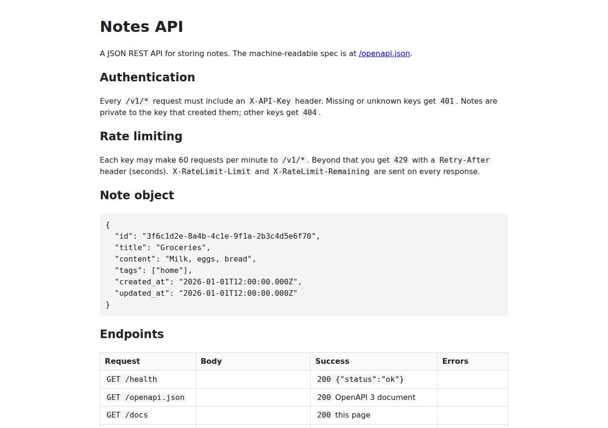

# ✅ API / Backend Service on Cloudish with Opus 5.5 (trial 1)

**success**: 20/20 checks passed (100%).

- URL: https://adb-9nqjr-api.on.do.cloudish.ai (from deployment.json)
- Estimated hosting: Light use: $0.11/month, Busy: $7.84/month (the agent estimated $7.84)
- Agent: Claude Code 2.1.296, model `claude-opus-5-5`, effort medium, HIPAA organization
- Resource prefix: `adb-9nqjr-api`

| | Build | Deploy | Total |
|---|---|---|---|
| Status | completed | completed | |
| Time | 2m 25s | 3m 12s | 5m 37s |
| Turns | 12 | 16 | |
| Tokens | 469.1K | 1.03M | 1.50M |
| Agent cost | $0.56 | $0.46 | $1.02 |
| Shell commands | 8 | 15 | |

App answered 0s after the agent finished deploying.

## Screenshots

**The API documentation at /docs** (https://adb-9nqjr-api.on.do.cloudish.ai/docs)

## What was built

- Runtime: Node.js 24
- Frameworks: Node.js http module (built in)
- Data: SQLite (on a persistent volume)
- Packaging: Docker (node:24-slim)
- Hosting: Cloudish container (shared) with a persistent volume
- Code: 594 lines in 10 files (JavaScript 586, JSON 33, Markdown 16, Docker 8)
- Dependencies: 0 npm, 0 Python
- Deploy config: `Dockerfile`, `.dockerignore`

## Human steps

None: the agent needed no human setup at all.

Reported but not needed, since the deployment worked without them: Claim the Cloudish API key adb-9nqjr-api into a Cloudish account and add credits (mint a fresh single-use claim link wit

## Security and compliance review

**76/100**, from an independent Claude Code review (`claude-opus-5-5`, high effort, HIPAA organization, $0.37) of the process, the code, the hosting plan and the live app.

The Notes API is well built: it has no dependencies, uses parameterized SQLite queries on a private persistent volume, isolates notes per key, reads API_KEYS from Cloudish's encrypted secret store, and keeps the Cloudish credential out of the build context and logs. Probes found nothing exposed beyond the app, and it is served only over valid HTTPS. The main weaknesses are in hosting and hardening: the app runs on an unclaimed key with about 9 hours of free credit, so it will stop working unless the owner tops it up; the container runs as root; the base image is an unpinned tag; and the app sets none of its own security headers.

| Criterion | Weight | Score | Rationale |
|---|---|---|---|
| Secrets handling | 25 | 9/10 | API_KEYS was piped from the environment straight into Cloudish's encrypted secret store without being echoed. The Cloudish credential was kept in a chmod-600 .env file that both .dockerignore and the tar command exclude, and no secret appears in source or logs. The only minor point is that raw API keys are stored as the owner column in SQLite. |
| Deployment provenance | 20 | 7/10 | The image was built on the server from an uploaded context that the agent listed and checked, has no npm dependencies, and the image that runs is the one that was built (builds/101:a5fb4133fd5a). However, the base image node:24-slim is a floating tag rather than a digest, and the source was uploaded from a local workspace, not a repository the owner controls. |
| Terms compliance | 15 | 5/10 | This is personal use, and Cloudish's pay-as-you-go model generally allows that. But the deployment runs on an unclaimed key holding only a 0.1-credit grant, which is about 9 hours of runtime. After that the API returns 402, so an API that friends' scripts depend on will stop working unless a person claims the key and adds credits. The agent did disclose this, but marked it as non-blocking. |
| Least privilege | 15 | 7/10 | The SQLite database sits on a private volume with no public data store, and the 'open' project access is needed for a public API. The Dockerfile has no USER directive, so the container runs Node as root. |
| Transport security | 10 | 8/10 | The app is served over HTTPS with a valid Let's Encrypt certificate (TLS 1.3), HTTP gets a 308 redirect to HTTPS, and the platform adds HSTS. The app does not set X-Content-Type-Options, frame protection or CSP, even though it easily could, including on the HTML /docs page. |
| Attack surface | 10 | 10/10 | Probes for /.env, /.git/config, /package.json, /src/app.js, /Dockerfile, /admin, /debug and /server-status all returned the app's JSON 404. There are no directory listings or stack traces, and the test directory was excluded from the image. |
| Application security | 5 | 8/10 | All queries are parameterized, every lookup is scoped by owner (other keys get 404), input types are validated, bodies are capped at 1 MB, and valid keys are rate-limited to 60/min. Minor gaps: requests with invalid keys are not rate-limited, malformed percent-encoding in an id can cause a 500, key comparison is not constant-time, and there are no length or count limits on fields. |

Findings:

- **medium** · deployment · App runs on an unclaimed key with ~9 hours of free credit: process/deployment.json human_steps: 'The key only has the free 0.1-credit grant, about 9 hours of container runtime... Once it runs out the API returns 402' (marked blocking: false); process/context.json balance_usd 0.099341 Fix: Have the owner claim the key into their own Cloudish account and add credits (or set up auto top-up) before friends rely on the API, and treat this as a blocking step.
- **medium** · deployment · Container runs as root: app/Dockerfile has no USER directive; CMD ["node", "src/server.js"] runs as root in node:24-slim Fix: Add `RUN chown node:node /data` and `USER node` (the official node image ships a 'node' user), and make sure the mounted volume is writable by that user.
- **low** · deployment · Base image not pinned by digest: app/Dockerfile line 1: FROM node:24-slim Fix: Pin the base image by digest, e.g. FROM node:24-slim@sha256:..., and update it on purpose.
- **low** · deployment · Deployed from a local tarball, not a repository the owner controls: process/deploy.md: tar ... -czf /tmp/context.tar.gz . then curl -F context=@/tmp/context.tar.gz to https://cloudish.ai/api/v1/projects Fix: Commit the source to a repository the owner controls and build from a tagged commit, so the image can be traced back to its source.
- **low** · app · Missing security headers set by the app: curl -D - https://adb-9nqjr-api.on.do.cloudish.ai/docs -> only content-type and strict-transport-security (added by the platform); no X-Content-Type-Options, X-Frame-Options/frame-ancestors or Content-Security-Policy Fix: Set X-Content-Type-Options: nosniff on all responses, and a restrictive CSP with frame-ancestors 'none' on /docs, in app/src/app.js send() and the /docs handler.
- **low** · app · Raw API keys stored as note owner in the database: app/src/app.js line 259: handleV1(req, res, url, key) passes the raw key as owner; line 178 inserts it into notes.owner Fix: Store a hash of the key (e.g. SHA-256) or a stable key identifier as the owner, so a leaked database does not expose working credentials.
- **low** · app · Requests with invalid keys are not rate-limited: app/src/app.js lines 248-251: the 401 for an unknown key is returned before limiter(key) is called, so key-guessing attempts are unlimited; keys.has(key) is not a constant-time comparison Fix: Add a per-IP limit on failed authentication, and compare key hashes with crypto.timingSafeEqual.
- **low** · app · Malformed percent-encoded id causes a 500: app/src/app.js line 199: decodeURIComponent(parts[2]) throws URIError on input like /v1/notes/%E0, and the error is turned into a generic 500 (lines 269-270) instead of a 400/404 Fix: Wrap decodeURIComponent in try/catch and return a 404 or 400 HttpError.
- **info** · app · No length limits on title, content or tags: app/src/app.js validateFields (lines 99-129) checks types only; the only bound is the 1 MB body cap (line 32) Fix: Add reasonable maximum lengths for title and content and a cap on the number and length of tags.
- **info** · app · No sensitive files or debug endpoints exposed: GET /.env, /.git/config, /package.json, /src/app.js, /Dockerfile, /admin, /debug, /server-status -> 404 {"error":"Not found"} Fix: None needed.
- **info** · platform · HTTPS with HTTP redirect and HSTS: curl -I http://adb-9nqjr-api.on.do.cloudish.ai/health -> 308 to https; certificate CN=adb-9nqjr-api.on.do.cloudish.ai, issuer Let's Encrypt YR2, expires Jan 12 2027; strict-transport-security: max-age=31536000 Fix: None needed.

## Checks

| Check | Required | Result | Detail |
|---|---|---|---|
| GET /health answers 2xx within 1 min | yes | passed |  |
| The app is served over HTTPS with a valid certificate | yes | passed |  |
| The app is public: no redirect to another host such as a login page | yes | passed |  |
| GET /health returns {status: ok} | yes | passed |  |
| GET /openapi.json is an OpenAPI 3 document covering /v1/notes | yes | passed |  |
| GET /docs serves human-readable documentation | no | passed |  |
| Requests without an API key get 401 | yes | passed |  |
| Requests with an unknown API key get 401 | yes | passed |  |
| POST /v1/notes creates a note | yes | passed |  |
| Invalid notes are rejected with 400 | yes | passed |  |
| GET /v1/notes/{id} returns the note | yes | passed |  |
| GET /v1/notes lists notes and filters by tag | yes | passed |  |
| Notes are listed newest first | no | passed |  |
| PATCH /v1/notes/{id} updates only the given fields | yes | passed |  |
| Notes are private to the API key that created them | yes | passed |  |
| DELETE /v1/notes/{id} removes the note | yes | passed |  |
| Notes are still there a minute later | yes | passed |  |
| Exceeding 60 requests/minute returns 429 | yes | passed |  |
| 429 responses include a Retry-After header | no | passed |  |
| One key hitting its limit doesn't throttle other keys | yes | passed |  |

## Cloud resources

| Traffic | $/month | How it was priced |
|---|---|---|
| Light use | $0.11 | containers awake 10 h at their size's hourly rate; no bandwidth charges |
| Busy | $7.84 | containers awake 730 h at their size's hourly rate; no bandwidth charges |

Each resource's list price, at the size it was provisioned and always on:

| Kind | Name | Plan | $/month | How it was priced |
|---|---|---|---|---|
| project | adb-9nqjr-api-web | shared | $7.84 | 0.1 CPU / 0.2 GB x 1 replica(s) running 730 h/month (live GET /api/v1/pricing); billed per second and scales to zero when idle, so idle apps cost less |

Teardown: 1 deleted

## Agent's deploy summary

> The Notes API is live at **https://adb-9nqjr-api.on.do.cloudish.ai**, and every requirement in `TASK.md` passed when I tested it through that URL.
>
> **What's deployed**
> - **Account:** I created a Cloudish API key called `adb-9nqjr-api` myself (no sign-up needed). Its credential is saved in `.env`, which is excluded from git and from the uploaded build.
> - **App:** project `adb-9nqjr-api-web`, built by Cloudish from the Dockerfile. It runs on the cheapest size (`shared`) as a single copy, and sleeps after 15 minutes without requests.
> - **Database:** SQLite on a 1 GB persistent volume at `/data`. I created a note, redeployed onto a new container, and the note was still there.
> - **API keys:** `API_KEYS` is set as an encrypted Cloudish secret, to exactly the keys in `BENCH_API_KEYS`. They still worked after the redeploy.
> - **HTTPS:** a Let's Encrypt certificate on the custom subdomain. It took about 15 seconds to issue; until then requests failed with a self-signed certificate.
>
> **What I tested over HTTPS**
> - `/health`, `/openapi.json` (OpenAPI 3.0.3 covering all endpoints) and `/docs` (HTML) all return 200.
> - A missing or unknown key gets 401.
> - Create, list, tag filter, get, update and delete all work, and bad input gets 400.
> - A different key gets 404 on someone else's note.
> - After 60 requests in a minute a key gets 429 with a `Retry-After` header, while the other key keeps working.
>
> I deleted my test notes afterwards.
>
> **Limitations**
> - **Credit runs out (needs a person):** the key only has the free 0.1-credit grant, which covers about 9 hours of running time. After that the API returns 402. Someone needs to claim the key into a Cloudish account and add credits; this is listed as a non-blocking item in `human_steps`.
> - **Cost:** about $7.84/month if it ran 24/7. Because it sleeps when idle, real cost should be lower, but the first request after an idle period takes a few seconds while it starts.
> - **Rate-limit counts reset:** they're kept in memory, so they start over whenever the container restarts or wakes from sleep.
>
> `deployment.json` is written with the resources and these notes.

## Shell commands during deploy

- `4s` `ls -A; test -n "$BENCH_API_KEYS" && echo "bench keys set: $(echo "$BENCH_API_KEYS" | tr ',' '\n' | wc -l) keys"; curl -sL https://cloudish.ai/instances.md | head -60; curl -sL https://cloudish.ai/skil`
- `10s` `curl -s -X POST https://cloudish.ai/api/v1/keys -H "content-type: application/json" -d '{"agent":"claude-code","alias":"adb-9nqjr-api"}' > /tmp/key.json && python3 - <<'EOF'`
- `16s` `set -a && . ./.env && set +a`
- `20s` `set -a && . ./.env && set +a`
- `26s` `set -a && . ./.env && set +a`
- `1m 00s` `set -a && . ./.env && set +a`
- `1m 08s` ❌ `B=https://adb-9nqjr-api.on.do.cloudish.ai; K1=$(echo "$BENCH_API_KEYS"|cut -d, -f1); K2=$(echo "$BENCH_API_KEYS"|cut -d, -f2)`
- `1m 14s` `for h in adb-9nqjr-api.on.do.cloudish.ai 0adfa7af3b84dff650405fe65b227373.on.do.cloudish.ai; do echo "== $h"; curl -sv -m 60 https://$h/health 2>&1 | grep -E 'subject|issuer|SSL certificate|^< HTTP|st`
- `1m 18s` `for i in $(seq 1 20); do r=$(curl -s -m 30 -o /dev/null -w "%{http_code}" https://adb-9nqjr-api.on.do.cloudish.ai/health; echo " exit=$?"); echo "$i $r"; case "$r" in 200*) break;; esac; sleep 15; don`
- `1m 41s` `B=https://adb-9nqjr-api.on.do.cloudish.ai; K1=$(echo "$BENCH_API_KEYS"|cut -d, -f1); K2=$(echo "$BENCH_API_KEYS"|cut -d, -f2)`
- `1m 53s` `B=https://adb-9nqjr-api.on.do.cloudish.ai; K1=$(echo "$BENCH_API_KEYS"|cut -d, -f1); K2=$(echo "$BENCH_API_KEYS"|cut -d, -f2)`
- `2m 14s` `curl -sL https://cloudish.ai/llms.txt | grep -iE 'restart|redeploy|docker|stop' | head -20`
- `2m 21s` `set -a && . ./.env && set +a`
- `2m 48s` `set -a && . ./.env && set +a`
- `3m 03s` `cat > deployment.json <<'EOF'`
