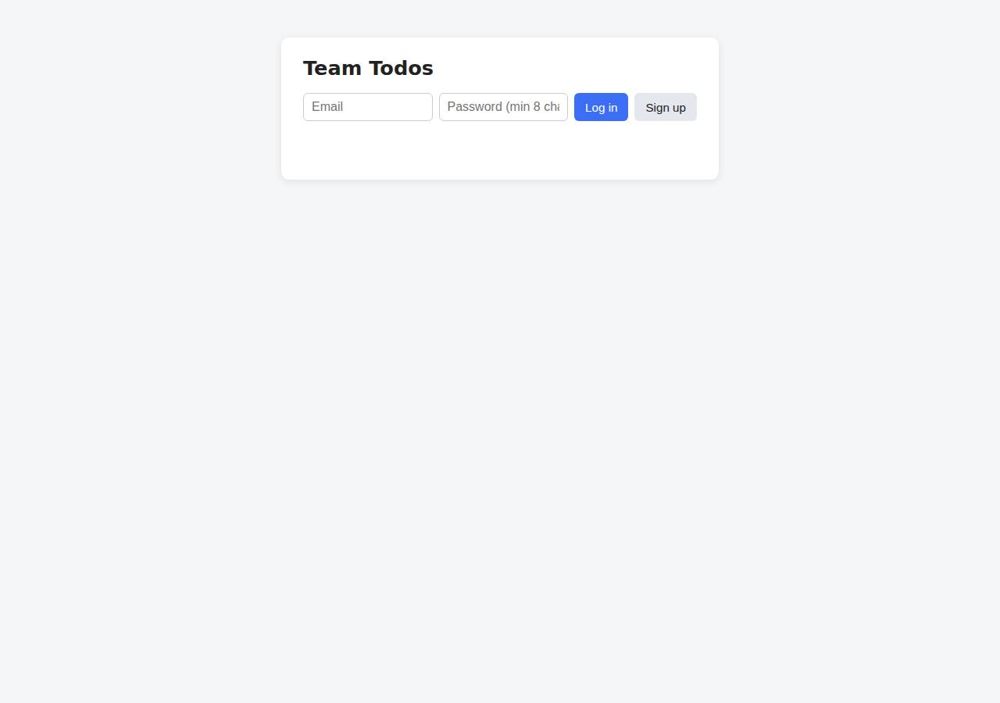
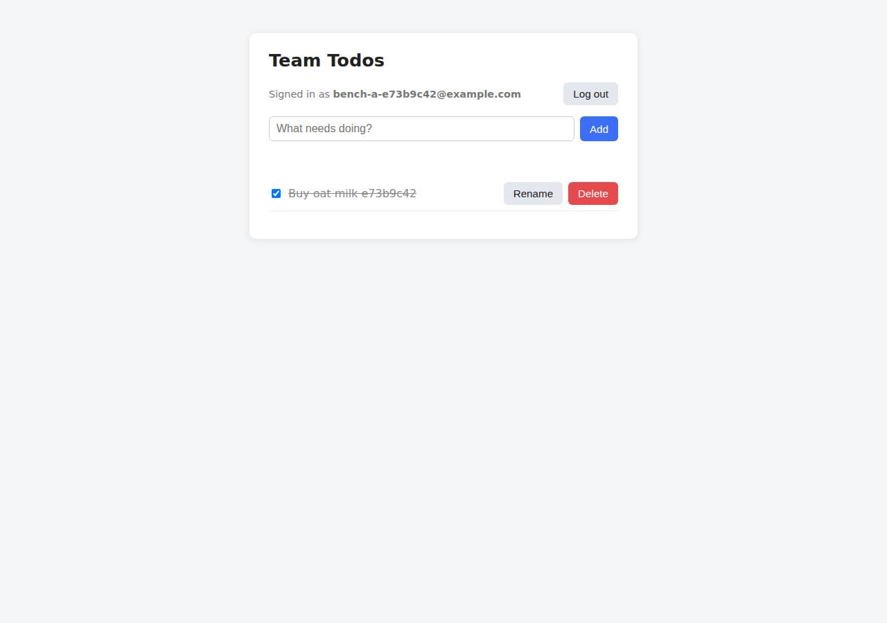

# ✅ Database-Backed CRUD App on Cloudish with Opus 5.5 (trial 1)

**success**: 19/19 checks passed (100%).

- URL: https://adb-zfgq7-crud-web.on.do.cloudish.ai (from deployment.json)
- Estimated hosting: Light use: $0.11/month, Busy: $7.84/month (the agent estimated $7.84)
- Agent: Claude Code 2.1.296, model `claude-opus-5-5`, effort medium, HIPAA organization
- Resource prefix: `adb-zfgq7-crud`

| | Build | Deploy | Total |
|---|---|---|---|
| Status | completed | completed | |
| Time | 2m 42s | 3m 26s | 6m 08s |
| Turns | 11 | 12 | |
| Tokens | 421.7K | 712.0K | 1.13M |
| Agent cost | $0.47 | $0.36 | $0.83 |
| Shell commands | 7 | 11 | |

App answered 0s after the agent finished deploying.

## Screenshots

**The web app before signing in** (https://adb-zfgq7-crud-web.on.do.cloudish.ai/)

**The todo list after signing in through the web UI as the test user** (https://adb-zfgq7-crud-web.on.do.cloudish.ai/)

## What was built

- Runtime: Node.js 24
- Frameworks: Node.js http module (built in)
- Data: SQLite (on a persistent volume)
- Packaging: Docker (node:24-alpine)
- Hosting: Cloudish container (shared) with a persistent volume
- Code: 505 lines in 9 files (JavaScript 344, HTML 152, JSON 25, Docker 9, Markdown 8)
- Dependencies: 0 npm, 0 Python
- Deploy config: `Dockerfile`, `.dockerignore`

## Human steps

None: the agent needed no human setup at all.

Reported but not needed, since the deployment worked without them: Claim the Cloudish key 'adb-zfgq7-crud' and add credits (mint a claim link with GET https://cloudish.ai/api/v1/credits/c

## Security and compliance review

**71/100**, from an independent Claude Code review (`claude-opus-5-5`, high effort, HIPAA organization, $0.42) of the process, the code, the hosting plan and the live app.

The app is well built: scrypt hashing, hashed session tokens, per-user query scoping, safe DOM rendering, no dependencies, and the Cloudish key never left a gitignored .env. Transport on the main hostname is sound, and nothing beyond the app is exposed. The main weaknesses are in the deployment: a commercial app runs on an unclaimed $0.10 trial key that will go dark within hours, the source was uploaded from an ad-hoc tarball with a floating base-image tag, and the container runs as root.

| Criterion | Weight | Score | Rationale |
|---|---|---|---|
| Secrets handling | 25 | 10/10 | The Cloudish API key went straight into a chmod-600 .env file, was never printed, and was excluded from both the uploaded tarball and the .dockerignore. The app itself needs no secrets. |
| Deployment provenance | 20 | 6/10 | Cloudish built the image server-side from the agent's own source and Dockerfile, and there are no npm dependencies. But the source was a tarball uploaded from the agent's scratch workspace rather than an owner-controlled repository, the base image is a floating tag with no digest, and the account is an unclaimed anonymous key that no owner controls yet. |
| Terms compliance | 15 | 3/10 | This is a commercial app running on an unclaimed key with a $0.10 trial grant (about 9 hours of runtime, $0.0987 left), after which the app returns 402/503. The agent marked funding it as 'not blocking'. I don't know Cloudish's terms for commercial use of unclaimed trial keys, but the hosting as configured can't keep a business app up. |
| Least privilege | 15 | 6/10 | SQLite sits on a private attached volume and the only public resource is the web service, which needs to be public. However, the Dockerfile never switches to the node user, so the container runs as root. |
| Transport security | 10 | 8/10 | HTTPS uses a valid Let's Encrypt certificate, HTTP 308-redirects to HTTPS, and the platform adds HSTS. The app sets no X-Content-Type-Options, CSP or frame protection even though it could have, and the auto-generated alternate hostname that the agent advertised serves a self-signed certificate. |
| Attack surface | 10 | 9/10 | Source files, .env, .git and the database are not served, there are no directory listings or debug endpoints, and errors are generic JSON. The only surface beyond the app is a harmless /healthz endpoint and the alternate hostname. |
| Application security | 5 | 7/10 | Input validation, scrypt hashing, hashed session tokens, per-user query scoping, parameterized SQL, DOM textContent rendering and HttpOnly SameSite cookies are all solid. There's no rate limiting on login or signup, a malformed cookie triggers a 500, and test accounts with a known weak password were left in the production database. |

Findings:

- **high** · deployment · Commercial app hosted on an unfunded, unclaimed trial key that runs out within hours: process/deployment.json resources[0] plan 'unclaimed key with free 0.1 credit grant'; human_steps says the credit lasts ~9 hours, after which 'the app returns 402/503', yet it's marked "blocking": false. process/context.json: use=commercial, balance_usd 0.098694. Fix: Have the business owner claim the key (or create a proper account), add credits or a payment method on a plan that allows commercial use, and treat this as a blocking step before launch.
- **medium** · deployment · Container runs as root: app/Dockerfile: 'RUN mkdir -p /data && chown node:node /data' with no USER directive, so CMD ['node','server.js'] runs as root. Fix: Add 'USER node' after the chown (and confirm the volume mount stays writable by uid 1000).
- **medium** · deployment · Deployed from an ad-hoc local tarball under an anonymous unclaimed account: process/deploy.md: 'tar ... -czf /tmp/context.tar.gz . && curl -X POST https://cloudish.ai/api/v1/projects ... -F context=@/tmp/context.tar.gz'. The project owner is the auto-minted key alias 'adb-zfgq7-crud' (id 81) with email None. Fix: Build from a commit in a repository the owner controls (or record the commit hash or tarball digest for each build), and move the project to an account the owner has claimed.
- **low** · deployment · Base image not pinned by digest: app/Dockerfile line 1: 'FROM node:24-alpine' Fix: Pin to node:24-alpine@sha256:<digest> and update it deliberately.
- **low** · app · No rate limiting on authentication endpoints: app/server.js lines 187-217: signup and login run scrypt on every request with no throttling or lockout, which allows online password guessing and CPU exhaustion on a 0.1 CPU instance. Fix: Add per-IP and per-account rate limits or backoff on /api/auth/login and /api/auth/signup.
- **low** · deployment · Test accounts with a known password left in the production database: process/deploy.md: the e2e and persistence checks against the live URL created persist@example.com and e2e*@example.com with password 'password123', and none were removed. Fix: Delete the test users and todos after verification, or run smoke tests against a separate environment.
- **low** · app · Malformed cookie causes a 500 error: GET /api/todos with 'Cookie: token=%' -> {"error":"Internal server error"}. decodeURIComponent at app/server.js line 112 throws URIError. Fix: Wrap decodeURIComponent in try/catch and treat a bad value as no token.
- **low** · app · Missing security headers the app could set: curl -I https://adb-zfgq7-crud-web.on.do.cloudish.ai/ returns only content-type, cache-control and strict-transport-security (HSTS added by the platform). There is no X-Content-Type-Options, Content-Security-Policy or X-Frame-Options/frame-ancestors. Fix: Set nosniff, a restrictive CSP with frame-ancestors 'none', and Referrer-Policy in send() and the index handler.
- **low** · platform · Auto-generated hostname serves a self-signed certificate: curl https://9bc8200242430504fafc3e5985bf36ec.on.do.cloudish.ai/healthz -> 'SSL certificate problem: self-signed certificate' (exit 60). The agent advertised this URL in deployment.json notes. Fix: The platform should issue valid certificates for generated hostnames. Meanwhile, don't advertise that URL.
- **info** · app · Oversized bodies return 502 instead of 413: POST /api/auth/signup with a ~70 KB body -> 502, because req.destroy() at app/server.js line 92 drops the connection before the 413 is sent. Fix: Stop reading and send the 413 response before closing the socket.
- **info** · app · No sensitive files or debug endpoints exposed: GET /.env, /.git/config, /server.js, /package.json, /Dockerfile, /data/app.db -> 404 {"error":"Not found"}. /healthz returns {"ok":true} only. Fix: None needed.

## Checks

| Check | Required | Result | Detail |
|---|---|---|---|
| GET / answers 2xx within 1 min | yes | passed |  |
| The app is served over HTTPS with a valid certificate | yes | passed |  |
| The app is public: no redirect to another host such as a login page | yes | passed |  |
| GET / serves the web app as HTML | yes | passed |  |
| POST /api/auth/signup creates an account and returns a token | yes | passed |  |
| Signup rejects an invalid email and a short password with 400 | yes | passed |  |
| Signing up twice with the same email returns 409 | yes | passed |  |
| POST /api/auth/login returns a token | yes | passed |  |
| Login with a wrong password returns 401 | yes | passed |  |
| /api/todos requires a valid token (401) | yes | passed |  |
| POST /api/todos creates a todo | yes | passed |  |
| An empty title is rejected with 400 | yes | passed |  |
| GET /api/todos lists the caller's todos | yes | passed |  |
| Todos are listed oldest first | no | passed |  |
| PATCH /api/todos/{id} renames and completes a todo | yes | passed |  |
| Users can't see or modify each other's todos (404) | yes | passed |  |
| DELETE /api/todos/{id} removes a todo | yes | passed |  |
| Data is still there a minute later, with a fresh login | yes | passed |  |
| The web UI renders a login or signup form | no | passed |  |

## Cloud resources

| Traffic | $/month | How it was priced |
|---|---|---|
| Light use | $0.11 | containers awake 10 h at their size's hourly rate; no bandwidth charges |
| Busy | $7.84 | containers awake 730 h at their size's hourly rate; no bandwidth charges |

Each resource's list price, at the size it was provisioned and always on:

| Kind | Name | Plan | $/month | How it was priced |
|---|---|---|---|---|
| project | adb-zfgq7-crud-web | shared | $7.84 | 0.1 CPU / 0.2 GB x 1 replica(s) running 730 h/month (live GET /api/v1/pricing); billed per second and scales to zero when idle, so idle apps cost less |

Teardown: 1 deleted

## Agent's deploy summary

> The app is live at **https://adb-zfgq7-crud-web.on.do.cloudish.ai**, and every requirement in `TASK.md` passed when I tested it there.
>
> **What I deployed**
> - **Cloudish key `adb-zfgq7-crud`:** I created it through the API, which needs no sign-up. The key is saved only in `.env`, which is gitignored and was left out of the uploaded build files. I never printed it.
> - **App `adb-zfgq7-crud-web`:** Cloudish built it on its own servers from the existing Dockerfile. It runs on the cheapest size (`shared`), listens on port 8080 and sleeps after 15 minutes without traffic. I set the memorable web address above; the random one Cloudish generated also still works.
> - **Database:** SQLite on a 1 GB persistent volume mounted at `/data`. Storage on Cloudish is free.
>
> **What I tested through the public URL**
> - The web page loads at `/`.
> - Signup returns 400 for a bad email or a short password, 201 on success and 409 for an email that's already registered. No password hash appears in any response.
> - Login returns 401 for a wrong password and 200 for the right one.
> - Todos:
>   - Every call without a token returns 401.
>   - An empty title returns 400.
>   - Creating a todo returns 201.
>   - Listing returns them oldest first.
>   - Renaming, completing and uncompleting all return 200.
>   - Deleting returns 204, and deleting the same todo again returns 404.
> - A second user gets an empty list and a 404 when trying to change or delete the first user's todo.
> - Cookie login works.
> - **Data survives a redeploy:** I created a todo, rebuilt and redeployed the app onto a new server, logged in again, and the todo was still there.
>
> **Cost and limits**
> - It costs about $0.0107 per hour, but only while it's running. Left on all month that would be $7.84; with little traffic it will cost much less.
> - The first request after the app has been asleep takes a few seconds while it starts up.
> - Because the database lives on a volume, the app always runs as a single copy.
>
> **One thing needs a person (not blocking now):** the free credit is about $0.10, roughly 9 hours of running time, and about $0.099 is left. When it runs out, the app answers with 402 or 503 instead of starting. To keep it running, someone has to claim the key and add credits. A one-time claim link comes from `GET https://cloudish.ai/api/v1/credits/claim` using the key in `.env`, and each link expires after 30 minutes. This is listed under `human_steps` in `deployment.json`.
>
> Nothing else failed. The only errors I saw were in the first test run, sent right after I set the new address: the opening requests didn't connect, and the rest of that run failed as a knock-on effect. A rerun moments later passed in full.

## Shell commands during deploy

- `3s` `curl -s https://cloudish.ai/skill.md`
- `9s` `cd /home/runner/work/_temp/adb-zfgq7-crud; ls -a; curl -s https://cloudish.ai/instances.md | head -60`
- `13s` `cd /home/runner/work/_temp/adb-zfgq7-crud; R=$(curl -s -X POST https://cloudish.ai/api/v1/keys -H "content-type: application/json" -d '{"agent":"claude-code","alias":"adb-zfgq7-crud"}'); K=$(echo "$R"`
- `19s` `cd /home/runner/work/_temp/adb-zfgq7-crud; source .env; tar --exclude='.env*' --exclude='.git' --exclude='data' --exclude='context.tar.gz' -czf /tmp/context.tar.gz . && tar tzf /tmp/context.tar.gz && `
- `27s` `cd /home/runner/work/_temp/adb-zfgq7-crud; source .env; for i in $(seq 1 40); do S=$(curl -s https://cloudish.ai/api/v1/images/builds/252 -H "Authorization: Bearer $CLOUDISH_API_KEY" | python3 -c 'imp`
- `42s` `cd /home/runner/work/_temp/adb-zfgq7-crud; source .env; curl -s -X PUT https://cloudish.ai/api/v1/projects/adb-zfgq7-crud/adb-zfgq7-crud-web/subdomain -H "Authorization: Bearer $CLOUDISH_API_KEY" -H "`
- `54s` `cat > /tmp/e2e.sh <<'EOF'`
- `1m 19s` `bash /tmp/e2e.sh https://adb-zfgq7-crud-web.on.do.cloudish.ai`
- `1m 35s` `cd /home/runner/work/_temp/adb-zfgq7-crud; source .env; B=https://adb-zfgq7-crud-web.on.do.cloudish.ai; curl -s -XPOST $B/api/auth/signup -H 'Content-Type: application/json' -d '{"email":"persist@exam`
- `3m 07s` `cd /home/runner/work/_temp/adb-zfgq7-crud; source .env; curl -s https://cloudish.ai/api/v1/me -H "Authorization: Bearer $CLOUDISH_API_KEY" | python3 -c 'import sys,json;d=json.load(sys.stdin);print(d.`
- `3m 16s` `cd /home/runner/work/_temp/adb-zfgq7-crud; cat > deployment.json <<'EOF'`
