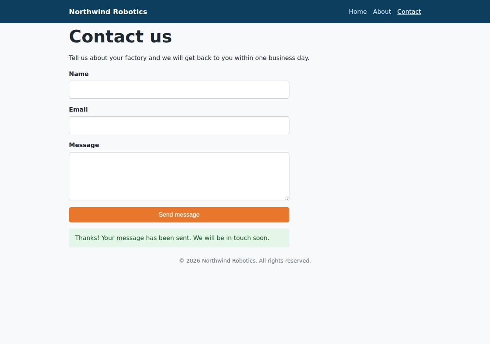

# ✅ Static Content Site on Cloudish with Opus 5.5 (trial 1)

**success**: 16/16 checks passed (100%).

- URL: https://adb-l5mz8-static-web.on.do.cloudish.ai (from deployment.json)
- Estimated hosting: Light use: $0.11/month, Busy: $7.84/month (the agent estimated $7.84)
- Agent: Claude Code 2.1.296, model `claude-opus-5-5`, effort medium, HIPAA organization
- Resource prefix: `adb-l5mz8-static`

| | Build | Deploy | Total |
|---|---|---|---|
| Status | completed | completed | |
| Time | 1m 30s | 2m 17s | 3m 47s |
| Turns | 8 | 13 | |
| Tokens | 265.7K | 675.9K | 941.6K |
| Agent cost | $0.29 | $0.32 | $0.61 |
| Shell commands | 6 | 12 | |

App answered 0s after the agent finished deploying.

## Screenshots

**The home page** (https://adb-l5mz8-static-web.on.do.cloudish.ai/)

**The contact page after the verifier submitted the form** (https://adb-l5mz8-static-web.on.do.cloudish.ai/contact)

## What was built

- Runtime: Node.js 22
- Frameworks: Node.js http module (built in)
- Packaging: Docker (node:22-alpine)
- Hosting: Cloudish container (shared)
- Code: 295 lines in 13 files (JavaScript 184, HTML 90, JSON 24, CSS 13, Docker 8, Markdown 5)
- Dependencies: 0 npm, 0 Python
- Deploy config: `Dockerfile`, `.dockerignore`

## Human steps

None: the agent needed no human setup at all.

Reported but not needed, since the deployment worked without them: Claim the Cloudish API key 'adb-l5mz8-static' into a human account (mint a link with GET https://cloudish.ai/api/v1/cred

## Security and compliance review

**82/100**, from an independent Claude Code review (`claude-opus-5-5`, high effort, HIPAA organization, $0.39) of the process, the code, the hosting plan and the live app.

The Northwind Robotics site is a small dependency-free Node server, and it was built and deployed cleanly: the API key never leaked, the container runs as non-root, only the explicit routes are served, and HTTPS with HSTS is enforced. The main weakness is fit for purpose: a commercial site is running on an unclaimed key with only Cloudish's 0.1-credit free grant, which lasts about 9 hours. Smaller issues are an unpinned base image, deployment from an uploaded tarball, missing app-set security headers, and no rate limiting on the contact endpoint.

| Criterion | Weight | Score | Rationale |
|---|---|---|---|
| Secrets handling | 25 | 10/10 | The Cloudish API key was written straight to a chmod-600 .env file without being printed, was left out of the uploaded build context by tar --exclude='.env*', and never appears in source, the image or the transcripts. The app needs no runtime secrets. |
| Deployment provenance | 20 | 7/10 | The running image (registry.do.cloudish.ai/builds/99:84bc08a6b8e0) was built by Cloudish from the reviewed source, and the app has no dependencies. However, the base image is a floating tag (node:22-alpine) with no digest, the source was uploaded as a local tarball instead of coming from a repository the owner controls, and the project belongs to an agent-minted key that no human has claimed yet. |
| Terms compliance | 15 | 4/10 | A business's marketing site is running on an unclaimed key that only has Cloudish's free 0.1-credit starter grant. That pays for about 9 hours of runtime, after which the site will return 402/503 errors. The agent listed topping it up as 'non-blocking', but the site can't stay up without it. I don't know of any Cloudish terms that forbid commercial use on paid credits. |
| Least privilege | 15 | 10/10 | There is one small container running as the non-root 'node' user, with no volume, no environment secrets and no extra services. Public 'open' access is what a public marketing site needs. |
| Transport security | 10 | 8/10 | The site is HTTPS-only: HTTP gets a 308 redirect, the Let's Encrypt certificate is valid, and the platform adds HSTS. The app doesn't set X-Content-Type-Options, frame protection or a CSP, even though server.js could easily add them. |
| Attack surface | 10 | 10/10 | The server only answers an explicit route table. Every probe for .env, .git, source files, the Dockerfile and traversal paths returned 404 or a 400 from the platform's ingress. There is no directory listing, stack trace or debug endpoint. |
| Application security | 5 | 8/10 | Input is checked for types, an email pattern, malformed JSON and a 64 KB body limit, and the client shows messages with textContent. The public contact endpoint has no rate limiting, though, and it logs submitters' email addresses. |

Findings:

- **medium** · deployment · Commercial site runs on an unclaimed free starter grant that runs out in about 9 hours: process/deployment.json human_steps: 'The key only has the 0.1-credit free grant, which covers about 9 hours of container runtime. Once it runs out, the site returns 402/503'; process/context.json use=commercial, balance_usd=0.099345; deploy.md: creditsPerHour 0.010733 Fix: Before launch, claim the key into the business's Cloudish account and add credits or set up billing. Treat this as a blocking step, not an optional one.
- **low** · deployment · Base image not pinned to a digest: app/Dockerfile:1 'FROM node:22-alpine' Fix: Pin the base image to a digest, e.g. node:22-alpine@sha256:..., and update it on purpose.
- **low** · deployment · Deployed from an uploaded local tarball under an agent-owned account: deploy.md: tar ... -czf /tmp/context.tar.gz . then POST /api/v1/projects -F context=@/tmp/context.tar.gz; the project owner is the agent-minted key 'adb-l5mz8-static' (id 80), which hasn't been claimed Fix: Commit the source to a repository the owner controls, build from a tagged commit, and move the project under the owner's account.
- **low** · app · Missing security headers: curl -sI https://adb-l5mz8-static-web.on.do.cloudish.ai/ returned only content-type, content-length, cache-control and strict-transport-security (no X-Content-Type-Options, X-Frame-Options/frame-ancestors or Content-Security-Policy); app/server.js:97 sets no security headers Fix: Have server.js add X-Content-Type-Options: nosniff, a CSP such as default-src 'self'; frame-ancestors 'none', and Referrer-Policy to every response.
- **low** · app · No rate limiting on the public contact endpoint: app/server.js:49-77 accepts any number of POST /api/contact requests; each request also wakes the scale-to-zero container and uses up credits Fix: Add per-IP rate limiting (in-memory token bucket) and a honeypot field, or use platform rate limiting if Cloudish has it.
- **info** · app · Submitter email addresses written to logs: app/server.js:74 console.log(`contact submission from ${data.email.trim()}`) Fix: Don't log personal data, or log a non-identifying event only.
- **info** · platform · Fallback hostname now serves the ingress default certificate: openssl s_client to 4fd1d94ca7d6e70db98084023443606a.on.do.cloudish.ai shows subject 'Kubernetes Ingress Controller Fake Certificate'; curl exits with code 60. deployment.json says this URL 'also works' Fix: Use only the custom label URL and correct deployment.json. The platform should stop routing to, or properly retire, old hostnames.
- **info** · platform · Platform HSTS has no includeSubDomains: Response header 'strict-transport-security: max-age=31536000' Fix: Acceptable on a shared platform subdomain. A custom domain could use a stronger policy.
- **info** · platform · Ingress error page reveals nginx: GET /%2e%2e/server.js -> 400 with body '
nginx
' Fix: The platform could serve generic error pages. Nothing for the app to fix.

## Checks

| Check | Required | Result | Detail |
|---|---|---|---|
| GET / answers 2xx within 1 min | yes | passed |  |
| The app is served over HTTPS with a valid certificate | yes | passed |  |
| The app is public: no redirect to another host such as a login page | yes | passed |  |
| GET / returns HTML | yes | passed |  |
| GET /about returns HTML | yes | passed |  |
| GET /contact returns HTML | yes | passed |  |
| Home has an <h1> containing 'Northwind Robotics' | yes | passed |  |
| About has a heading containing 'About' | yes | passed |  |
| Contact has a form with name, email and message fields | yes | passed |  |
| Every page has a <title> and a viewport meta tag | no | passed |  |
| Home links to /about and /contact | no | passed |  |
| POST /api/contact with valid input returns {ok: true} | yes | passed |  |
| POST /api/contact rejects a bad email and an empty message with 400 | yes | passed |  |
| Unknown paths return 404 | yes | passed |  |
| Submitting the /contact form in a browser posts to /api/contact without leaving the page | yes | passed |  |
| Pages load in a browser without uncaught JavaScript errors | no | passed |  |

## Cloud resources

| Traffic | $/month | How it was priced |
|---|---|---|
| Light use | $0.11 | containers awake 10 h at their size's hourly rate; no bandwidth charges |
| Busy | $7.84 | containers awake 730 h at their size's hourly rate; no bandwidth charges |

Each resource's list price, at the size it was provisioned and always on:

| Kind | Name | Plan | $/month | How it was priced |
|---|---|---|---|---|
| project | adb-l5mz8-static-web | shared | $7.84 | 0.1 CPU / 0.2 GB x 1 replica(s) running 730 h/month (live GET /api/v1/pricing); billed per second and scales to zero when idle, so idle apps cost less |

Teardown: 1 deleted

## Agent's deploy summary

> The site is live at **https://adb-l5mz8-static-web.on.do.cloudish.ai**, and every requirement in `TASK.md` works through that URL.
>
> **What I set up:**
> - **API key:** I created a Cloudish API key named `adb-l5mz8-static` and saved it only in `.env`, which is gitignored and left out of the upload.
> - **Project:** `adb-l5mz8-static-web`. Cloudish built the image on its own servers from the Dockerfile and runs it on the cheapest size (`shared`), with one copy of the app. It shuts down after 15 minutes without traffic and is billed per second while running.
> - **Address:** I gave it a readable subdomain with a Let's Encrypt HTTPS certificate. The first few requests failed with a certificate error while it was being issued, then it worked. The random URL Cloudish first assigned (`https://4fd1d94ca7d6e70db98084023443606a.on.do.cloudish.ai`) also still works.
>
> **Tested through the public URL:**
> - `/`, `/about` and `/contact` return 200 with `text/html`, and each has the required title, viewport tag, navigation and content.
> - Unknown paths, `/about.html` and `/contact/` return 404.
> - `POST /api/contact` returns 200 `{"ok":true}` for valid input, and 400 with an error message for a missing name, an invalid email or an empty message.
> - In headless Chrome at a phone-sized screen, submitting the form showed the confirmation message without reloading the page.
>
> **Cost:** about $7.84/month at most, which is what it would cost to run around the clock. Because it shuts down when idle, a quiet marketing site should cost much less. The trade-off is a slower first request after an idle period.
>
> **Needs a person (not blocking):** the key only has Cloudish's free 0.1 credits, which covers about 9 hours of running time. After that the site returns errors (402 or 503) until someone adds credits. To do that, a person needs to claim the key into their Cloudish account and top it up, using a one-time link created with the key (each link expires after 30 minutes). This is recorded under `human_steps` in `deployment.json`.

## Shell commands during deploy

- `6s` `curl -s https://cloudish.ai/skill.md`
- `12s` `cd /home/runner/work/_temp/adb-l5mz8-static`
- `17s` `cd /home/runner/work/_temp/adb-l5mz8-static; set -a; . ./.env; set +a`
- `25s` `cd /home/runner/work/_temp/adb-l5mz8-static; set -a; . ./.env; set +a`
- `1m 07s` `cd /home/runner/work/_temp/adb-l5mz8-static; set -a; . ./.env; set +a`
- `1m 10s` `cd /home/runner/work/_temp/adb-l5mz8-static; set -a; . ./.env; set +a`
- `1m 16s` ❌ `U=https://adb-l5mz8-static-web.on.do.cloudish.ai`
- `1m 22s` ❌ `curl -sv -o /dev/null https://adb-l5mz8-static-web.on.do.cloudish.ai/ 2>&1 | grep -iE 'subject|issuer|SSL|error' | head; `
- `1m 27s` `for i in $(seq 30); do c=$(curl -s -o /dev/null -w "%{http_code}" https://adb-l5mz8-static-web.on.do.cloudish.ai/); [ "$c" = 200 ] && break; sleep 10; done; echo "$i $c"`
- `1m 43s` `U=https://adb-l5mz8-static-web.on.do.cloudish.ai`
- `1m 53s` `mkdir -p /tmp/pw && cd /tmp/pw && npm init -y >/dev/null && npm i -s playwright-core >/dev/null 2>&1; which google-chrome`
- `2m 09s` `cd /home/runner/work/_temp/adb-l5mz8-static`
