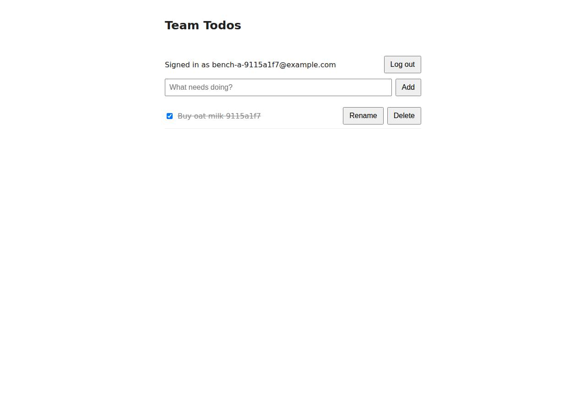

# ✅ Database-Backed CRUD App on DigitalOcean with Opus 5.5 (trial 1)

**success**: 19/19 checks passed (100%).

- URL: https://adb-5glop-crud-h7v3k.ondigitalocean.app (from deployment.json)
- Estimated hosting: Light use: $12.00/month, Busy: $12.00/month (the agent estimated $12.00)
- Agent: Claude Code 2.1.296, model `claude-opus-5-5`, effort medium, HIPAA organization
- Resource prefix: `adb-5glop-crud`

| | Build | Deploy | Total |
|---|---|---|---|
| Status | completed | completed | |
| Time | 2m 20s | 9m 39s | 12m 00s |
| Turns | 11 | 10 | |
| Tokens | 393.7K | 500.7K | 894.4K |
| Agent cost | $0.42 | $0.38 | $0.80 |
| Shell commands | 10 | 9 | |

App answered 0s after the agent finished deploying.

## Screenshots

**The web app before signing in** (https://adb-5glop-crud-h7v3k.ondigitalocean.app/)

**The todo list after signing in through the web UI as the test user** (https://adb-5glop-crud-h7v3k.ondigitalocean.app/)

## What was built

- Runtime: Node.js 22
- Frameworks: Express
- Data: PostgreSQL (App Platform dev database)
- Libraries: node-postgres, bcrypt.js, jsonwebtoken
- Dev tools: SuperTest
- Packaging: Docker (node:22-alpine), App spec (.do/app.yaml)
- Hosting: App Platform service (apps-s-1vcpu-0.5gb), DigitalOcean Container Registry (starter)
- Code: 391 lines in 12 files (JavaScript 265, HTML 117, JSON 35, YAML 27, Markdown 18, Docker 9)
- Dependencies: 5 npm, 0 Python
- Deploy config: `Dockerfile`, `.dockerignore`, `.do/app.yaml`

## Human steps

3 step(s), about 7 min of a person's time.

- **Sign up for an account and verify the email address** (~3 min): prerequisite: account setup
- **Add a payment method to the account** (~2 min): prerequisite: account setup
- **Create an API token and hand it to the agent** (~2 min): prerequisite: account setup

## Security and compliance review

**71/100**, from an independent Claude Code review (`claude-opus-5-5`, high effort, HIPAA organization, $0.41) of the process, the code, the hosting plan and the live app.

The agent built a well-structured Express/PostgreSQL todo app: queries are parameterized and owner-scoped, passwords use bcrypt, nothing sensitive is exposed, and database credentials come from App Platform bindings, with HTTPS and an HTTP redirect handled by the platform. The main weaknesses are in deployment: a root container, a floating base image deployed by a mutable tag from a locally built image, and a commercial app's data on a non-production dev database. The app also sets no security headers and does not rate-limit authentication.

| Criterion | Weight | Score | Rationale |
|---|---|---|---|
| Secrets handling | 25 | 8/10 | No credentials showed up in source, transcripts, the image or the live site. The database URL and CA cert come from App Platform's bindable variables (${adb-5glop-crud-db.DATABASE_URL}/CA_CERT). The one deviation: the JWT signing key is generated at runtime and stored in plaintext in an app_settings table, not kept as an App Platform encrypted secret. |
| Deployment provenance | 20 | 6/10 | The image was built from the agent's own code and pushed to the owner's private DOCR, and npm ci installs from the lockfile. But the base image is a floating tag (node:22-alpine), App Platform deploys the mutable tag v1 rather than a digest, the code lives only in a local git repo, and doctl was installed via curl\|tar with no checksum check. |
| Terms compliance | 15 | 7/10 | This is a commercial app on a paid App Platform Basic plan, which DigitalOcean's terms allow for business use, and the app does not sleep or expire. However, its data sits on an App Platform dev database, which DigitalOcean describes as for development and not production: no standby, limited backups, 512 MB. That fits a business's production app poorly, though it is not a terms violation as far as I know. |
| Least privilege | 15 | 6/10 | The container runs as root because the Dockerfile has no USER directive. The dev database is a DigitalOcean-managed cluster that, as far as I know, has a public endpoint whose trusted sources cannot be restricted to the app (it is protected only by credentials and TLS). Everything else is minimal: one service, one private registry, and DB access scoped to the app's own database user. |
| Transport security | 10 | 7/10 | The site serves a valid Google Trust Services certificate for *.ondigitalocean.app, and HTTP gets a 301 redirect to HTTPS. Neither the platform nor the app sets HSTS, X-Content-Type-Options, frame protection or CSP, and the agent could easily have added them in Express. |
| Attack surface | 10 | 9/10 | Requests for /.env, /.git/config, /package.json, /src/server.js, /Dockerfile, /.do/app.yaml and /README.md all return 404, because only public/ is served statically. Malformed JSON returns a clean 400 and the 500 handler hides stack traces. The only leaks are /healthz (harmless) and Express's default 'Cannot GET' 404 pages, which reveal the framework. |
| Application security | 5 | 7/10 | Every query is parameterized and owner-scoped (WHERE id=$1 AND user_id=$2), passwords use bcrypt cost 12, hashes are never returned, the JWT algorithm is fixed by the library default (an alg=none token was rejected), and the UI uses textContent. On the other hand, login and signup have no rate limiting or lockout, titles have no length limit beyond the 100kb body cap, and tokens are 30-day JWTs kept in localStorage with no way to revoke them. |

Findings:

- **medium** · deployment · Container runs as root: app/Dockerfile: FROM node:22-alpine ... CMD ["node", "src/server.js"] with no USER directive, so the process runs as uid 0 Fix: Add `USER node` (the node image ships an unprivileged node user) after copying files, and chown /app if needed.
- **medium** · deployment · Unpinned base image and mutable deploy tag: app/Dockerfile line 1 `FROM node:22-alpine` (no digest); app/.do/app.yaml `image: ... tag: v1` (no digest); deploy.md: `docker build ... -t registry.digitalocean.com/adb-5glop-crud/adb-5glop-crud-web:v1 . && docker push` Fix: Pin the base image by digest (node:22-alpine@sha256:...), deploy the pushed image by digest or an immutable per-commit tag, and build from a source repository the owner controls (e.g. a GitHub-connected spec or CI).
- **medium** · deployment · Commercial app's data on a non-production dev database: app/.do/app.yaml `databases: - name: adb-5glop-crud-db ... production: false`; process/deployment.json notes: 'it has no standby/backups SLA - upgrade to a managed cluster for production'; context.json use=commercial Fix: Use a production managed PostgreSQL cluster (production: true, cluster_name set) with backups and, ideally, a standby node for a business's app.
- **low** · deployment · Deployment tool downloaded without integrity check; source only in local repo: deploy.md: `curl -sL https://github.com/digitalocean/doctl/releases/download/v1.146.0/doctl-1.146.0-linux-amd64.tar.gz | tar xz && sudo mv doctl /usr/local/bin/`; code committed only to a local git repo (`git init -q` in build.md) Fix: Verify the release checksum before installing, and push the source to an owner-controlled remote so the deployed image traces back to a reviewable commit.
- **low** · platform · Dev database reachable over a public endpoint without trusted-source restriction: process/resources.json: database is an App Platform dev database (engine PG 16), and the spec has no VPC or trusted-sources configuration. As far as I know, App Platform dev databases cannot restrict trusted sources (not verifiable without cloud credentials). Fix: Move to a managed cluster with trusted sources limited to the app (or VPC-only access).
- **low** · app · JWT signing key stored in the database instead of a platform secret: app/src/app.js lines 11-19: loadSecret() generates a random key and stores it in app_settings in plaintext when JWT_SECRET is unset; app/.do/app.yaml defines no JWT_SECRET env Fix: Store JWT_SECRET as an App Platform env var of type SECRET, so that a database dump or read access does not also let someone forge tokens.
- **low** · app · No security headers (HSTS, X-Content-Type-Options, frame protection, CSP): curl -sI https://adb-5glop-crud-h7v3k.ondigitalocean.app/ returns only date, content-type, cache-control, set-cookie (__cf_bm), x-do-* and cf-* headers: no strict-transport-security, x-content-type-options, x-frame-options or content-security-policy Fix: Add helmet (or set the headers manually) in Express: HSTS, nosniff, frame-ancestors 'none', and a CSP suited to the inline script (or move the script to a file).
- **low** · app · No rate limiting on login/signup: 8 consecutive POST /api/auth/login with wrong credentials all returned 401 with no throttling; app/src/app.js has no rate-limit middleware Fix: Add per-IP and per-account rate limiting (e.g. express-rate-limit) on /api/auth/* to slow credential stuffing and bcrypt-CPU exhaustion.
- **low** · app · Unbounded todo title length and long-lived, non-revocable tokens: app/src/app.js lines 110-117: title is only checked for non-empty (the 100kb body limit is the only cap); line 38: jwt expiresIn '30d'; public/index.html stores the token in localStorage Fix: Cap title length (e.g. 500 chars), shorten token lifetime or add server-side revocation, and consider an HttpOnly cookie for the web UI.
- **info** · app · Default Express 404 pages reveal framework: GET /.env -> 404 '<pre>Cannot GET /.env</pre>' (Express default HTML error page); sensitive files are not served Fix: Add a generic catch-all 404 handler.

## Checks

| Check | Required | Result | Detail |
|---|---|---|---|
| GET / answers 2xx within 1 min | yes | passed |  |
| The app is served over HTTPS with a valid certificate | yes | passed |  |
| The app is public: no redirect to another host such as a login page | yes | passed |  |
| GET / serves the web app as HTML | yes | passed |  |
| POST /api/auth/signup creates an account and returns a token | yes | passed |  |
| Signup rejects an invalid email and a short password with 400 | yes | passed |  |
| Signing up twice with the same email returns 409 | yes | passed |  |
| POST /api/auth/login returns a token | yes | passed |  |
| Login with a wrong password returns 401 | yes | passed |  |
| /api/todos requires a valid token (401) | yes | passed |  |
| POST /api/todos creates a todo | yes | passed |  |
| An empty title is rejected with 400 | yes | passed |  |
| GET /api/todos lists the caller's todos | yes | passed |  |
| Todos are listed oldest first | no | passed |  |
| PATCH /api/todos/{id} renames and completes a todo | yes | passed |  |
| Users can't see or modify each other's todos (404) | yes | passed |  |
| DELETE /api/todos/{id} removes a todo | yes | passed |  |
| Data is still there a minute later, with a fresh login | yes | passed |  |
| The web UI renders a login or signup form | no | passed |  |

## Cloud resources

| Traffic | $/month | How it was priced |
|---|---|---|
| Light use | $12.00 | fixed monthly prices; 0.0373 GiB out of a 50 GiB allowance |
| Busy | $12.00 | fixed monthly prices; 49 GiB out of a 50 GiB allowance |

Each resource's list price, at the size it was provisioned and always on:

| Kind | Name | Plan | $/month | How it was priced |
|---|---|---|---|---|
| app | adb-5glop-crud | adb-5glop-crud-web: apps-s-1vcpu-0.5gb x 1, adb-5glop-crud-db: dev database | $12.00 | adb-5glop-crud-web: apps-s-1vcpu-0.5gb x 1; adb-5glop-crud-db: dev database |
| registry | adb-5glop-crud | starter | $0.00 | Container Registry starter tier (one per account) |

Teardown: 2 deleted

## Agent's deploy summary

> The app is live at **https://adb-5glop-crud-h7v3k.ondigitalocean.app**, and every requirement in `TASK.md` works through that URL.
>
> **What's deployed (about $12/month):**
> - **Web service:** an App Platform app, `adb-5glop-crud`, on the smallest Basic instance (`apps-s-1vcpu-0.5gb`, $5/month). It runs the Docker image `adb-5glop-crud-web:v1`.
> - **Container registry:** `adb-5glop-crud` on the free starter tier. I built the image locally and pushed it there, so no GitHub connection was needed.
> - **Database:** PostgreSQL 16 as an App Platform dev database, `adb-5glop-crud-db` ($7/month). The app connects over TLS and checks the database's certificate.
> - **HTTPS:** comes with the default `ondigitalocean.app` domain, and plain HTTP redirects to HTTPS.
>
> **Tested through the public URL with curl:**
> - `/` serves the HTML page.
> - Signup returns 400 for a bad email or a short password, 409 for a duplicate email, and a token otherwise. Login returns 401 for a wrong password and 200 for the right one.
> - Without a token the todo endpoints return 401.
> - Creating, listing (oldest first), renaming, completing, uncompleting and deleting todos all work. Delete returns 204, and a second delete of the same todo returns 404.
> - A second user sees an empty list and gets 404 when trying to change or delete the first user's todo.
> - After a forced rebuild and redeploy, the existing user could still log in and their todo was still there.
>
> **Limitations:**
> - I didn't drive the web UI in a browser; I only fetched the page.
> - The dev database has no high-availability setup and isn't meant for production. Moving to a managed PostgreSQL cluster (about $15/month) would fix that.
> - To ship a new version, push a new image tag, update the tag in `.do/app.yaml`, and run `doctl apps update` with that spec. The README's deploy section is out of date: it still describes the step-1 spec that built from source.
>
> Nothing needed a person, so `human_steps` is empty. I created no credentials, so `.env` is empty, and no secrets were written to committed files. `deployment.json` and the updated `.do/app.yaml` are committed.

## Shell commands during deploy

- `6s` `which doctl; doctl version 2>/dev/null; curl -s -H "Authorization: Bearer $DIGITALOCEAN_ACCESS_TOKEN" https://api.digitalocean.com/v2/account | python3 -c 'import json,sys;a=json.load(sys.stdin)["acco`
- `10s` `cd /tmp && curl -sL https://github.com/digitalocean/doctl/releases/download/v1.146.0/doctl-1.146.0-linux-amd64.tar.gz | tar xz && sudo mv doctl /usr/local/bin/ && doctl version && doctl registry creat`
- `22s` `doctl registry login >/dev/null && docker build -q --platform linux/amd64 -t registry.digitalocean.com/adb-5glop-crud/adb-5glop-crud-web:v1 . && docker push -q registry.digitalocean.com/adb-5glop-crud`
- `49s` `cat > .do/app.yaml <<'EOF'`
- `55s` `for i in $(seq 1 40); do s=$(doctl apps get f4dfa355-ee7d-4a4c-8c73-a6e2bc7caf95 -o json | python3 -c 'import json,sys;a=json.load(sys.stdin)[0];print(a.get("active_deployment",{}).get("phase","-"), a`
- `7m 02s` `B=https://adb-5glop-crud-h7v3k.ondigitalocean.app; J='content-type: application/json'`
- `7m 15s` `APP=f4dfa355-ee7d-4a4c-8c73-a6e2bc7caf95; doctl apps create-deployment $APP --wait >/dev/null 2>&1; doctl apps get $APP -o json | python3 -c 'import json,sys;a=json.load(sys.stdin)[0];print(a["active_`
- `8m 17s` `APP=f4dfa355-ee7d-4a4c-8c73-a6e2bc7caf95; B=https://adb-5glop-crud-h7v3k.ondigitalocean.app; J='content-type: application/json'`
- `9m 31s` `cat > deployment.json <<'EOF'`
