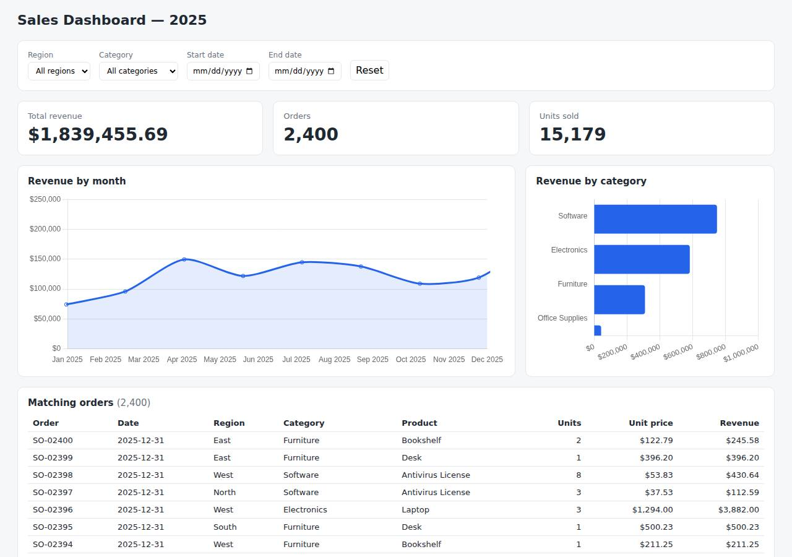

# ✅ Data / Visualization App on DigitalOcean with Opus 5.5 (trial 1)

**success**: 12/12 checks passed (100%).

- URL: https://adb-wqhai-dataviz-ja39g.ondigitalocean.app (from deployment.json)
- Estimated hosting: Light use: $5.00/month, Busy: $5.00/month (the agent estimated $5.00)
- Agent: Claude Code 2.1.296, model `claude-opus-5-5`, effort medium, HIPAA organization
- Resource prefix: `adb-wqhai-dataviz`

| | Build | Deploy | Total |
|---|---|---|---|
| Status | completed | completed | |
| Time | 1m 42s | 1m 45s | 3m 26s |
| Turns | 9 | 10 | |
| Tokens | 335.3K | 446.5K | 781.8K |
| Agent cost | $0.35 | $0.19 | $0.53 |
| Shell commands | 8 | 9 | |

App answered 0s after the agent finished deploying.

## Screenshots

**The dashboard** (https://adb-wqhai-dataviz-ja39g.ondigitalocean.app/)

## What was built

- Runtime: Node.js 22
- Frameworks: Node.js http module (built in)
- Packaging: Docker (node:22-alpine), App spec (app.yaml)
- Hosting: App Platform service (apps-s-1vcpu-0.5gb), DigitalOcean Container Registry (starter)
- Code: 309 lines in 11 files (JavaScript 155, HTML 144, JSON 24, YAML 16, Docker 10, Markdown 8)
- Dependencies: 0 npm, 0 Python
- Deploy config: `Dockerfile`, `.dockerignore`, `app.yaml`

## Human steps

3 step(s), about 7 min of a person's time.

- **Sign up for an account and verify the email address** (~3 min): prerequisite: account setup
- **Add a payment method to the account** (~2 min): prerequisite: account setup
- **Create an API token and hand it to the agent** (~2 min): prerequisite: account setup

## Security and compliance review

**86/100**, from an independent Claude Code review (`claude-opus-5-5`, high effort, HIPAA organization, $0.26) of the process, the code, the hosting plan and the live app.

This small, dependency-free Node.js dashboard runs as a non-root container on a paid, always-on DigitalOcean App Platform instance, which suits commercial use. It handles no secrets, exposes no files beyond the app, and redirects HTTP to HTTPS with a valid certificate. The weaknesses are mostly in provenance: a base image with no digest, a mutable v1 image tag, doctl installed without a checksum check, and a CDN script with no SRI. The app also sends none of the standard security headers.

| Criterion | Weight | Score | Rationale |
|---|---|---|---|
| Secrets handling | 25 | 10/10 | The app needs no secrets. The DigitalOcean token was only used through the $DIGITALOCEAN_ACCESS_TOKEN environment variable and doctl's credential helper, and never got into source, the image, the logs or the deployed files. |
| Deployment provenance | 20 | 6/10 | The image was built locally from the reviewed source and pushed to a registry the owner controls. But the base image is a floating tag with no digest, the deployed image tag v1 is mutable, doctl was downloaded with no checksum check, and Chart.js loads from a CDN without Subresource Integrity. |
| Terms compliance | 15 | 10/10 | This is a commercial app on a paid App Platform Basic instance, which is always on and doesn't sleep. DigitalOcean's standard terms allow business use, and the DOCR starter tier is a supported free tier with no expiry. |
| Least privilege | 15 | 9/10 | There is a single public web service and no database. The container runs as the non-root node user and the data is read-only inside the image. The only minor gap is that the spec doesn't make the read-only intent explicit, and that has little effect here. |
| Transport security | 10 | 7/10 | HTTP redirects to HTTPS with a 301 and the certificate is valid (Google Trust Services, expires Dec 2026). The app sets none of HSTS, X-Content-Type-Options, X-Frame-Options/frame-ancestors or CSP, even though its own send() helper could easily add them. |
| Attack surface | 10 | 10/10 | Probes for .env, .git/config, package.json, source files, the CSV, the Dockerfile and app.yaml all return a JSON 404. Errors are generic JSON with no stack traces, and the only extra endpoints are the harmless /health and /api/options. |
| Application security | 5 | 8/10 | Date parameters are checked against a regex, limit and page are clamped (limit at most 500), non-GET methods get a 405, and the orders table escapes every string field. The app has no rate limiting of its own; for public read-only aggregate data that is a minor gap, partly covered by the platform's Cloudflare edge. |

Findings:

- **medium** · deployment · Base image not pinned by digest: app/Dockerfile:1 `FROM node:22-alpine` (floating tag, no @sha256 digest) Fix: Pin the base image to a specific version and digest, e.g. node:22.x-alpine3.xx@sha256:..., and update it on purpose.
- **low** · deployment · Deployed image referenced by mutable tag: app/app.yaml:7 `tag: v1`; process/resources.json shows spec image tag v1, with no digest, although the push printed sha256:624826e5... Fix: Use unique immutable tags (e.g. the git SHA) or deploy by digest, so a re-push can't silently change what runs.
- **low** · deployment · doctl binary downloaded without checksum verification: process/deploy.md: `curl -sL https://github.com/digitalocean/doctl/releases/download/v1.115.0/doctl-1.115.0-linux-amd64.tar.gz | tar xz && sudo mv doctl /usr/local/bin/` (version pinned, but there is no sha256 check) Fix: Check the release checksum file before installing, or use a trusted package source.
- **low** · app · Third-party CDN script loaded without Subresource Integrity: app/public/index.html:7 `` with no integrity or crossorigin attribute Fix: Add an integrity hash and crossorigin="anonymous", or bundle Chart.js and serve it from the app.
- **low** · app · Security headers missing: curl -sI https://adb-wqhai-dataviz-ja39g.ondigitalocean.app/ returns only content-type, cache-control and Cloudflare/DO headers, with no Strict-Transport-Security, X-Content-Type-Options, X-Frame-Options or Content-Security-Policy; app/src/server.js:15 sets only Content-Type and Cache-Control Fix: Add HSTS, X-Content-Type-Options: nosniff, a CSP with frame-ancestors 'none' (allowing cdn.jsdelivr.net for scripts) and X-Frame-Options: DENY in send().
- **info** · app · No application-level rate limiting on public API: app/src/server.js:31-60 has no throttling; every /api/orders request filters and sorts all 2,400 rows Fix: Fine for this dataset size. Add basic per-IP rate limiting, or rely on and configure edge protections, if the data or traffic grows.
- **info** · app · Input validation and output escaping are in place: GET /api/summary?start=bad -> 400 {"error":"start must be YYYY-MM-DD"}; GET /api/orders?limit=99999&page=-5 -> 200 with limit 500, page 1; POST /api/summary -> 405; index.html:109-112 escapes fields with esc() Fix: No action needed.

## Checks

| Check | Required | Result | Detail |
|---|---|---|---|
| GET / answers 2xx within 1 min | yes | passed |  |
| The app is served over HTTPS with a valid certificate | yes | passed |  |
| The app is public: no redirect to another host such as a login page | yes | passed |  |
| GET / serves the dashboard as HTML | yes | passed |  |
| GET /api/summary (no filters) matches the dataset | yes | passed |  |
| GET /api/summary (region=West) matches the dataset | yes | passed |  |
| GET /api/summary (category=Electronics) matches the dataset | yes | passed |  |
| GET /api/summary (region=East, category=Furniture, start=2025-03-01, end=2025-06-30) matches the dataset | yes | passed |  |
| GET /api/summary (region=Atlantis) matches the dataset | yes | passed |  |
| The dashboard renders a chart (SVG or canvas) in a browser | yes | passed |  |
| The dashboard shows at least two charts | no | passed |  |
| The dashboard has filter controls | no | passed |  |

## Cloud resources

| Traffic | $/month | How it was priced |
|---|---|---|
| Light use | $5.00 | fixed monthly prices; 0.0373 GiB out of a 50 GiB allowance |
| Busy | $5.00 | fixed monthly prices; 49 GiB out of a 50 GiB allowance |

Each resource's list price, at the size it was provisioned and always on:

| Kind | Name | Plan | $/month | How it was priced |
|---|---|---|---|---|
| app | adb-wqhai-dataviz | adb-wqhai-dataviz-web: apps-s-1vcpu-0.5gb x 1 | $5.00 | adb-wqhai-dataviz-web: apps-s-1vcpu-0.5gb x 1 |
| registry | adb-wqhai-dataviz | starter | $0.00 | Container Registry starter tier (one per account) |

Teardown: 2 deleted

## Agent's deploy summary

> The dashboard is live over HTTPS at **https://adb-wqhai-dataviz-ja39g.ondigitalocean.app**. Every API requirement checked out through that public URL. I didn't open the page in a browser, so the charts and filters in the actual page are untested.
>
> **What I deployed:**
> - **Container registry** `adb-wqhai-dataviz`, on the free starter tier. It holds the app's Docker image, `adb-wqhai-dataviz-web:v1`.
> - **App Platform app** `adb-wqhai-dataviz` with one web service, `adb-wqhai-dataviz-web`. It runs on the smallest basic instance (1 vCPU, 0.5 GB) in the NYC region. HTTPS comes from DigitalOcean's default `ondigitalocean.app` address, and it uses `/health` as its health check.
> - **Cost:** about $5/month in total; the registry is free.
>
> **What I tested through the public URL:**
> - `GET /` returns 200 and the dashboard page.
> - `/api/summary` with no filters returns all 2,400 orders, 15,179 units and $1,839,455.69 in revenue, the same totals as locally.
> - With region, category and date filters all set, the API returns only orders matching all of them.
> - With no matches, it returns zeros and empty arrays.
> - `/api/orders` returns the filtered orders, newest first.
> - The Chart.js file the page loads from the jsDelivr CDN is reachable.
>
> **Live test suite:** I changed the tests so they can run against the live site with `BASE_URL=<url> npm test`. The first run had one failure that I didn't capture. Three runs straight after that all passed, so it was probably a one-off on a newly started instance, but I don't know the cause.
>
> **Other notes:**
> - The order data is built into the image, so there's no database.
> - The deployment settings are in `app.yaml`. To redeploy, push a new image tag to the registry and point `app.yaml` at it.
> - No step needed a person, and I didn't create any credentials, so `.env` is empty. I added it to `.gitignore` and `.dockerignore` anyway.
> - Everything is recorded in `deployment.json`.

## Shell commands during deploy

- `4s` `which doctl; doctl version 2>/dev/null; curl -s -H "Authorization: Bearer $DIGITALOCEAN_ACCESS_TOKEN" https://api.digitalocean.com/v2/registry | head -c 400; echo; curl -s -H "Authorization: Bearer $D`
- `8s` `cd /tmp && curl -sL https://github.com/digitalocean/doctl/releases/download/v1.115.0/doctl-1.115.0-linux-amd64.tar.gz | tar xz && sudo mv doctl /usr/local/bin/ && doctl version && doctl registry creat`
- `24s` `cd /home/runner/work/_temp/adb-wqhai-dataviz; doctl registry login >/dev/null 2>&1 && docker build -q --platform linux/amd64 -t registry.digitalocean.com/adb-wqhai-dataviz/adb-wqhai-dataviz-web:v1 . &`
- `1m 08s` ❌ `doctl apps list --format ID,Spec.Name,DefaultIngress,ActiveDeployment.Phase,InProgressDeployment.Phase`
- `1m 11s` `doctl apps list -o json | python3 -c "import json,sys; [print(a['id'],a['spec']['name'],a.get('default_ingress'),a.get('active_deployment',{}).get('phase'),a.get('tier_slug')) for a in json.load(sys.s`
- `1m 16s` `U=https://adb-wqhai-dataviz-ja39g.ondigitalocean.app`
- `1m 20s` `cd /home/runner/work/_temp/adb-wqhai-dataviz; BASE_URL=https://adb-wqhai-dataviz-ja39g.ondigitalocean.app npm test 2>&1 | grep -A12 "failing tests"`
- `1m 23s` `cd /home/runner/work/_temp/adb-wqhai-dataviz; for i in 1 2 3; do BASE_URL=https://adb-wqhai-dataviz-ja39g.ondigitalocean.app npm test 2>&1 | grep -E "^ℹ fail|^✖|error" | head -5; done`
- `1m 34s` `cd /home/runner/work/_temp/adb-wqhai-dataviz; echo ".env" >> .gitignore; echo ".env" >> .dockerignore`
