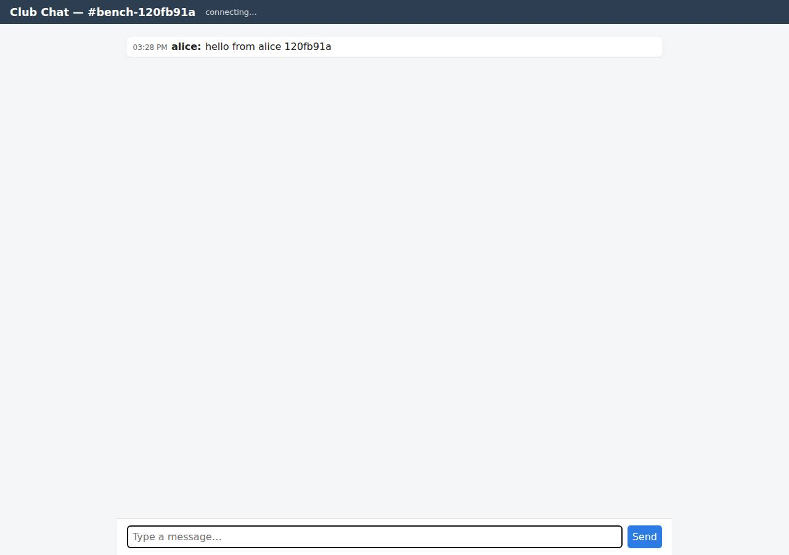

# ✅ Real-Time Collaborative App on DigitalOcean with Opus 5.5 (trial 1)

**success**: 13/13 checks passed (100%).

- URL: https://adb-wf7uo-realtime-5cs45.ondigitalocean.app (from deployment.json)
- Estimated hosting: Light use: $5.00/month, Busy: $5.00/month (the agent estimated $5.00)
- Agent: Claude Code 2.1.296, model `claude-opus-5-5`, effort medium, HIPAA organization
- Resource prefix: `adb-wf7uo-realtime`

| | Build | Deploy | Total |
|---|---|---|---|
| Status | completed | completed | |
| Time | 1m 58s | 1m 44s | 3m 42s |
| Turns | 12 | 7 | |
| Tokens | 423.8K | 335.0K | 758.8K |
| Agent cost | $0.42 | $0.18 | $0.60 |
| Shell commands | 8 | 6 | |

App answered 0s after the agent finished deploying.

## Screenshots

**The room the verifier's clients chatted in, with its history** (https://adb-wf7uo-realtime-5cs45.ondigitalocean.app/?room=bench-120fb91a)

## What was built

- Runtime: Node.js 22
- Frameworks: Node.js http module (built in)
- Libraries: ws
- Packaging: Docker (node:22-alpine), App spec (.do/app.yaml)
- Hosting: App Platform service (apps-s-1vcpu-0.5gb), DigitalOcean Container Registry (starter)
- Code: 486 lines in 10 files (JavaScript 345, HTML 130, JSON 29, Markdown 16, YAML 16, Docker 11)
- Dependencies: 1 npm, 0 Python
- Deploy config: `Dockerfile`, `.dockerignore`, `.do/app.yaml`

## Human steps

3 step(s), about 7 min of a person's time.

- **Sign up for an account and verify the email address** (~3 min): prerequisite: account setup
- **Add a payment method to the account** (~2 min): prerequisite: account setup
- **Create an API token and hand it to the agent** (~2 min): prerequisite: account setup

## Security and compliance review

**88/100**, from an independent Claude Code review (`claude-opus-5-5`, high effort, HIPAA organization, $0.34) of the process, the code, the hosting plan and the live app.

A small, carefully built Node/ws chat app on a paid DigitalOcean App Platform Basic instance. The app needs no secrets, the container runs as non-root, nothing beyond the app is exposed, HTTPS is enforced, and the hosting fits personal use. The main weaknesses are provenance (an unpinned base image, a mutable v1 image tag, and builds pushed from the agent's local workspace), plus minor app-level gaps: no security headers, no rate limiting, unbounded in-memory room creation, and no Origin check on WebSocket upgrades.

| Criterion | Weight | Score | Rationale |
|---|---|---|---|
| Secrets handling | 25 | 10/10 | The app needs no secrets and none were created. The DigitalOcean token was only referenced as $DIGITALOCEAN_ACCESS_TOKEN in deploy commands and never printed, and no credentials appear in the source, the image or the app spec. |
| Deployment provenance | 20 | 6/10 | The image was built from the local workspace and pushed to the owner's private DOCR, so production runs the code that was built. But the base image is an unpinned tag (node:22-alpine), the app spec deploys a mutable tag (v1) instead of a digest, there's no source repository or CI, and doctl was downloaded with no checksum check. |
| Terms compliance | 15 | 10/10 | The app is for personal use. It runs on a paid App Platform Basic instance ($5/month), which doesn't sleep or expire, and uses the free DOCR Starter tier for its single ~61 MB repository, which is within that tier's limits. As far as I know, DigitalOcean's terms allow this use. |
| Least privilege | 15 | 10/10 | The container runs as the non-root node user. The registry is private, there's no data store, and the only public resource is the single App Platform service. |
| Transport security | 10 | 8/10 | The app is served over HTTPS with a valid Google Trust Services certificate (valid to Dec 22, 2026), and HTTP returns a 301 redirect to HTTPS. The app sets no HSTS, X-Content-Type-Options, frame-protection or CSP headers, though it could easily have done so. |
| Attack surface | 10 | 10/10 | Probes for .env, .git, source files, the Dockerfile and admin paths all return a generic JSON 404. Errors return no stack traces, and the only extra endpoint is a harmless /health. |
| Application security | 5 | 7/10 | Input validation is solid: room-name regex, message and name length limits, a body-size cap, a WebSocket maxPayload and safe JSON errors. The UI renders with textContent, so there's no XSS. However, the app has no rate limiting, any request can create a new in-memory room without limit, and WebSocket upgrades don't check the Origin header. |

Findings:

- **medium** · deployment · Base image and deployed image not pinned by digest: app/Dockerfile:1 `FROM node:22-alpine`; app/.do/app.yaml uses `tag: v1` (process/resources.json image.tag "v1"), a mutable tag that can be overwritten in DOCR Fix: Pin the base image as node:22-alpine@sha256:<digest> and deploy the pushed image by digest (image.digest in the app spec), or use unique immutable tags.
- **medium** · app · Unbounded room creation and no rate limiting: server.js:19-26 getRoom() inserts a new room into the global Map for any valid name, and it is called even on GET /api/rooms/<room>/messages (server.js:131) and for SSE connections; rooms are never removed, and there is no per-client limit on POSTs, WebSocket messages or connections Fix: Create rooms only when messages are posted, evict empty rooms, cap the room count, and add per-IP rate limits on posts, WebSocket messages and connections.
- **low** · deployment · Built from local workspace with no source-controlled pipeline: process/deploy.md: `docker build ... -t registry.digitalocean.com/adb-wf7uo-realtime/adb-wf7uo-realtime-web:v1 . && docker push` run from the agent's machine; no git repository or CI involved Fix: Build and deploy from a repository the owner controls (App Platform GitHub source, or a CI pipeline that pushes digest-tagged images).
- **low** · deployment · Deploy tool downloaded without integrity verification: process/deploy.md: `curl -sL https://github.com/digitalocean/doctl/releases/download/v1.146.0/doctl-1.146.0-linux-amd64.tar.gz | tar xz && sudo mv doctl /usr/local/bin/`, with no checksum check Fix: Verify the release checksum file, or install doctl from a signed package source.
- **low** · app · No security headers: GET https://adb-wf7uo-realtime-5cs45.ondigitalocean.app/?room=general returns only content-type, cache-control and the platform/Cloudflare headers: no Strict-Transport-Security, X-Content-Type-Options, X-Frame-Options/frame-ancestors or Content-Security-Policy (server.js:112) Fix: Set HSTS, X-Content-Type-Options: nosniff, a CSP with frame-ancestors 'none', and Referrer-Policy in sendJson and the index handler.
- **low** · app · WebSocket upgrade does not check Origin: server.js:184-199 accepts upgrades without inspecting the Origin header; an upgrade request with `Origin: https://evil.example` to /ws?room=review&user=rev returned 101 Fix: Reject upgrades whose Origin is not the app's own host, so third-party pages can't open sockets for visitors.
- **info** · deployment · Dependencies installed from lockfile: app/Dockerfile:4-5 `COPY package*.json ./` and `RUN npm ci --omit=dev`; the only runtime dependency is ws ^8.22.0 (app/package.json) Fix: No action needed; keep committing package-lock.json.
- **info** · app · Output encoding prevents XSS: app/public/index.html:74-75 builds messages with createElement/textContent; a POST with user `` and blank text was rejected 400 by validText (server.js:39-41) Fix: No action needed.
- **info** · deployment · Container runs as non-root: app/Dockerfile:10 `USER node` Fix: No action needed.
- **info** · app · No sensitive files or debug endpoints exposed: GET /.env, /.git/config, /package.json, /server.js, /Dockerfile and /admin all returned 404 {"error":"not found"}; server.js:170 is a catch-all 404, and server.js:177 returns a generic 500 Fix: No action needed.
- **info** · deployment · No secrets required or leaked: process/deploy.md uses the token only as `$DIGITALOCEAN_ACCESS_TOKEN` in curl headers; app/.do/app.yaml has no envs; .dockerignore excludes .git and .env is gitignored Fix: No action needed; add .env to .dockerignore as well, as defense in depth.

## Checks

| Check | Required | Result | Detail |
|---|---|---|---|
| GET / answers 2xx within 1 min | yes | passed |  |
| The app is served over HTTPS with a valid certificate | yes | passed |  |
| The app is public: no redirect to another host such as a login page | yes | passed |  |
| GET / serves the chat UI as HTML | yes | passed |  |
| deployment.json declares a supported transport (websocket or sse) | no | passed |  |
| Clients connect over websocket | yes | passed |  |
| A message reaches another client in the same room within 5 s | yes | passed |  |
| The sender receives its own message too | no | passed |  |
| Messages never reach clients in other rooms | yes | passed |  |
| Five users posting at the same time all see every message within 10 s | yes | passed |  |
| GET /api/rooms/<room>/messages returns recent messages | yes | passed |  |
| Messages over 1000 characters are rejected | no | passed |  |
| The chat UI loads in a browser without errors | no | passed |  |

## Cloud resources

| Traffic | $/month | How it was priced |
|---|---|---|
| Light use | $5.00 | fixed monthly prices; 0.0373 GiB out of a 50 GiB allowance |
| Busy | $5.00 | fixed monthly prices; 49 GiB out of a 50 GiB allowance |

Each resource's list price, at the size it was provisioned and always on:

| Kind | Name | Plan | $/month | How it was priced |
|---|---|---|---|---|
| app | adb-wf7uo-realtime | adb-wf7uo-realtime-web: apps-s-1vcpu-0.5gb x 1 | $5.00 | adb-wf7uo-realtime-web: apps-s-1vcpu-0.5gb x 1 |
| registry | adb-wf7uo-realtime | starter | $0.00 | Container Registry starter tier (one per account) |

Teardown: 2 deleted

## Agent's deploy summary

> The chat app is live at **https://adb-wf7uo-realtime-5cs45.ondigitalocean.app** over HTTPS, and every requirement in `TASK.md` worked when I tested it through that URL.
>
> **What I deployed (about $5/month):**
> - **Container registry:** `adb-wf7uo-realtime` on the free starter tier, in nyc3. I built the Docker image locally and pushed it there as `adb-wf7uo-realtime-web:v1`.
> - **App Platform app:** `adb-wf7uo-realtime` (id `d1340407-bcac-4f7c-8ded-82851d8e8b53`). It runs one instance of the smallest paid size, `apps-s-1vcpu-0.5gb`, which costs $5/month. DigitalOcean provides the HTTPS certificate, and the health check uses `/health`. The app configuration is saved in `.do/app.yaml`.
>
> **What I tested on the public URL:**
> - The web UI returns 200.
> - Posting a message over HTTP returns `201`; empty text and text over 1000 characters both return `400`.
> - The history endpoint returns the room's messages in the expected shape.
> - **WebSocket (`wss://…/ws`):** four clients sent 20 messages at the same time, and every client received all 20 within 60 ms. An invalid message got an `error` reply, and a client in another room received nothing.
> - **Server-Sent Events:** the stream delivered a posted message.
>
> `deployment.json` is written, with `realtime` set to WebSocket at `wss://adb-wf7uo-realtime-5cs45.ondigitalocean.app/ws`. Nothing needed a person, so `human_steps` is empty. I didn't create any credentials, so there's no `.env` file; I added `.env` to `.gitignore` anyway.
>
> **Limitation:** message history is kept in memory. It's wiped on every redeploy or restart, and the app has to stay at one instance, because a second instance wouldn't share rooms with the first.

## Shell commands during deploy

- `10s` `git diff --no-index /dev/null server.js | head -0; grep -n "MAX_ROOM\|module.exports" server.js; which doctl; curl -s -H "Authorization: Bearer $DIGITALOCEAN_ACCESS_TOKEN" https://api.digitalocean.com`
- `14s` `cd /tmp && curl -sL https://github.com/digitalocean/doctl/releases/download/v1.146.0/doctl-1.146.0-linux-amd64.tar.gz | tar xz && sudo mv doctl /usr/local/bin/ && doctl version && doctl registry optio`
- `18s` `doctl registry create adb-wf7uo-realtime --subscription-tier starter --region nyc3 && doctl registry login --expiry-seconds 3600 >/dev/null && docker build -q --platform linux/amd64 -t registry.digita`
- `40s` `mkdir -p .do && cat > .do/app.yaml <<'EOF'`
- `1m 23s` `U=https://adb-wf7uo-realtime-5cs45.ondigitalocean.app`
- `1m 37s` `echo ".env" >> .gitignore && doctl registry get -o json | python3 -c "import sys,json;print(json.load(sys.stdin))" 2>/dev/null | head -c 300; echo; cat > deployment.json <<'EOF'`
