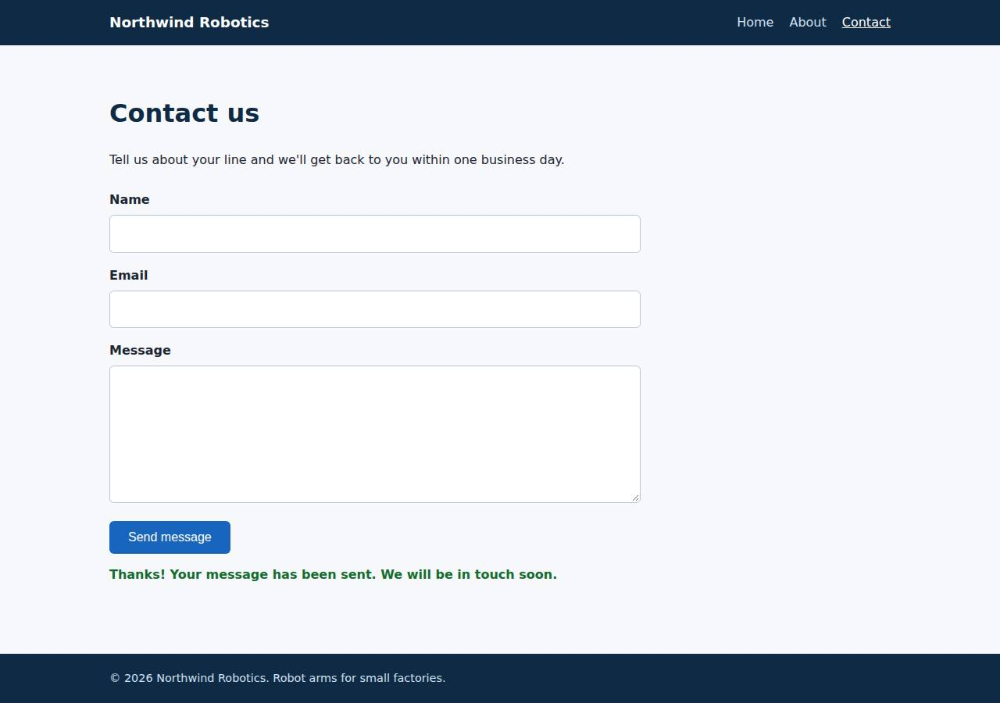

# ✅ Static Content Site on DigitalOcean with Opus 5.5 (trial 1)

**success**: 16/16 checks passed (100%).

- URL: https://adb-6gtad-static-7z8zf.ondigitalocean.app (from deployment.json)
- Estimated hosting: Light use: $5.00/month, Busy: $5.00/month (the agent estimated $5.00)
- Agent: Claude Code 2.1.296, model `claude-opus-5-5`, effort medium, HIPAA organization
- Resource prefix: `adb-6gtad-static`

| | Build | Deploy | Total |
|---|---|---|---|
| Status | completed | completed | |
| Time | 1m 28s | 2m 08s | 3m 36s |
| Turns | 8 | 9 | |
| Tokens | 296.0K | 392.5K | 688.5K |
| Agent cost | $0.43 | $0.18 | $0.61 |
| Shell commands | 7 | 8 | |

App answered 0s after the agent finished deploying.

## Screenshots

**The home page** (https://adb-6gtad-static-7z8zf.ondigitalocean.app/)

**The contact page after the verifier submitted the form** (https://adb-6gtad-static-7z8zf.ondigitalocean.app/contact)

## What was built

- Runtime: Node.js 22
- Frameworks: Node.js http module (built in)
- Packaging: Docker (node:22-alpine), App spec (app.yaml)
- Hosting: App Platform service (apps-s-1vcpu-0.5gb), DigitalOcean Container Registry (starter)
- Code: 402 lines in 15 files (JavaScript 198, HTML 160, CSS 35, JSON 24, YAML 16, Markdown 10, Docker 9)
- Dependencies: 0 npm, 0 Python
- Deploy config: `Dockerfile`, `.dockerignore`, `app.yaml`

## Human steps

3 step(s), about 7 min of a person's time.

- **Sign up for an account and verify the email address** (~3 min): prerequisite: account setup
- **Add a payment method to the account** (~2 min): prerequisite: account setup
- **Create an API token and hand it to the agent** (~2 min): prerequisite: account setup

## Security and compliance review

**90/100**, from an independent Claude Code review (`claude-opus-5-5`, high effort, HIPAA organization, $0.24) of the process, the code, the hosting plan and the live app.

The Northwind Robotics site is a zero-dependency Node.js server, built into a non-root container and run on a paid, always-on DigitalOcean App Platform Basic plan, which fits commercial use. It has no secrets, serves HTTPS only, and exposes nothing beyond the allowlisted routes. The weaknesses are minor: unpinned build inputs (floating base image tag, the mutable `v1` image tag, a doctl download with no checksum check), no security headers, and no rate limiting on the contact endpoint.

| Criterion | Weight | Score | Rationale |
|---|---|---|---|
| Secrets handling | 25 | 10/10 | The app needs no secrets and contains none. The DigitalOcean token was only used through the $DIGITALOCEAN_ACCESS_TOKEN environment variable and never printed, and no .env or credential file was created or copied into the image. |
| Deployment provenance | 20 | 7/10 | A zero-dependency image was built from the reviewed source and pushed to a private DOCR registry the owner controls. But the base image is an unpinned floating tag (node:22-alpine), the app spec deploys the mutable tag v1 rather than a digest, and the doctl binary was installed with curl \| tar without checksum verification. |
| Terms compliance | 15 | 10/10 | For commercial use the app runs on a paid, always-on App Platform Basic instance ($5/month) plus the free Starter registry. DigitalOcean's standard terms allow commercial use, and nothing here expires or sleeps. |
| Least privilege | 15 | 10/10 | The container runs as the non-root node user. There is no data store, the registry is private, and the only public surface is the App Platform HTTPS ingress to the one service. |
| Transport security | 10 | 7/10 | HTTPS works with a valid Google Trust Services certificate, and HTTP returns a 301 redirect to HTTPS. However, the app sends none of HSTS, X-Content-Type-Options, frame protection or CSP, and it could easily have set them in server.js. |
| Attack surface | 10 | 10/10 | Only the whitelisted pages, assets, /healthz and /api/contact are served. Probes for .env, .git, server.js, package.json, Dockerfile, app.yaml and path traversal all returned 404 or 400, with no stack traces or directory listings. |
| Application security | 5 | 8/10 | Input is type-checked and validated, the body is capped at 64 KB (413 above that), malformed JSON gets a clean 400, and the client renders server messages with textContent, so there is no XSS. The public POST endpoint has no rate limiting or anti-spam control of its own. |

Findings:

- **low** · deployment · Base image not pinned to a digest: app/Dockerfile:1 `FROM node:22-alpine` Fix: Pin the base image by digest (node:22-alpine@sha256:...) and update it deliberately.
- **low** · deployment · App deploys a mutable image tag: app/app.yaml lines 6-9 and process/resources.json: image tag `v1`, while the push printed digest sha256:1025a225...e804 (process/deploy.md line 43) Fix: Reference the pushed image by digest in the App Platform spec, or use immutable unique tags, so production can't silently change.
- **low** · deployment · doctl installed without checksum verification: process/deploy.md line 19: `curl -sL https://github.com/digitalocean/doctl/releases/download/v1.146.0/doctl-1.146.0-linux-amd64.tar.gz | tar xz && sudo mv doctl /usr/local/bin/` Fix: Verify the release's published SHA-256 checksum before installing it, or use a package source that verifies signatures.
- **low** · app · No security headers: `curl -sI https://adb-6gtad-static-7z8zf.ondigitalocean.app/` returns only content-type, cache-control and platform/Cloudflare headers, with no Strict-Transport-Security, X-Content-Type-Options, X-Frame-Options/frame-ancestors or Content-Security-Policy; server.js:31 and :83 set no such headers Fix: Set HSTS, X-Content-Type-Options: nosniff, a frame-ancestors/X-Frame-Options policy and a restrictive CSP (default-src 'self') on all responses in server.js.
- **low** · app · Contact endpoint has no rate limiting: app/server.js:39-63: handleContact accepts any number of valid POSTs and logs each one (line 61), with no throttling or anti-spam check Fix: Add per-IP rate limiting (in-process or at the edge) and a honeypot field to curb spam and log flooding.
- **info** · deployment · Registry login stored on the build host for 30 days: process/deploy.md line 36: `doctl registry login` printed 'Login valid for 30 days' Fix: Use `doctl registry login --expiry-seconds` with a short lifetime on shared or CI hosts.
- **info** · app · Unknown paths and sensitive files are not served: GET /.env, /.git/config, /server.js, /package.json, /Dockerfile, /app.yaml, /index.html -> 404; /..%2fserver.js -> 400; server.js:7-11 serves only an explicit allowlist from an in-memory cache Fix: None needed.

## Checks

| Check | Required | Result | Detail |
|---|---|---|---|
| GET / answers 2xx within 1 min | yes | passed |  |
| The app is served over HTTPS with a valid certificate | yes | passed |  |
| The app is public: no redirect to another host such as a login page | yes | passed |  |
| GET / returns HTML | yes | passed |  |
| GET /about returns HTML | yes | passed |  |
| GET /contact returns HTML | yes | passed |  |
| Home has an <h1> containing 'Northwind Robotics' | yes | passed |  |
| About has a heading containing 'About' | yes | passed |  |
| Contact has a form with name, email and message fields | yes | passed |  |
| Every page has a <title> and a viewport meta tag | no | passed |  |
| Home links to /about and /contact | no | passed |  |
| POST /api/contact with valid input returns {ok: true} | yes | passed |  |
| POST /api/contact rejects a bad email and an empty message with 400 | yes | passed |  |
| Unknown paths return 404 | yes | passed |  |
| Submitting the /contact form in a browser posts to /api/contact without leaving the page | yes | passed |  |
| Pages load in a browser without uncaught JavaScript errors | no | passed |  |

## Cloud resources

| Traffic | $/month | How it was priced |
|---|---|---|
| Light use | $5.00 | fixed monthly prices; 0.0373 GiB out of a 50 GiB allowance |
| Busy | $5.00 | fixed monthly prices; 49 GiB out of a 50 GiB allowance |

Each resource's list price, at the size it was provisioned and always on:

| Kind | Name | Plan | $/month | How it was priced |
|---|---|---|---|---|
| app | adb-6gtad-static | adb-6gtad-static-web: apps-s-1vcpu-0.5gb x 1 | $5.00 | adb-6gtad-static-web: apps-s-1vcpu-0.5gb x 1 |
| registry | adb-6gtad-static | starter | $0.00 | Container Registry starter tier (one per account) |

Teardown: 2 deleted

## Agent's deploy summary

> The site is live at **https://adb-6gtad-static-7z8zf.ondigitalocean.app**, and every requirement in `TASK.md` passed when I tested it through that URL.
>
> **What I deployed:**
> - **Container registry** `adb-6gtad-static` (free starter tier): the app's Docker image is stored there as `adb-6gtad-static-web:v1`.
> - **App Platform app** `adb-6gtad-static` (ID `dd8c3ea9-fd28-417d-bcc1-1a4c58189fcb`): it runs that image as one small instance (`apps-s-1vcpu-0.5gb`, about $5/month). DigitalOcean provides HTTPS on its default `ondigitalocean.app` address, and the platform checks `/healthz` to confirm the app is up.
> - **Total cost:** about $5/month.
>
> **Tested on the public URL:**
> - `/`, `/about` and `/contact` return 200 as `text/html`, with the required headings, title, viewport tag, navigation and form fields.
> - Unknown paths and `.html` versions of the pages, like `/about.html`, return 404.
> - `POST /api/contact` returns 200 with `{"ok":true}` for valid input. A missing name, a bad email or an empty message each return 400 with an error message.
> - In headless Chrome, submitting the form showed the confirmation message without reloading the page.
>
> Nothing needed a person, so `human_steps` in `deployment.json` is empty. I didn't create any credentials, so there's no `.env`. The app's deployment settings are in `app.yaml`. To redeploy, push a new image tag, update `app.yaml`, then run `doctl apps update <id> --spec app.yaml`.

## Shell commands during deploy

- `5s` `which doctl; docker --version; curl -s -H "Authorization: Bearer $DIGITALOCEAN_ACCESS_TOKEN" https://api.digitalocean.com/v2/registry | head -c 500; echo; curl -s -H "Authorization: Bearer $DIGITALOCE`
- `9s` `cd /tmp && curl -sL https://github.com/digitalocean/doctl/releases/download/v1.146.0/doctl-1.146.0-linux-amd64.tar.gz | tar xz && sudo mv doctl /usr/local/bin/ && doctl version && doctl registry creat`
- `26s` `doctl registry login >/dev/null && docker build -q --platform linux/amd64 -t registry.digitalocean.com/adb-6gtad-static/adb-6gtad-static-web:v1 . && docker push -q registry.digitalocean.com/adb-6gtad-`
- `1m 36s` ❌ `doctl apps list --format ID,Spec.Name,DefaultIngress,ActiveDeployment.Phase,InProgressDeployment.Phase`
- `1m 40s` `doctl apps list -o json | python3 -c 'import sys,json`
- `1m 45s` `U=https://adb-6gtad-static-7z8zf.ondigitalocean.app`
- `1m 52s` `mkdir -p /tmp/pw && cd /tmp/pw && npm i -s playwright-core@1 >/dev/null 2>&1; CH=$(which google-chrome || which chromium); echo $CH; cat > t.js <<'EOF'`
- `2m 01s` `cat > deployment.json <<'EOF'`
