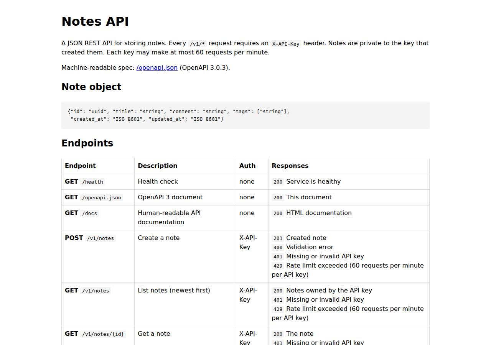

# ✅ API / Backend Service on Render with Opus 5.5 (trial 1)

**success**: 20/20 checks passed (100%).

- URL: https://adb-olgy9-api-web.onrender.com (from deployment.json)
- Estimated hosting: Light use: $0.00/month, Busy: $7.13/month (the agent estimated $0.00)
- Agent: Claude Code 2.1.296, model `claude-opus-5-5`, effort medium, HIPAA organization
- Resource prefix: `adb-olgy9-api`

| | Build | Deploy | Total |
|---|---|---|---|
| Status | completed | completed | |
| Time | 2m 28s | 5m 47s | 8m 15s |
| Turns | 13 | 17 | |
| Tokens | 542.4K | 1.00M | 1.55M |
| Agent cost | $0.52 | $0.53 | $1.05 |
| Shell commands | 12 | 15 | |

App answered 0s after the agent finished deploying.

## Screenshots

**The API documentation at /docs** (https://adb-olgy9-api-web.onrender.com/docs)

## What was built

- Runtime: Node.js 24
- Frameworks: Express
- Data: PostgreSQL (Render Postgres, free)
- Libraries: node-postgres
- Packaging: Render Blueprint (render.yaml)
- Hosting: Render web service (free, running the prebuilt image node:24-alpine)
- Code: 489 lines in 12 files (JavaScript 489, JSON 34, Markdown 23, YAML 22)
- Dependencies: 2 npm, 0 Python
- Deploy config: `render.yaml`

## Human steps

2 step(s), about 5 min of a person's time.

- **Sign up for an account and verify the email address** (~3 min): prerequisite: account setup
- **Create an API token and hand it to the agent** (~2 min): prerequisite: account setup

Reported but not needed, since the deployment worked without them: Add a payment method at https://dashboard.render.com/billing, then upgrade adb-olgy9-api-db to basic-256mb (~$6/mo) and ; Optionally connect a GitHub/GitLab account to Render in the dashboard and push this repo, then switch the service to a G

## Security and compliance review

**66/100**, from an independent Claude Code review (`claude-opus-5-5`, high effort, HIPAA organization, $0.37) of the process, the code, the hosting plan and the live app.

The Notes API code is solid: queries are parameterized, ownership is enforced on every query, keys are stored only as hashes, errors are clean and HTTPS is enforced, and no secrets leaked. The deployment is weaker. Production runs a locally built bundle uploaded as a Render secret file, with no source-control provenance and an unpinned node:24-alpine image running as root. The free Postgres is likely reachable from any IP and expires on 2026-11-13, which conflicts with the requirement that notes persist.

| Criterion | Weight | Score | Rationale |
|---|---|---|---|
| Secrets handling | 25 | 9/10 | No credentials appear in source, transcripts or the deployed bundle. API_KEYS and DATABASE_URL are set as Render service env vars, and the agent filtered postgres:// URLs out of the logs it read. One small extra: the agent also fetched the external DB connection string and saved it to a local .env file, which the app never needed. |
| Deployment provenance | 20 | 4/10 | Production runs a minified esbuild bundle that was built on the agent's machine, gzipped, base64-encoded and uploaded as a Render secret file. It isn't tied to any repo or commit the owner controls. The base image is the floating tag node:24-alpine with no digest, and esbuild was pulled with `npx -y esbuild@0.25`, which floats within 0.25.x. |
| Terms compliance | 15 | 5/10 | Render's free tier allows a personal hobby project, and spin-down while idle is acceptable for a few friends' scripts. But the free Postgres expires on 2026-11-13 and is then deleted, while the spec requires notes to survive restarts and redeploys. The agent recorded the upgrade as a human step but marked it non-blocking. |
| Least privilege | 15 | 5/10 | The container runs as root, which is the default for node:24-alpine (no non-root user or dockerCommand change). The Postgres was created through the API without an ipAllowList, so its external endpoint is most likely reachable from any IP (Render's default). The app connects as the database owner role. |
| Transport security | 10 | 8/10 | HTTP returns a 301 redirect to HTTPS, and the certificate is valid (Google Trust Services, expires Dec 2026). No HSTS, X-Content-Type-Options, frame-protection or CSP headers are sent. Render web services don't add them, but the app could have. |
| Attack surface | 10 | 9/10 | Only the spec'd endpoints respond. Probes for .env, .git, package.json and the bundle paths return a clean JSON 404, TRACE is blocked at the edge, and errors return no stack traces. The broader issue is the publicly reachable database endpoint, which is scored under least_privilege. |
| Application security | 5 | 8/10 | All SQL is parameterized, input types are validated, ownership is enforced in every query, keys are stored only as hashes, the docs HTML is escaped and the body limit is 1mb. Minor gaps: requests with unknown keys aren't rate-limited, there are no limits on field length or note count, and the rate limiter lives in process memory and resets on restart. |

Findings:

- **medium** · deployment · Free Postgres expires in 30 days; notes will be deleted: process/resources.json: postgres plan "free", expires_at "2026-11-13T15:01:29Z"; deploy.md POST /v1/postgres with plan basic_256mb returned 'Payment information is required', so the agent fell back to plan "free"; deployment.json human_steps marks the upgrade "blocking": false Fix: Upgrade the database to a paid plan (e.g. basic-256mb) before expiry, or treat it as a blocking step. Until then, set up regular pg_dump backups.
- **medium** · deployment · App code delivered as an opaque bundle in a secret file, not from source control: deploy.md line ~75: `npx -y esbuild@0.25 src/server.js --bundle ... | gzip | base64 > app.js.gz.b64`; line ~142: secretFiles [{name:"app.js.gz.b64"}], dockerCommand decodes it to /tmp/server.js; line ~215: start.sh launcher also uploaded as a secret file Fix: Push the code to a Git repo the owner controls and deploy it as a Git-backed service (render.yaml already exists), or build a Docker image in CI and push it to a registry referenced by digest, so production can be traced to a commit.
- **medium** · deployment · Postgres external endpoint likely open to all IPs: deploy.md POST https://api.render.com/v1/postgres body has no ipAllowList (Render defaults to 0.0.0.0/0); connection-info returned an externalConnectionString, which the agent saved to .env (deploy.md line ~168); the app only needs the internal URL Fix: Set ipAllowList to [] (or to specific admin IPs) so the database is reachable only over Render's private network.
- **low** · deployment · Base image and build tool versions not pinned: process/resources.json source "docker.io/library/node:24-alpine" (tag, no digest); deploy.md `npx -y esbuild@0.25` (floats within 0.25.x) Fix: Reference the image as node:24-alpine@sha256:<digest> and pin esbuild to an exact version in devDependencies with a lockfile.
- **low** · deployment · Container runs as root: Image node:24-alpine defaults to root; dockerCommand `sh /etc/secrets/start.sh` (deploy.md line ~215) writes /tmp/server.js and runs node without dropping privileges Fix: Run as the image's built-in `node` user (a Dockerfile with USER node, or `su-exec node node /tmp/server.js`).
- **low** · app · No security response headers: curl -D- https://adb-olgy9-api-web.onrender.com/docs: no Strict-Transport-Security, X-Content-Type-Options, X-Frame-Options or Content-Security-Policy headers Fix: Add helmet (or set the headers manually) in app.js, at least HSTS and nosniff. Add a CSP on /docs.
- **low** · app · Unknown-key requests and payload sizes not limited: app/src/app.js lines 76-79: 401 is returned before rateLimiter.check, so invalid-key attempts are never throttled; validateNote (lines 34-61) has no maximum length for title/content/tags and there is no cap on notes per key; GET with X-API-Key: bogus -> 401 {"error":"Invalid API key"} Fix: Rate-limit by client IP for failed auth, cap field lengths and tag count, and limit notes per key.
- **info** · platform · Free web service spins down when idle: process/resources.json plan "free"; deployment.json notes: 'spins down after 15 min idle ... ~30-60s' cold start Fix: Acceptable for a personal project. Upgrade to Starter if callers need consistent latency.
- **info** · deployment · External DB credentials saved locally without need: deploy.md line ~168 writes RENDER_DATABASE_EXTERNAL_URL into .env (chmod 600, git-ignored) Fix: Fetch only the internal connection string the service needs, and remove local copies after deploy.

## Checks

| Check | Required | Result | Detail |
|---|---|---|---|
| GET /health answers 2xx within 1 min | yes | passed |  |
| The app is served over HTTPS with a valid certificate | yes | passed |  |
| The app is public: no redirect to another host such as a login page | yes | passed |  |
| GET /health returns {status: ok} | yes | passed |  |
| GET /openapi.json is an OpenAPI 3 document covering /v1/notes | yes | passed |  |
| GET /docs serves human-readable documentation | no | passed |  |
| Requests without an API key get 401 | yes | passed |  |
| Requests with an unknown API key get 401 | yes | passed |  |
| POST /v1/notes creates a note | yes | passed |  |
| Invalid notes are rejected with 400 | yes | passed |  |
| GET /v1/notes/{id} returns the note | yes | passed |  |
| GET /v1/notes lists notes and filters by tag | yes | passed |  |
| Notes are listed newest first | no | passed |  |
| PATCH /v1/notes/{id} updates only the given fields | yes | passed |  |
| Notes are private to the API key that created them | yes | passed |  |
| DELETE /v1/notes/{id} removes the note | yes | passed |  |
| Notes are still there a minute later | yes | passed |  |
| Exceeding 60 requests/minute returns 429 | yes | passed |  |
| 429 responses include a Retry-After header | no | passed |  |
| One key hitting its limit doesn't throttle other keys | yes | passed |  |

## Cloud resources

| Traffic | $/month | How it was priced |
|---|---|---|
| Light use | $0.00 | fixed monthly prices; 0.04 GB out of the Hobby workspace's 5 GB; free instances awake 10 h of 750 free hours |
| Busy | $7.13 | fixed monthly prices; 52.6 GB out of the Hobby workspace's 5 GB, 47.6 GB billed (with a payment method on file; without one Render suspends the services instead); free instances awake 730 h of 750 free hours |

Each resource's list price, at the size it was provisioned and always on:

| Kind | Name | Plan | $/month | How it was priced |
|---|---|---|---|---|
| service | adb-olgy9-api-web | free | $0.00 | free x 1 instance(s) |
| postgres | adb-olgy9-api-db | free | $0.00 | Postgres free |

Teardown: 2 deleted

## Agent's deploy summary

> The Notes API is live at **https://adb-olgy9-api-web.onrender.com**, and every requirement in `TASK.md` passed when I tested it through that URL.
>
> **What's running** (both on Render's free plan, $0/month):
> - **Web service `adb-olgy9-api-web`** (`srv-db7pitd9fdbs73f2vj2g`). `API_KEYS` contains exactly the keys in `BENCH_API_KEYS`.
> - **Postgres 16 database `adb-olgy9-api-db`** (`dpg-db7piiaj9qps73d9noe0-a`). The web service connects to it over Render's internal network. Both connection strings are saved in `.env`, which is git-ignored.
>
> **How the code gets there:** Render only builds from a connected Git repo or a container image, and no Git credentials were available. So the service runs the official public `node:24-alpine` image, and the app is packed into a single JavaScript file stored as a Render secret file, unpacked by a small start script when the service starts. To ship new code, you rebuild that file, upload it again, and trigger a deploy.
>
> **Tested through the public URL:**
> - `/health`, `/openapi.json` and `/docs` respond without a key.
> - A missing or unknown key gets `401`.
> - Create, list (newest first, with the `tag` filter), get, update and delete all work, and bad input gets `400`.
> - Another key gets `404` on someone else's notes.
> - The 61st request in a minute gets `429` with `Retry-After`, while a second key is unaffected.
> - A note was still there after a redeploy.
>
> I deleted the test notes afterwards. The first key will be rate-limited for a minute or so after my test, which should have cleared by now.
>
> **Limitations:**
> - **The database expires on 2026-11-13.** Render deletes free Postgres databases 30 days after creation. Paid plans were refused because the account has no payment method.
> - **First request after idle is slow.** The free web service sleeps after 15 idle minutes, and the first request after that can take about 30–60 seconds.
> - **Rate-limit counts reset when the service restarts or sleeps.** They're kept in the server's memory, which is fine for this single instance.
>
> Two optional steps for a person are listed in `deployment.json` under `human_steps`, neither of them blocking:
> - Add a card and move the database to `basic-256mb` (about $6/month), and optionally the web service to `starter` ($7/month) so it stops sleeping.
> - Connect a GitHub or GitLab account so Render can deploy from the repo with the existing `render.yaml`.
>
> Sources:
> - [Deploying on Render – Render Docs](https://render.com/docs/deploys)
> - [Deploy without GitHub/GitLab – Render feature request](https://feedback.render.com/features/p/deploy-without-githubgitlab)

## Shell commands during deploy

- `11s` `env | grep -oE '^(RENDER|BENCH|GH|GITHUB)[A-Z_]*' ; which render gh; gh auth status 2>&1 | head -5; curl -s -H "Authorization: Bearer $RENDER_API_KEY" https://api.render.com/v1/owners | head -c 600; e`
- `45s` `mkdir -p /tmp/bundle && npx -y esbuild@0.25 src/server.js --bundle --platform=node --target=node20 --minify --external:pg-native --outfile=/tmp/bundle/server.js 2>&1 | tail -3 && gzip -9c /tmp/bundle/`
- `58s` `OWNER=tea-db6fig0473hc73eb9aeg; curl -s -XPOST https://api.render.com/v1/postgres -H "Authorization: Bearer $RENDER_API_KEY" -H 'Content-Type: application/json' -d "{\"name\":\"adb-olgy9-api-db\",\"ow`
- `1m 02s` `OWNER=tea-db6fig0473hc73eb9aeg; curl -s -XPOST https://api.render.com/v1/postgres -H "Authorization: Bearer $RENDER_API_KEY" -H 'Content-Type: application/json' -d "{\"name\":\"adb-olgy9-api-db\",\"ow`
- `1m 08s` `for i in $(seq 1 40); do s=$(curl -s -H "Authorization: Bearer $RENDER_API_KEY" https://api.render.com/v1/postgres/dpg-db7piiaj9qps73d9noe0-a | node -pe 'JSON.parse(require("fs").readFileSync(0)).stat`
- `1m 46s` `node -e '`
- `1m 52s` `for i in $(seq 1 40); do s=$(curl -s -H "Authorization: Bearer $RENDER_API_KEY" https://api.render.com/v1/services/srv-db7pitd9fdbs73f2vj2g/deploys/dep-db7pitl9fdbs73f2vjog | node -pe 'JSON.parse(requ`
- `3m 56s` `{ echo "RENDER_DATABASE_INTERNAL_URL=$(cat /tmp/dburl)"; curl -s -H "Authorization: Bearer $RENDER_API_KEY" https://api.render.com/v1/postgres/dpg-db7piiaj9qps73d9noe0-a/connection-info | node -pe '"R`
- `4m 00s` `until grep -qE 'live|fail|cancel|deactiv' /tmp/claude-1001/-home-runner-work--temp-adb-olgy9-api/066b1ace-7e3c-4eda-a18b-40b119632200/tasks/boazfq5ez.output 2>/dev/null; do sleep 5; done; cat /tmp/cla`
- `4m 03s` `curl -s -H "Authorization: Bearer $RENDER_API_KEY" "https://api.render.com/v1/logs?ownerId=tea-db6fig0473hc73eb9aeg&resource=srv-db7pitd9fdbs73f2vj2g&limit=40&direction=backward" | node -e 'const j=JS`
- `4m 10s` `S=srv-db7pitd9fdbs73f2vj2g; H="Authorization: Bearer $RENDER_API_KEY"`
- `4m 15s` `for i in $(seq 1 55); do s=$(curl -s -H "Authorization: Bearer $RENDER_API_KEY" https://api.render.com/v1/services/srv-db7pitd9fdbs73f2vj2g/deploys/dep-db7pk1a5b2lc738q4d1g | node -pe 'JSON.parse(requ`
- `4m 51s` `mkdir -p /tmp/smoke && cat > /tmp/smoke/smoke.mjs <<'EOF'`
- `5m 04s` `H="Authorization: Bearer $RENDER_API_KEY"; S=srv-db7pitd9fdbs73f2vj2g`
- `5m 37s` `A=$(echo "$BENCH_API_KEYS" | cut -d, -f1); B=https://adb-olgy9-api-web.onrender.com`
