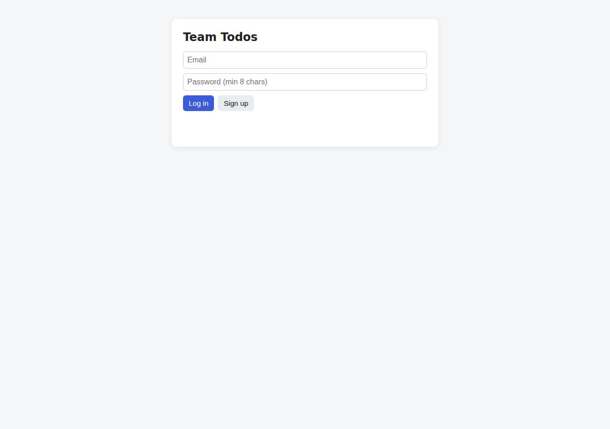
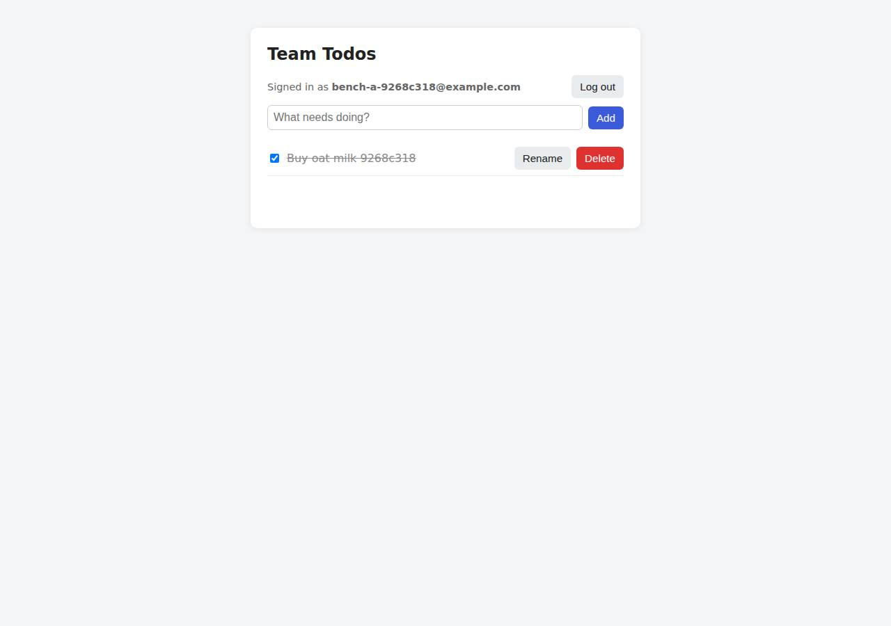

# ✅ Database-Backed CRUD App on Render with Opus 5.5 (trial 1)

**success**: 19/19 checks passed (100%).

- URL: https://adb-gsxkv-crud-web.onrender.com (from deployment.json)
- Estimated hosting: Light use: $0.00/month, Busy: $7.13/month (the agent estimated $0.00)
- Agent: Claude Code 2.1.296, model `claude-opus-5-5`, effort medium, HIPAA organization
- Resource prefix: `adb-gsxkv-crud`

| | Build | Deploy | Total |
|---|---|---|---|
| Status | completed | completed | |
| Time | 2m 00s | 4m 14s | 6m 14s |
| Turns | 10 | 16 | |
| Tokens | 397.1K | 855.9K | 1.25M |
| Agent cost | $0.42 | $0.46 | $0.88 |
| Shell commands | 9 | 15 | |

App answered 0s after the agent finished deploying.

## Screenshots

**The web app before signing in** (https://adb-gsxkv-crud-web.onrender.com/)

**The todo list after signing in through the web UI as the test user** (https://adb-gsxkv-crud-web.onrender.com/)

## What was built

- Runtime: Node.js 22
- Frameworks: Express
- Data: PostgreSQL (Render Postgres, free)
- Libraries: node-postgres, bcrypt.js, cookie-parser
- Dev tools: esbuild
- Packaging: Render Blueprint (render.yaml)
- Hosting: Render web service (free, running the prebuilt image node:22-alpine)
- Code: 416 lines in 11 files (JavaScript 280, HTML 136, JSON 37, Markdown 20, YAML 20)
- Dependencies: 5 npm, 0 Python
- Deploy config: `render.yaml`

## Human steps

2 step(s), about 5 min of a person's time.

- **Sign up for an account and verify the email address** (~3 min): prerequisite: account setup
- **Create an API token and hand it to the agent** (~2 min): prerequisite: account setup

## Security and compliance review

**62/100**, from an independent Claude Code review (`claude-opus-5-5`, high effort, HIPAA organization, $0.37) of the process, the code, the hosting plan and the live app.

The app code is solid: queries are parameterized, passwords use bcrypt, session tokens are stored hashed, ownership is checked on every query, and the live site exposes no files or stack traces. Secrets also stayed out of logs and source. The weak spots are the deployment and hosting. The code runs as an opaque, locally built bundle uploaded as Render 'secret files' on an unpinned public node image as root, and the free Postgres is open to external access. A commercial app is hosted on Render's free plans, whose database expires on 2026-11-13 and whose web service sleeps when idle.

| Criterion | Weight | Score | Rationale |
|---|---|---|---|
| Secrets handling | 25 | 9/10 | The Render API key was only referenced as $RENDER_API_KEY and the DB connection string was moved between files by Python without being printed. DATABASE_URL is set as a Render service env var (the platform's secret store) and nothing secret is in the source. Minor: the external DB URL was also written to a local .env (git-ignored, chmod 600). |
| Deployment provenance | 20 | 4/10 | Production runs a minified esbuild bundle built on the agent's machine and uploaded as Render 'secret files' on top of a public node:22-alpine image. It is not tied to any repo or commit, can't be inspected in the dashboard, and the base image is pinned by tag only, not digest. The lockfile does pin the dependencies that went into the bundle. |
| Terms compliance | 15 | 3/10 | This is a business (commercial) app on Render's free web and Postgres plans. Render presents these for hobby and testing use: the web service sleeps when idle, and the free database expires on 2026-11-13, 30 days after creation. A business's persistent todo store therefore can't rely on it. As far as I know, Render's terms don't outright ban commercial use of the free tier, but its expiry and sleep limits rule it out for this use. |
| Least privilege | 15 | 5/10 | The app uses the internal DB connection string, but the free Postgres was created via the API with the default external access left open to any IP (no ipAllowList restriction). The container runs node:22-alpine with its default root user, and the app connects as the database owner role. |
| Transport security | 10 | 7/10 | The app is served over HTTPS with a valid Render/Cloudflare certificate, and HTTP gets a 301 redirect to HTTPS. HSTS, CSP, X-Content-Type-Options and frame protection are all missing, though the app could easily set them (e.g. helmet). X-Powered-By: Express is also sent. |
| Attack surface | 10 | 9/10 | Requests for /.env, /.git/config, /package.json, source and bundle paths all return 404, there's no directory listing, and errors return generic JSON without stack traces. The only minor leaks are the X-Powered-By header and Express's default HTML 404 page. |
| Application security | 5 | 7/10 | Every query is parameterized, passwords use bcrypt cost 12, session tokens are random and stored only as SHA-256 hashes, ownership is enforced in the SQL WHERE clause, and the UI renders with textContent. But login and signup have no rate limiting (and bcrypt signup is CPU-heavy), and the UI keeps the bearer token in localStorage. |

Findings:

- **high** · deployment · Commercial app on Render free plans with expiring database: process/context.json use=commercial; process/resources.json postgres plan=free, expires_at=2026-11-13T14:51:20Z; service plan=free (sleeps when idle, per deployment.json notes) Fix: Move to a paid instance type (e.g. Starter) and a paid Postgres plan (Basic-256mb or higher) with backups, so data persists and the service stays up.
- **medium** · deployment · Code shipped as opaque secret-file bundle, not from a controlled source: process/deploy.md line 159: secretFiles app.js.gz.b64 (gzipped minified bundle from local dist/server.js) and index.html; line 203: boot.js uploaded and dockerCommand 'node /etc/secrets/boot.js'; app/deploy/boot.js writes /tmp/server.js and requires it Fix: Deploy from a git repo the owner controls (render.yaml Blueprint), or build a Docker image in CI pushed to a private registry by digest, so production code can be traced to a commit.
- **medium** · deployment · Free Postgres reachable from the internet: process/deploy.md line 129: POST /v1/postgres without an ipAllowList; line 151: connection-info includes externalConnectionString Fix: Set the database's ipAllowList to empty (internal-only) or restrict it to known admin IPs.
- **medium** · app · No rate limiting on authentication endpoints: Six consecutive POST /api/auth/login with wrong credentials all returned 401 with no throttling; app/src/app.js lines 78-112 have no limiter; signup runs bcrypt cost 12 for every request Fix: Add per-IP/per-account rate limiting (e.g. express-rate-limit) on signup and login.
- **low** · deployment · Base image pinned by tag, not digest: process/deploy.md line 159: imagePath docker.io/library/node:22-alpine Fix: Pin the image by sha256 digest, or use Render's native Node runtime with a pinned version.
- **low** · deployment · Container runs as root: node:22-alpine defaults to root; the dockerCommand 'node /etc/secrets/boot.js' (process/deploy.md line 203) doesn't switch users Fix: Use an image with USER node (custom Dockerfile) or Render's native runtime.
- **low** · app · App uses the DB owner role for runtime queries: app/src/db.js: migrate() runs CREATE TABLE with the same DATABASE_URL credentials used for serving requests Fix: Run migrations separately and use a role limited to DML on the app tables.
- **low** · app · Security headers missing: GET https://adb-gsxkv-crud-web.onrender.com/ response has no strict-transport-security, content-security-policy, x-content-type-options or x-frame-options; includes x-powered-by: Express Fix: Add helmet (HSTS, CSP, nosniff, frame-ancestors) and call app.disable('x-powered-by').
- **low** · app · Bearer token stored in localStorage: app/public/index.html line 55 localStorage.getItem('token'), line 128 localStorage.setItem('token', token) Fix: Rely on the HttpOnly session cookie for the web UI, and add a CSP.
- **low** · app · Framework fingerprinting: x-powered-by: Express header; GET /.env returns Express default '<pre>Cannot GET /.env' HTML page Fix: Disable x-powered-by and add a generic 404 handler.
- **low** · deployment · External DB connection string written to local .env: process/deploy.md line 296: writes DATABASE_URL and EXTERNAL_DATABASE_URL to .env (git-ignored, chmod 600) Fix: Don't persist DB credentials locally; fetch them from Render when needed.
- **info** · platform · HTTPS enforced by platform: curl -I http://adb-gsxkv-crud-web.onrender.com/ -> 301 Location: https://... Fix: None.

## Checks

| Check | Required | Result | Detail |
|---|---|---|---|
| GET / answers 2xx within 1 min | yes | passed |  |
| The app is served over HTTPS with a valid certificate | yes | passed |  |
| The app is public: no redirect to another host such as a login page | yes | passed |  |
| GET / serves the web app as HTML | yes | passed |  |
| POST /api/auth/signup creates an account and returns a token | yes | passed |  |
| Signup rejects an invalid email and a short password with 400 | yes | passed |  |
| Signing up twice with the same email returns 409 | yes | passed |  |
| POST /api/auth/login returns a token | yes | passed |  |
| Login with a wrong password returns 401 | yes | passed |  |
| /api/todos requires a valid token (401) | yes | passed |  |
| POST /api/todos creates a todo | yes | passed |  |
| An empty title is rejected with 400 | yes | passed |  |
| GET /api/todos lists the caller's todos | yes | passed |  |
| Todos are listed oldest first | no | passed |  |
| PATCH /api/todos/{id} renames and completes a todo | yes | passed |  |
| Users can't see or modify each other's todos (404) | yes | passed |  |
| DELETE /api/todos/{id} removes a todo | yes | passed |  |
| Data is still there a minute later, with a fresh login | yes | passed |  |
| The web UI renders a login or signup form | no | passed |  |

## Cloud resources

| Traffic | $/month | How it was priced |
|---|---|---|
| Light use | $0.00 | fixed monthly prices; 0.04 GB out of the Hobby workspace's 5 GB; free instances awake 10 h of 750 free hours |
| Busy | $7.13 | fixed monthly prices; 52.6 GB out of the Hobby workspace's 5 GB, 47.6 GB billed (with a payment method on file; without one Render suspends the services instead); free instances awake 730 h of 750 free hours |

Each resource's list price, at the size it was provisioned and always on:

| Kind | Name | Plan | $/month | How it was priced |
|---|---|---|---|---|
| service | adb-gsxkv-crud-web | free | $0.00 | free x 1 instance(s) |
| postgres | adb-gsxkv-crud-db | free | $0.00 | Postgres free |

Teardown: 2 deleted

## Agent's deploy summary

> The app is live at **https://adb-gsxkv-crud-web.onrender.com**, and every requirement in `TASK.md` passed when I tested it through that URL.
>
> **What I created on Render (both free, $0/month):**
> - `adb-gsxkv-crud-db`: PostgreSQL 16 database, id `dpg-db7pdq2vcj2c73efd6o0-a`.
> - `adb-gsxkv-crud-web`: web service, id `srv-db7pe6mq1p3s73da62b0`. It connects to the database over Render's internal network.
>
> **How the code got there:** there were no GitHub credentials, so Render couldn't pull from a repo. Instead, the service runs the public `node:22-alpine` image. I bundled the app into one compressed file and uploaded it, along with the HTML page and a small startup script, as Render "secret files" through the API. The service starts with `node /etc/secrets/boot.js`. My first attempt used a shell one-liner as the start command and failed, because Render passed the quoted string as a single word; the startup script replaced it.
>
> **What I tested through the public URL:**
> - **Signup and login:** 400 for a bad email or a short password, 409 for a duplicate email, 401 for wrong credentials, and 201/200 with a token on success.
> - **Todos:** create, list oldest first, rename, complete and uncomplete, and delete all return the right status codes. Requests without a token get 401, and an empty title gets 400.
> - **Isolation:** a second user sees an empty list and gets 404 when trying to edit or delete the first user's todo.
> - **Persistence:** after a redeploy, the todos were still there and the same login token still worked.
> - **Web page:** a headless Chromium run through sign up, add, complete, rename, uncomplete, delete and log out worked end to end.
>
> **Free-tier limits:**
> - The web service sleeps when idle, so the first request after a quiet spell takes about 30–60 seconds.
> - **Render deletes free Postgres databases 30 days after creation.** If the data needs to last longer, upgrade it (Basic-256mb is about $6/month).
>
> **Updating the code later:** run `npm run bundle`, upload the secret files again and trigger a deploy. `render.yaml` remains for a git-based deploy if a repo is connected later.
>
> The database connection strings are saved in `.env`, which is git-ignored. No secrets were printed or written to committed files. `deployment.json` is written, with no human steps needed.

## Shell commands during deploy

- `6s` `cd /home/runner/work/_temp/adb-gsxkv-crud; curl -s -H "Authorization: Bearer $RENDER_API_KEY" https://api.render.com/v1/owners | head -c 600; echo; curl -s -H "Authorization: Bearer $RENDER_API_KEY" "`
- `22s` `grep -n "static" src/app.js`
- `28s` `python3 - <<'EOF'`
- `37s` `gzip -9c dist/server.js | base64 -w0 > dist/server.js.gz.b64 && ls -la dist && docker run -d --name pg -e POSTGRES_PASSWORD=pg --network host postgres:16 >/dev/null && sleep 4 && mkdir -p /tmp/secrets`
- `54s` `docker rm -f app pg >/dev/null; cd /home/runner/work/_temp/adb-gsxkv-crud`
- `1m 04s` `for i in $(seq 1 40); do s=$(curl -s -H "Authorization: Bearer $RENDER_API_KEY" https://api.render.com/v1/postgres/dpg-db7pdq2vcj2c73efd6o0-a | python3 -c 'import json,sys;print(json.load(sys.stdin)["`
- `1m 44s` `python3 - <<'EOF' > /tmp/svc_out.json`
- `1m 50s` `for i in $(seq 1 40); do s=$(curl -s -H "Authorization: Bearer $RENDER_API_KEY" https://api.render.com/v1/services/srv-db7pe6mq1p3s73da62b0/deploys/dep-db7pe76q1p3s73da638g | python3 -c 'import json,s`
- `2m 03s` `curl -s -H "Authorization: Bearer $RENDER_API_KEY" "https://api.render.com/v1/logs?ownerId=tea-db6fig0473hc73eb9aeg&resource=srv-db7pe6mq1p3s73da62b0&limit=30&direction=backward" | python3 -c 'import `
- `2m 16s` `mkdir -p deploy && cat > deploy/boot.js <<'EOF'`
- `2m 20s` `for i in $(seq 1 40); do s=$(curl -s -H "Authorization: Bearer $RENDER_API_KEY" https://api.render.com/v1/services/srv-db7pe6mq1p3s73da62b0/deploys/dep-db7peenavr4c7393dvpg | python3 -c 'import json,s`
- `2m 53s` `B=https://adb-gsxkv-crud-web.onrender.com; J='Content-Type: application/json'; E="u$(date +%s)@example.com"`
- `3m 12s` `D=$(curl -s -XPOST -H "Authorization: Bearer $RENDER_API_KEY" -H 'Content-Type: application/json' -d '{}' https://api.render.com/v1/services/srv-db7pe6mq1p3s73da62b0/deploys | python3 -c 'import json,`
- `3m 47s` `mkdir -p /tmp/pw && cd /tmp/pw && npm init -y >/dev/null && npm i playwright >/dev/null 2>&1 && npx playwright install chromium >/dev/null 2>&1; cat > ui.js <<'EOF'`
- `4m 05s` `python3 - <<'EOF'`
