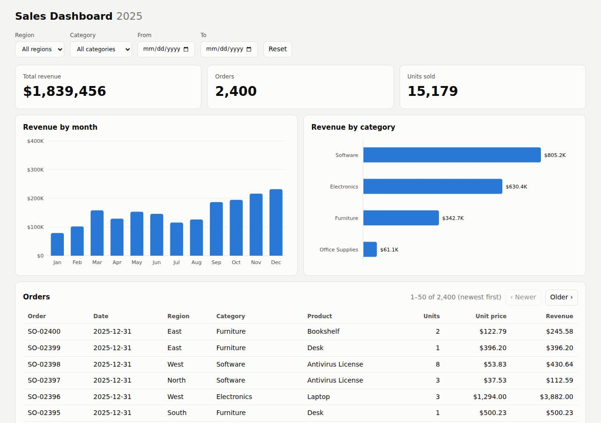

# ✅ Data / Visualization App on Render with Opus 5.5 (trial 1)

**success**: 12/12 checks passed (100%).

- URL: https://adb-nkt5l-dataviz-web.onrender.com (from deployment.json)
- Estimated hosting: Light use: $0.00/month, Busy: $7.13/month (the agent estimated $0.00)
- Agent: Claude Code 2.1.296, model `claude-opus-5-5`, effort medium, HIPAA organization
- Resource prefix: `adb-nkt5l-dataviz`

| | Build | Deploy | Total |
|---|---|---|---|
| Status | completed | completed | |
| Time | 2m 34s | 2m 36s | 5m 10s |
| Turns | 16 | 13 | |
| Tokens | 559.0K | 799.2K | 1.36M |
| Agent cost | $0.57 | $0.43 | $1.00 |
| Shell commands | 11 | 10 | |

App answered 0s after the agent finished deploying.

## Screenshots

**The dashboard** (https://adb-nkt5l-dataviz-web.onrender.com/)

## What was built

- Runtime: Node.js 22
- Frameworks: Node.js http module (built in)
- Packaging: Render Blueprint (render.yaml)
- Hosting: Render web service (free, running the prebuilt image node:22-alpine)
- Code: 515 lines in 13 files (JavaScript 366, CSS 66, HTML 61, JSON 22, Shell 22, Markdown 16, YAML 11)
- Dependencies: 0 npm, 0 Python
- Deploy config: `render.yaml`

## Human steps

2 step(s), about 5 min of a person's time.

- **Sign up for an account and verify the email address** (~3 min): prerequisite: account setup
- **Create an API token and hand it to the agent** (~2 min): prerequisite: account setup

## Security and compliance review

**76/100**, from an independent Claude Code review (`claude-opus-5-5`, high effort, HIPAA organization, $0.34) of the process, the code, the hosting plan and the live app.

The zero-dependency Node dashboard is well built: inputs are validated, the frontend avoids XSS, no secrets are involved or leaked, it's served only over HTTPS, and nothing beyond the app is exposed. The weaker parts are the deployment: a business's app runs on Render's Free plan, which sleeps when idle. The code ships as a base64 tarball in a secret file on an unpinned, root-running node:22-alpine image, with no source-control provenance. Security headers are also missing.

| Criterion | Weight | Score | Rationale |
|---|---|---|---|
| Secrets handling | 25 | 10/10 | The app needs no credentials. The agent only used RENDER_API_KEY from the environment (masked when listed with `sed 's/=.*/=<set>/'`), and no secret appears in the source, the uploaded bundle, the logs or the deployed files. |
| Deployment provenance | 20 | 6/10 | There are no npm dependencies and the uploaded tarball came straight from the built source. But production runs a floating `node:22-alpine` tag with no digest, the code is delivered as a base64 tarball in a Render secret file and unpacked at runtime instead of coming from a repository or a built image, and render.yaml doesn't describe what is actually deployed. |
| Terms compliance | 15 | 5/10 | A business's dashboard runs on Render's Free instance type. As far as I know Render's terms don't forbid commercial use there, but Render positions Free for hobby and testing use: it spins down after about 15 minutes idle (30–60 s cold starts), has a monthly hours cap and no SLA, which doesn't suit a company's working app. |
| Least privilege | 15 | 7/10 | There is a single public web service and no data stores or extra resources. However, the container runs the stock node:22-alpine image with its default root user, because the start command never switches to the image's `node` user. |
| Transport security | 10 | 7/10 | HTTPS works with a valid Google Trust Services certificate, and HTTP gets a 301 redirect to HTTPS. The app sets no HSTS, X-Content-Type-Options, frame-protection or CSP headers, though its own response code could easily add them. |
| Attack surface | 10 | 10/10 | Requests for .env, .git/config, server.js, package.json, the data CSV, the secret-file path and traversal attempts all returned 404 or a Cloudflare 400. The server serves only an allowlist of public assets and its JSON API, with generic JSON errors and no stack traces. |
| Application security | 5 | 8/10 | Filters are validated: dates must be YYYY-MM-DD, repeated parameters are rejected, page size is capped at 500, and only GET/HEAD are allowed. The frontend renders data with textContent, so it is safe from XSS. The public endpoints have no rate limiting, a minor gap for a read-only dataset. |

Findings:

- **medium** · deployment · Commercial dashboard hosted on Render Free plan that sleeps when idle: process/context.json: "use": "commercial"; process/resources.json: "plan": "free"; process/deployment.json notes: "Free instances spin down after ~15 minutes idle, so the first request after that can take 30-60 seconds (cold start)." Fix: Use a paid instance type (e.g. Starter) for a business's app, so it stays up without cold starts or monthly hours limits.
- **medium** · deployment · App code shipped as a base64 tarball in a secret file and unpacked at runtime: process/deploy.md line 87: service created with image docker.io/library/node:22-alpine and secretFiles app.b64 (tar czf of package.json server.js lib public data); app/scripts/render-start.sh: `base64 -d /etc/secrets/app.b64 | tar xz -C /tmp/app; exec node server.js`; autoDeploy "no", no repo connected. Fix: Push the code to a repository the owner controls and deploy from it (render.yaml Blueprint or Dockerfile build), so each deploy maps to a reviewable commit and an immutable artifact.
- **low** · deployment · Base image referenced by floating tag, not digest: process/resources.json: "source": "docker.io/library/node:22-alpine" (no @sha256 digest) Fix: Pin the image by digest (node:22-alpine@sha256:...) and update it deliberately.
- **low** · deployment · render.yaml does not match the live deployment: app/render.yaml declares `runtime: node`, `name: sales-dashboard`, `startCommand: npm start`, while the live service is image runtime `adb-nkt5l-dataviz-web` with dockerCommand `sh /etc/secrets/start.sh` (process/deploy.md line 184). Fix: Keep one source of truth for the infrastructure config and deploy from it.
- **low** · deployment · Container runs as root: Stock node:22-alpine image (default user root) started with dockerCommand `sh /etc/secrets/start.sh` (process/deploy.md line 176), with no user switch. Fix: Build a Dockerfile with `USER node`, or run the process as the image's unprivileged node user.
- **low** · app · No security headers set: curl -sI https://adb-nkt5l-dataviz-web.onrender.com/ returns only content-type, cache-control, rndr-id, server, vary, cf-* headers, with no Strict-Transport-Security, X-Content-Type-Options, X-Frame-Options/frame-ancestors or Content-Security-Policy; app/server.js writeHead calls set only Content-Type and Cache-Control. Fix: Add HSTS, X-Content-Type-Options: nosniff, a CSP with frame-ancestors 'none' (or X-Frame-Options: DENY) in the server's response headers.
- **low** · app · No rate limiting on public API endpoints: app/server.js handle(): /api/summary and /api/orders run a full filter (and sort for orders) over the dataset on every request, with no throttling. Fix: Add simple per-IP rate limiting or response caching. The dataset is small and read-only, so the risk is low.
- **info** · app · Health endpoint discloses row count: GET /healthz -> 200 {"status":"ok","rows":2400} Fix: Acceptable. Optionally return only {"status":"ok"}.
- **info** · deployment · Render API key used only from environment: process/deploy.md line 4: `env | grep -iE "github|gh_|render" | sed 's/=.*/=<set>/'`; all API calls use `Bearer $RENDER_API_KEY`, and the key's value never appears in commands, files or outputs. Fix: None needed.

## Checks

| Check | Required | Result | Detail |
|---|---|---|---|
| GET / answers 2xx within 1 min | yes | passed |  |
| The app is served over HTTPS with a valid certificate | yes | passed |  |
| The app is public: no redirect to another host such as a login page | yes | passed |  |
| GET / serves the dashboard as HTML | yes | passed |  |
| GET /api/summary (no filters) matches the dataset | yes | passed |  |
| GET /api/summary (region=West) matches the dataset | yes | passed |  |
| GET /api/summary (category=Electronics) matches the dataset | yes | passed |  |
| GET /api/summary (region=East, category=Furniture, start=2025-03-01, end=2025-06-30) matches the dataset | yes | passed |  |
| GET /api/summary (region=Atlantis) matches the dataset | yes | passed |  |
| The dashboard renders a chart (SVG or canvas) in a browser | yes | passed |  |
| The dashboard shows at least two charts | no | passed |  |
| The dashboard has filter controls | no | passed |  |

## Cloud resources

| Traffic | $/month | How it was priced |
|---|---|---|
| Light use | $0.00 | fixed monthly prices; 0.04 GB out of the Hobby workspace's 5 GB; free instances awake 10 h of 750 free hours |
| Busy | $7.13 | fixed monthly prices; 52.6 GB out of the Hobby workspace's 5 GB, 47.6 GB billed (with a payment method on file; without one Render suspends the services instead); free instances awake 730 h of 750 free hours |

Each resource's list price, at the size it was provisioned and always on:

| Kind | Name | Plan | $/month | How it was priced |
|---|---|---|---|---|
| service | adb-nkt5l-dataviz-web | free | $0.00 | free x 1 instance(s) |

Teardown: 1 deleted

## Agent's deploy summary

> The dashboard is live at **https://adb-nkt5l-dataviz-web.onrender.com**, and every requirement in `TASK.md` works through that URL. It runs as one free Render web service (`adb-nkt5l-dataviz-web`, id `srv-db7pnrg473hc73e7na20`) and costs $0 a month.
>
> **How it's deployed:** Render normally builds from a Git repository, but there were no GitHub credentials here, and Render has no way to upload local code directly. So the service runs the public `node:22-alpine` image from Docker Hub. That image is only downloaded; nothing of ours is stored outside Render. The app itself is uploaded to Render as a "secret file" (a small encoded archive). On startup, `scripts/render-start.sh` unpacks it and runs `node server.js`.
>
> To fit the app into that file, I removed the Express dependency and rewrote the server on Node's built-in `http` module. The 5 tests still pass.
>
> **Tested through the public URL:**
> - **Dashboard:** `GET /` returns 200, and the page's script and stylesheet load. A headless-browser screenshot with the category filter set shows the KPI tiles, both charts and the orders table updated to match.
> - **Summary API:**
>   - Unfiltered, it returns 2,400 orders, 15,179 units and $1,839,455.69 in revenue, the same as locally.
>   - Region, category and dates combine correctly, and a single-day range includes that day.
>   - A filter that matches nothing returns zeros and empty arrays.
> - **Redeploy:** `scripts/deploy-render.sh` re-uploads the app and triggers a new deploy. I ran it once and the new deploy went live.
>
> **Limitations:**
> - **Updates are manual.** Because the service isn't connected to a repository, it won't redeploy on its own; run `RENDER_API_KEY=… scripts/deploy-render.sh` after changes. Once the code is in a Git repo, it can be deployed from `render.yaml` instead and update automatically.
> - **Slow first request:** the free plan puts the service to sleep after about 15 minutes without traffic, so the next request can take 30–60 seconds.
>
> Nothing needed a person, so `human_steps` in `deployment.json` is empty. I didn't create any credentials, so there's no `.env` file.
>
> Sources:
> - [Deploying on Render – Render Docs](https://render.com/docs/deploys)
> - [Deploy without GitHub/GitLab | Feature Requests | Render](https://feedback.render.com/features/p/deploy-without-githubgitlab)

## Shell commands during deploy

- `6s` `cd /home/runner/work/_temp/adb-nkt5l-dataviz; env | grep -iE "github|gh_|render" | sed 's/=.*/=<set>/'; gh auth status 2>&1 | head -5; curl -s -H "Authorization: Bearer $RENDER_API_KEY" "https://api.r`
- `39s` `cd /home/runner/work/_temp/adb-nkt5l-dataviz; cat > server.js <<'EOF'`
- `48s` `cd /home/runner/work/_temp/adb-nkt5l-dataviz; tar czf /tmp/app.tgz package.json server.js lib public data; base64 -w0 /tmp/app.tgz > /tmp/app.b64; ls -la /tmp/app.tgz /tmp/app.b64`
- `54s` `for i in $(seq 1 40); do s=$(curl -s -H "Authorization: Bearer $RENDER_API_KEY" https://api.render.com/v1/services/srv-db7pnrg473hc73e7na20/deploys/dep-db7pnro473hc73e7nb4g | python3 -c "import json,s`
- `1m 07s` `curl -s -H "Authorization: Bearer $RENDER_API_KEY" "https://api.render.com/v1/logs?ownerId=tea-db6fig0473hc73eb9aeg&resource=srv-db7pnrg473hc73e7na20&limit=50&direction=backward" | python3 -c "import `
- `1m 18s` `cat > /tmp/start.sh <<'EOF'`
- `1m 24s` `S=srv-db7pnrg473hc73e7na20; for i in $(seq 1 40); do s=$(curl -s -H "Authorization: Bearer $RENDER_API_KEY" https://api.render.com/v1/services/$S/deploys/dep-db7po349v7es73ctfie0 | python3 -c "import `
- `1m 41s` `U=https://adb-nkt5l-dataviz-web.onrender.com; curl -s -o /dev/null -w "/ %{http_code} %{content_type}\n" $U/; for p in "" "?region=West&category=Software&start=2025-06-01&end=2025-06-30" "?start=2025-`
- `1m 58s` `cd /home/runner/work/_temp/adb-nkt5l-dataviz; mkdir -p scripts; cp /tmp/start.sh scripts/render-start.sh; cat > scripts/deploy-render.sh <<'EOF'`
- `2m 04s` `cd /home/runner/work/_temp/adb-nkt5l-dataviz; D=$(scripts/deploy-render.sh | awk '{print $2}'); echo $D; for i in $(seq 1 40); do s=$(curl -s -H "Authorization: Bearer $RENDER_API_KEY" https://api.ren`
