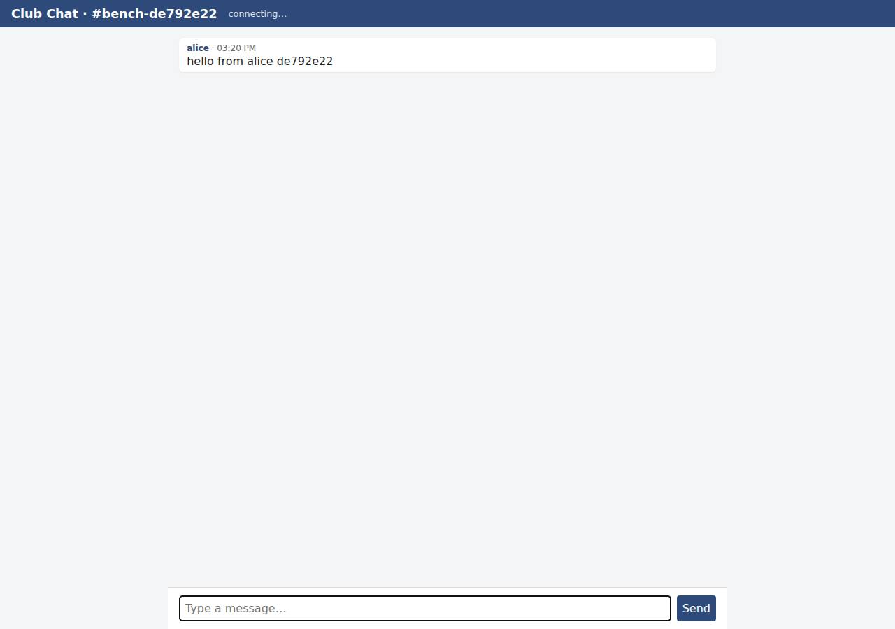

# ✅ Real-Time Collaborative App on Render with Opus 5.5 (trial 1)

**success**: 13/13 checks passed (100%).

- URL: https://adb-cg693-realtime-web.onrender.com (from deployment.json)
- Estimated hosting: Light use: $0.00/month, Busy: $7.13/month (the agent estimated $0.00)
- Agent: Claude Code 2.1.296, model `claude-opus-5-5`, effort medium, HIPAA organization
- Resource prefix: `adb-cg693-realtime`

| | Build | Deploy | Total |
|---|---|---|---|
| Status | completed | completed | |
| Time | 1m 42s | 2m 14s | 3m 56s |
| Turns | 9 | 10 | |
| Tokens | 341.8K | 495.9K | 837.7K |
| Agent cost | $0.39 | $0.31 | $0.70 |
| Shell commands | 8 | 9 | |

App answered 0s after the agent finished deploying.

## Screenshots

**The room the verifier's clients chatted in, with its history** (https://adb-cg693-realtime-web.onrender.com/?room=bench-de792e22)

## What was built

- Runtime: Node.js 24
- Frameworks: Node.js http module (built in)
- Libraries: ws
- Packaging: Render Blueprint (render.yaml)
- Hosting: Render web service (free, running the prebuilt image node:24-alpine)
- Code: 472 lines in 10 files (JavaScript 331, HTML 129, JSON 27, Markdown 14, Shell 12, YAML 9)
- Dependencies: 1 npm, 0 Python
- Deploy config: `render.yaml`

## Human steps

2 step(s), about 5 min of a person's time.

- **Sign up for an account and verify the email address** (~3 min): prerequisite: account setup
- **Create an API token and hand it to the agent** (~2 min): prerequisite: account setup

## Security and compliance review

**76/100**, from an independent Claude Code review (`claude-opus-5-5`, high effort, HIPAA organization, $0.35) of the process, the code, the hosting plan and the live app.

The Render chat app handles secrets cleanly, exposes nothing beyond its routes, validates input well, and serves HTTPS with a redirect from HTTP. Its main weakness is provenance: the code runs as a locally built base64 tarball stored in an env var, executed with eval on a floating, unpinned node:24-alpine tag, as root, with no owner-controlled repo behind it. Smaller issues are missing security headers, no rate limiting, no WebSocket Origin check and unbounded room creation; the free plan suits this personal club app.

| Criterion | Weight | Score | Rationale |
|---|---|---|---|
| Secrets handling | 25 | 10/10 | The app needs no secrets. The Render API key was only used as $RENDER_API_KEY in curl headers and masked when environment variables were listed. No credentials appear in source, deploy scripts or the shipped tarball. |
| Deployment provenance | 20 | 4/10 | Production runs a base64 tarball built on the agent's machine, stored in an env var and run via `node -e eval(process.env.BOOT)` on the floating `node:24-alpine` tag. No owner-controlled repo, no image digest, and the committed render.yaml doesn't describe what actually runs. Dependencies were at least installed from a lockfile with npm ci. |
| Terms compliance | 15 | 8/10 | This is a personal hobby-club app, and Render's free web services allow hobby and non-commercial use. The service sleeps after about 15 minutes idle, which causes cold starts and dropped sockets. The agent documented this and noted the Starter upgrade. |
| Least privilege | 15 | 7/10 | There is one public web service and no data stores or extra resources. But the stock node image runs the app as root (no USER / non-root uid), and the boot script writes to /app and /tmp as root. |
| Transport security | 10 | 7/10 | HTTPS has a valid Google Trust Services certificate, HTTP gets a 301 to HTTPS, and the socket runs over wss. The app sets none of HSTS, X-Content-Type-Options, frame protection or CSP, though it easily could have. |
| Attack surface | 10 | 10/10 | Probes for /.env, /.git/config, /server.js, /package.json, /public/ and path traversal all returned a generic JSON 404. Errors are generic with no stack traces, and only the app routes plus a harmless /healthz are exposed. |
| Application security | 5 | 7/10 | Input validation is solid: room regex, user and text lengths, 16 KB body and WS payload caps, and 400s for bad JSON. The UI renders with textContent, so there's no XSS. There is no rate limiting, no WebSocket Origin check, and rooms are created without bound and never evicted. |

Findings:

- **medium** · deployment · App delivered as base64 tarball in env var, executed via eval: process/deploy.md: service created with envVars APP_B64=<tarball> and dockerCommand 'node -e eval(process.env.BOOT)'; app/deploy/boot.js unpacks the tarball to /app and runs server.js; app/deploy/redeploy.sh builds the tarball from the local working tree Fix: Deploy from a git repo the owner controls (Render native Node runtime or a Dockerfile build), or push a built image to an owner-controlled registry, so production can be traced to a commit.
- **medium** · deployment · Base image referenced by mutable tag, not digest: process/resources.json source 'docker.io/library/node:24-alpine'; process/deploy.md create.json image.imagePath 'docker.io/library/node:24-alpine' Fix: Pin the base image by digest (node:24-alpine@sha256:...) and update it on purpose.
- **low** · deployment · Committed render.yaml doesn't match the live deployment: app/render.yaml declares service 'chat-rooms', runtime node, buildCommand 'npm ci'. The live service is 'adb-cg693-realtime-web', an image-backed runtime with an eval bootstrap Fix: Keep a single source of truth for the deployment config (Blueprint or deploy script) that matches production.
- **low** · deployment · Container runs as root: The stock docker.io/library/node:24-alpine image runs as root by default; app/deploy/boot.js runs as that user and writes to /app and /tmp, and no USER or non-root setting was configured Fix: Use a Dockerfile with 'USER node' (and files owned by node), or start the process as the built-in node user.
- **low** · app · No security headers: GET https://adb-cg693-realtime-web.onrender.com/?room=general -> 200 with only content-type, cache-control and Render/Cloudflare headers; no Strict-Transport-Security, X-Content-Type-Options, X-Frame-Options/frame-ancestors or Content-Security-Policy (server.js:112) Fix: Set HSTS, X-Content-Type-Options: nosniff, a CSP with frame-ancestors 'none' and X-Frame-Options: DENY in server.js responses.
- **low** · app · No rate limiting and unbounded room creation: server.js:16-23 getRoom creates a room for any valid name on WS connect or SSE subscribe, and rooms are never removed. POST /api/rooms/<room>/messages and WS messages have no per-client throttle (server.js:130-141, 203-217) Fix: Add per-IP/per-connection rate limits, cap the number of rooms/connections, and evict empty rooms.
- **low** · app · WebSocket upgrade does not check Origin: Upgrade request to /ws?room=reviewtest&user=probe with 'Origin: https://evil.example' -> 101 Switching Protocols (server.js:178-192 has no Origin check) Fix: Reject upgrades whose Origin isn't the app's own host.
- **info** · platform · Free web service sleeps when idle: process/resources.json plan 'free'; deployment.json notes the service spins down after about 15 min idle with a 30-60 s cold start Fix: Acceptable for a personal club app. Move to the Starter plan if the chat must stay up all the time.
- **info** · app · Unauthenticated identity (anyone can use any display name): server.js:182 accepts any user query param; server.js:138 accepts any body.user Fix: Fine for the spec's display-name model. Add light auth (e.g. a club join code) if impersonation becomes a concern.

## Checks

| Check | Required | Result | Detail |
|---|---|---|---|
| GET / answers 2xx within 1 min | yes | passed |  |
| The app is served over HTTPS with a valid certificate | yes | passed |  |
| The app is public: no redirect to another host such as a login page | yes | passed |  |
| GET / serves the chat UI as HTML | yes | passed |  |
| deployment.json declares a supported transport (websocket or sse) | no | passed |  |
| Clients connect over websocket | yes | passed |  |
| A message reaches another client in the same room within 5 s | yes | passed |  |
| The sender receives its own message too | no | passed |  |
| Messages never reach clients in other rooms | yes | passed |  |
| Five users posting at the same time all see every message within 10 s | yes | passed |  |
| GET /api/rooms/<room>/messages returns recent messages | yes | passed |  |
| Messages over 1000 characters are rejected | no | passed |  |
| The chat UI loads in a browser without errors | no | passed |  |

## Cloud resources

| Traffic | $/month | How it was priced |
|---|---|---|
| Light use | $0.00 | fixed monthly prices; 0.04 GB out of the Hobby workspace's 5 GB; free instances awake 10 h of 750 free hours |
| Busy | $7.13 | fixed monthly prices; 52.6 GB out of the Hobby workspace's 5 GB, 47.6 GB billed (with a payment method on file; without one Render suspends the services instead); free instances awake 730 h of 750 free hours |

Each resource's list price, at the size it was provisioned and always on:

| Kind | Name | Plan | $/month | How it was priced |
|---|---|---|---|---|
| service | adb-cg693-realtime-web | free | $0.00 | free x 1 instance(s) |

Teardown: 1 deleted

## Agent's deploy summary

> The chat app is live on Render's free plan at **https://adb-cg693-realtime-web.onrender.com**, and I tested every requirement through that public URL.
>
> **How it's deployed:** there was no GitHub account available, so I couldn't deploy from a git repo. Instead, the service (`srv-db7pqp0u01pc739ltang`) runs Render's free tier with the public `node:24-alpine` image. The app code is packed into an environment variable and unpacked when the service starts, with start command `node -e eval(process.env.BOOT)`. The first deploy failed because Render didn't accept the quoted shell start command I gave it; the second worked. To ship code changes, run `deploy/redeploy.sh`. Cost is $0/month, and nothing needed a person, so `human_steps` is empty.
>
> **Results through the public URL:**
> - The UI loads.
> - 15 messages sent at the same time by 3 WebSocket clients over `wss://` reached all 3 clients, including each sender, within about 160 ms.
> - A client in another room got none of them.
> - Invalid WebSocket messages got a `{"type":"error"}` reply.
> - Over HTTP, empty text, 1001-character text and missing text all got `400`; a 1000-character message got `201`.
> - A message sent with `POST` reached both the Server-Sent Events stream and the WebSocket clients.
> - History returns the latest 50 messages, oldest first.
>
> **Limitations (also in `deployment.json` notes):**
> - **Lost history:** messages are kept in memory only, so history disappears whenever the service restarts or is redeployed.
> - **Single instance:** it must run as one copy, because messages aren't shared between copies.
> - **Free-plan sleep:** the service sleeps after about 15 minutes with no traffic. The next visitor waits roughly 30–60 seconds, and open connections drop when it goes to sleep (the UI reconnects on its own). Render's Starter plan, about $7/month, keeps it always on.
>
> `deployment.json` lists the service with `realtime` set to `{"transport": "websocket", "url": "wss://adb-cg693-realtime-web.onrender.com/ws"}`. I didn't create any new credentials, so there's no `.env`. The deploy files and `deployment.json` are committed to the local git repo.

## Shell commands during deploy

- `5s` `env | grep -iE 'token|github|render' | sed 's/=.*/=***/'; gh auth status 2>&1 | head -5; curl -s -H "Authorization: Bearer $RENDER_API_KEY" https://api.render.com/v1/owners | head -c 600; echo; curl -`
- `16s` `tar czf /tmp/app.tgz server.js package.json package-lock.json public node_modules && ls -l /tmp/app.tgz && base64 -w0 /tmp/app.tgz | wc -c`
- `23s` `B64=$(base64 -w0 /tmp/app.tgz) python3 - <<'EOF' > /tmp/create.json`
- `30s` `for i in $(seq 1 40); do s=$(curl -s -H "Authorization: Bearer $RENDER_API_KEY" https://api.render.com/v1/services/srv-db7pqp0u01pc739ltang/deploys/dep-db7pqp8u01pc739ltbh0 | python3 -c "import json,s`
- `49s` `curl -s -H "Authorization: Bearer $RENDER_API_KEY" "https://api.render.com/v1/logs?ownerId=tea-db6fig0473hc73eb9aeg&resource=srv-db7pqp0u01pc739ltang&limit=30&direction=backward" | python3 -c "`
- `1m 06s` `cd /tmp && cat > boot.js <<'EOF'`
- `1m 13s` `S=srv-db7pqp0u01pc739ltang; for i in $(seq 1 40); do s=$(curl -s -H "Authorization: Bearer $RENDER_API_KEY" https://api.render.com/v1/services/$S/deploys/dep-db7pr3u7bikc73bo4ch0 | python3 -c "import `
- `1m 45s` `mkdir -p /tmp/e2e && cd /tmp/e2e && cat > e2e.js <<'EOF'`
- `2m 06s` `mkdir -p deploy && cp /tmp/boot.js deploy/boot.js && cat > deploy/redeploy.sh <<'EOF'`
