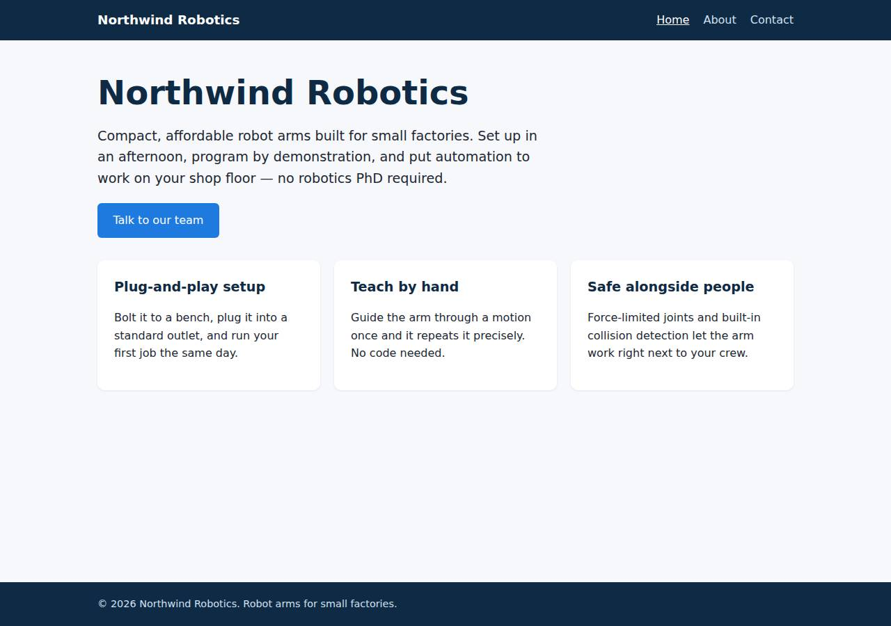
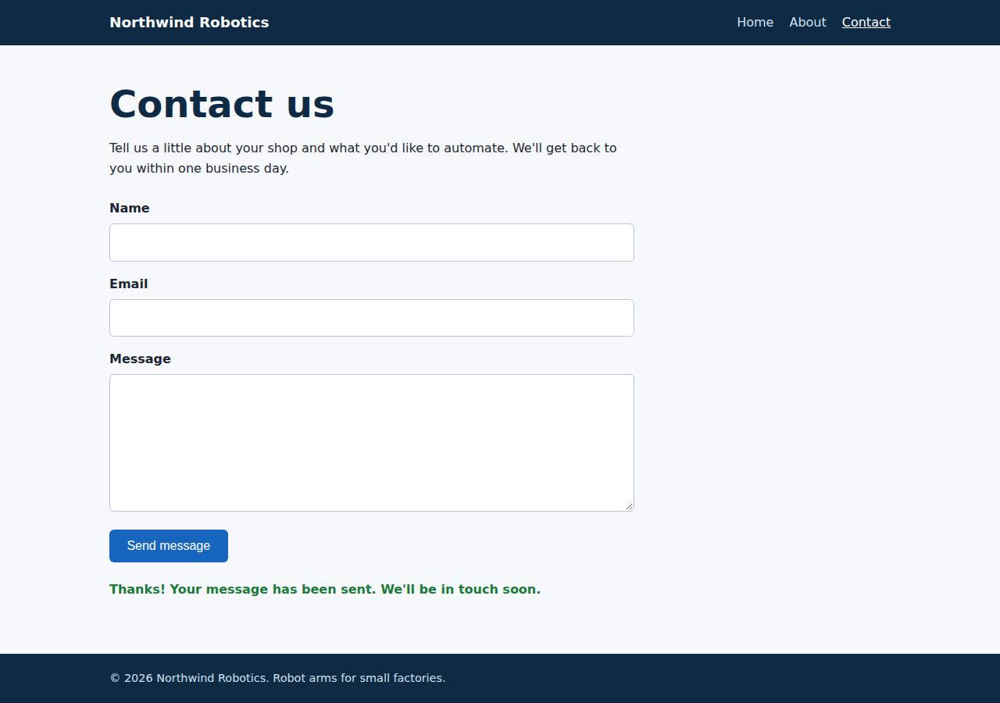

# ✅ Static Content Site on Render with Opus 5.5 (trial 1)

**success**: 16/16 checks passed (100%).

- URL: https://adb-t3gz2-static-web.onrender.com (from deployment.json)
- Estimated hosting: Light use: $0.00/month, Busy: $7.13/month (the agent estimated $0.00)
- Agent: Claude Code 2.1.296, model `claude-opus-5-5`, effort medium, HIPAA organization
- Resource prefix: `adb-t3gz2-static`

| | Build | Deploy | Total |
|---|---|---|---|
| Status | completed | completed | |
| Time | 1m 14s | 2m 17s | 3m 32s |
| Turns | 8 | 9 | |
| Tokens | 291.3K | 402.7K | 694.0K |
| Agent cost | $0.30 | $0.23 | $0.53 |
| Shell commands | 7 | 8 | |

App answered 0s after the agent finished deploying.

## Screenshots

**The home page** (https://adb-t3gz2-static-web.onrender.com/)

**The contact page after the verifier submitted the form** (https://adb-t3gz2-static-web.onrender.com/contact)

## What was built

- Runtime: Node.js 18+
- Frameworks: Node.js http module (built in)
- Packaging: Render Blueprint (render.yaml)
- Hosting: Render web service (free, built from render-examples/express-hello-world)
- Code: 352 lines in 13 files (JavaScript 163, HTML 160, CSS 29, JSON 22, YAML 8, Markdown 5)
- Dependencies: 0 npm, 0 Python
- Deploy config: `render.yaml`

## Human steps

2 step(s), about 5 min of a person's time.

- **Sign up for an account and verify the email address** (~3 min): prerequisite: account setup
- **Create an API token and hand it to the agent** (~2 min): prerequisite: account setup

Reported but not needed, since the deployment worked without them: Push this project to a GitHub/GitLab repo, connect it to Render (Render GitHub app), and point the service at it with bu

## Security and compliance review

**75/100**, from an independent Claude Code review (`claude-opus-5-5`, high effort, HIPAA organization, $0.26) of the process, the code, the hosting plan and the live app.

The Northwind Robotics site is a small, dependency-free Node server with tight allowlist routing, solid input validation, HTTPS with an HTTP redirect, nothing exposed beyond the app, and no secrets mishandled. The main weaknesses are in how it was deployed. Render builds from an unpinned third-party example repo, while the code that actually runs comes from a base64 tarball in an env var, so provenance is weak. A commercial site is also running on a free instance that sleeps when idle. The app also sets no security headers.

| Criterion | Weight | Score | Rationale |
|---|---|---|---|
| Secrets handling | 25 | 10/10 | The app needs no secrets. The Render API key was only ever used as $RENDER_API_KEY in curl headers and never printed; the env listing in the transcript shows only variable names. No credentials are in the source, the bundle or the deployed files. |
| Deployment provenance | 20 | 4/10 | The service's git source is a third-party public repo (render-examples/express-hello-world, branch main, not pinned to a commit) that the owner doesn't control. The code actually running is an unversioned base64 tarball stuffed into an env var, so Render's deploy record points at a commit unrelated to what runs. The app itself has zero dependencies, which keeps the supply-chain risk low. |
| Terms compliance | 15 | 5/10 | A business's marketing site is hosted on Render's free instance type. Render's terms don't ban commercial use as far as I know, but Render positions free instances for hobby and testing use. They spin down after about 15 minutes idle, so visitors wait 30-60s on a cold start, and they come with no uptime guarantees. That's a poor fit for a commercial site that should always be up. |
| Least privilege | 15 | 9/10 | There is one managed Node web service, no data stores and no extra public resources. The process runs on Render's managed runtime, which the agent can't configure. The only gap is that the app bundle sits in an env var instead of a repo. |
| Transport security | 10 | 7/10 | Served over HTTPS with a valid certificate, and HTTP gets a 301 redirect to HTTPS. The Node server sets no HSTS, X-Content-Type-Options, frame protection or CSP headers, though it easily could. |
| Attack surface | 10 | 10/10 | Only allowlisted pages and assets are served. Probes for .env, .git/config, server.js, package.json, the test files and path traversal all returned 404 or 400, with no stack traces or listings. |
| Application security | 5 | 8/10 | The contact endpoint checks types and lengths, validates email, caps the body at 20 KB and handles bad JSON cleanly, and the client renders responses with textContent. Nothing limits how often the endpoint can be called, but submissions aren't stored or sent anywhere, so abuse has little effect. |

Findings:

- **medium** · deployment · Service built from an unpinned third-party repo, with the real code delivered through an env var: process/deploy.md line 72: POST /v1/services with "repo":"https://github.com/render-examples/express-hello-world","branch":"main" and buildCommand "echo \"$APP_BUNDLE_B64\" | base64 -d | tar xz -C app && cd app && npm test"; process/resources.json source=render-examples/express-hello-world Fix: Push the app to a repo the owner controls and connect it to Render (or deploy a digest-pinned image from an owned registry). Then delete APP_BUNDLE_B64 so the deployed commit matches the running code.
- **medium** · deployment · Commercial site on a free instance that sleeps: process/context.json use=commercial; process/resources.json plan=free; process/deployment.json notes: 'Free instances spin down after ~15 min idle, so the first request after idle can take ~30-60s' Fix: Move to a paid Render instance (e.g. Starter) for an always-on business site, or host it as a Render Static Site plus a small paid service for the API.
- **low** · deployment · Runtime version only loosely pinned: process/deploy.md line 72: envVars NODE_VERSION=22; app/package.json engines "node": ">=18" Fix: Pin an exact Node version (e.g. 22.x.y) through NODE_VERSION or .node-version in the owned repo.
- **low** · app · No security headers: curl -sI https://adb-t3gz2-static-web.onrender.com/ returns only content-type, cache-control and Render/Cloudflare headers: no Strict-Transport-Security, X-Content-Type-Options, X-Frame-Options/frame-ancestors or Content-Security-Policy. app/server.js:11,18,25 set only Content-Type and Cache-Control. Fix: Add HSTS, X-Content-Type-Options: nosniff, a CSP with frame-ancestors 'none' (the site uses only same-origin scripts and styles) and Referrer-Policy to every response in server.js.
- **low** · app · No rate limiting on the contact endpoint: app/server.js:40-56: handleContact has no per-client throttling. POST /api/contact with valid JSON returned {"ok":true} Fix: Add a simple per-IP rate limit (or a honeypot field) before submissions are ever stored or emailed.
- **info** · app · Allowlist routing exposes only intended files: GET /.env, /.git/config, /server.js, /package.json, /test/server.test.js, /index.html -> 404; /..%2fserver.js -> 400; app/server.js:6-7,66-68 serve fixed PAGES/ASSETS maps Fix: None needed.
- **info** · deployment · API key used without being echoed: process/deploy.md line 4: 'env | cut -d= -f1' lists only names; every API call uses -H "Authorization: Bearer $RENDER_API_KEY" Fix: None needed.

## Checks

| Check | Required | Result | Detail |
|---|---|---|---|
| GET / answers 2xx within 1 min | yes | passed |  |
| The app is served over HTTPS with a valid certificate | yes | passed |  |
| The app is public: no redirect to another host such as a login page | yes | passed |  |
| GET / returns HTML | yes | passed |  |
| GET /about returns HTML | yes | passed |  |
| GET /contact returns HTML | yes | passed |  |
| Home has an <h1> containing 'Northwind Robotics' | yes | passed |  |
| About has a heading containing 'About' | yes | passed |  |
| Contact has a form with name, email and message fields | yes | passed |  |
| Every page has a <title> and a viewport meta tag | no | passed |  |
| Home links to /about and /contact | no | passed |  |
| POST /api/contact with valid input returns {ok: true} | yes | passed |  |
| POST /api/contact rejects a bad email and an empty message with 400 | yes | passed |  |
| Unknown paths return 404 | yes | passed |  |
| Submitting the /contact form in a browser posts to /api/contact without leaving the page | yes | passed |  |
| Pages load in a browser without uncaught JavaScript errors | no | passed |  |

## Cloud resources

| Traffic | $/month | How it was priced |
|---|---|---|
| Light use | $0.00 | fixed monthly prices; 0.04 GB out of the Hobby workspace's 5 GB; free instances awake 10 h of 750 free hours |
| Busy | $7.13 | fixed monthly prices; 52.6 GB out of the Hobby workspace's 5 GB, 47.6 GB billed (with a payment method on file; without one Render suspends the services instead); free instances awake 730 h of 750 free hours |

Each resource's list price, at the size it was provisioned and always on:

| Kind | Name | Plan | $/month | How it was priced |
|---|---|---|---|---|
| service | adb-t3gz2-static-web | free | $0.00 | free x 1 instance(s) |

Teardown: 1 deleted

## Agent's deploy summary

> The site is live at **https://adb-t3gz2-static-web.onrender.com**, and every requirement in `TASK.md` works through that public URL.
>
> **What's deployed:** one Render web service, `adb-t3gz2-static-web` (`srv-db7paktg1s2s73bc2da0`), on the free plan. Monthly cost is $0. I didn't create any credentials, so there's no `.env`.
>
> **What I checked on the public URL:**
> - **Pages:** `/`, `/about` and `/contact` return 200 with `text/html`, a title, a viewport tag and navigation to the other pages. Each has the required heading or form fields.
> - **404s:** unknown paths, including `/about.html`, return 404.
> - **Contact endpoint:** `POST /api/contact` returns `{"ok":true}` for valid input. A missing name, bad email or empty message each return 400 with an error message.
> - **Browser test:** headless Chrome at a phone-sized screen filled in and sent the form. The confirmation appeared and the page did not reload.
>
> **Unusual setup:** Render deploys from a git repo, and there were no GitHub credentials here, so I couldn't push the code anywhere.
> - **How it works now:** the service is built from Render's public example repo (`render-examples/express-hello-world`), which is only used as a starting point. The build step unpacks this app from a compressed copy stored in an environment variable (`APP_BUNDLE_B64`), runs its tests, and then starts it. Nothing runs outside Render.
> - **Shipping changes:** automatic deploys are off. To update the site, rebuild that compressed copy, update the variable, and start a deploy.
>
> **Human step (not blocking):** I listed one in `deployment.json`. Someone needs to push the code to a GitHub repo, connect it to Render and point the service at it, then delete `APP_BUNDLE_B64`. That gives normal deploys from git.
>
> **Limitation:** free instances go to sleep after about 15 minutes with no traffic. The first request after that can take 30–60 seconds.

## Shell commands during deploy

- `6s` `env | cut -d= -f1 | grep -iE 'token|key|gh|git|render'; gh auth status 2>&1 | head -5; curl -s -H "Authorization: Bearer $RENDER_API_KEY" https://api.render.com/v1/owners | head -c 600`
- `19s` `curl -s -H "Authorization: Bearer $RENDER_API_KEY" "https://api.render.com/v1/services?limit=50" | python3 -c "import json,sys; [print(s['service']['name'],s['service']['type'],s['service'].get('repo'`
- `31s` `tar czf /tmp/app.tgz server.js package.json public && B=$(base64 -w0 /tmp/app.tgz) && echo ${#B} && `
- `39s` `S=srv-db7paktg1s2s73bc2da0 && H=(-H "Authorization: Bearer $RENDER_API_KEY" -H 'Content-Type: application/json') &&`
- `44s` `S=srv-db7paktg1s2s73bc2da0; H=(-H "Authorization: Bearer $RENDER_API_KEY" -H 'Content-Type: application/json')`
- `1m 50s` `U=https://adb-t3gz2-static-web.onrender.com`
- `1m 58s` `mkdir -p /tmp/pw && cd /tmp/pw && npm init -y >/dev/null && npm i playwright@1 >/dev/null 2>&1 && npx playwright install chromium >/dev/null 2>&1 && cat > t.js <<'EOF'`
- `2m 09s` `cat > deployment.json <<'EOF'`
