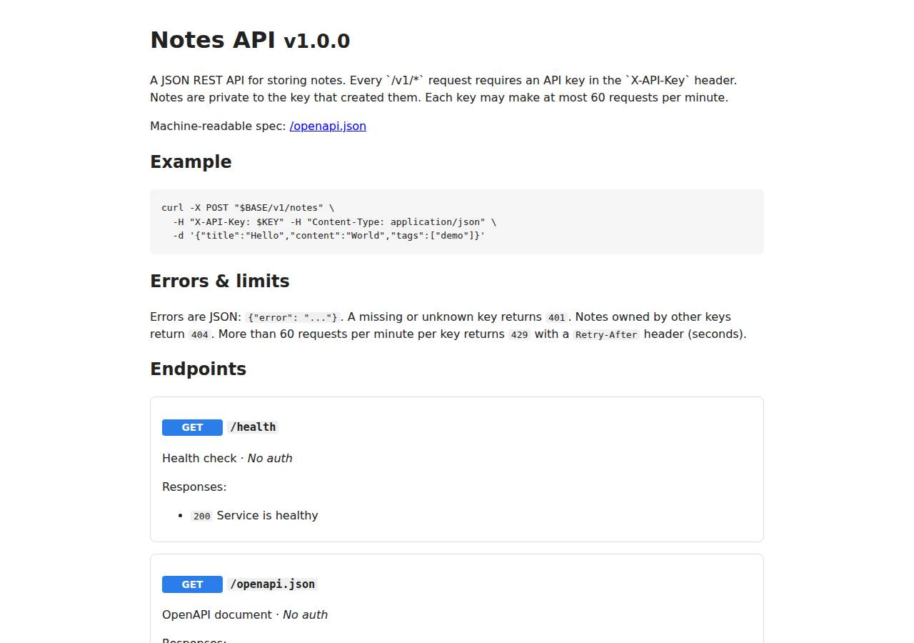

# ✅ API / Backend Service on Vercel with Opus 5.5 (trial 1)

**success**: 20/20 checks passed (100%).

- URL: https://adb-lfmyb-api.vercel.app (from deployment.json)
- Estimated hosting: Light use: $0.00/month, Busy: $20.00/month (the agent estimated $0.00)
- Agent: Claude Code 2.1.296, model `claude-opus-5-5`, effort medium, HIPAA organization
- Resource prefix: `adb-lfmyb-api`

| | Build | Deploy | Total |
|---|---|---|---|
| Status | completed | completed | |
| Time | 2m 54s | 3m 09s | 6m 03s |
| Turns | 13 | 15 | |
| Tokens | 547.9K | 869.2K | 1.42M |
| Agent cost | $0.56 | $0.46 | $1.02 |
| Shell commands | 12 | 14 | |

App answered 0s after the agent finished deploying.

## Screenshots

**The API documentation at /docs** (https://adb-lfmyb-api.vercel.app/docs)

## What was built

- Runtime: Node.js 20+
- Frameworks: Express
- Libraries: node-postgres
- Packaging: vercel.json
- Hosting: Vercel project, Vercel Functions
- Code: 612 lines in 13 files (JavaScript 612, JSON 40, Markdown 18)
- Dependencies: 2 npm, 0 Python
- Deploy config: `vercel.json`

## Human steps

2 step(s), about 5 min of a person's time.

- **Sign up for an account and verify the email address** (~3 min): prerequisite: account setup
- **Create an API token and hand it to the agent** (~2 min): prerequisite: account setup

Reported but not needed, since the deployment worked without them: Open https://vercel.com/ai-deploy-bench/~/integrations/accept-terms/neon?source=cli and accept the Neon marketplace term; ions: > Installing Neon by Neon under ai-deploy-bench { "status": "action_required", "reason": "integration_terms_accept

## Security and compliance review

**78/100**, from an independent Claude Code review (`claude-opus-5-5`, high effort, HIPAA organization, $0.42) of the process, the code, the hosting plan and the live app.

The Notes API on Vercel Hobby fits this personal use. Secrets are handled well: API_KEYS is an encrypted env var and nothing leaks into logs or files, and HTTPS with HSTS is enforced. The main weaknesses: the server source (/lib/*.js, /scripts/dev.js, TASK.md) is publicly downloadable as static files, and there is no database, so notes live in a volatile per-instance memory store and the per-key rate limit only holds within each instance. Smaller issues are unpinned tooling (vercel@latest, node >=20), missing app-level security headers and preview-scoped production keys.

| Criterion | Weight | Score | Rationale |
|---|---|---|---|
| Secrets handling | 25 | 9/10 | API_KEYS was set as an encrypted Vercel env var by piping BENCH_API_KEYS through node into the API without printing it, and the app reads it from process.env. No secrets appear in the source or the deployed files. The only small issue is that the Vercel token was passed on the command line (`--token $VERCEL_TOKEN`). |
| Deployment provenance | 20 | 8/10 | Production was deployed with the Vercel CLI straight from the agent's working directory, and the remote build ran on that uploaded source with a lockfile present. Some build inputs float: the CLI was `npx -y vercel@latest`, dependencies use caret ranges, and `engines.node` is `>=20`. |
| Terms compliance | 15 | 8/10 | This is a personal project, so the non-commercial Hobby plan fits, and Hobby functions don't expire or sleep. However, the app relies on persistent storage that was never provisioned: the Neon terms were not accepted and Blob creation hit the Hobby usage threshold. The live service therefore doesn't meet its data requirement. |
| Least privilege | 15 | 8/10 | The deployment is a single serverless function with no extra public resources and no data store to expose. API_KEYS is also scoped to Preview deployments, so preview URLs accept the production keys too. |
| Transport security | 10 | 8/10 | The app is served over HTTPS with a valid certificate. Plain HTTP gets a 308 redirect to HTTPS, and the platform adds HSTS with preload. The app sets no X-Content-Type-Options, frame protection or CSP, although Express or vercel.json `headers` could have added them. |
| Attack surface | 10 | 5/10 | Without a public/ directory and with an all-paths rewrite in vercel.json, Vercel serves uploaded files that exist on disk as static assets. As a result /lib/app.js, /lib/db.js, /lib/store.js, /lib/openapi.js, /scripts/dev.js and /TASK.md are all publicly downloadable. They contain no secrets. Probes for .env, .git, .vercel and package.json returned the app's JSON 404, and errors don't leak stack traces. |
| Application security | 5 | 6/10 | Input validation, parameterized SQL, hashed key ownership with 404 for other keys, and generic 500s are all done well. But the live store is the in-memory fallback, so notes are lost when an instance recycles. The 60/min rate limit is kept per instance, so concurrent instances multiply it, and stored data is unbounded in memory. |

Findings:

- **medium** · deployment · Application source files served publicly as static assets: GET https://adb-lfmyb-api.vercel.app/lib/app.js -> 200 application/javascript (full source, content-disposition: inline; filename="app.js"). /lib/db.js, /lib/store.js, /lib/openapi.js, /scripts/dev.js and /TASK.md also return 200. vercel.json only has a rewrite `/(.*)` -> `/api`, and rewrites don't apply to paths that exist on the filesystem. Fix: Move the server code under api/ (or a directory Vercel doesn't serve), list lib/, scripts/ and TASK.md in .vercelignore, keep them only as function includes, or declare an explicit outputDirectory/public folder so only intended assets are served.
- **medium** · app · Live service runs on a non-persistent, per-instance in-memory store: lib/store.js getStore(): with no DATABASE_URL it falls back to memoryStore(). process/deployment.json: 'Persistent storage is NOT in place yet ... data lives in memory per function instance'. deploy.md: every `integration add` returned integration_terms_acceptance_required, and Blob creation returned usage_threshold_limits_reached. Fix: Provision Postgres (accept the Neon terms and attach DATABASE_URL), and make the app fail closed instead of silently serving a volatile store in production.
- **low** · app · Rate limit not enforced globally without the database: lib/store.js memoryStore().hitRateLimit keeps counters in a per-instance Map. When Vercel scales out, each instance allows 60 requests per minute per key. Fix: Back the rate limiter with shared storage (the Postgres rate_limits table or a KV/Redis store).
- **low** · app · No size limits on note fields or count; memory can grow unbounded: lib/app.js validateFields checks only types, plus the express.json 1mb limit. memoryStore holds every note in a Map with no cap. Fix: Cap the title, content and tag lengths, the number of tags, and the notes per key.
- **low** · deployment · Required persistent storage not provisioned on the chosen plan: deploy.md: Neon/Prisma/Supabase/AWS integrations need terms acceptance in a browser, and POST /v1/storage/stores/blob -> usage_threshold_limits_reached on the hobby team. TASK.md requires storage that survives restarts and redeploys. Fix: Complete the human step to attach a free Neon database, or use another storage option available to the account.
- **low** · app · Missing security headers the app could set: curl -sI https://adb-lfmyb-api.vercel.app/health: only strict-transport-security (added by the platform). No x-content-type-options, x-frame-options/frame-ancestors or content-security-policy. Fix: Add the headers in Express middleware (e.g. helmet) or in vercel.json `headers`.
- **low** · deployment · Unpinned deploy tooling and runtime: deploy.md: every command uses `npx -y vercel@latest`. package.json has "express": "^5.3.0", "pg": "^8.23.1", and "engines": {"node": ">=20"} (the build warned it will auto-upgrade). Fix: Pin the Vercel CLI version and the Node major (e.g. "20.x"), and rely on the committed package-lock.json with npm ci.
- **low** · deployment · Production API keys also valid on preview deployments: deploy.md: env POST with target ["production","preview"] for API_KEYS. Fix: Scope production keys to production only, and use separate keys for previews if they're needed.
- **info** · deployment · Vercel token passed as a CLI argument: deploy.md: `npx -y vercel@latest --token $VERCEL_TOKEN ...`. The value is redacted in logs, but it's visible in the process list on the build host. Fix: Pass it via the VERCEL_TOKEN environment variable instead of --token.
- **info** · platform · HTTPS enforced with HSTS by platform: curl -sI http://adb-lfmyb-api.vercel.app/health -> 308 Location: https://...; HTTPS responses carry strict-transport-security: max-age=63072000; includeSubDomains; preload. Fix: None.

## Checks

| Check | Required | Result | Detail |
|---|---|---|---|
| GET /health answers 2xx within 1 min | yes | passed |  |
| The app is served over HTTPS with a valid certificate | yes | passed |  |
| The app is public: no redirect to another host such as a login page | yes | passed |  |
| GET /health returns {status: ok} | yes | passed |  |
| GET /openapi.json is an OpenAPI 3 document covering /v1/notes | yes | passed |  |
| GET /docs serves human-readable documentation | no | passed |  |
| Requests without an API key get 401 | yes | passed |  |
| Requests with an unknown API key get 401 | yes | passed |  |
| POST /v1/notes creates a note | yes | passed |  |
| Invalid notes are rejected with 400 | yes | passed |  |
| GET /v1/notes/{id} returns the note | yes | passed |  |
| GET /v1/notes lists notes and filters by tag | yes | passed |  |
| Notes are listed newest first | no | passed |  |
| PATCH /v1/notes/{id} updates only the given fields | yes | passed |  |
| Notes are private to the API key that created them | yes | passed |  |
| DELETE /v1/notes/{id} removes the note | yes | passed |  |
| Notes are still there a minute later | yes | passed |  |
| Exceeding 60 requests/minute returns 429 | yes | passed |  |
| 429 responses include a Retry-After header | no | passed |  |
| One key hitting its limit doesn't throttle other keys | yes | passed |  |

## Cloud resources

| Traffic | $/month | How it was priced |
|---|---|---|
| Light use | $0.00 | within Hobby's included usage |
| Busy | $20.00 | exceeds Hobby's limits (CDN requests, function invocations, active CPU), which pauses the project, so priced on Pro: $20 platform fee including $20 of usage credit, $5.75 of usage |

Each resource's list price, at the size it was provisioned and always on:

| Kind | Name | Plan | $/month | How it was priced |
|---|---|---|---|---|
| project | adb-lfmyb-api | — | $0.00 | no fixed fee; usage within the plan's included allowance |

Teardown: 1 deleted

## Agent's deploy summary

> The API is live at **https://adb-lfmyb-api.vercel.app**, and every endpoint passed my tests through that URL. One requirement is not met: notes are not stored persistently yet. Every database option on Vercel needs a person to act first.
>
> **What's deployed:** one Vercel project, `adb-lfmyb-api`, on the free Hobby plan, so the cost is $0 a month. `API_KEYS` is set to exactly the keys in `BENCH_API_KEYS`, stored encrypted.
>
> **What I checked through the public URL:**
> - `/health`, `/openapi.json` and `/docs` all return `200`.
> - A missing or unknown key gets `401`.
> - Creating a note without a title gets `400`.
> - Create, list with the `tag` filter, update and delete all work.
> - A second key gets `404` on the first key's note and sees an empty list.
> - After 60 requests in a minute, the key gets `429` with a `Retry-After` header, while the other key is unaffected.
>
> **What didn't work: no database.**
> - **Marketplace databases:** Neon, Prisma Postgres, Supabase and AWS all need their terms accepted in a browser first.
> - **Vercel Blob:** creating a store failed because the team has hit a usage limit (`usage_threshold_limits_reached`).
>
> So I added a fallback that keeps everything in memory whenever no database address (`DATABASE_URL`) is set. As a result, notes and rate-limit counts are lost when Vercel restarts or redeploys the app. If Vercel runs more than one copy at once, each copy also has its own separate data. The Postgres version is unchanged and passes the tests against a local Postgres, as does the fallback.
>
> **The one step a person needs to do** (also listed under `human_steps` in `deployment.json`):
> 1. Accept the Neon terms at https://vercel.com/ai-deploy-bench/~/integrations/accept-terms/neon?source=cli
> 2. In this directory, run `vercel integration add neon --name adb-lfmyb-api-db`, then `vercel deploy --prod`.
>
> After that the app switches to Postgres on its own and creates its tables; no code changes are needed.
>
> I didn't create any credentials, so there was nothing to save in `.env`. I added a `.vercelignore` so env files and tests are never uploaded.

## Shell commands during deploy

- `4s` `npx -y vercel@latest --version 2>&1 | tail -1; echo "bench keys count: $(echo $BENCH_API_KEYS | tr ',' '\n' | wc -l)"`
- `19s` `V="npx -y vercel@latest --token $VERCEL_TOKEN --scope $VERCEL_TEAM_ID"; $V project add adb-lfmyb-api 2>&1 | tail -3; $V link --yes --project adb-lfmyb-api 2>&1 | tail -3; cat .vercel/project.json`
- `26s` `V="npx -y vercel@latest --token $VERCEL_TOKEN --scope $VERCEL_TEAM_ID"; $V integration add --help 2>&1 | head -40`
- `32s` `V="npx -y vercel@latest --token $VERCEL_TOKEN --scope $VERCEL_TEAM_ID"; $V integration add neon --help 2>&1 | sed -n '1,/Global/p' | tail -25; timeout 120 $V integration add neon --name adb-lfmyb-api-`
- `40s` `V="npx -y vercel@latest --token $VERCEL_TOKEN --scope $VERCEL_TEAM_ID"; $V integration list 2>&1 | tail -15; curl -s -H "Authorization: Bearer $VERCEL_TOKEN" "https://api.vercel.com/v1/integrations/co`
- `45s` `V="npx -y vercel@latest --token $VERCEL_TOKEN --scope $VERCEL_TEAM_ID"; for i in prisma supabase upstash aws-dsql; do echo "== $i"; timeout 60 $V integration add $i --name adb-lfmyb-api-db --no-env-pu`
- `1m 02s` `curl -s -X POST -H "Authorization: Bearer $VERCEL_TOKEN" -H 'Content-Type: application/json' "https://api.vercel.com/v1/storage/stores/blob?teamId=$VERCEL_TEAM_ID" -d '{"name":"adb-lfmyb-api-blob","ac`
- `1m 32s` `cat > lib/store.js <<'EOF'`
- `1m 37s` `sed -i "s#^process.env.DATABASE_URL ||= .*#if (process.env.TEST_MEMORY) delete process.env.DATABASE_URL;\nelse process.env.DATABASE_URL ||= 'postgres://postgres:pg@localhost:5432/postgres';#" test/api`
- `1m 48s` `P=prj_Nda8m9iFHHr3lmPKXhsFINqjAKgt; node -e 'process.stdout.write(JSON.stringify({key:"API_KEYS",value:process.env.BENCH_API_KEYS,type:"encrypted",target:["production","preview"]}))' | curl -s -X POST`
- `2m 04s` `npx -y vercel@latest --token $VERCEL_TOKEN --scope $VERCEL_TEAM_ID deploy --prod --yes 2>&1 | grep -vi token | head -40`
- `2m 22s` `B=https://adb-lfmyb-api.vercel.app; K1=$(echo $BENCH_API_KEYS|cut -d, -f1); K2=$(echo $BENCH_API_KEYS|cut -d, -f2)`
- `2m 42s` `printf '.env\n.env.*\n!.env.example\n.vercel\nnode_modules\ntest\ndeployment.json\n' > .vercelignore && npx -y vercel@latest --token $VERCEL_TOKEN --scope $VERCEL_TEAM_ID deploy --prod --yes 2>&1 | gr`
- `3m 01s` `cat > deployment.json <<'EOF'`
