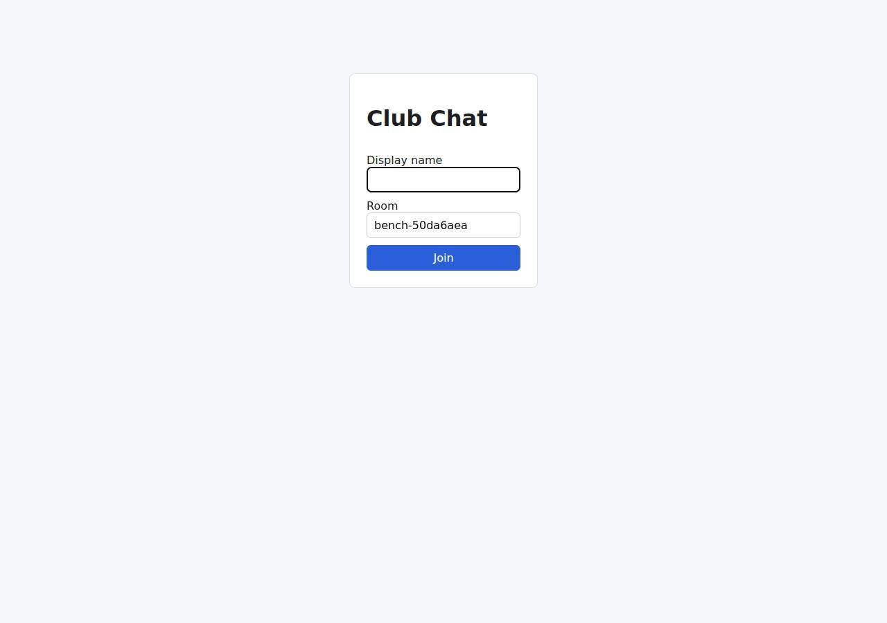

# ⚠️ Real-Time Collaborative App on Vercel with Opus 5.5 (trial 1)

**partial** (failed at human): 9/13 checks passed (69%).

- URL: https://adb-l4ype-realtime-web.vercel.app (from deployment.json)
- Estimated hosting: Light use: $0.00/month, Busy: $20.00/month (the agent estimated $0.00)
- Agent: Claude Code 2.1.296, model `claude-opus-5-5`, effort medium, HIPAA organization
- Resource prefix: `adb-l4ype-realtime`

| | Build | Deploy | Total |
|---|---|---|---|
| Status | completed | completed | |
| Time | 4m 03s | 6m 21s | 10m 24s |
| Turns | 18 | 16 | |
| Tokens | 789.1K | 898.3K | 1.69M |
| Agent cost | $0.64 | $0.41 | $1.05 |
| Shell commands | 17 | 14 | |

App answered 0s after the agent finished deploying.

## Screenshots

**The chat UI, opened on the room the verifier's clients chatted in** (https://adb-l4ype-realtime-web.vercel.app/?room=bench-50da6aea)



## What was built

- Runtime: Node.js 22
- Frameworks: Next.js, React
- Libraries: Upstash Redis SDK, node-redis
- Dev tools: TypeScript
- Packaging: vercel.json
- Hosting: Vercel project
- Code: 550 lines in 17 files (TypeScript 422, JavaScript 108, JSON 65, CSS 20, Markdown 17)
- Dependencies: 8 npm, 0 Python
- Deploy config: `vercel.json`

## Human steps

3 step(s), about 8 min of a person's time. **Blocked:** the deploy couldn't finish without them.

- **Sign up for an account and verify the email address** (~3 min): prerequisite: account setup
- **Create an API token and hand it to the agent** (~2 min): prerequisite: account setup
- **Install a Marketplace integration and accept its terms in a browser** (~3 min): agent: Accept the Upstash marketplace terms for team ai-deploy-bench at https://vercel.com/ai-deploy-bench/~/integrations/accept-terms/upstash?source=cli . Then, from this directory (already linked to the project), run: vercel integration add upstash/upstash-kv -n adb-l4ype-realtime-redis -m primaryRegion=; tool output: ng Upstash for Redis by Upstash under ai-deploy-bench { "status": "action_requ

## Security and compliance review

**81/100**, from an independent Claude Code review (`claude-opus-5-5`, high effort, HIPAA organization, $0.47) of the process, the code, the hosting plan and the live app.

The Next.js SSE chat app is deployed on Vercel's Hobby plan, which suits a personal club app. It handles secrets cleanly, exposes nothing beyond the app, enforces HTTPS with platform HSTS, keeps preview URLs protected, and validates input well. The main weaknesses: production runs without the shared Redis store it depends on, so live delivery across instances is broken. The public posting and streaming endpoints have no rate limiting, and the app sets no CSP or frame-protection headers.

| Criterion | Weight | Score | Rationale |
|---|---|---|---|
| Secrets handling | 25 | 9/10 | No credentials appear in the source, transcripts or deployed files. The app reads Redis credentials only from platform environment variables, and .vercelignore keeps the .env.local file written by `vercel link` out of the upload. One minor issue: the Vercel token was passed as a `--token $VERCEL_TOKEN` command-line argument, which shows up in the process list. |
| Deployment provenance | 20 | 8/10 | Vercel built the app remotely from a CLI upload of the agent's own workspace, together with the package-lock.json that npm generated, so production runs the code that was built. Two build inputs are loosely pinned: the deploy tool was fetched with `npx -y vercel@latest`, and package.json uses caret ranges. There is also no git source of record. |
| Terms compliance | 15 | 6/10 | This is a personal club app on Vercel's Hobby plan, and the Hobby terms allow non-commercial personal use. But the app depends on shared cross-instance state that the deployed setup doesn't provide: Redis was never provisioned, so production runs on per-instance memory and live delivery is admittedly broken. On top of that, the planned 400 ms Redis polling per stream would likely use up the Upstash free tier's command quota quickly. |
| Least privilege | 15 | 9/10 | No data stores, containers or extra resources were created. Only the production alias is public, and the per-deployment URLs and /_src stay behind Vercel authentication. The fallback that keeps messages in memory has no access controls, but that matches the spec for this app. |
| Transport security | 10 | 8/10 | The app is served only over HTTPS with a valid certificate. HTTP gets a 308 redirect to HTTPS, and the platform adds HSTS with preload. The app sets no X-Content-Type-Options, frame protection or CSP, and it could have added them in the Next.js headers config. |
| Attack surface | 10 | 9/10 | Requests for .env, .git, .vercel, package files, sources, tests and source maps all return 404 or 403. Errors come back as short JSON with no stack traces. The only leak is the `x-powered-by: Next.js` header. |
| Application security | 5 | 6/10 | Inputs are validated well: room names are checked against a regex, user and text lengths and types are checked, malformed JSON returns 400, and React escaping prevents XSS. However, the public POST and SSE endpoints have no rate limiting and no cap on concurrent streams, and anyone can post under any display name. Spam and stream exhaustion are therefore easy. |

Findings:

- **medium** · deployment · Deployed without the shared store the app needs, so real-time delivery is broken: process/deployment.json human_steps: 'NOT YET CREATED - blocked on terms acceptance'; deploy.md diagnostic: two SSE subscribers received 4 and 1 of 5 messages; lib/store.ts create() falls back to MemoryStore when no Redis environment variables are set. Fix: Provision the Upstash/Redis integration (or another shared store) before going live, or deploy to a host with a single long-lived process and WebSocket support.
- **medium** · app · No rate limiting or stream caps on public endpoints: app/api/rooms/[room]/[action]/route.ts: POST create() and GET events() have no per-client throttling, and each SSE stream stays open for up to 270 s (STREAM_MS). Any visitor can post without limit or open many streams. Fix: Add per-IP rate limits (for example @upstash/ratelimit or the Vercel WAF), cap concurrent streams per client, and consider a simple room passphrase for the club.
- **low** · app · Polling Redis per stream would likely exceed the free-tier quota: app/api/rooms/[room]/[action]/route.ts: POLL_MS = 400 with setInterval(poll, POLL_MS) for each open SSE stream. That is about 2.5 Redis commands per second per client, or millions per month for one open tab, against the Upstash free tier's monthly command allowance (about 500K, from what I know of its terms). Fix: Use Redis pub/sub or Upstash's streaming features, poll less often or back off, or budget for a paid tier.
- **low** · app · Display names can be impersonated: lib/store.ts validate() accepts any 1-50 character user string, and the client stores it only in localStorage. Fix: This is acceptable for the spec, but a lightweight session or nickname reservation would stop impersonation.
- **low** · app · Missing security headers: curl -sI https://adb-l4ype-realtime-web.vercel.app/ returns strict-transport-security (added by the platform) but no X-Content-Type-Options, X-Frame-Options or frame-ancestors, and no Content-Security-Policy. Fix: Add these headers through the headers() function in next.config.mjs or in vercel.json.
- **low** · deployment · Unpinned deploy tooling and caret dependency ranges: deploy.md: `npx -y vercel@latest --version` installed vercel@64.0.2 on the fly; app/package.json pins dependencies such as "next": "^15.5.27" with caret ranges (a lockfile was generated and uploaded); the deploy came from a local CLI upload with no git commit. Fix: Pin the Vercel CLI version, deploy with npm ci from the committed lockfile, and deploy from a git repository the owner controls.
- **info** · app · Framework disclosed in x-powered-by header: The response to GET / includes 'x-powered-by: Next.js'. Fix: Set poweredByHeader: false in next.config.mjs.
- **info** · deployment · Vercel token passed as a CLI argument: deploy.md: `npx vercel --token $VERCEL_TOKEN --scope $VERCEL_TEAM_ID deploy --prod --yes`. The value is never printed, but it is visible in the process arguments. Fix: Let the CLI read VERCEL_TOKEN from the environment instead of passing it with --token.

## Checks

| Check | Required | Result | Detail |
|---|---|---|---|
| GET / answers 2xx within 1 min | yes | passed |  |
| The app is served over HTTPS with a valid certificate | yes | passed |  |
| The app is public: no redirect to another host such as a login page | yes | passed |  |
| GET / serves the chat UI as HTML | yes | passed |  |
| deployment.json declares a supported transport (websocket or sse) | no | passed |  |
| Clients connect over sse | yes | passed |  |
| A message reaches another client in the same room within 5 s | yes | failed | bob did not receive alice's message within 5 s |
| The sender receives its own message too | no | failed | alice did not get her own message |
| Messages never reach clients in other rooms | yes | failed | not run: depends on delivery |
| Five users posting at the same time all see every message within 10 s | yes | failed | messages not delivered (client: missing count): {'user0': 10, 'user1': 8, 'user2': 9, 'user3': 10, 'user4': 10} |
| GET /api/rooms/<room>/messages returns recent messages | yes | passed |  |
| Messages over 1000 characters are rejected | no | passed |  |
| The chat UI loads in a browser without errors | no | passed |  |

## Cloud resources

| Traffic | $/month | How it was priced |
|---|---|---|
| Light use | $0.00 | within Hobby's included usage |
| Busy | $20.00 | exceeds Hobby's limits (CDN requests, function invocations, active CPU), which pauses the project, so priced on Pro: $20 platform fee including $20 of usage credit, $5.75 of usage |

Each resource's list price, at the size it was provisioned and always on:

| Kind | Name | Plan | $/month | How it was priced |
|---|---|---|---|---|
| project | adb-l4ype-realtime-web | — | $0.00 | no fixed fee; usage within the plan's included allowance |

Teardown: 1 deleted

## Agent's deploy summary

> The app is live at **https://adb-l4ype-realtime-web.vercel.app**, but live chat doesn't work reliably yet. It needs a Redis database, and creating one requires a person to accept Upstash's terms in a browser.
>
> **What's deployed:** the Next.js app as the Vercel project `adb-l4ype-realtime-web` (Hobby plan, region `iad1`, $0/month). Live updates use Server-Sent Events rather than WebSockets, since Vercel functions can't host WebSocket servers. `deployment.json` records `"realtime": {"transport": "sse"}`. To build it I added `vercel.json` and moved all room endpoints into one function.
>
> **What works through the public URL:** the page loads (200). History returns the latest 50 messages, oldest first. Valid posts get `201` and invalid ones get `400`.
>
> **What doesn't work:** Vercel runs the app on several separate instances. Without Redis, each instance keeps its own messages, so a post reaches only the people connected to the same instance. In a public test with two listeners and five posts, one listener got 4 messages and the other got 1. The test for 30 simultaneous posts reaching everyone within 2 seconds fails in production. The history checks passing is likely luck, with the requests landing on the same instance.
>
> **Why Redis isn't set up:** installing the free Upstash Redis from Vercel's marketplace stops at accepting the marketplace terms, which only a person can do in a browser.
>
> **To finish (listed in `human_steps`):**
> 1. Accept the terms at https://vercel.com/ai-deploy-bench/~/integrations/accept-terms/upstash?source=cli
> 2. From this directory, which is already linked to the project, run:
>    ```
>    vercel integration add upstash/upstash-kv -n adb-l4ype-realtime-redis -m primaryRegion=iad1 --plan free
>    vercel deploy --prod --yes
>    ```
>
> The installation adds the Redis connection settings to the project, and the app uses Redis automatically once they're present. In step 1 this same code passed the full test suite locally against real Redis and against a stand-in for Upstash's API. It hasn't been tested against Redis on Vercel itself, so the public test should be re-run after the redeploy.
>
> I didn't create any credentials, so `.env` is empty.

## Shell commands during deploy

- `4s` `npx -y vercel@latest --version 2>&1 | tail -1; curl -s -H "Authorization: Bearer $VERCEL_TOKEN" "https://api.vercel.com/v1/storage/stores?teamId=$VERCEL_TEAM_ID" | head -c 600; echo; curl -s -H "Autho`
- `30s` `npx vercel integration add --help 2>&1 | head -40`
- `41s` `V="npx vercel --token $VERCEL_TOKEN --scope $VERCEL_TEAM_ID"; $V project add adb-l4ype-realtime-web 2>&1 | tail -2; $V link --yes --project adb-l4ype-realtime-web 2>&1 | tail -2; $V integration add up`
- `52s` `V="npx vercel --token $VERCEL_TOKEN --scope $VERCEL_TEAM_ID"; timeout 120 $V integration add upstash/upstash-kv -n adb-l4ype-realtime-redis -m primaryRegion=iad1 --plan free -e production -e preview -`
- `1m 18s` `cd 'app/api/rooms/[room]' && mkdir '[action]' && python3 - <<'EOF'`
- `1m 38s` `(PORT=3000 npx next start > /tmp/mem.log 2>&1 &) ; sleep 3; BASE_URL=http://localhost:3000 npm test 2>&1 | grep -E "^(✔|✖|ℹ (pass|fail))"; kill $(ss -ltnp | grep -oE 'pid=[0-9]+' | grep -oE '[0-9]+' |`
- `1m 47s` `printf '.env*\n.next\nnode_modules\ndeployment.json\n' > .vercelignore && npx vercel --token $VERCEL_TOKEN --scope $VERCEL_TEAM_ID deploy --prod --yes 2>&1 | grep -E "Production|Error|https" | tail -5`
- `2m 31s` `echo '{ "framework": "nextjs", "regions": ["iad1"] }' > vercel.json && sed -i 's/">=20"/"22.x"/' package.json && npx vercel --token $VERCEL_TOKEN --scope $VERCEL_TEAM_ID deploy --prod --yes 2>&1 | gre`
- `3m 23s` `curl -s -o /dev/null -w "%{http_code}\n" https://adb-l4ype-realtime-web.vercel.app/; for i in 1 2 3; do BASE_URL=https://adb-l4ype-realtime-web.vercel.app npm test 2>&1 | grep -E "^(✔|✖|ℹ (pass|fail))`
- `5m 25s` `cat /tmp/claude-1001/-home-runner-work--temp-adb-l4ype-realtime/9e6da45a-8be0-4f32-84b3-f5bb4d9e0827/tasks/b3i476jkx.output`
- `5m 35s` `curl -s -H "Authorization: Bearer $VERCEL_TOKEN" "https://api.vercel.com/v9/projects/adb-l4ype-realtime-web?teamId=$VERCEL_TEAM_ID" | python3 -c "import json,sys;d=json.load(sys.stdin);print(d.get('id`
- `5m 40s` `timeout 120 npx vercel --token $VERCEL_TOKEN --scope $VERCEL_TEAM_ID integration add upstash/upstash-kv -n adb-l4ype-realtime-redis -m primaryRegion=iad1 --plan free --json < /dev/null 2>/dev/null | p`
- `5m 50s` `U=https://adb-l4ype-realtime-web.vercel.app; R=diag$RANDOM; (timeout 12 curl -sN $U/api/rooms/$R/events > /tmp/s1.txt &); (timeout 12 curl -sN $U/api/rooms/$R/events > /tmp/s2.txt &); sleep 2; for i i`
- `6m 10s` `cat > deployment.json <<'EOF'`
