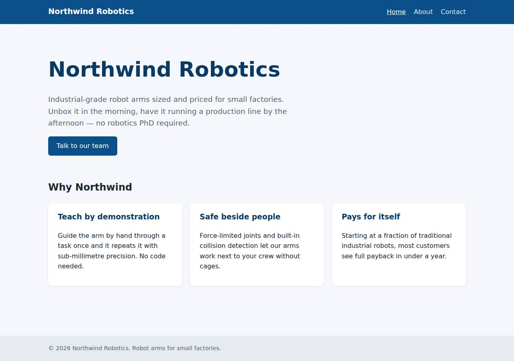
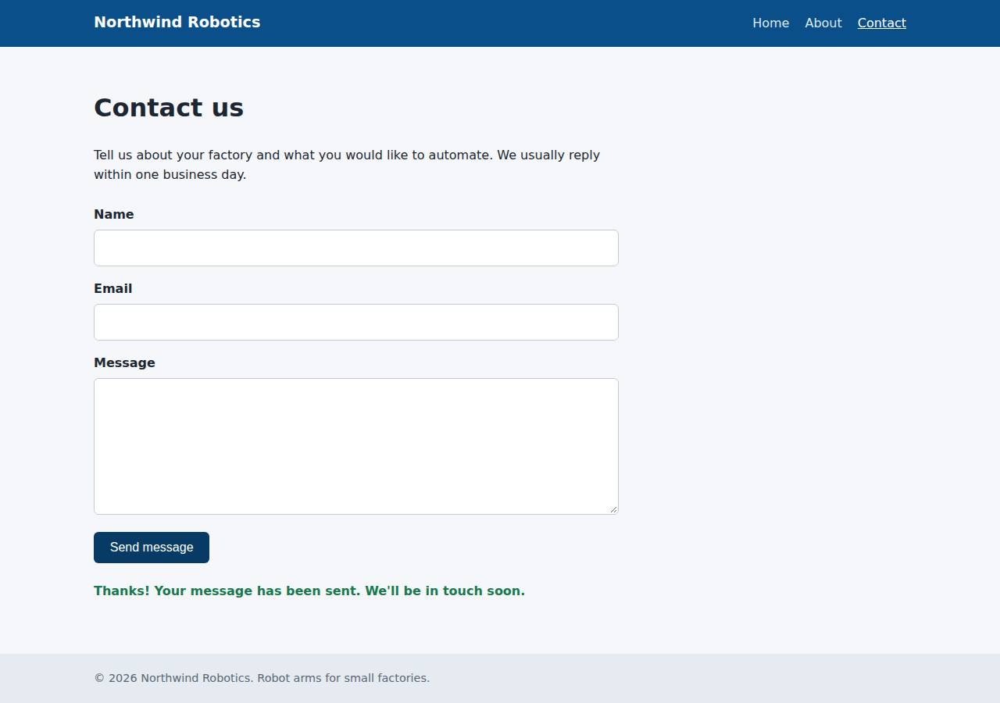

# ✅ Static Content Site on Vercel with Opus 5.5 (trial 1)

**success**: 16/16 checks passed (100%).

- URL: https://adb-kt8oc-static-web.vercel.app (from deployment.json)
- Estimated hosting: Light use: $20.00/month, Busy: $20.00/month (the agent estimated $0.00)
- Agent: Claude Code 2.1.296, model `claude-opus-5-5`, effort medium, HIPAA organization
- Resource prefix: `adb-kt8oc-static`

| | Build | Deploy | Total |
|---|---|---|---|
| Status | completed | completed | |
| Time | 1m 46s | 1m 13s | 2m 59s |
| Turns | 9 | 8 | |
| Tokens | 335.2K | 358.8K | 694.0K |
| Agent cost | $0.33 | $0.17 | $0.50 |
| Shell commands | 8 | 7 | |

App answered 0s after the agent finished deploying.

## Screenshots

**The home page** (https://adb-kt8oc-static-web.vercel.app/)

**The contact page after the verifier submitted the form** (https://adb-kt8oc-static-web.vercel.app/contact)

## What was built

- Runtime: Node.js 18+
- Frameworks: Plain Vercel Functions
- Packaging: vercel.json
- Hosting: Vercel project (node), Vercel Functions
- Code: 380 lines in 15 files (JavaScript 185, HTML 164, JSON 35, CSS 31, Markdown 5)
- Dependencies: 0 npm, 0 Python
- Deploy config: `vercel.json`

## Human steps

2 step(s), about 5 min of a person's time.

- **Sign up for an account and verify the email address** (~3 min): prerequisite: account setup
- **Create an API token and hand it to the agent** (~2 min): prerequisite: account setup

## Security and compliance review

**76/100**, from an independent Claude Code review (`claude-opus-5-5`, high effort, HIPAA organization, $0.27) of the process, the code, the hosting plan and the live app.

The Northwind Robotics site was built and deployed cleanly on Vercel. It needs no secrets, serves only public/ (no source, config or .env), enforces HTTPS with HSTS, and validates contact-form input correctly. The main problem is compliance: a business's commercial site is running on a Hobby team, which Vercel's terms limit to personal, non-commercial use. Minor issues are an unpinned `vercel@latest` CLI, missing CSP and nosniff headers, and no length or rate limits on /api/contact.

| Criterion | Weight | Score | Rationale |
|---|---|---|---|
| Secrets handling | 25 | 9/10 | The app needs no secrets. The Vercel token came only from the $VERCEL_TOKEN environment variable and never showed up in output or files. The one small issue is that it was passed as a --token CLI argument rather than through the VERCEL_TOKEN env var the CLI reads natively. |
| Deployment provenance | 20 | 7/10 | Production is the code that was reviewed, uploaded with the Vercel CLI from local files and no build step or dependencies. However, the deployer was fetched as an unpinned `npx -y vercel@latest`, and no Git source records which commit is live. |
| Terms compliance | 15 | 2/10 | This is a commercial business's marketing site, but it runs on a Vercel Hobby team. Vercel's terms limit Hobby to personal, non-commercial use, so commercial use needs a Pro plan. The agent called it an 'existing team plan' and never checked whether the plan allowed this use. |
| Least privilege | 15 | 10/10 | The only resources are one project with static files and a stateless function that stores nothing. There are no data stores, credentials or extra public resources, and the production alias being public is what the task requires. |
| Transport security | 10 | 8/10 | HTTP returns a 308 redirect to HTTPS, the certificate is valid, and the platform sends HSTS with preload. The agent could have set CSP, X-Content-Type-Options and frame protection in vercel.json but did not. |
| Attack surface | 10 | 10/10 | Source files, config, .env, .git, .vercel, tests and README all return 404. Only public/ is served, unknown paths get the custom 404 page, and errors leak no stack traces. |
| Application security | 5 | 8/10 | Input validation is correct: types, trimming, an email regex, JSON-object checks, 405 for other methods and 400 for bad JSON. The client renders messages with textContent, so there is no XSS. Field lengths are not limited and the public endpoint has no rate limiting or bot protection. |

Findings:

- **high** · deployment · Commercial site hosted on Vercel Hobby (non-commercial) plan: process/context.json: use=commercial, team_plans.team_U2tHOV4fpUx18nl9EpcRQ4hO=hobby; process/deployment.json describes the plan as 'Existing team plan (usage within included free allowances)' Fix: Deploy the business site on a Vercel Pro (or Enterprise) team, or another host whose plan allows commercial use.
- **low** · deployment · Deploy tooling fetched unpinned at deploy time: process/deploy.md: `npx -y vercel@latest deploy --prod --yes --token "$VERCEL_TOKEN" ...` (also `npx -y vercel@latest build` in process/build.md) Fix: Pin the Vercel CLI to a specific version (for example, a devDependency with a lockfile) and deploy from a Git repository or CI so it is traceable which commit is in production.
- **low** · deployment · No CSP, X-Content-Type-Options or frame-protection headers: curl -sI https://adb-kt8oc-static-web.vercel.app/ returns strict-transport-security but no content-security-policy, x-content-type-options or x-frame-options; app/vercel.json has no `headers` block Fix: Add a `headers` entry in vercel.json with Content-Security-Policy (default-src 'self'; frame-ancestors 'none'), X-Content-Type-Options: nosniff and Referrer-Policy.
- **low** · app · No length limits or rate limiting on public contact endpoint: app/lib/validate.js checks only for presence and format; a POST with a ~5 MB message reached the platform's FUNCTION_PAYLOAD_TOO_LARGE (413) limit and was not rejected by the app; repeated POSTs all returned 200 Fix: Cap field lengths (for example, name 200, email 254, message 5000 characters) and add rate limiting or Vercel Firewall/BotID rules on /api/contact.
- **info** · deployment · Token passed as a command-line argument: process/deploy.md: `--token "$VERCEL_TOKEN"` on several vercel CLI calls; its value was never printed Fix: Rely on the VERCEL_TOKEN environment variable, which the CLI reads natively, so the token doesn't show up in process listings.
- **info** · platform · Platform source-view path redirects to Vercel dashboard: curl -sI https://adb-kt8oc-static-web.vercel.app/_src -> 307 Location: https://vercel.com/deployments/adb-kt8oc-static-web.vercel.app/source (requires an owner login) Fix: No action needed. The source view needs team authentication. Keep source protection enabled in the project settings.

## Checks

| Check | Required | Result | Detail |
|---|---|---|---|
| GET / answers 2xx within 1 min | yes | passed |  |
| The app is served over HTTPS with a valid certificate | yes | passed |  |
| The app is public: no redirect to another host such as a login page | yes | passed |  |
| GET / returns HTML | yes | passed |  |
| GET /about returns HTML | yes | passed |  |
| GET /contact returns HTML | yes | passed |  |
| Home has an <h1> containing 'Northwind Robotics' | yes | passed |  |
| About has a heading containing 'About' | yes | passed |  |
| Contact has a form with name, email and message fields | yes | passed |  |
| Every page has a <title> and a viewport meta tag | no | passed |  |
| Home links to /about and /contact | no | passed |  |
| POST /api/contact with valid input returns {ok: true} | yes | passed |  |
| POST /api/contact rejects a bad email and an empty message with 400 | yes | passed |  |
| Unknown paths return 404 | yes | passed |  |
| Submitting the /contact form in a browser posts to /api/contact without leaving the page | yes | passed |  |
| Pages load in a browser without uncaught JavaScript errors | no | passed |  |

## Cloud resources

| Traffic | $/month | How it was priced |
|---|---|---|
| Light use | $20.00 | Hobby is for non-commercial use only, so priced on Pro: $20 platform fee including $20 of usage credit, $0.00 of usage |
| Busy | $20.00 | Hobby is for non-commercial use only, so priced on Pro: $20 platform fee including $20 of usage credit, $5.75 of usage |

Each resource's list price, at the size it was provisioned and always on:

| Kind | Name | Plan | $/month | How it was priced |
|---|---|---|---|---|
| project | adb-kt8oc-static-web | — | $0.00 | no fixed fee; usage within the plan's included allowance |

Teardown: 1 deleted

## Agent's deploy summary

> The site is live at **https://adb-kt8oc-static-web.vercel.app**, and every requirement in `TASK.md` works through that URL.
>
> **What I deployed:** one Vercel project, `adb-kt8oc-static-web`, which serves the static pages plus the Node.js function for `/api/contact`. I deployed it with the Vercel CLI straight from local files, with no Git repository connected. It should cost $0 a month, since usage stays within the team plan's included allowance.
>
> **What I checked on the public URL:**
> - **Pages:** `/`, `/about` and `/contact` return 200 as `text/html`, with the correct title, viewport tag, `<h1>` and form fields.
> - **404s:** unknown paths return 404. Local-only files like `server.js` and `package.json` are not served.
> - **Old-style links:** `/about.html` redirects to `/about`.
> - **API:** a valid submission returns 200 `{"ok":true}`. A missing name, invalid email, empty message or malformed JSON each return 400 with a reason.
> - **Browser test:** in headless Chromium at phone width, the form showed the confirmation without reloading the page, and nothing ran off the side of the screen.
>
> **One problem along the way:** on the first deploy the API returned 404. Vercel had guessed the project was a Node server app and left out the `api/` folder. I fixed it by adding `"framework": null` to `vercel.json`, then redeployed.
>
> Nothing needed a person, so `human_steps` in `deployment.json` is empty. I didn't create any credentials, so there's no `.env` file; I added `.env` to `.gitignore` in case one is added later.

## Shell commands during deploy

- `3s` `npx -y vercel@latest deploy --prod --yes --token "$VERCEL_TOKEN" --scope "$VERCEL_TEAM_ID" --name adb-kt8oc-static-web 2>&1 | tail -15; cat .vercel/project.json`
- `13s` `U=https://adb-kt8oc-static-web.vercel.app; for p in / /about /contact /xyz /contact.js; do curl -s -o /dev/null -w "$p %{http_code} %{content_type}\n" $U$p; done; curl -s $U/ | grep -oE '<h1>[^<]*|<ti`
- `24s` `npx vercel inspect https://adb-kt8oc-static-web.vercel.app --token "$VERCEL_TOKEN" --scope "$VERCEL_TEAM_ID" 2>&1 | tail -30; curl -s -H "Authorization: Bearer $VERCEL_TOKEN" "https://api.vercel.com/v`
- `36s` `python3 - <<'EOF'`
- `48s` `U=https://adb-kt8oc-static-web.vercel.app; for p in / /about /contact /xyz /about.html /styles.css /server.js /package.json; do curl -s -o /dev/null -w "$p %{http_code} %{content_type}\n" $U$p; done; `
- `56s` `mkdir -p /tmp/pw && cd /tmp/pw && npm i -s playwright@latest >/dev/null 2>&1 && npx playwright install chromium >/dev/null 2>&1; cat > t.js <<'EOF'`
- `1m 07s` `cat > deployment.json <<'EOF'`
