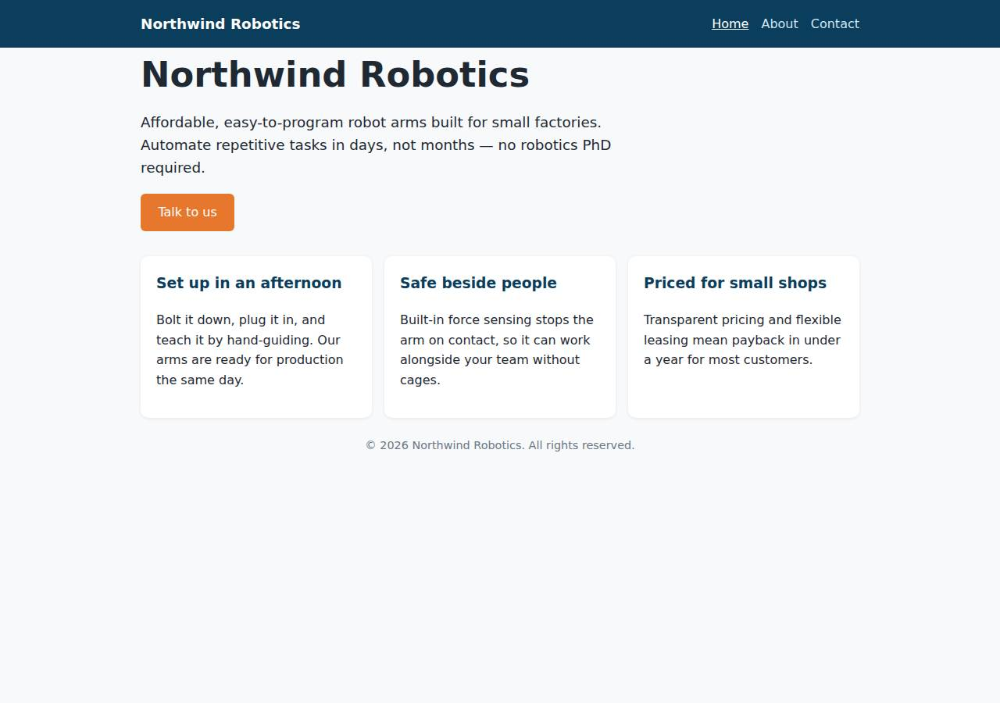
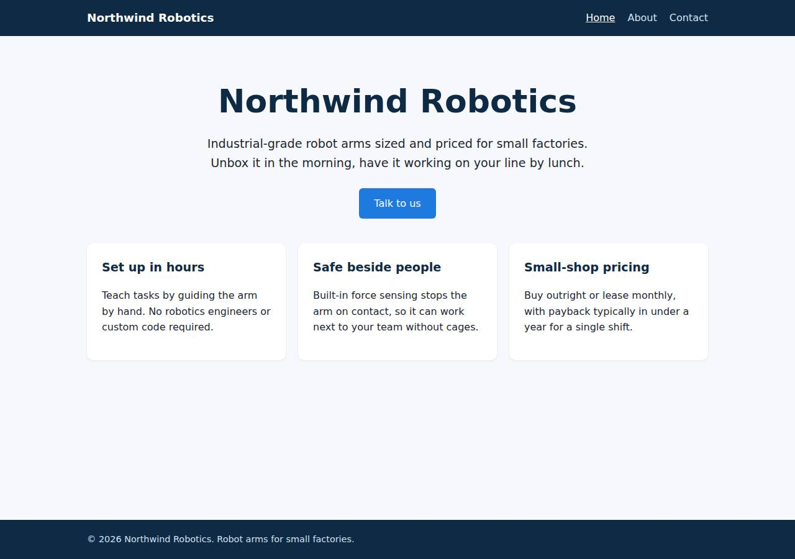
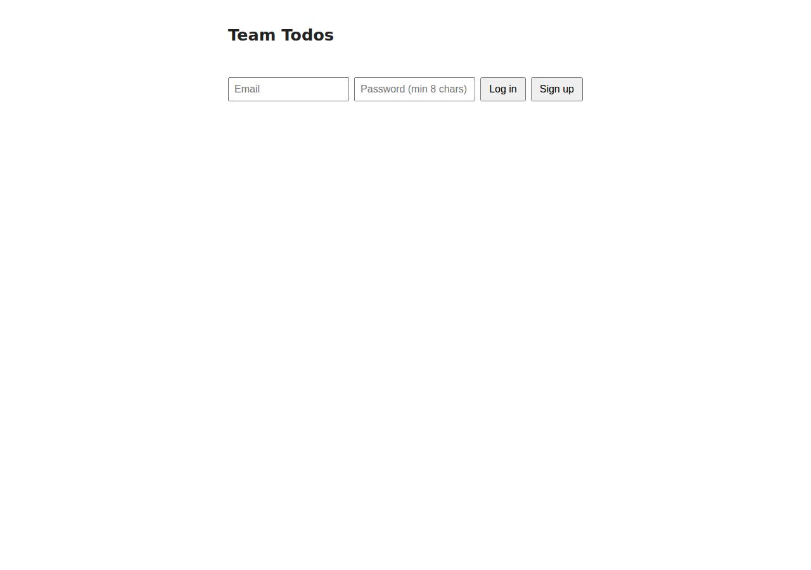
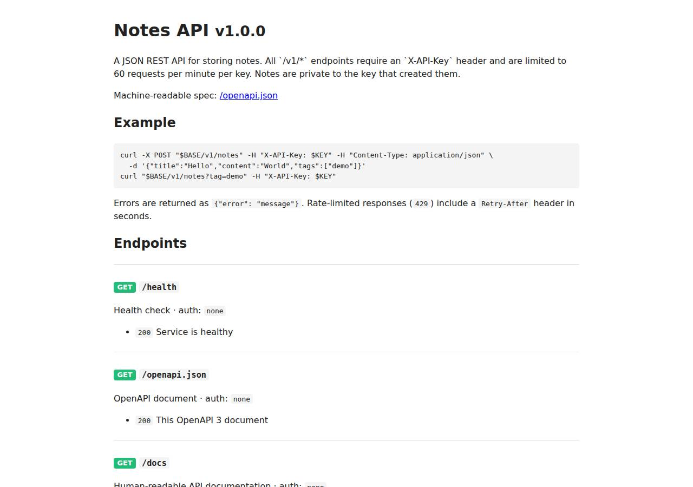
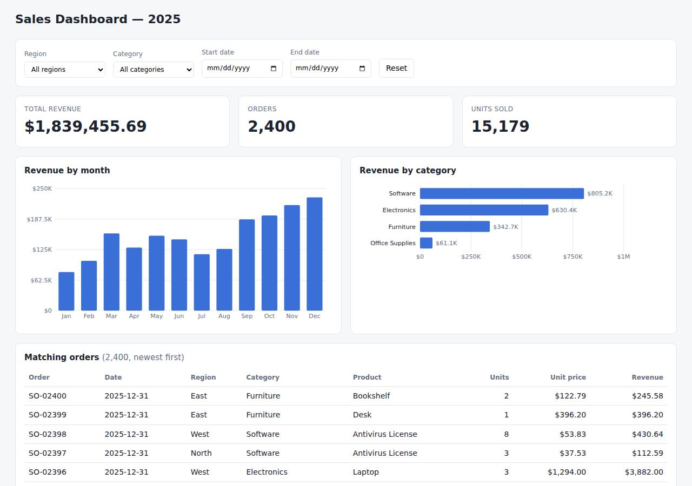
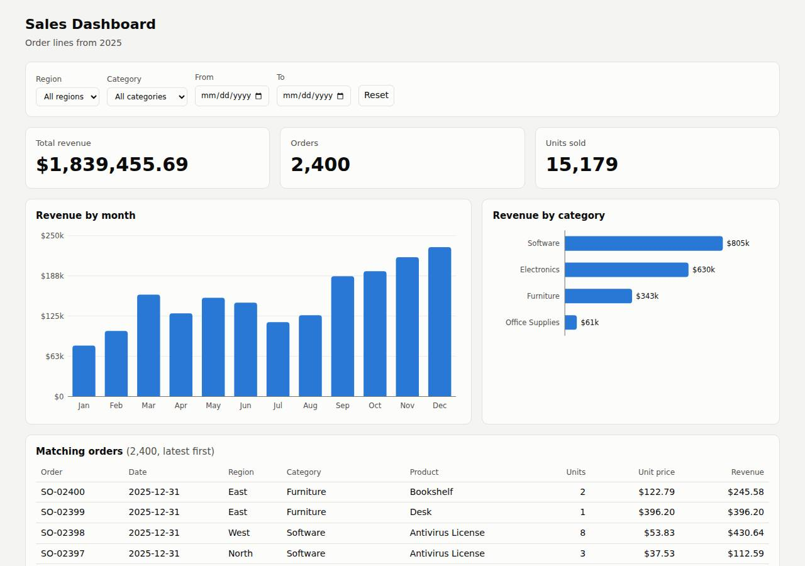
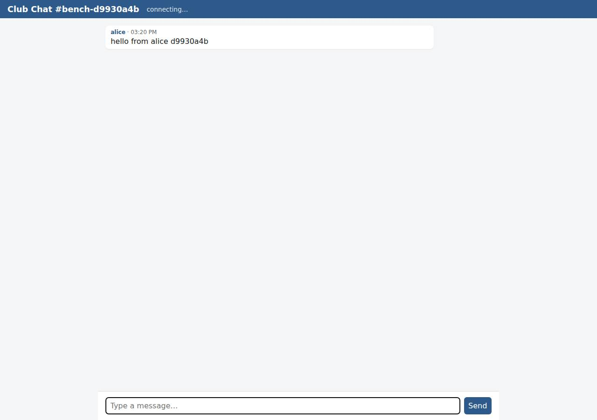

# Benchmark run 2026-10-14_10-1

- Date: 2026-10-14
- Agent: Claude Code 2.1.296
- Models: Opus 5.5 · medium effort · HIPAA organization
- Scope: full
- Trials per cell: 1
- Workflow run: https://github.com/cloudishai/ai-deploy-bench/actions/runs/38582810085

## Summary

| Cloud | Success | Human steps | Human time | Security & compliance | Checks passed | Avg build | Avg deploy | Tokens | Agent cost | Hosting, light use | Hosting, busy |
|---|---|---|---|---|---|---|---|---|---|---|---|
| [Cloudish](https://cloudish.ai) | 5/5 | 0 | 0 min | 77/100 | 100% | 2m 09s | 2m 58s | 5.52M | $3.90 | $0.55 | $39.20 |
| [DigitalOcean](https://www.digitalocean.com) | 5/5 | 3 | 7 min | 84/100 | 100% | 2m 02s | 5m 02s | 4.07M | $3.45 | $39.00 | $39.00 |
| [Render](https://render.com) | 5/5 | 2 | 5 min | 71/100 | 100% | 2m 00s | 3m 26s | 5.69M | $4.15 | $0.00 | $35.65 |
| [Vercel](https://vercel.com) | 3/5 | 3 | 8 min | 76/100 | 80% | 2m 35s | 2m 55s | 5.94M | $4.06 | $60.00 | $100.00 |

## By app

✅ success · ⚠️ deployed but some required checks failed (checks passed shown) · 🙋 blocked on something only a person can do · ❌ failed (stage shown) · 💥 the agent couldn't run (stage shown) · ❔ no result

| Cloud | Static site | CRUD app | API | Dashboard | Realtime chat |
|---|---|---|---|---|---|
| Cloudish | ✅ | ✅ | ✅ | ✅ | ✅ |
| DigitalOcean | ✅ | ✅ | ✅ | ✅ | ✅ |
| Render | ✅ | ✅ | ✅ | ✅ | ✅ |
| Vercel | ✅ | 🙋 needs a person | ✅ | ✅ | 🙋 needs a person |

## All cells

| Model | Cloud | App | Trial | Result | Checks | Human steps | Human time | Security & compliance | Build | Deploy | Ready after | Tokens | Agent cost | Hosting, light use | Hosting, busy |
|---|---|---|---|---|---|---|---|---|---|---|---|---|---|---|---|
| opus-5-5 | cloudish | static | 1 | [✅ success](cells/opus-5-5/cloudish/static-t1.md) | 16/16 | 0 | 0 min | 82/100 | 1m 30s | 2m 17s | 0s | 941.6K | $0.61 | $0.11 | $7.84 |
| opus-5-5 | cloudish | crud | 1 | [✅ success](cells/opus-5-5/cloudish/crud-t1.md) | 19/19 | 0 | 0 min | 71/100 | 2m 42s | 3m 26s | 0s | 1.13M | $0.83 | $0.11 | $7.84 |
| opus-5-5 | cloudish | api | 1 | [✅ success](cells/opus-5-5/cloudish/api-t1.md) | 20/20 | 0 | 0 min | 76/100 | 2m 25s | 3m 12s | 0s | 1.50M | $1.02 | $0.11 | $7.84 |
| opus-5-5 | cloudish | dataviz | 1 | [✅ success](cells/opus-5-5/cloudish/dataviz-t1.md) | 12/12 | 0 | 0 min | 76/100 | 1m 54s | 2m 59s | 0s | 972.5K | $0.71 | $0.11 | $7.84 |
| opus-5-5 | cloudish | realtime | 1 | [✅ success](cells/opus-5-5/cloudish/realtime-t1.md) | 13/13 | 0 | 0 min | 80/100 | 2m 17s | 2m 53s | 0s | 969.3K | $0.73 | $0.11 | $7.84 |
| opus-5-5 | digitalocean | static | 1 | [✅ success](cells/opus-5-5/digitalocean/static-t1.md) | 16/16 | 3 | 7 min | 90/100 | 1m 28s | 2m 08s | 0s | 688.5K | $0.61 | $5.00 | $5.00 |
| opus-5-5 | digitalocean | crud | 1 | [✅ success](cells/opus-5-5/digitalocean/crud-t1.md) | 19/19 | 3 | 7 min | 71/100 | 2m 20s | 9m 39s | 0s | 894.4K | $0.80 | $12.00 | $12.00 |
| opus-5-5 | digitalocean | api | 1 | [✅ success](cells/opus-5-5/digitalocean/api-t1.md) | 20/20 | 3 | 7 min | 82/100 | 2m 41s | 9m 52s | 0s | 943.4K | $0.90 | $12.00 | $12.00 |
| opus-5-5 | digitalocean | dataviz | 1 | [✅ success](cells/opus-5-5/digitalocean/dataviz-t1.md) | 12/12 | 3 | 7 min | 86/100 | 1m 42s | 1m 45s | 0s | 781.8K | $0.53 | $5.00 | $5.00 |
| opus-5-5 | digitalocean | realtime | 1 | [✅ success](cells/opus-5-5/digitalocean/realtime-t1.md) | 13/13 | 3 | 7 min | 88/100 | 1m 58s | 1m 44s | 0s | 758.8K | $0.60 | $5.00 | $5.00 |
| opus-5-5 | render | static | 1 | [✅ success](cells/opus-5-5/render/static-t1.md) | 16/16 | 2 | 5 min | 75/100 | 1m 14s | 2m 17s | 0s | 694.0K | $0.53 | $0.00 | $7.13 |
| opus-5-5 | render | crud | 1 | [✅ success](cells/opus-5-5/render/crud-t1.md) | 19/19 | 2 | 5 min | 62/100 | 2m 00s | 4m 14s | 0s | 1.25M | $0.88 | $0.00 | $7.13 |
| opus-5-5 | render | api | 1 | [✅ success](cells/opus-5-5/render/api-t1.md) | 20/20 | 2 | 5 min | 66/100 | 2m 28s | 5m 47s | 0s | 1.55M | $1.05 | $0.00 | $7.13 |
| opus-5-5 | render | dataviz | 1 | [✅ success](cells/opus-5-5/render/dataviz-t1.md) | 12/12 | 2 | 5 min | 76/100 | 2m 34s | 2m 36s | 0s | 1.36M | $1.00 | $0.00 | $7.13 |
| opus-5-5 | render | realtime | 1 | [✅ success](cells/opus-5-5/render/realtime-t1.md) | 13/13 | 2 | 5 min | 76/100 | 1m 42s | 2m 14s | 0s | 837.7K | $0.70 | $0.00 | $7.13 |
| opus-5-5 | vercel | static | 1 | [✅ success](cells/opus-5-5/vercel/static-t1.md) | 16/16 | 2 | 5 min | 76/100 | 1m 46s | 1m 13s | 0s | 694.0K | $0.50 | $20.00 | $20.00 |
| opus-5-5 | vercel | crud | 1 | [⚠️ partial](cells/opus-5-5/vercel/crud-t1.md) | 6/19 | 3 | 8 min | 66/100 | 1m 50s | 2m 32s | 0s | 1.13M | $0.77 | $20.00 | $20.00 |
| opus-5-5 | vercel | api | 1 | [✅ success](cells/opus-5-5/vercel/api-t1.md) | 20/20 | 2 | 5 min | 78/100 | 2m 54s | 3m 09s | 0s | 1.42M | $1.02 | $0.00 | $20.00 |
| opus-5-5 | vercel | dataviz | 1 | [✅ success](cells/opus-5-5/vercel/dataviz-t1.md) | 12/12 | 2 | 5 min | 77/100 | 2m 21s | 1m 21s | 0s | 1.02M | $0.73 | $20.00 | $20.00 |
| opus-5-5 | vercel | realtime | 1 | [⚠️ partial](cells/opus-5-5/vercel/realtime-t1.md) | 9/13 | 3 | 8 min | 81/100 | 4m 03s | 6m 21s | 0s | 1.69M | $1.05 | $0.00 | $20.00 |

## What was built

Every cell builds its app from scratch for its cloud, so stacks differ by platform.

| Model | Cloud | App | Trial | Technologies | Code lines | Dependencies | Deploy config | Build tokens | Deploy tokens |
|---|---|---|---|---|---|---|---|---|---|
| opus-5-5 | cloudish | static | 1 | Node.js 22, Node.js http | 295 | 0 | Dockerfile, .dockerignore | 265.7K | 675.9K |
| opus-5-5 | cloudish | crud | 1 | Node.js 24, Node.js http, SQLite | 505 | 0 | Dockerfile, .dockerignore | 421.7K | 712.0K |
| opus-5-5 | cloudish | api | 1 | Node.js 24, Node.js http, SQLite | 594 | 0 | Dockerfile, .dockerignore | 469.1K | 1.03M |
| opus-5-5 | cloudish | dataviz | 1 | Node.js 22, Node.js http | 364 | 0 | Dockerfile, .dockerignore | 239.5K | 733.1K |
| opus-5-5 | cloudish | realtime | 1 | Node.js 22, Node.js http, Files on a persistent volume | 458 | 1 | Dockerfile, .dockerignore | 401.5K | 567.8K |
| opus-5-5 | digitalocean | static | 1 | Node.js 22, Node.js http | 402 | 0 | Dockerfile, .dockerignore, app.yaml | 296.0K | 392.5K |
| opus-5-5 | digitalocean | crud | 1 | Node.js 22, Express, PostgreSQL | 391 | 5 | Dockerfile, .dockerignore, .do/app.yaml | 393.7K | 500.7K |
| opus-5-5 | digitalocean | api | 1 | Node.js 22, Express, PostgreSQL | 522 | 3 | Dockerfile, .dockerignore, .do/app.yaml | 460.7K | 482.7K |
| opus-5-5 | digitalocean | dataviz | 1 | Node.js 22, Node.js http | 309 | 0 | Dockerfile, .dockerignore, app.yaml | 335.3K | 446.5K |
| opus-5-5 | digitalocean | realtime | 1 | Node.js 22, Node.js http | 486 | 1 | Dockerfile, .dockerignore, .do/app.yaml | 423.8K | 335.0K |
| opus-5-5 | render | static | 1 | Node.js 18+, Node.js http | 352 | 0 | render.yaml | 291.3K | 402.7K |
| opus-5-5 | render | crud | 1 | Node.js 22, Express, PostgreSQL | 416 | 5 | render.yaml | 397.1K | 855.9K |
| opus-5-5 | render | api | 1 | Node.js 24, Express, PostgreSQL | 489 | 2 | render.yaml | 542.4K | 1.00M |
| opus-5-5 | render | dataviz | 1 | Node.js 22, Node.js http | 515 | 0 | render.yaml | 559.0K | 799.2K |
| opus-5-5 | render | realtime | 1 | Node.js 24, Node.js http | 472 | 1 | render.yaml | 341.8K | 495.9K |
| opus-5-5 | vercel | static | 1 | Node.js 18+, Vercel Functions | 380 | 0 | vercel.json | 335.2K | 358.8K |
| opus-5-5 | vercel | crud | 1 | Node.js 20+, Express | 379 | 3 | vercel.json | 351.1K | 777.1K |
| opus-5-5 | vercel | api | 1 | Node.js 20+, Express | 612 | 2 | vercel.json | 547.9K | 869.2K |
| opus-5-5 | vercel | dataviz | 1 | Node.js 18+, Vercel Functions | 467 | 0 | vercel.json | 614.0K | 402.1K |
| opus-5-5 | vercel | realtime | 1 | Node.js 22, Next.js, React | 550 | 8 | vercel.json | 789.1K | 898.3K |

*Human steps* counts the distinct things a person had to do, or would have to do, for the agent's deployments to work (account setup, terms, payment, Git hosting), and *human time* estimates how long they take. *Security & compliance* is an independent Claude Code review of how each app was deployed, whether its hosting plan fits how the app is used, and what is live, scored against a fixed rubric. See the methodology. Times are wall-clock time of the agent's build and deploy phases; *ready after* is how much longer the app took to answer once the agent finished. Tokens include cache reads and writes. Agent cost is the API cost reported by Claude Code. Hosting is the estimated monthly cost of the deployed resources at two levels of traffic: *light use* is a few visits a week, and *busy* is a public app that crawlers, monitors and visitors hit around the clock. Plans that a business's app can't use under their terms, or that the traffic would exceed, are priced on the cheapest plan that allows it. `+` means some values were unknown. See [docs/methodology.md](../../../docs/methodology.md#hosting-cost).

## Screenshots

What the verifier saw on each deployment. Each picture links to its cell's report, which has the rest.

| App | Cloudish | DigitalOcean | Render | Vercel |
|---|---|---|---|---|
| Static site |  |  |  |  |
| CRUD app |  |  |  |  |
| API |  |  |  |  |
| Dashboard |  |  |  |  |
| Realtime chat |  |  |  |  |
