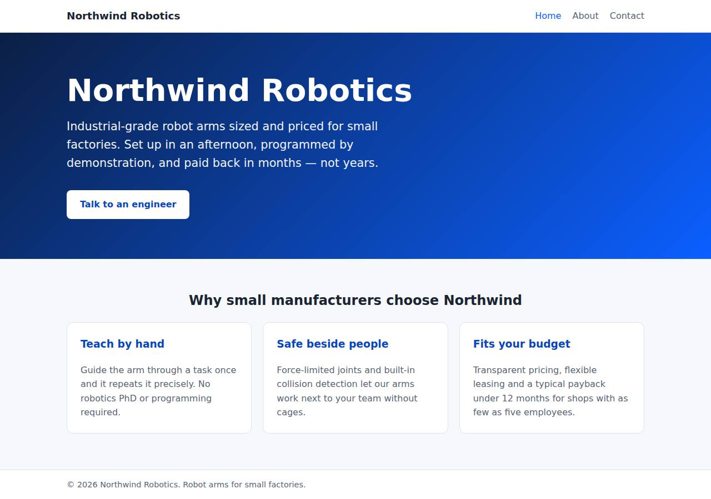
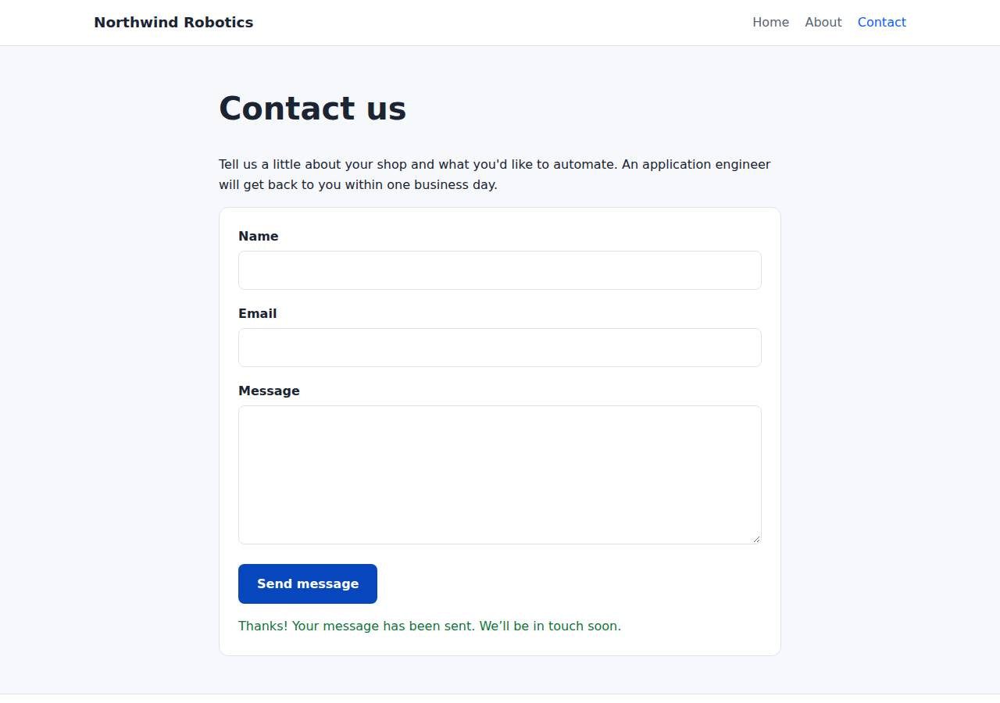

# ✅ Static Content Site on Railway with Opus 5.5 (trial 1)

**success**: 16/16 checks passed (100%).

- URL: https://adb-bbchf-static-web-production.up.railway.app (from deployment.json)
- Estimated hosting: Light use: $0.00/month, Busy: $0.00/month (the agent estimated $1.00)
- Agent: Claude Code 2.1.296, model `claude-opus-5-5`, effort medium, HIPAA organization
- Resource prefix: `adb-bbchf-static`

| | Build | Deploy | Total |
|---|---|---|---|
| Status | completed | completed | |
| Time | 2m 01s | 2m 35s | 5m 27s |
| Turns | 13 | 8 | |
| Tokens | 505.6K | 403.6K | 1.14M |
| Agent cost | $0.53 | $0.17 | $0.81 |
| Shell commands | 11 | 7 | |

App answered 0s after the agent finished deploying.

**Needed a human:** the no-credentials attempt didn't produce a working public URL, so the cloud's credentials were provided and the agent redeployed (that attempt took 51s, 227.5K tokens, $0.11).

## Screenshots

**The home page** (https://adb-bbchf-static-web-production.up.railway.app/)

**The contact page after the verifier submitted the form** (https://adb-bbchf-static-web-production.up.railway.app/contact)

## What was built

- Runtime: Node.js 18+
- Frameworks: Node.js http module (built in)
- Packaging: railway.json
- Code: 457 lines in 17 files (JavaScript 207, HTML 184, CSS 55, JSON 35, Markdown 22, Shell 11)
- Dependencies: 0 npm, 0 Python
- Deploy config: `railway.json`

### Stack fit

**90/100**, from the same independent review, judged against the app's requirements rather than a preferred stack.

A dependency-free Node.js server on a single Railway service is a proportionate, well-reasoned fit for three static pages plus a same-origin form endpoint, and it matches the plan in STACK.md.

| Criterion | Weight | Score | Rationale |
|---|---|---|---|
| Fit for the job | 40 | 9/10 | Built-in node:http serves the three static pages and the same-origin JSON endpoint correctly, with exact routing and 404s. Nothing needs storing, so having no data store is right. |
| Proportion | 30 | 10/10 | One file with roughly 100 lines and zero dependencies, which is about as small as the requirements allow. STACK.md reasonably rejects a proxy-plus-function or two-service setup. |
| Platform fit | 30 | 8/10 | Railway has no static hosting or serverless functions, so a single small always-on service is the natural way to serve static pages and an API on one origin. Railpack auto-detects it and it binds to $PORT. The cost is an always-on container mostly serving static files. |

## Human steps

2 step(s), about 5 min of a person's time.

- **Sign up for an account and verify the email address** (~3 min): prerequisite: account setup
- **Create an API token and hand it to the agent** (~2 min): prerequisite: account setup

## Security and compliance review

**85/100**, from an independent Claude Code review (`claude-opus-5-5`, high effort, HIPAA organization, $0.29) of the process, the code, the hosting plan and the live app.

A zero-dependency Node.js server serves the Northwind Robotics site and its contact endpoint on Railway. It handles secrets well, exposes nothing beyond the app, and validates input properly. The weaknesses are minor: no HSTS, CSP or frame-protection headers; no rate limit on the contact form; and a deploy uploaded from a local directory with an unpinned Node runtime and the default container user.

| Criterion | Weight | Score | Rationale |
|---|---|---|---|
| Secrets handling | 25 | 10/10 | The app needs no secrets. The deploy used an existing CLI login, no token shows up in the transcripts or source, and .railwayignore keeps .env out of the upload. |
| Deployment provenance | 20 | 7/10 | Production runs the reviewed code, uploaded with `railway up` from the agent's working directory and built by Railpack with no third-party dependencies. But there is no source repo tied to the deploy, and the Node runtime is unpinned (engines ">=18"), so Railpack's default base image picks the version. |
| Terms compliance | 15 | 8/10 | The service is an always-on usage-based Railway service with no sleep or expiry, which suits a commercial marketing site. The account's plan isn't recorded (context.json has no plan), and as far as I know Railway's Hobby and Pro terms don't forbid commercial use, though Railway pitches Pro for production business workloads. |
| Least privilege | 15 | 8/10 | There is one public web service with no data stores, no extra services and no variables. The container likely runs as Railpack's default (root) user, and the agent did nothing to change that. |
| Transport security | 10 | 8/10 | HTTPS works with a valid Let's Encrypt certificate, and plain HTTP gets a 301 redirect to HTTPS. Railway's edge sets no security headers and the app sets only X-Content-Type-Options, so HSTS, CSP and frame protection are missing. |
| Attack surface | 10 | 10/10 | Routing is an exact-match allowlist. Requests for source files, .env, .git, config files and path-traversal attempts all got the generic 404 page, and errors leak no stack traces or debug output. |
| Application security | 5 | 8/10 | Input validation is strict: type checks, an email regex, a 64 KB body cap, and handling for bad JSON and non-object bodies. The client renders messages with textContent, so there is no XSS path. The public form endpoint has no rate limiting, and it logs the submitter's email address. |

Findings:

- **low** · app · Missing HSTS, CSP and frame-protection headers: curl -sI https://adb-bbchf-static-web-production.up.railway.app/ returns only cache-control, content-type, x-content-type-options and Railway headers; server.js:50-55 sets only X-Content-Type-Options. Fix: Add Strict-Transport-Security, a restrictive Content-Security-Policy (default-src 'self'), X-Frame-Options: DENY (or frame-ancestors 'none'), and Referrer-Policy in sendFile/sendJson.
- **low** · app · No rate limiting on public POST /api/contact: server.js:60-86 accepts any number of submissions per client; the code has no per-client throttle or CAPTCHA, and an unauthenticated probe POST returned 200 {"ok":true} straight away. Fix: Add a simple per-IP token bucket (using X-Forwarded-For from Railway's edge) or a honeypot field to slow down spam.
- **low** · deployment · Deploy from local upload with unpinned Node runtime: deploy.md: `railway up --service adb-bbchf-static-web --ci` with no connected repo; package.json engines "node": ">=18" and railway.json builder RAILPACK, so Railpack's default base image chooses the Node version. Fix: Pin the Node version (e.g. engines "22.x" or a .node-version file), and deploy from a Git repository the owner controls so each deploy maps to a commit.
- **info** · deployment · Container user not set to non-root: railway.json uses the Railpack builder with no user configuration; the build log in deploy.md shows the default Railpack image, which typically runs as root. Fix: Use a Dockerfile based on a pinned node image with `USER node`, or configure the Railpack image to run as an unprivileged user.
- **info** · app · Submitter email written to logs: server.js:83 console.log(`contact submission from ${body.email.trim()}`) Fix: Leave personal data out of the log line (log only that a submission arrived), or document the retention period for Railway logs.
- **info** · deployment · Account plan not recorded for a commercial app: process/context.json has "use": "commercial" and an empty account; deployment.json says only "account's existing Railway plan (usage-based)". Fix: Confirm the account is on a paid plan suited to business production use (Railway Pro is aimed at that), not the trial.

## Checks

| Check | Required | Result | Detail |
|---|---|---|---|
| GET / answers 2xx within 1 min | yes | passed |  |
| The app is served over HTTPS with a valid certificate | yes | passed |  |
| The app is public: no redirect to another host such as a login page | yes | passed |  |
| GET / returns HTML | yes | passed |  |
| GET /about returns HTML | yes | passed |  |
| GET /contact returns HTML | yes | passed |  |
| Home has an <h1> containing 'Northwind Robotics' | yes | passed |  |
| About has a heading containing 'About' | yes | passed |  |
| Contact has a form with name, email and message fields | yes | passed |  |
| Every page has a <title> and a viewport meta tag | no | passed |  |
| Home links to /about and /contact | no | passed |  |
| POST /api/contact with valid input returns {ok: true} | yes | passed |  |
| POST /api/contact rejects a bad email and an empty message with 400 | yes | passed |  |
| Unknown paths return 404 | yes | passed |  |
| Submitting the /contact form in a browser posts to /api/contact without leaving the page | yes | passed |  |
| Pages load in a browser without uncaught JavaScript errors | no | passed |  |

## Cloud resources

| Traffic | $/month | How it was priced |
|---|---|---|
| Light use | $0.00 | nothing deployed |
| Busy | $0.00 | nothing deployed |

Each resource's list price, at the size it was provisioned and always on:

None found.

Teardown: 0 deleted

## Agent's deploy summary

> The site is live at **https://adb-bbchf-static-web-production.up.railway.app**, and every requirement in `TASK.md` passed when I tested it through that URL.
>
> **What I created:**
> - A Railway project, `adb-bbchf-static` (id `edb65e6c-734a-4532-8472-add1f9ae1602`).
> - One service in it, `adb-bbchf-static-web` (id `dc89ce35-c813-4e4b-8f0d-1c697b7f58ce`), with a Railway-generated HTTPS address. I uploaded the code directly from this folder; no GitHub repo is connected.
>
> **What I tested through the public URL:**
> - **Pages:** `/`, `/about` and `/contact` return 200 as HTML, each with a title, the viewport tag and links to the other pages. The home page heading is "Northwind Robotics".
> - **Unknown paths:** `/missing` and `/about.html` return 404.
> - **Contact endpoint:** valid input returns 200 with `{"ok":true}`. A missing name, an invalid email or an empty message each return 400 with an error message.
> - **Form in a browser:** in headless Chrome, an empty submit showed "Name is required", and a filled-in submit showed the thank-you message without reloading the page.
>
> **Cost:** about $1 a month, which is my estimate rather than a measured figure. It's a single small process billed by usage, and probably covered by the usage included in your existing plan. No person needed to do anything, so `human_steps` in `deployment.json` is empty.
>
> **Things to know:**
> - Railway warns that `railway.json` is deprecated in favour of `.railway/railway.ts`. It keeps working until 2026-12-01, and `railway config migrate` converts it.
> - `deploy.sh` would create a second project if run again. To redeploy changes, run `railway up --service adb-bbchf-static-web` instead.

## Shell commands during deploy

- `3s` `which railway || npm i -g @railway/cli >/dev/null 2>&1; railway whoami 2>&1; railway list 2>&1 | head`
- `10s` `railway init --help 2>&1 | grep -E '^\s+-' ; railway init --name adb-bbchf-static 2>&1 | tail -5`
- `14s` `railway add --service adb-bbchf-static-web 2>&1 | grep -v -i "config as code\|migrate\|keep working"; railway up --service adb-bbchf-static-web --ci 2>&1 | grep -v -i "config as code\|migrate\|keep wo`
- `2m 06s` `railway domain --service adb-bbchf-static-web --json 2>&1 | grep -v -i "config as code\|migrate\|keep working"; railway status --json 2>/dev/null | python3 -c 'import json,sys;d=json.load(sys.stdin);p`
- `2m 13s` `U=https://adb-bbchf-static-web-production.up.railway.app; for i in $(seq 1 30); do c=$(curl -s -o /dev/null -w '%{http_code}' $U/); [ "$c" = 200 ] && break; sleep 5; done`
- `2m 18s` `cd /tmp/e2e 2>/dev/null || { mkdir -p /tmp/e2e && cd /tmp/e2e && npm init -y >/dev/null && npm i -s puppeteer-core >/dev/null 2>&1; }; sed -i 's#http://localhost:4321#https://adb-bbchf-static-web-prod`
- `2m 27s` `cat > deployment.json <<'EOF'`
