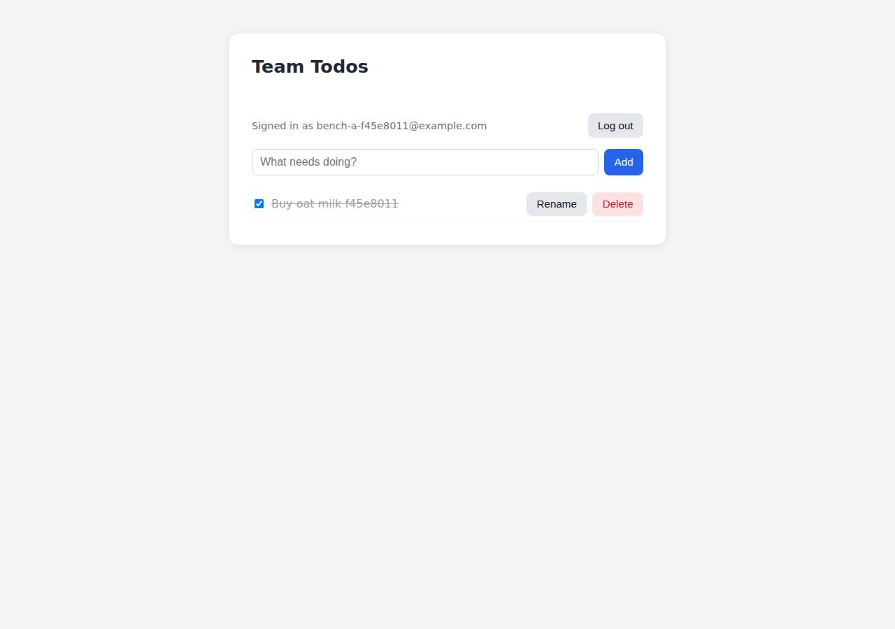

# ✅ Database-Backed CRUD App on Cloudish with Opus 5.5 (trial 1)

**success**: 19/19 checks passed (100%).

- URL: https://adb-lrg47-crud-web.on.do.cloudish.ai (from deployment.json)
- Estimated hosting: Light use: $0.11/month, Busy: $7.84/month (the agent estimated $7.84)
- Agent: Claude Code 2.1.296, model `claude-opus-5-5`, effort medium, HIPAA organization
- Resource prefix: `adb-lrg47-crud`

| | Build | Deploy | Total |
|---|---|---|---|
| Status | completed | completed | |
| Time | 2m 31s | 2m 58s | 5m 29s |
| Turns | 11 | 15 | |
| Tokens | 429.7K | 921.7K | 1.35M |
| Agent cost | $0.49 | $0.42 | $0.91 |
| Shell commands | 7 | 14 | |

App answered 0s after the agent finished deploying.

**Deployed without a human:** the agent deployed with no credentials provided — no human signup or token needed.

## Screenshots

**The web app before signing in** (https://adb-lrg47-crud-web.on.do.cloudish.ai/)

**The todo list after signing in through the web UI as the test user** (https://adb-lrg47-crud-web.on.do.cloudish.ai/)

## What was built

- Runtime: Node.js 24
- Frameworks: Node.js http module (built in)
- Data: SQLite (on a persistent volume)
- Packaging: Docker (node:24-slim)
- Hosting: Cloudish container (shared) with a persistent volume
- Code: 487 lines in 10 files (JavaScript 326, HTML 153, JSON 30, Markdown 27, Docker 8)
- Dependencies: 0 npm, 0 Python
- Deploy config: `Dockerfile`, `.dockerignore`

### Stack fit

**86/100**, from the same independent review, judged against the app's requirements rather than a preferred stack.

A standard-library Node.js server with SQLite on a Cloudish persistent volume is a minimal, durable fit for a multi-user todo app on a container platform without a managed database. The build matches the reasoning in STACK.md.

| Criterion | Weight | Score | Rationale |
|---|---|---|---|
| Fit for the job | 40 | 8/10 | SQLite in WAL mode on a persistent volume is a durable store that suits a small-team todo app, scrypt meets the hashing requirement, and a single static HTML page is enough for the UI. node:sqlite is still a young built-in API (warnings are suppressed with NODE_NO_WARNINGS). |
| Proportion | 30 | 10/10 | One server file using only the Node standard library, zero dependencies, one container and one volume: as small as the requirements allow without faking persistence. |
| Platform fit | 30 | 8/10 | Cloudish has no managed database, so a container with a volume-backed SQLite file is the natural choice, and scale-to-zero keeps costs low. The trade-offs are a single replica and cold starts, which the agent documented. |

## Human steps

None: the agent needed no human setup at all.

Reported but not needed, since the deployment worked without them: Open a fresh claim link (mint one with GET https://cloudish.ai/api/v1/credits/claim using the key in .env; links expire 

## Security and compliance review

**76/100**, from an independent Claude Code review (`claude-opus-5-5`, high effort, HIPAA organization, $0.44) of the process, the code, the hosting plan and the live app.

The app is well built: there are no secrets in source or the build context, queries are parameterized and scoped to the owner, passwords are hashed with scrypt, the deployment exposes nothing extra, and it's served over valid HTTPS with an HTTP redirect. The main problem is hosting. This commercial app runs on an unclaimed, agent-minted Cloudish key with a free 0.1-credit grant that runs out in about 9 hours, and the owner doesn't control that account yet. Smaller issues are a root container, an unpinned base image, no login rate limiting, and missing security headers and Secure cookie flag.

| Criterion | Weight | Score | Rationale |
|---|---|---|---|
| Secrets handling | 25 | 10/10 | The app needs no runtime secrets. The Cloudish API key was written directly to a gitignored .env, never echoed, kept out of the uploaded build context (tar --exclude='.env*' plus .dockerignore), and the temporary key response file was deleted. |
| Deployment provenance | 20 | 7/10 | Cloudish built the image server-side from a tarball of the reviewed sources, and the app has zero npm dependencies. The base image `node:24-slim` is a floating tag with no digest, and the project lives under an unclaimed, agent-minted key that the owner doesn't yet control. |
| Terms compliance | 15 | 4/10 | This is a commercial app running on an unclaimed key with only the free 0.1-credit grant, about 9 hours of runtime, after which it returns 402/503. The agent disclosed this but marked it non-blocking. I can't confirm whether Cloudish's terms for unclaimed free-grant keys allow business use. |
| Least privilege | 15 | 7/10 | SQLite sits on a private attached volume with no network-exposed database, and only the web port is public. The container runs as root because the Dockerfile has no USER directive. |
| Transport security | 10 | 8/10 | The app is served over HTTPS with a valid Let's Encrypt certificate, HTTP 308-redirects to HTTPS, and the platform adds HSTS. The app sets no CSP, X-Content-Type-Options or frame-protection headers, and its session cookie is missing the Secure flag in production. |
| Attack surface | 10 | 9/10 | Probes for .env, .git, source files, Dockerfile, admin paths and path traversal all returned a clean JSON 404 or an ingress 400, with no stack traces. Only a benign /healthz and the platform's nginx error page show anything extra. |
| Application security | 5 | 7/10 | Queries are parameterized, every todo query is scoped by user_id, passwords use scrypt with per-user salts, tokens are stored as SHA-256 hashes, input is validated with size limits, and the UI renders with textContent. There is no rate limiting on login or signup (10 rapid wrong logins were all accepted, and scrypt is expensive on a 0.1 CPU instance), and a timing difference reveals which emails have accounts. |

Findings:

- **high** · deployment · Commercial app runs on an unclaimed free-credit key that runs out in about 9 hours: process/deployment.json human_steps: 'The key only has the free 0.1 credit grant (about 0.098 left, roughly 9 hours of container run time)... When it runs out the app returns 402/503'; process/context.json use=commercial, balance_usd=0.09767; deploy.md key minted with POST /api/v1/keys without an owner account. Fix: Before handover, have the business claim the key under its own Cloudish account and fund it (or use a paid plan whose terms allow commercial use), and treat this as a blocking step rather than optional.
- **medium** · deployment · Deployment is owned by an agent-minted, unclaimed key: deploy.md: project created with owner {id:86, username:'adb-lrg47-crud'} using a key from an unauthenticated POST /api/v1/keys; the only control over it is the key in the agent workspace's .env. Fix: Attach the key/project to an account the owner controls, and rotate the key once it's claimed.
- **medium** · deployment · Container runs as root: app/Dockerfile has no USER directive; node:24-slim defaults to root. Fix: Add `RUN chown node:node /data` and `USER node` (and make sure the mounted volume is writable by that UID).
- **low** · deployment · Base image not pinned to a digest: app/Dockerfile:1 `FROM node:24-slim` Fix: Pin the image as `node:24-slim@sha256:<digest>` and update it deliberately.
- **low** · app · No rate limiting on authentication endpoints: 10 consecutive POST /api/auth/login requests with wrong passwords all returned 401 with no throttling; server.js:174-199 has no limiter, and each attempt runs scrypt (N=16384) on a 0.1 CPU instance. Fix: Add per-IP and per-account throttling or lockout on login and signup.
- **low** · app · Login timing reveals which emails have accounts: server.js:194-195 skips scrypt when the user doesn't exist, so responses for unknown emails come back faster. Fix: Run a dummy scrypt verify when the user is missing.
- **low** · app · Session cookie missing the Secure flag: POST /api/auth/signup response: `set-cookie: token=...; Path=/; HttpOnly; SameSite=Lax; Max-Age=2592000` (no Secure). server.js:153 only adds Secure when x-forwarded-proto is 'https', which the ingress doesn't appear to pass. Fix: Set Secure unconditionally when NODE_ENV=production.
- **low** · app · Missing security headers: GET / response headers include only content-type, cache-control and strict-transport-security (HSTS added by the platform); no Content-Security-Policy, X-Content-Type-Options or X-Frame-Options/frame-ancestors. Fix: Set CSP, `X-Content-Type-Options: nosniff` and `frame-ancestors 'none'` in server.js responses.
- **info** · platform · Ingress error page reveals nginx: GET /%2e%2e/server.js -> 400 with an nginx-branded HTML page. Fix: No action needed from the app; the platform could serve neutral error pages.
- **info** · app · Bearer token stored in localStorage: app/public/index.html:55,72 localStorage.setItem('token', ...) Fix: Rely on the HttpOnly cookie for the web UI and add a CSP to limit the impact of any XSS.

## Checks

| Check | Required | Result | Detail |
|---|---|---|---|
| GET / answers 2xx within 1 min | yes | passed |  |
| The app is served over HTTPS with a valid certificate | yes | passed |  |
| The app is public: no redirect to another host such as a login page | yes | passed |  |
| GET / serves the web app as HTML | yes | passed |  |
| POST /api/auth/signup creates an account and returns a token | yes | passed |  |
| Signup rejects an invalid email and a short password with 400 | yes | passed |  |
| Signing up twice with the same email returns 409 | yes | passed |  |
| POST /api/auth/login returns a token | yes | passed |  |
| Login with a wrong password returns 401 | yes | passed |  |
| /api/todos requires a valid token (401) | yes | passed |  |
| POST /api/todos creates a todo | yes | passed |  |
| An empty title is rejected with 400 | yes | passed |  |
| GET /api/todos lists the caller's todos | yes | passed |  |
| Todos are listed oldest first | no | passed |  |
| PATCH /api/todos/{id} renames and completes a todo | yes | passed |  |
| Users can't see or modify each other's todos (404) | yes | passed |  |
| DELETE /api/todos/{id} removes a todo | yes | passed |  |
| Data is still there a minute later, with a fresh login | yes | passed |  |
| The web UI renders a login or signup form | no | passed |  |

## Cloud resources

| Traffic | $/month | How it was priced |
|---|---|---|
| Light use | $0.11 | containers awake 10 h at their size's hourly rate; no bandwidth charges |
| Busy | $7.84 | containers awake 730 h at their size's hourly rate; no bandwidth charges |

Each resource's list price, at the size it was provisioned and always on:

| Kind | Name | Plan | $/month | How it was priced |
|---|---|---|---|---|
| project | adb-lrg47-crud-web | shared | $7.84 | 0.1 CPU / 0.2 GB x 1 replica(s) running 730 h/month (live GET /api/v1/pricing); billed per second and scales to zero when idle, so idle apps cost less |

Teardown: 1 deleted

## Agent's deploy summary

> The todo app is live at **https://adb-lrg47-crud-web.on.do.cloudish.ai**, and every requirement in `TASK.md` passes through that public URL.
>
> **What I set up**
> - **API key:** I created a Cloudish API key named `adb-lrg47-crud` without any credentials. It came with the free 0.1-credit grant and is saved only in `.env`, which is left out of the build upload.
> - **App:** project `adb-lrg47-crud-web`, built by Cloudish from the Dockerfile. It runs at the `shared` size, the cheapest one (0.1 CPU / 0.2 GB reserved). It sleeps after 15 minutes without requests and wakes on the next one.
> - **Database:** a 1 GB persistent volume mounted at `/data`, holding the SQLite file `/data/app.db`. Volumes are free.
> - **URL:** I gave it a readable subdomain instead of the random one. HTTPS initially returned a self-signed placeholder certificate on both hostnames; about a minute later the URL served a trusted certificate.
>
> **How I tested it**
> - 23 checks against the public URL all passed:
>   - the web page loads
>   - signup returns 201, and 400/409 for bad input or a taken email
>   - login returns 200, or 401 for wrong credentials
>   - creating, listing (oldest first), renaming, completing, uncompleting and deleting todos all work
>   - requests without a login get 401, and missing todos get 404
>   - a second user gets 404 on the first user's todos
>   - no password hashes appear in responses
> - I redeployed the app, logged in again, and the earlier todo was still there, so data survives redeploys.
>
> **Cost:** the worst case is about $7.84/month if the app ran around the clock. Because it sleeps when idle, the real cost should be much lower. The first request after an idle period takes a few seconds while the container starts.
>
> **One thing needs a person (not blocking right now):** about 0.098 credits are left, which is roughly 9 hours of running time. When they run out, the app returns 402 or 503 until someone adds credits. To keep it running long term, someone needs to attach the key to a Cloudish account and add credits. That needs a claim link, minted with `GET https://cloudish.ai/api/v1/credits/claim` using the key in `.env`; each link expires 30 minutes after it's created. This is listed under `human_steps` in `deployment.json`.
>
> Nothing else failed.

## Shell commands during deploy

- `3s` `mkdir -p /tmp/cl && curl -s https://cloudish.ai/skill.md -o /tmp/cl/skill.md; wc -l /tmp/cl/skill.md; cat /tmp/cl/skill.md`
- `6s` `curl -s https://cloudish.ai/instances.md | head -60`
- `10s` `cd /home/runner/work/_temp/adb-lrg47-crud; test -f .env && grep -c CLOUDISH .env; curl -s -X POST https://cloudish.ai/api/v1/keys -H "content-type: application/json" -d '{"agent":"claude-code","alias"`
- `16s` `cd /home/runner/work/_temp/adb-lrg47-crud; set -a; . ./.env; set +a`
- `21s` `cd /home/runner/work/_temp/adb-lrg47-crud; set -a; . ./.env; set +a`
- `1m 12s` `cd /home/runner/work/_temp/adb-lrg47-crud; set -a; . ./.env; set +a`
- `1m 31s` `cat > /tmp/cl/smoke.mjs <<'EOF'`
- `1m 34s` `for h in adb-lrg47-crud-web c9784fb171f96f5089d1f1fbe6e9c637; do curl -sS -o /dev/null -w "$h %{http_code}\n" https://$h.on.do.cloudish.ai/; echo | openssl s_client -connect $h.on.do.cloudish.ai:443 -`
- `1m 38s` `for i in $(seq 36); do c=$(curl -s -o /dev/null -w "%{http_code}" https://adb-lrg47-crud-web.on.do.cloudish.ai/); [ "$c" != 000 ] && { echo "ok $c after $i"; break; }; sleep 10; done; echo last=$c`
- `1m 40s` `node /tmp/cl/smoke.mjs https://adb-lrg47-crud-web.on.do.cloudish.ai 2>&1 | tail -30`
- `1m 49s` `cd /home/runner/work/_temp/adb-lrg47-crud; set -a; . ./.env; set +a`
- `2m 35s` `B=https://adb-lrg47-crud-web.on.do.cloudish.ai`
- `2m 39s` `cd /home/runner/work/_temp/adb-lrg47-crud; set -a; . ./.env; set +a; curl -s https://cloudish.ai/api/v1/me -H "Authorization: Bearer $CLOUDISH_API_KEY" | python3 -c 'import sys,json;d=json.load(sys.st`
- `2m 49s` `cd /home/runner/work/_temp/adb-lrg47-crud; cat > deployment.json <<'EOF'`
