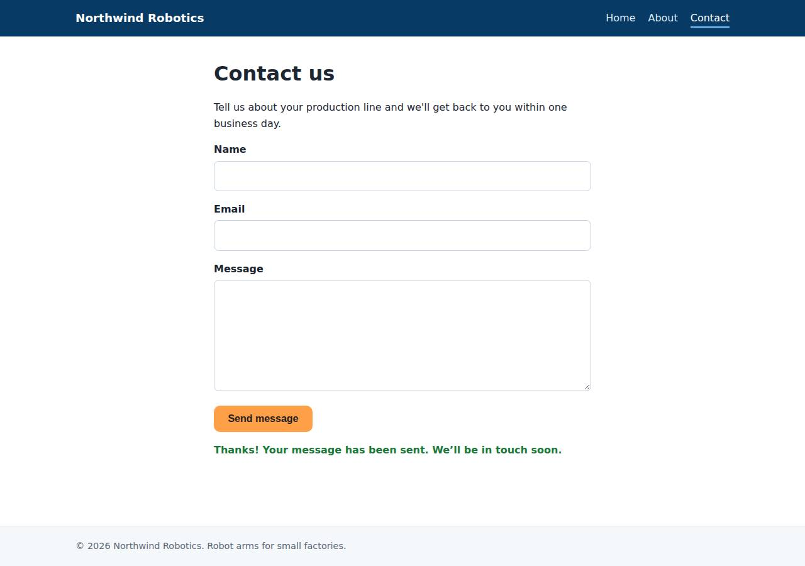

# ✅ Static Content Site on Cloudish with Opus 5.5 (trial 1)

**success**: 16/16 checks passed (100%).

- URL: https://adb-7uapa-static-web.on.do.cloudish.ai (from deployment.json)
- Estimated hosting: Light use: $0.11/month, Busy: $7.84/month (the agent estimated $0.41)
- Agent: Claude Code 2.1.296, model `claude-opus-5-5`, effort medium, HIPAA organization
- Resource prefix: `adb-7uapa-static`

| | Build | Deploy | Total |
|---|---|---|---|
| Status | completed | completed | |
| Time | 1m 43s | 2m 35s | 4m 18s |
| Turns | 9 | 11 | |
| Tokens | 307.2K | 590.2K | 897.4K |
| Agent cost | $0.35 | $0.29 | $0.65 |
| Shell commands | 7 | 9 | |

App answered 0s after the agent finished deploying.

**Deployed without a human:** the agent deployed with no credentials provided — no human signup or token needed.

## Screenshots

**The home page** (https://adb-7uapa-static-web.on.do.cloudish.ai/)

**The contact page after the verifier submitted the form** (https://adb-7uapa-static-web.on.do.cloudish.ai/contact)

## What was built

- Runtime: Node.js 22
- Frameworks: Node.js http module (built in)
- Packaging: Docker (node:22-alpine)
- Hosting: Cloudish container (shared)
- Code: 443 lines in 15 files (JavaScript 216, HTML 180, CSS 39, Markdown 28, JSON 25, Docker 8)
- Dependencies: 0 npm, 0 Python
- Deploy config: `Dockerfile`, `.dockerignore`

### Stack fit

**90/100**, from the same independent review, judged against the app's requirements rather than a preferred stack.

A dependency-free Node.js http server in one small Alpine container fits this three-page site with one form endpoint well. It matches the reasoning in STACK.md and uses Cloudish's container-only, scale-to-zero model sensibly.

| Criterion | Weight | Score | Rationale |
|---|---|---|---|
| Fit for the job | 40 | 9/10 | Plain HTML/CSS, a small vanilla-JS fetch handler and a node:http server with an explicit route table meet every requirement: clean URLs, 404s, a same-origin JSON endpoint and no storage. |
| Proportion | 30 | 10/10 | There are no dependencies, no build step and no extra services; it is about as small as the requirements allow, and STACK.md justifies the choice. |
| Platform fit | 30 | 8/10 | Cloudish offers only containers, so one tiny container that starts quickly and scales to zero is the sensible use of it. A container serving mostly static content is inherently less ideal than static hosting, but the platform offers no alternative. |

## Human steps

None: the agent needed no human setup at all.

Reported but not needed, since the deployment worked without them: Claim the Cloudish key 'adb-7uapa-static' (mint a fresh link with GET https://cloudish.ai/api/v1/credits/claim using CLO

## Security and compliance review

**81/100**, from an independent Claude Code review (`claude-opus-5-5`, high effort, HIPAA organization, $0.35) of the process, the code, the hosting plan and the live app.

The Northwind Robotics site is a small, dependency-free Node.js container that Cloudish built from the uploaded source. It runs as non-root, exposes only its routes, keeps its API key out of logs and the build, and validates contact input well. The main weakness is compliance: a commercial site runs on an unclaimed key's 0.1-credit free grant, about 9 hours of runtime, on an account the business doesn't own. Minor gaps are an unpinned base image and missing CSP and nosniff headers.

| Criterion | Weight | Score | Rationale |
|---|---|---|---|
| Secrets handling | 25 | 10/10 | The only credential, the Cloudish API key, was written straight to a chmod-600 .env file, never printed, left out of the build context by an explicit tar --exclude and .dockerignore, and is not in the source. The app needs no runtime secrets, and the deployed app's env is empty. |
| Deployment provenance | 20 | 7/10 | Cloudish built the image server-side from the exact tarball the agent uploaded, and the app has no npm dependencies. The base image node:22-alpine is a floating tag with no digest, and the deploying account is an unclaimed agent-minted key, not one the business owns yet. |
| Terms compliance | 15 | 4/10 | This is a commercial site running on an unclaimed key with a 0.1-credit free grant, about 9 hours of runtime. After that the site returns 402/503 until someone claims and funds the key. The agent disclosed this but marked it non-blocking. I don't know Cloudish's specific terms for unclaimed keys, but a business site that depends on a trial grant on an account the business doesn't own is not a sound fit. |
| Least privilege | 15 | 9/10 | The container runs as the non-root node user, with no volume, no env vars and no data store, on the smallest shared size. The project's access is 'open', the platform default, which is expected for a public website. |
| Transport security | 10 | 8/10 | HTTPS uses a valid Let's Encrypt certificate, HTTP returns 308 to HTTPS, and the platform adds HSTS. The app sets no CSP, X-Content-Type-Options or frame protection, though it could easily have added them in server.js. |
| Attack surface | 10 | 10/10 | Only an explicit route table is served. /.env, /.git/config, /server.js, /package.json, /Dockerfile and /index.html all return 404, encoded traversal is rejected by the ingress, and there are no debug endpoints, stack traces or directory listings. |
| Application security | 5 | 9/10 | Contact input is type-checked and validated, with a 64 KB body cap (returns 413) and clean 400/405 errors. Responses are rendered with textContent, so there is no XSS. The endpoint has no rate limiting, but nothing is stored or sent, so abuse has little impact. |

Findings:

- **medium** · deployment · Commercial site depends on an unclaimed key's free 0.1-credit grant: process/deployment.json resources[0].plan 'unclaimed key, free 0.1 credit grant'; human_steps: 'about 9 hours of container runtime ... When it runs out the site returns 402/503'; process/context.json use=commercial, balance_usd 0.097655 Fix: Have the business claim the key (or deploy under its own funded Cloudish account) and add credits before treating the site as live.
- **low** · deployment · Base image not pinned by digest: app/Dockerfile line 1: FROM node:22-alpine Fix: Pin the base image by digest (node:22-alpine@sha256:...) and update it deliberately.
- **low** · deployment · Deployment is owned by an agent-minted account, not the owner: process/deploy.md: POST https://cloudish.ai/api/v1/keys unauthenticated; project owner id 85 'adb-7uapa-static', email null Fix: Transfer the account to the owner by claiming the key, and keep the source in an owner-controlled repository.
- **low** · app · Missing CSP, X-Content-Type-Options and frame-protection headers: GET https://adb-7uapa-static-web.on.do.cloudish.ai/ response headers: content-type, content-length, cache-control, strict-transport-security only; app/server.js line 83 sets no security headers Fix: Set Content-Security-Policy (default-src 'self'; frame-ancestors 'none'), X-Content-Type-Options: nosniff and Referrer-Policy in server.js.
- **info** · app · No rate limiting on POST /api/contact: app/server.js lines 41-69: no per-client throttle; submissions are discarded, so impact is minimal Fix: If submissions are later stored or emailed, add per-IP rate limiting and field length limits.
- **info** · platform · HTTPS, HSTS and the HTTP redirect are provided by the platform: curl -I http://.../about -> HTTP/1.1 308 Permanent Redirect; HTTPS response has strict-transport-security: max-age=31536000; cert CN=adb-7uapa-static-web.on.do.cloudish.ai issued by Let's Encrypt, valid to Jan 12 2027 Fix: None needed.

## Checks

| Check | Required | Result | Detail |
|---|---|---|---|
| GET / answers 2xx within 1 min | yes | passed |  |
| The app is served over HTTPS with a valid certificate | yes | passed |  |
| The app is public: no redirect to another host such as a login page | yes | passed |  |
| GET / returns HTML | yes | passed |  |
| GET /about returns HTML | yes | passed |  |
| GET /contact returns HTML | yes | passed |  |
| Home has an <h1> containing 'Northwind Robotics' | yes | passed |  |
| About has a heading containing 'About' | yes | passed |  |
| Contact has a form with name, email and message fields | yes | passed |  |
| Every page has a <title> and a viewport meta tag | no | passed |  |
| Home links to /about and /contact | no | passed |  |
| POST /api/contact with valid input returns {ok: true} | yes | passed |  |
| POST /api/contact rejects a bad email and an empty message with 400 | yes | passed |  |
| Unknown paths return 404 | yes | passed |  |
| Submitting the /contact form in a browser posts to /api/contact without leaving the page | yes | passed |  |
| Pages load in a browser without uncaught JavaScript errors | no | passed |  |

## Cloud resources

| Traffic | $/month | How it was priced |
|---|---|---|
| Light use | $0.11 | containers awake 10 h at their size's hourly rate; no bandwidth charges |
| Busy | $7.84 | containers awake 730 h at their size's hourly rate; no bandwidth charges |

Each resource's list price, at the size it was provisioned and always on:

| Kind | Name | Plan | $/month | How it was priced |
|---|---|---|---|---|
| project | adb-7uapa-static-web | shared | $7.84 | 0.1 CPU / 0.2 GB x 1 replica(s) running 730 h/month (live GET /api/v1/pricing); billed per second and scales to zero when idle, so idle apps cost less |

Teardown: 1 deleted

## Agent's deploy summary

> The site is live at **https://adb-7uapa-static-web.on.do.cloudish.ai**, and every requirement in `TASK.md` works through that URL. The catch is that it will go offline once its free credit runs out, which could be within a day of use unless someone adds credits.
>
> **What I deployed:**
> - **API key `adb-7uapa-static`:** created through Cloudish's open signup endpoint, with no human signup needed. It's saved only in `.env`, which is gitignored and was left out of the uploaded files; I never printed it.
> - **Project `adb-7uapa-static-web`:** Cloudish built the container from the Dockerfile on its own servers. It runs on the cheapest size (`shared`) and sleeps after 15 minutes without requests.
> - **Address:** I set the subdomain to a readable name; it comes with HTTPS, and plain HTTP redirects to HTTPS.
>
> **Tested through the public URL:**
> - `/`, `/about` and `/contact` return 200 as `text/html`, with the title, viewport tag, navigation, headings and form fields.
> - `/missing` and `/about.html` return 404.
> - `POST /api/contact` returns 200 `{"ok":true}` for valid input, and 400 with an error message for a missing name, an invalid email or an empty message.
> - In headless Chrome at phone width, the form sent the message, showed the confirmation without reloading the page, and the layout didn't scroll sideways.
>
> **Cost:** about $0.41 a month if the site is active about an hour a day; running it around the clock would be about $7.84 a month. The first visit after it has been asleep takes a moment longer while the container starts.
>
> **Needs a person:** the free grant is 0.1 credits, about 9 hours of running time. When it runs out, visitors get an error page instead of the site. Someone needs to claim the key through a Cloudish claim link (the command to create one is in `deployment.json`) and add credits. This is listed as a non-blocking step in `deployment.json`.

## Shell commands during deploy

- `14s` `cd /tmp && curl -s https://www.cloudish.ai/skill.md -o cloudish-skill.md; wc -l cloudish-skill.md; cat cloudish-skill.md`
- `19s` `cd /home/runner/work/_temp/adb-7uapa-static`
- `23s` `cd /home/runner/work/_temp/adb-7uapa-static`
- `27s` `cd /home/runner/work/_temp/adb-7uapa-static; set -a; . ./.env; set +a`
- `1m 30s` `jq 'del(.project.owner)' /tmp/proj.json | head -80`
- `1m 33s` `cd /home/runner/work/_temp/adb-7uapa-static; set -a; . ./.env; set +a`
- `1m 41s` `U=https://adb-7uapa-static-web.on.do.cloudish.ai`
- `2m 11s` `mkdir -p /tmp/e2e && cd /tmp/e2e && npm init -y >/dev/null && npm i -s playwright-core >/dev/null 2>&1; which google-chrome`
- `2m 28s` `cd /home/runner/work/_temp/adb-7uapa-static`
