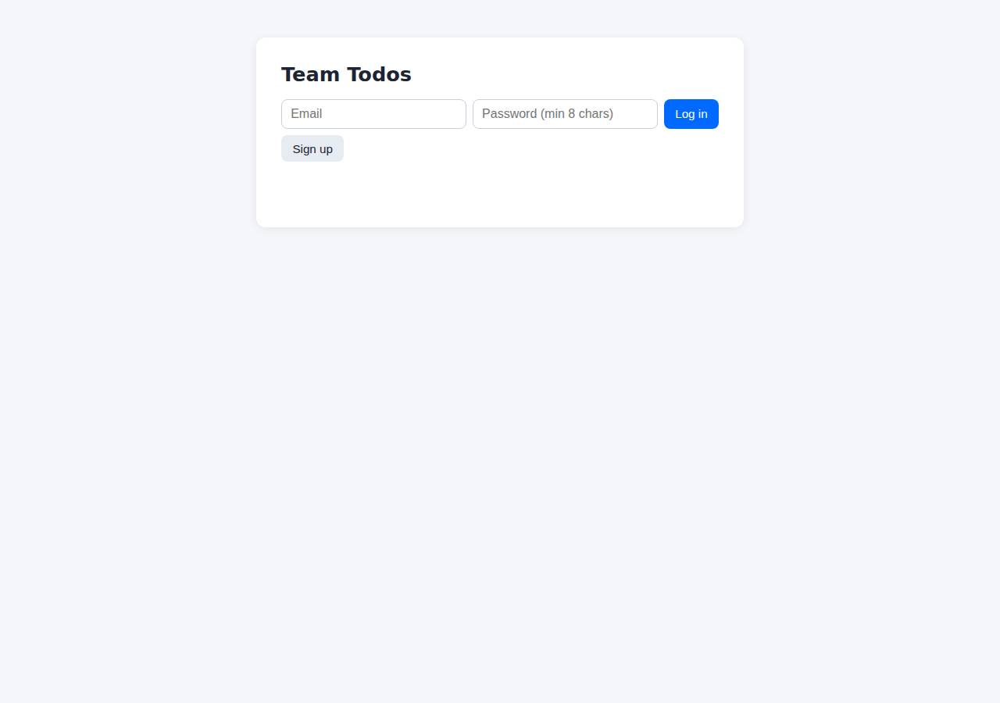
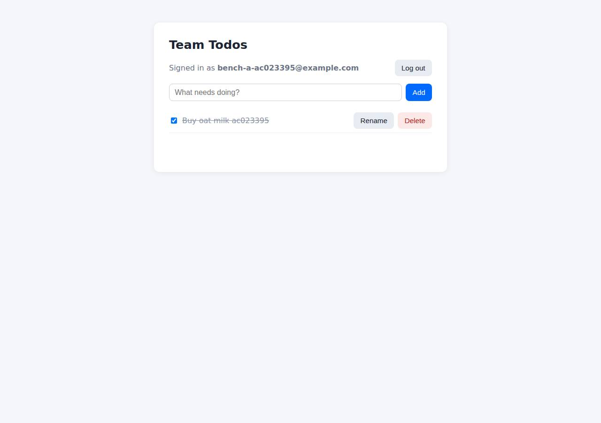

# ✅ Database-Backed CRUD App on DigitalOcean with Opus 5.5 (trial 1)

**success**: 19/19 checks passed (100%).

- URL: https://adb-sdx0i-crud-kqceu.ondigitalocean.app (from deployment.json)
- Estimated hosting: Light use: $12.00/month, Busy: $12.00/month (the agent estimated $12.00)
- Agent: Claude Code 2.1.296, model `claude-opus-5-5`, effort medium, HIPAA organization
- Resource prefix: `adb-sdx0i-crud`

| | Build | Deploy | Total |
|---|---|---|---|
| Status | completed | completed | |
| Time | 2m 39s | 7m 18s | 11m 14s |
| Turns | 15 | 7 | |
| Tokens | 488.3K | 419.5K | 1.25M |
| Agent cost | $0.50 | $0.18 | $0.93 |
| Shell commands | 9 | 6 | |

App answered 0s after the agent finished deploying.

**Needed a human:** the no-credentials attempt didn't produce a working public URL, so the cloud's credentials were provided and the agent redeployed (that attempt took 1m 17s, 339.8K tokens, $0.25).

## Screenshots

**The web app before signing in** (https://adb-sdx0i-crud-kqceu.ondigitalocean.app/)

**The todo list after signing in through the web UI as the test user** (https://adb-sdx0i-crud-kqceu.ondigitalocean.app/)

## What was built

- Runtime: Node.js 24
- Frameworks: Express
- Data: PostgreSQL (App Platform dev database)
- Libraries: node-postgres, bcrypt.js
- Dev tools: SuperTest
- Packaging: Docker (node:24-alpine), Docker Compose, App spec (.do/app.yaml)
- Hosting: App Platform service (apps-s-1vcpu-0.5gb), DigitalOcean Container Registry (starter)
- Code: 512 lines in 16 files (JavaScript 312, HTML 129, Shell 62, YAML 45, Markdown 35, JSON 33, Docker 9)
- Dependencies: 4 npm, 0 Python
- Deploy config: `Dockerfile`, `docker-compose.yml`, `.dockerignore`, `.do/app.yaml`

### Stack fit

**83/100**, from the same independent review, judged against the app's requirements rather than a preferred stack.

Node/Express + PostgreSQL on App Platform is a well-proportioned, sensible stack for a multi-user CRUD app. The main departure from STACK.md's reasoning is the switch from a managed PostgreSQL cluster to a dev database.

| Criterion | Weight | Score | Rationale |
|---|---|---|---|
| Fit for the job | 40 | 8/10 | Express with pg and bcryptjs, plus a static HTML/fetch UI, covers the requirements well, and PostgreSQL is a durable store that survives redeploys. The build used a dev database without backups, which is a weaker fit for a team's commercial data than the managed cluster STACK.md chose. |
| Proportion | 30 | 9/10 | Three runtime dependencies, one stateless service and one database, with no unneeded frameworks or services. |
| Platform fit | 30 | 8/10 | A stateless container on App Platform with a bound database and platform-managed TLS uses what the platform does well. Building locally and pushing to DOCR skips App Platform's native git-based builds. |

## Human steps

3 step(s), about 7 min of a person's time.

- **Sign up for an account and verify the email address** (~3 min): prerequisite: account setup
- **Add a payment method to the account** (~2 min): prerequisite: account setup
- **Create an API token and hand it to the agent** (~2 min): prerequisite: account setup

## Security and compliance review

**78/100**, from an independent Claude Code review (`claude-opus-5-5`, high effort, HIPAA organization, $0.40) of the process, the code, the hosting plan and the live app.

A small, carefully written Express + PostgreSQL todo app on DigitalOcean App Platform. Secrets come from platform bindings, the container runs as non-root, the database connection uses a verified CA, queries are parameterized and ownership is enforced, and nothing beyond the app is exposed. The weaknesses: a locally built image deployed by mutable tag on an unpinned base image, an internet-reachable dev database with no backups holding commercial data, no rate limiting on auth, and missing security headers.

| Criterion | Weight | Score | Rationale |
|---|---|---|---|
| Secrets handling | 25 | 9/10 | The DATABASE_URL and CA cert are injected at runtime through App Platform bindings (.do/app.yaml envs), the transcripts never show the DO token, and no .env existed or was baked into the image. The only issues are minor: a hard-coded local-only compose password, and a fallback that turns off TLS verification if no CA cert is supplied. |
| Deployment provenance | 20 | 6/10 | The image is built from the agent's local workspace and pushed to the owner's DOCR, and the deploy references it by a timestamp tag rather than a digest. The base image node:24-alpine is a floating tag. Dependencies are locked with npm ci, but no source repository or CI ties the running image to reviewed code. |
| Terms compliance | 15 | 8/10 | A paid App Platform plan suits a commercial app, and nothing sleeps or expires. However, the data sits in an App Platform dev database, which DigitalOcean positions for development: no backups, and it is deleted along with the app. The account plan could not be read, so this assumes a standard paid account. |
| Least privilege | 15 | 7/10 | The container runs as the non-root node user and only the web service is public. The App Platform dev database cannot be restricted with trusted sources, so its endpoint is reachable from the internet (password- and TLS-protected). |
| Transport security | 10 | 8/10 | HTTPS works with a valid Google Trust Services certificate, HTTP 301-redirects to HTTPS, and the session cookie is Secure, HttpOnly and SameSite=Lax. Responses carry no HSTS, X-Content-Type-Options, frame protection or CSP, which the app could have added itself. |
| Attack surface | 10 | 10/10 | Probes for .env, .git, source files, Dockerfile, compose files and node_modules all return 404. Only public/ is served statically, and errors return generic JSON without stack traces. |
| Application security | 5 | 7/10 | All queries are parameterized, every todo query is scoped by user_id, input is validated (types, lengths, ID format), bcrypt cost is 12 with a dummy hash against timing attacks, session tokens are stored hashed, and the UI renders with textContent. Login and signup have no rate limiting or lockout. |

Findings:

- **medium** · deployment · Locally built image deployed by mutable tag with floating base image: app/scripts/deploy.sh: docker build ... -t registry.digitalocean.com/$REGISTRY/$PREFIX-web:$TAG && docker push; process/resources.json image.tag "20261014232707" (no digest); app/Dockerfile line 1 'FROM node:24-alpine' Fix: Build from a git repository the owner controls (App Platform git source or CI), pin the base image by digest, and deploy by image digest.
- **medium** · app · No rate limiting on login/signup: app/app.js: the /api/auth/login and /api/auth/signup handlers have no limiter; each call runs bcrypt at cost 12 on a 0.5 GB/1 vCPU instance, so they are open to credential guessing and CPU exhaustion Fix: Add per-IP and per-account rate limiting (e.g. express-rate-limit) on the auth endpoints.
- **medium** · deployment · Dev database endpoint is publicly reachable: app/.do/app.yaml databases: engine PG, production: false. App Platform dev databases do not support trusted sources or VPC-only access Fix: Use a managed PostgreSQL cluster attached to the app with trusted sources limited to the app (or a VPC).
- **low** · deployment · Commercial data stored in a non-production dev database: process/deployment.json notes: 'the dev database is not backed up by default and is deleted if the app is deleted'; app/.do/app.yaml production: false. STACK.md had chosen a managed PostgreSQL with backups Fix: Move to a production managed PostgreSQL cluster with automated backups, as STACK.md intended.
- **low** · app · Missing security headers: curl -sI https://adb-sdx0i-crud-kqceu.ondigitalocean.app/ returns no Strict-Transport-Security, X-Content-Type-Options, X-Frame-Options/frame-ancestors or Content-Security-Policy Fix: Add helmet (or equivalent middleware) to set HSTS, nosniff, frame protection and a CSP.
- **low** · app · TLS verification disabled when no CA cert is provided: app/db.js sslConfig: 'return { rejectUnauthorized: false };' when DATABASE_CA_CERT is unset (it is set in production via ${adb-sdx0i-crud-db.CA_CERT}) Fix: Fail closed: require a CA cert or use system CAs with rejectUnauthorized: true.
- **info** · app · Hard-coded local development DB password: app/docker-compose.yml: POSTGRES_PASSWORD: todos (local compose only, not used in production) Fix: Read local credentials from an untracked .env file.
- **info** · app · Stored XSS payload rendered safely; ownership enforced: POST /api/todos {title:''} -> 201 stored as text; index.html uses textContent; PATCH /api/todos/6 with another user's token -> 404 Fix: None.

## Checks

| Check | Required | Result | Detail |
|---|---|---|---|
| GET / answers 2xx within 1 min | yes | passed |  |
| The app is served over HTTPS with a valid certificate | yes | passed |  |
| The app is public: no redirect to another host such as a login page | yes | passed |  |
| GET / serves the web app as HTML | yes | passed |  |
| POST /api/auth/signup creates an account and returns a token | yes | passed |  |
| Signup rejects an invalid email and a short password with 400 | yes | passed |  |
| Signing up twice with the same email returns 409 | yes | passed |  |
| POST /api/auth/login returns a token | yes | passed |  |
| Login with a wrong password returns 401 | yes | passed |  |
| /api/todos requires a valid token (401) | yes | passed |  |
| POST /api/todos creates a todo | yes | passed |  |
| An empty title is rejected with 400 | yes | passed |  |
| GET /api/todos lists the caller's todos | yes | passed |  |
| Todos are listed oldest first | no | passed |  |
| PATCH /api/todos/{id} renames and completes a todo | yes | passed |  |
| Users can't see or modify each other's todos (404) | yes | passed |  |
| DELETE /api/todos/{id} removes a todo | yes | passed |  |
| Data is still there a minute later, with a fresh login | yes | passed |  |
| The web UI renders a login or signup form | no | passed |  |

## Cloud resources

| Traffic | $/month | How it was priced |
|---|---|---|
| Light use | $12.00 | fixed monthly prices; 0.0373 GiB out of a 50 GiB allowance |
| Busy | $12.00 | fixed monthly prices; 49 GiB out of a 50 GiB allowance |

Each resource's list price, at the size it was provisioned and always on:

| Kind | Name | Plan | $/month | How it was priced |
|---|---|---|---|---|
| app | adb-sdx0i-crud | adb-sdx0i-crud-web: apps-s-1vcpu-0.5gb x 1, adb-sdx0i-crud-db: dev database | $12.00 | adb-sdx0i-crud-web: apps-s-1vcpu-0.5gb x 1; adb-sdx0i-crud-db: dev database |
| registry | adb-sdx0i-crud | starter | $0.00 | Container Registry starter tier (one per account) |

Teardown: 2 deleted

## Agent's deploy summary

> The app is live at **https://adb-sdx0i-crud-kqceu.ondigitalocean.app**, and every `TASK.md` requirement passed when I tested it through that URL.
>
> **What's deployed** (about $12/month):
> - **Web service** `adb-sdx0i-crud-web` on App Platform, smallest instance ($5/mo). HTTPS comes with App Platform. App ID `39fcdee2-bec0-42d5-a220-cbcb8b945256`.
> - **PostgreSQL** `adb-sdx0i-crud-db`, an App Platform development database ($7/mo). The app's connection to it is encrypted and the certificate is checked.
> - **Container registry** `adb-sdx0i-crud`, free Starter tier, holding the app's Docker image.
>
> **Testing through the public URL:**
> - `scripts/smoke.sh` passed every check:
>   - signup returns `201`, `400` for a bad email or short password, and `409` for a duplicate;
>   - login returns `200`, or `401` for wrong credentials;
>   - creating, listing, renaming, completing/uncompleting and deleting todos returns the right success and error codes;
>   - todos are listed oldest first;
>   - one user can't see or change another user's todos.
> - A todo I created was still there after a redeploy.
> - Cookie login, which the web UI uses, works.
> - `/healthz` reports the database is reachable.
>
> **What went wrong along the way:** the first deploy failed because the image tag (a timestamp) was read as a number. I quoted it in `.do/app.yaml` and the second run succeeded. To redeploy, re-run `scripts/deploy.sh`.
>
> **Limitations:**
> - The development database isn't backed up by default and is deleted if the app is deleted. It does survive restarts and redeploys. For real use, a managed PostgreSQL cluster costs about $15/month.
> - The test accounts I created (`persist@example.com` and several `smoke…@example.com`) are still in the database.
>
> No human steps were needed, and I didn't create any new credentials, so there's no `.env` file. Everything above is recorded in `deployment.json`.

## Shell commands during deploy

- `3s` `which doctl || echo nodoctl; doctl account get --format Email,Status,DropletLimit 2>&1 | tail -1; doctl registry get 2>&1 | tail -1; doctl apps list 2>&1 | tail -3; git diff --no-index /dev/null /dev/`
- `8s` `scripts/deploy.sh > /tmp/deploy.log 2>&1; echo exit=$?; tail -15 /tmp/deploy.log`
- `53s` `sed -i 's/tag: IMAGE_TAG/tag: "IMAGE_TAG"/' .do/app.yaml && scripts/deploy.sh > /tmp/deploy.log 2>&1; echo exit=$?; tail -5 /tmp/deploy.log`
- `5m 55s` `U=https://adb-sdx0i-crud-kqceu.ondigitalocean.app; curl -s $U/healthz; echo; scripts/smoke.sh $U; doctl apps logs 39fcdee2-bec0-42d5-a220-cbcb8b945256 --type run 2>&1 | tail -5`
- `6m 07s` `U=https://adb-sdx0i-crud-kqceu.ondigitalocean.app; J='content-type: application/json'`
- `7m 11s` `cat > deployment.json <<'EOF'`
