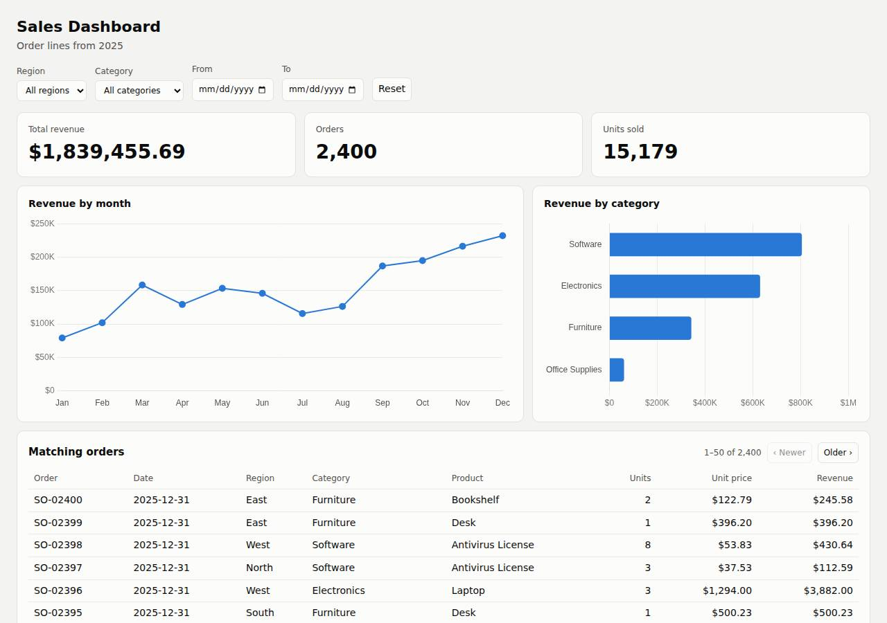

# ✅ Data / Visualization App on DigitalOcean with Opus 5.5 (trial 1)

**success**: 12/12 checks passed (100%).

- URL: https://adb-ankp0-dataviz-4fbum.ondigitalocean.app (from deployment.json)
- Estimated hosting: Light use: $5.00/month, Busy: $5.00/month (the agent estimated $5.00)
- Agent: Claude Code 2.1.296, model `claude-opus-5-5`, effort medium, HIPAA organization
- Resource prefix: `adb-ankp0-dataviz`

| | Build | Deploy | Total |
|---|---|---|---|
| Status | completed | completed | |
| Time | 2m 53s | 1m 49s | 6m 07s |
| Turns | 18 | 7 | |
| Tokens | 692.2K | 448.4K | 1.49M |
| Agent cost | $0.56 | $0.17 | $0.96 |
| Shell commands | 14 | 6 | |

App answered 0s after the agent finished deploying.

**Needed a human:** the no-credentials attempt didn't produce a working public URL, so the cloud's credentials were provided and the agent redeployed (that attempt took 1m 25s, 350.8K tokens, $0.22).

## Screenshots

**The dashboard** (https://adb-ankp0-dataviz-4fbum.ondigitalocean.app/)

## What was built

- Runtime: Node.js 20
- Frameworks: Express
- Libraries: Chart.js
- Packaging: Docker (node:20-alpine), App spec (.do/app.yaml)
- Hosting: App Platform service (apps-s-1vcpu-0.5gb), DigitalOcean Container Registry (starter)
- Code: 501 lines in 16 files (JavaScript 319, HTML 60, Shell 59, CSS 55, JSON 28, Markdown 27, YAML 16, Docker 8)
- Dependencies: 2 npm, 0 Python
- Deploy config: `Dockerfile`, `.dockerignore`, `.do/app.yaml`

### Stack fit

**87/100**, from the same independent review, judged against the app's requirements rather than a preferred stack.

Express with the data in memory, Chart.js served locally, and one App Platform service is a simple, well-reasoned stack for a small read-only dashboard. The one departure from STACK.md is a Dockerfile built locally and pushed to DOCR instead of an App Platform source build.

| Criterion | Weight | Score | Rationale |
|---|---|---|---|
| Fit for the job | 40 | 9/10 | Node/Express with the 2,400-row read-only CSV held in memory fits the task well: aggregation is trivial, the data never changes, and Chart.js covers the charts. Filtering is plain fetch calls with no realtime transport, which the task doesn't need. |
| Proportion | 30 | 9/10 | There are only two runtime dependencies and no database. STACK.md explicitly and soundly rules out a managed database. The only extra piece is a container registry the platform didn't strictly require. |
| Platform fit | 30 | 8/10 | A single App Platform web service on port 8080 with a health check suits a small dynamic API plus page. STACK.md planned to let App Platform build from source with the Node buildpack, but the agent instead built a Dockerfile locally and pushed it to DOCR, adding a registry and a less traceable build path. |

## Human steps

3 step(s), about 7 min of a person's time.

- **Sign up for an account and verify the email address** (~3 min): prerequisite: account setup
- **Add a payment method to the account** (~2 min): prerequisite: account setup
- **Create an API token and hand it to the agent** (~2 min): prerequisite: account setup

## Security and compliance review

**81/100**, from an independent Claude Code review (`claude-opus-5-5`, high effort, HIPAA organization, $0.34) of the process, the code, the hosting plan and the live app.

The dashboard runs on a paid, always-on App Platform service with a private DOCR image. It needs no secrets, and no credentials leaked during build or deploy. HTTPS is enforced and nothing beyond the app is exposed. The main weaknesses are in the deployment: an unpinned node:20-alpine base image, deploying from a mutable :latest tag built on the agent's machine, a container that runs as root, and missing security headers.

| Criterion | Weight | Score | Rationale |
|---|---|---|---|
| Secrets handling | 25 | 10/10 | The app needs no runtime secrets. The DigitalOcean token came from the environment (or a git-ignored, docker-ignored .env), was never echoed in the transcripts, and is not in the source, image build context or deployed files. |
| Deployment provenance | 20 | 6/10 | The image was built on the agent's machine and pushed to the owner's private DOCR, so it does match the code that was built. But the base image is the floating tag node:20-alpine with no digest, and the app is deployed from the mutable :latest tag rather than a digest or an immutable tag. Dependencies are locked through npm ci, although package-lock.json is missing from the delivered sources. |
| Terms compliance | 15 | 9/10 | This is a commercial app on a paid, always-on App Platform Basic service ($5/mo) plus the free DOCR Starter tier. As far as I know, neither plan's terms forbid commercial use, and neither sleeps or expires. The only gap is that a single instance gives no redundancy. |
| Least privilege | 15 | 7/10 | There is no data store, the registry is private, and only one HTTP service is public. However, the container runs as root, because the Dockerfile has no USER directive and node:20-alpine defaults to root. |
| Transport security | 10 | 7/10 | HTTPS works with a valid platform certificate, and HTTP returns a 301 redirect to HTTPS. The app sets none of HSTS, X-Content-Type-Options, frame protection or CSP, which it could have done itself (for example with helmet). |
| Attack surface | 10 | 9/10 | Requests for source files, .env, .git, the Dockerfile, the CSV, node_modules and directory listings all return 404, and there are no stack traces. Small leaks: the X-Powered-By: Express header and Express's default error pages. |
| Application security | 5 | 8/10 | Output is rendered with textContent, so there is no XSS. Filters are exact-match comparisons against in-memory data, so there is nothing to inject into. Malformed dates get a 400 and the orders limit is capped at 500. Minor gaps: impossible dates such as 2025-02-31 are accepted, and nothing rate-limits the public API. |

Findings:

- **medium** · deployment · Deployed from mutable :latest tag with unpinned base image: app/.do/app.yaml lines 5-9 (tag: latest); app/Dockerfile line 1 'FROM node:20-alpine'; scripts/deploy.sh builds and pushes registry.digitalocean.com/$REG/$REPO:latest Fix: Pin the base image by digest (node:20-alpine@sha256:...). Tag each image with an immutable version (git SHA) or deploy by digest, and build from a version-controlled source (App Platform git source or CI).
- **medium** · deployment · Container runs as root: app/Dockerfile has no USER directive; node:20-alpine runs as root by default Fix: Add 'USER node' (and copy files with --chown=node:node) so the server runs unprivileged.
- **low** · deployment · Lock file not part of delivered sources: Dockerfile runs 'npm ci --omit=dev' (needs package-lock.json, which appears in the build transcript's ls output), but app/ contains no package-lock.json; package.json uses caret ranges ^4.5.1 / ^4.22.3 Fix: Commit package-lock.json alongside the source so the dependency set used in production can be reproduced and audited.
- **low** · app · Missing security headers: curl -sI https://adb-ankp0-dataviz-4fbum.ondigitalocean.app/ returns no Strict-Transport-Security, X-Content-Type-Options, X-Frame-Options/frame-ancestors or Content-Security-Policy Fix: Add helmet (or set the headers manually) with HSTS, nosniff, frame-ancestors 'none' and a strict CSP ('self' only, since Chart.js is served locally).
- **low** · app · Framework fingerprinting via X-Powered-By: Every response includes 'x-powered-by: Express'; unknown paths return Express's default 'Cannot GET /path' page Fix: Call app.disable('x-powered-by') and add a minimal custom 404 handler.
- **low** · app · Impossible calendar dates accepted: GET /api/summary?start=2025-02-31 -> 200 (filtered from 2025-03). In lib/data.js parseFilters, the check is the regex plus Date.parse, which rolls over invalid days Fix: Check that the parsed date round-trips (new Date(s).toISOString().slice(0,10) === s) and return 400 otherwise.
- **low** · app · No rate limiting on public API: server.js: /api/summary and /api/orders (up to 500 rows per request, e.g. GET /api/orders?limit=99999 -> 77 KB response) have no throttling Fix: Add a lightweight per-IP limiter such as express-rate-limit, or rely on caching. The risk is low with in-memory data on one instance.
- **info** · platform · HTTP redirects to HTTPS: curl -sI http://adb-ankp0-dataviz-4fbum.ondigitalocean.app/ -> 301 Location: https://.../ Fix: None needed.

## Checks

| Check | Required | Result | Detail |
|---|---|---|---|
| GET / answers 2xx within 1 min | yes | passed |  |
| The app is served over HTTPS with a valid certificate | yes | passed |  |
| The app is public: no redirect to another host such as a login page | yes | passed |  |
| GET / serves the dashboard as HTML | yes | passed |  |
| GET /api/summary (no filters) matches the dataset | yes | passed |  |
| GET /api/summary (region=West) matches the dataset | yes | passed |  |
| GET /api/summary (category=Electronics) matches the dataset | yes | passed |  |
| GET /api/summary (region=East, category=Furniture, start=2025-03-01, end=2025-06-30) matches the dataset | yes | passed |  |
| GET /api/summary (region=Atlantis) matches the dataset | yes | passed |  |
| The dashboard renders a chart (SVG or canvas) in a browser | yes | passed |  |
| The dashboard shows at least two charts | no | passed |  |
| The dashboard has filter controls | no | passed |  |

## Cloud resources

| Traffic | $/month | How it was priced |
|---|---|---|
| Light use | $5.00 | fixed monthly prices; 0.0373 GiB out of a 50 GiB allowance |
| Busy | $5.00 | fixed monthly prices; 49 GiB out of a 50 GiB allowance |

Each resource's list price, at the size it was provisioned and always on:

| Kind | Name | Plan | $/month | How it was priced |
|---|---|---|---|---|
| app | adb-ankp0-dataviz | adb-ankp0-dataviz-web: apps-s-1vcpu-0.5gb x 1 | $5.00 | adb-ankp0-dataviz-web: apps-s-1vcpu-0.5gb x 1 |
| registry | adb-ankp0-dataviz | starter | $0.00 | Container Registry starter tier (one per account) |

Teardown: 2 deleted

## Agent's deploy summary

> The dashboard is live at **https://adb-ankp0-dataviz-4fbum.ondigitalocean.app**, and every requirement in `TASK.md` works through that public URL.
>
> **What I deployed (about $5/month):**
> - **App Platform app** `adb-ankp0-dataviz` (ID `88ff4d9a-fe5c-4451-af62-4377e579adf5`), with one web service `adb-ankp0-dataviz-web` on the $5 Basic plan (512 MB, one instance, New York). HTTPS uses DigitalOcean's certificate, and plain HTTP redirects to HTTPS.
> - **Container registry** `adb-ankp0-dataviz` on the free Starter tier, holding the image `adb-ankp0-dataviz-web:latest`.
>
> **Tested through the public URL:**
> - **Smoke test:** `scripts/smoke.sh` passed. It checks the dashboard page, `/api/summary` with no filters, with combined filters (exact expected values) and with no matches (zeros and empty arrays), and the orders table.
> - **Browser test:** in headless Chrome, changing the region, category and start-date filters updated the revenue and order tiles, the charts and the table without reloading the page, with no console errors.
>
> **What didn't work at first:** creating the app failed with "Image does not exist or is private", even though the push had succeeded. Naming the registry explicitly in `.do/app.yaml` fixed it, and the spec now includes it. `human_steps` is empty: the token you provided was enough, and I didn't create any new credentials, so there is no `.env` file.
>
> To redeploy, run `./scripts/deploy.sh` with `DIGITALOCEAN_ACCESS_TOKEN` set. With a single instance there is no redundancy if it goes down.

## Shell commands during deploy

- `3s` `cd /home/runner/work/_temp/adb-ankp0-dataviz; which doctl || echo nodoctl; [ -n "$DIGITALOCEAN_ACCESS_TOKEN" ] && echo token-set; doctl account get --format Email,Status,DropletLimit 2>&1 | tail -1; d`
- `8s` `cd /home/runner/work/_temp/adb-ankp0-dataviz; ./scripts/deploy.sh > /tmp/deploy.log 2>&1; echo exit=$?; grep -vE "^#|^ *[0-9a-f]{12}: " /tmp/deploy.log | tail -25`
- `53s` `cd /home/runner/work/_temp/adb-ankp0-dataviz; doctl registry repository list-v2; doctl registry repository list-tags adb-ankp0-dataviz-web`
- `57s` `cd /home/runner/work/_temp/adb-ankp0-dataviz; sed -i 's#      registry_type: DOCR#      registry_type: DOCR\n      registry: adb-ankp0-dataviz#' .do/app.yaml; cat .do/app.yaml | head -9; doctl apps sp`
- `1m 25s` `cd /home/runner/work/_temp/adb-ankp0-dataviz; U=https://adb-ankp0-dataviz-4fbum.ondigitalocean.app; doctl apps get 88ff4d9a-fe5c-4451-af62-4377e579adf5 --format ActiveDeployment.Phase,Region --no-head`
- `1m 41s` `cd /home/runner/work/_temp/adb-ankp0-dataviz`
