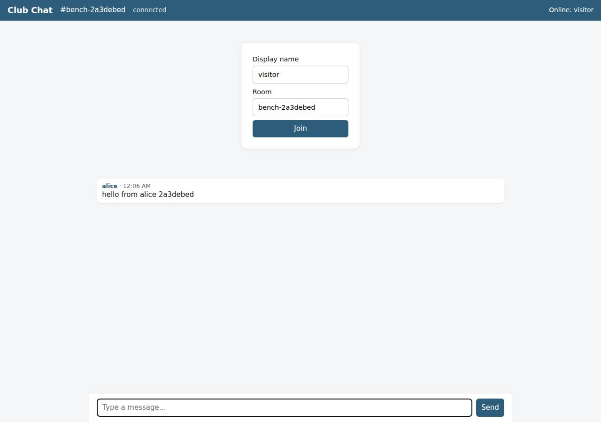

# ✅ Real-Time Collaborative App on DigitalOcean with Opus 5.5 (trial 1)

**success**: 13/13 checks passed (100%).

- URL: https://adb-9tydh-realtime-9x954.ondigitalocean.app (from deployment.json)
- Estimated hosting: Light use: $5.00/month, Busy: $5.00/month (the agent estimated $5.00)
- Agent: Claude Code 2.1.296, model `claude-opus-5-5`, effort medium, HIPAA organization
- Resource prefix: `adb-9tydh-realtime`

| | Build | Deploy | Total |
|---|---|---|---|
| Status | completed | completed | |
| Time | 2m 10s | 1m 45s | 4m 46s |
| Turns | 12 | 6 | |
| Tokens | 432.4K | 325.4K | 1.05M |
| Agent cost | $0.45 | $0.14 | $0.77 |
| Shell commands | 8 | 5 | |

App answered 0s after the agent finished deploying.

**Needed a human:** the no-credentials attempt didn't produce a working public URL, so the cloud's credentials were provided and the agent redeployed (that attempt took 51s, 293.6K tokens, $0.18).

## Screenshots

**The room the verifier's clients chatted in, with its history** (https://adb-9tydh-realtime-9x954.ondigitalocean.app/?room=bench-2a3debed)

## What was built

- Runtime: Node.js 22
- Frameworks: Node.js http module (built in)
- Libraries: ws
- Packaging: Docker (node:22-alpine), App spec (.do/app.yaml)
- Hosting: App Platform service (apps-s-1vcpu-0.5gb), DigitalOcean Container Registry (starter)
- Code: 563 lines in 13 files (JavaScript 396, HTML 133, Markdown 34, JSON 28, Shell 24, YAML 16, Docker 10)
- Dependencies: 1 npm, 0 Python
- Deploy config: `Dockerfile`, `.dockerignore`, `.do/app.yaml`

### Stack fit

**82/100**, from the same independent review, judged against the app's requirements rather than a preferred stack.

A minimal Node.js + ws server on one App Platform service fits a hobby-club chat well and is well reasoned in STACK.md. Its main gap is that message history lives only in memory, so it isn't durable across restarts.

| Criterion | Weight | Score | Rationale |
|---|---|---|---|
| Fit for the job | 40 | 7/10 | Node with `ws` is a strong fit for WebSocket broadcast, and SSE is included as a fallback. But history is kept only in memory, so a room's recent history is lost on every restart or redeploy, and the service cannot scale past one instance. |
| Proportion | 30 | 9/10 | There is one process, one runtime dependency, and the static HTML is served by the same server, with no needless services. The in-memory store is an honest, documented simplification rather than a disguised fake database. |
| Platform fit | 30 | 9/10 | App Platform supports long-lived WebSockets on a container service with managed TLS, health checks and always-on Basic instances, which suits this app. A source or GitHub-based App Platform deploy would have avoided the separate registry and the :latest tag. |

## Human steps

3 step(s), about 7 min of a person's time.

- **Sign up for an account and verify the email address** (~3 min): prerequisite: account setup
- **Add a payment method to the account** (~2 min): prerequisite: account setup
- **Create an API token and hand it to the agent** (~2 min): prerequisite: account setup

## Security and compliance review

**89/100**, from an independent Claude Code review (`claude-opus-5-5`, high effort, HIPAA organization, $0.34) of the process, the code, the hosting plan and the live app.

The agent deployed a small Node.js + ws chat server to a paid DigitalOcean App Platform Basic instance from its own image in a private registry. The app needs no secrets and none leaked. The container runs as non-root, HTTPS is enforced with a valid certificate, and nothing beyond the app is exposed. Remaining weaknesses are minor: a mutable :latest tag and an unpinned base image, no security headers, and no rate limiting or connection caps on the anonymous endpoints.

| Criterion | Weight | Score | Rationale |
|---|---|---|---|
| Secrets handling | 25 | 10/10 | The app needs no runtime secrets, and none appear in the source, image or transcripts. doctl used existing authentication, and deploy.sh reads the DO token from a .env file that is git-ignored and docker-ignored. |
| Deployment provenance | 20 | 7/10 | The image is built from the agent's own source and pushed to the owner's private DOCR registry, and its push digest is recorded. But the app spec deploys the mutable `:latest` tag, the base image `node:22-alpine` is not pinned to a digest, and `ws` is a caret range. |
| Terms compliance | 15 | 10/10 | This is a personal club app on a paid App Platform Basic instance ($5/mo, always on, no sleeping) with a free Starter registry. Both fit DigitalOcean's standard terms for this use. |
| Least privilege | 15 | 9/10 | The container runs as the non-root `node` user. There is one public web service and no data store, and the registry is private. The only nit is that `COPY . .` puts unneeded docs (README, STACK, TASK, deployment.json) in the image. |
| Transport security | 10 | 8/10 | HTTPS only: HTTP returns a 301 to HTTPS, the certificate is valid (Google Trust Services, expires Dec 2026), and WebSockets use wss://. The app sets none of HSTS, X-Content-Type-Options, frame protection or CSP, though it could have. |
| Attack surface | 10 | 10/10 | Only the routes the app defines respond. Probes for .env, .git, package.json, server.js, Dockerfile and /admin returned JSON 404s, with no directory listings or stack traces. Error responses are generic. |
| Application security | 5 | 7/10 | Input is validated well: 1-1000 character text, name and room length limits, a 16 KB body cap, WS maxPayload, and the UI renders with textContent so stored XSS is blocked. There is no rate limiting, no cap on rooms, WebSocket or SSE connections, and no WebSocket Origin check. |

Findings:

- **low** · app · No rate limiting or resource caps on public endpoints: server.js:18-27 creates a room in an unbounded Map for any valid name, including on GET /events (server.js:161). server.js:140-151 accepts POSTs with no throttling, and there are no connection limits on /ws or SSE streams. On a 0.5 GB instance, an anonymous client could exhaust memory or flood rooms. Fix: Add per-IP rate limits for POST and WS messages, cap the number of rooms and connections (or evict idle rooms), and limit SSE/WS connections per IP.
- **low** · app · WebSocket upgrade does not check Origin: server.js:189-203 accepts any upgrade with valid room and user params and never inspects req.headers.origin, so any website can open sockets and post as any name. Impact is limited because the app has no authentication. Fix: Reject upgrades whose Origin isn't the app's own host.
- **low** · deployment · Mutable :latest image tag and unpinned base image: .do/app.yaml: `tag: latest`. Dockerfile:1 `FROM node:22-alpine` has no digest. package.json `"ws": "^8.22.0"`. The deploy pushed digest sha256:121964b5..., but the spec doesn't reference it. Fix: Deploy by immutable tag or digest (for example the git SHA), pin the base image by digest, and commit package-lock.json.
- **low** · app · Missing security headers: `curl -sI https://adb-9tydh-realtime-9x954.ondigitalocean.app/` returns content-type, cache-control and Cloudflare headers only. There is no Strict-Transport-Security, X-Content-Type-Options, X-Frame-Options or Content-Security-Policy, and the app's writeHead calls (server.js:86-90, 119) set none. Fix: Set HSTS, X-Content-Type-Options: nosniff, frame-ancestors/X-Frame-Options and a restrictive CSP on HTML and JSON responses.
- **info** · deployment · Lockfile not present in delivered sources: The Dockerfile runs `npm ci --omit=dev`, which requires package-lock.json. The build succeeded, so the lockfile existed locally, but it isn't in app/ and isn't kept alongside the source. Fix: Commit package-lock.json so dependency resolution can be reproduced.
- **info** · deployment · Non-root container, minimal resources: Dockerfile: `USER node`. resources.json shows only one App Platform service and a private DOCR registry. .dockerignore excludes .env, .git, .do and deploy.sh. Fix: Optionally copy only server.js and public/ into the image.
- **info** · app · Stored script payload rendered safely: A POST to /api/rooms/reviewprobe/messages with text `` returned 201 and stored it verbatim. public/index.html:78-81 renders user and text via textContent, so the script does not execute. Fix: None required. Keep using textContent.

## Checks

| Check | Required | Result | Detail |
|---|---|---|---|
| GET / answers 2xx within 1 min | yes | passed |  |
| The app is served over HTTPS with a valid certificate | yes | passed |  |
| The app is public: no redirect to another host such as a login page | yes | passed |  |
| GET / serves the chat UI as HTML | yes | passed |  |
| deployment.json declares a supported transport (websocket or sse) | no | passed |  |
| Clients connect over websocket | yes | passed |  |
| A message reaches another client in the same room within 5 s | yes | passed |  |
| The sender receives its own message too | no | passed |  |
| Messages never reach clients in other rooms | yes | passed |  |
| Five users posting at the same time all see every message within 10 s | yes | passed |  |
| GET /api/rooms/<room>/messages returns recent messages | yes | passed |  |
| Messages over 1000 characters are rejected | no | passed |  |
| The chat UI loads in a browser without errors | no | passed |  |

## Cloud resources

| Traffic | $/month | How it was priced |
|---|---|---|
| Light use | $5.00 | fixed monthly prices; 0.0373 GiB out of a 50 GiB allowance |
| Busy | $5.00 | fixed monthly prices; 49 GiB out of a 50 GiB allowance |

Each resource's list price, at the size it was provisioned and always on:

| Kind | Name | Plan | $/month | How it was priced |
|---|---|---|---|---|
| app | adb-9tydh-realtime | adb-9tydh-realtime-web: apps-s-1vcpu-0.5gb x 1 | $5.00 | adb-9tydh-realtime-web: apps-s-1vcpu-0.5gb x 1 |
| registry | adb-9tydh-realtime | starter | $0.00 | Container Registry starter tier (one per account) |

Teardown: 2 deleted

## Agent's deploy summary

> The chat app is live at **https://adb-9tydh-realtime-9x954.ondigitalocean.app**, and every requirement in `TASK.md` worked when I tested it through that address.
>
> **What I deployed:**
> - **Web service:** App Platform app `adb-9tydh-realtime` (ID `7eb32aca-6d0b-455f-bba6-3c34bbd47cba`), one Basic instance (`apps-s-1vcpu-0.5gb`) in New York, about $5/month. App Platform provides the HTTPS and `wss://` address.
> - **Container registry:** `adb-9tydh-realtime` on the free Starter tier, holding the app's Docker image.
> - **Live connection URL:** `wss://adb-9tydh-realtime-9x954.ondigitalocean.app/ws`, recorded under `realtime` in `deployment.json`.
>
> Estimated total is about $5/month, and `human_steps` is empty.
>
> **Testing:** I ran `test/smoke.js` against the public URL and it passed. It checks:
> - the web page loads;
> - messages reach every client in the room, including the sender;
> - two users posting at the same time both get through;
> - rooms stay separate;
> - invalid messages are rejected over WebSocket;
> - posting over HTTP returns `201`, or `400` for invalid input;
> - history comes back correctly.
>
> I also checked the Server-Sent Events stream by hand with curl: a message posted over HTTP showed up in the stream.
>
> **One thing went wrong along the way:** the first attempt to create the app failed with "Image does not exist or is private" even though the image push had succeeded. Adding the registry name to `.do/app.yaml` fixed it, and the second attempt worked.
>
> **Limitation:** chat history (the last 50 messages per room) is kept in memory. It is lost whenever the app restarts or is redeployed, and the service has to stay at one instance.
>
> I didn't create any new credentials, so there is no `.env`. To redeploy, run `./deploy.sh`.

## Shell commands during deploy

- `3s` `which doctl || echo none; doctl account get --format Email,Status 2>&1 | tail -1; doctl registry get 2>&1 | tail -2; doctl apps list --format ID,Spec.Name 2>&1`
- `7s` `./deploy.sh 2>&1 | grep -vE '^\s*$' | tail -25`
- `51s` `sed -i 's/      registry_type: DOCR/      registry_type: DOCR\n      registry: adb-9tydh-realtime/' .do/app.yaml && doctl registry repository list-tags adb-9tydh-realtime-web --format Tag 2>&1; doctl `
- `1m 17s` `U=https://adb-9tydh-realtime-9x954.ondigitalocean.app; doctl apps get 7eb32aca-6d0b-455f-bba6-3c34bbd47cba --format ActiveDeployment.Phase,Region 2>&1; node test/smoke.js $U; timeout 4 curl -sN $U/api`
- `1m 31s` `cat > deployment.json <<'EOF'`
