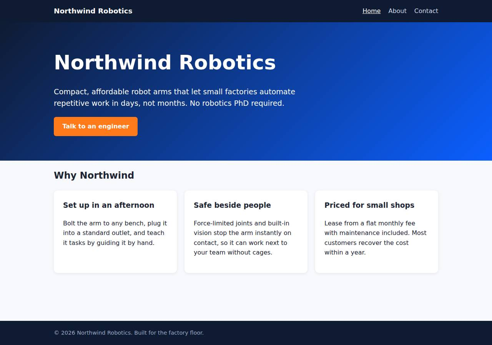
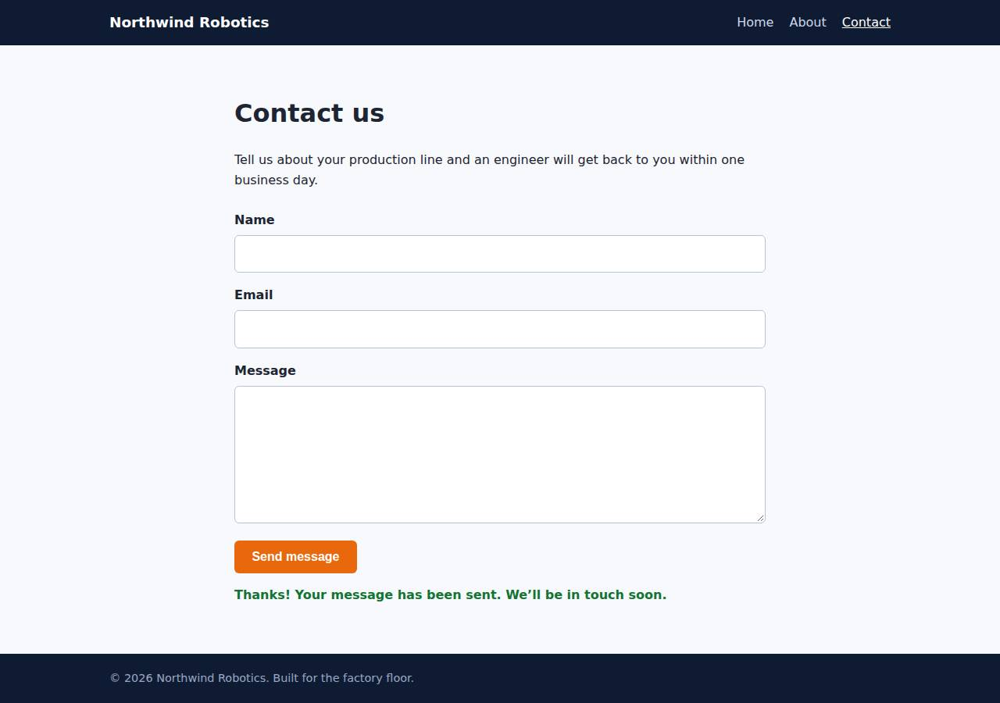

# ✅ Static Content Site on DigitalOcean with Opus 5.5 (trial 1)

**success**: 16/16 checks passed (100%).

- URL: https://adb-qzsmi-static-cw3ti.ondigitalocean.app (from deployment.json)
- Estimated hosting: Light use: $5.00/month, Busy: $5.00/month (the agent estimated $5.00)
- Agent: Claude Code 2.1.296, model `claude-opus-5-5`, effort medium, HIPAA organization
- Resource prefix: `adb-qzsmi-static`

| | Build | Deploy | Total |
|---|---|---|---|
| Status | completed | completed | |
| Time | 2m 02s | 2m 07s | 5m 12s |
| Turns | 12 | 8 | |
| Tokens | 459.9K | 363.7K | 1.10M |
| Agent cost | $0.39 | $0.17 | $0.75 |
| Shell commands | 11 | 6 | |

App answered 0s after the agent finished deploying.

**Needed a human:** the no-credentials attempt didn't produce a working public URL, so the cloud's credentials were provided and the agent redeployed (that attempt took 1m 03s, 277.4K tokens, $0.19).

## Screenshots

**The home page** (https://adb-qzsmi-static-cw3ti.ondigitalocean.app/)

**The contact page after the verifier submitted the form** (https://adb-qzsmi-static-cw3ti.ondigitalocean.app/contact)

## What was built

- Runtime: Node.js 22
- Frameworks: Node.js http module (built in)
- Packaging: Docker (node:22-alpine), App spec (.do/app.yaml)
- Hosting: App Platform service (apps-s-1vcpu-0.5gb), DigitalOcean Container Registry (starter)
- Code: 458 lines in 19 files (JavaScript 193, HTML 170, Shell 53, CSS 34, Markdown 22, JSON 22, YAML 15, Docker 8)
- Dependencies: 0 npm, 0 Python
- Deploy config: `Dockerfile`, `.dockerignore`, `.do/app.yaml`

### Stack fit

**81/100**, from the same independent review, judged against the app's requirements rather than a preferred stack.

A zero-dependency Node.js web service on App Platform is a simple, correct fit for three static pages and one JSON endpoint. A static site plus a Function would have matched the platform better, but the agent documented why it chose against it.

| Criterion | Weight | Score | Rationale |
|---|---|---|---|
| Fit for the job | 40 | 9/10 | A built-in http server meets the exact clean-path, 404 and same-origin JSON endpoint requirements with no database, as the spec asks. The contact form uses fetch with in-page confirmation. |
| Proportion | 30 | 8/10 | About 100 lines, no dependencies and no build step is very lean. Running a container to serve mostly static pages is slightly more than strictly needed. |
| Platform fit | 30 | 7/10 | An always-on $5/mo container serves static files that App Platform could host for free as a static site plus a Function. The agent weighed that option in STACK.md and rejected it reasonably, since it needed a connected git repo, but it doesn't make the most of the platform. |

## Human steps

3 step(s), about 7 min of a person's time.

- **Sign up for an account and verify the email address** (~3 min): prerequisite: account setup
- **Add a payment method to the account** (~2 min): prerequisite: account setup
- **Create an API token and hand it to the agent** (~2 min): prerequisite: account setup

## Security and compliance review

**91/100**, from an independent Claude Code review (`claude-opus-5-5`, high effort, HIPAA organization, $0.26) of the process, the code, the hosting plan and the live app.

A small, zero-dependency Node.js server runs as a non-root container on a paid DigitalOcean App Platform Basic instance. It handles secrets cleanly, exposes nothing beyond its allow-listed pages and assets, and redirects HTTP to HTTPS. The remaining weaknesses are minor: the base and deployed images aren't pinned by digest, the app sets no HSTS/CSP/frame-protection headers, and the contact endpoint has no rate limiting.

| Criterion | Weight | Score | Rationale |
|---|---|---|---|
| Secrets handling | 25 | 10/10 | The app needs no secrets. The DigitalOcean token was only read from the environment by doctl, never printed in the transcripts, and .env is excluded by both .gitignore and .dockerignore. |
| Deployment provenance | 20 | 7/10 | The image was built locally from the reviewed source and pushed to a DOCR registry in the owner's account, and it has no npm dependencies. But the base image is the floating tag node:22-alpine, and App Platform deploys the mutable :latest tag, not a digest. |
| Terms compliance | 15 | 10/10 | A commercial app on a paid App Platform Basic instance ($5/mo) plus the free DOCR starter tier. As far as I know, both plans allow commercial use and the instance stays up instead of sleeping. |
| Least privilege | 15 | 10/10 | The container runs as the non-root node user. The only public component is the single web service, and there are no data stores or extra resources. |
| Transport security | 10 | 8/10 | HTTPS is served with a valid Google Trust Services certificate and HTTP returns 301 to HTTPS. The app sets X-Content-Type-Options, but it sends no HSTS, CSP or frame protection, even though its own server could have set them. |
| Attack surface | 10 | 10/10 | Only the allow-listed pages and assets are served. Source files, .env, .git, package.json and Dockerfile all return the generic 404 page, with no directory listings or stack traces. |
| Application security | 5 | 8/10 | Input is validated strictly by type and email regex, bodies are capped at 16 KB, JSON errors are handled, non-POST methods get 405, and the client renders responses with textContent, so there is no XSS. Minor gaps: no rate limiting on the public endpoint, and submitter emails are written to logs. |

Findings:

- **low** · deployment · Base image and deployed image not pinned by digest: app/Dockerfile:1 `FROM node:22-alpine`; app/.do/app.yaml:7 and process/resources.json image `tag: latest` Fix: Pin the base image to a sha256 digest and deploy the pushed image by digest or by an immutable version tag instead of :latest.
- **low** · app · Missing HSTS, CSP and frame-protection headers: `curl -sI https://adb-qzsmi-static-cw3ti.ondigitalocean.app/` returns only x-content-type-options among security headers; server.js:41 sets nothing else Fix: In sendFile/sendJson, add Strict-Transport-Security, a restrictive Content-Security-Policy (default-src 'self'; frame-ancestors 'none') and X-Frame-Options: DENY.
- **low** · app · No rate limiting on public contact endpoint: server.js:45-73 handleContact accepts unlimited submissions. Each one only writes a log line. Fix: Add a simple per-IP rate limit or a honeypot field if submissions are ever stored or emailed.
- **info** · app · Submitter email addresses logged: server.js:70 `console.log(`contact submission from ${body.email.trim()}`)` Fix: Log a submission count or a masked address to avoid keeping personal data in platform logs.
- **info** · deployment · Credentials handled cleanly: process/deploy.md: doctl used DIGITALOCEAN_ACCESS_TOKEN from the environment, the account email was masked with sed, and there are no [REDACTED] occurrences. app/.dockerignore and app/.gitignore exclude .env. Fix: None.

## Checks

| Check | Required | Result | Detail |
|---|---|---|---|
| GET / answers 2xx within 1 min | yes | passed |  |
| The app is served over HTTPS with a valid certificate | yes | passed |  |
| The app is public: no redirect to another host such as a login page | yes | passed |  |
| GET / returns HTML | yes | passed |  |
| GET /about returns HTML | yes | passed |  |
| GET /contact returns HTML | yes | passed |  |
| Home has an <h1> containing 'Northwind Robotics' | yes | passed |  |
| About has a heading containing 'About' | yes | passed |  |
| Contact has a form with name, email and message fields | yes | passed |  |
| Every page has a <title> and a viewport meta tag | no | passed |  |
| Home links to /about and /contact | no | passed |  |
| POST /api/contact with valid input returns {ok: true} | yes | passed |  |
| POST /api/contact rejects a bad email and an empty message with 400 | yes | passed |  |
| Unknown paths return 404 | yes | passed |  |
| Submitting the /contact form in a browser posts to /api/contact without leaving the page | yes | passed |  |
| Pages load in a browser without uncaught JavaScript errors | no | passed |  |

## Cloud resources

| Traffic | $/month | How it was priced |
|---|---|---|
| Light use | $5.00 | fixed monthly prices; 0.0373 GiB out of a 50 GiB allowance |
| Busy | $5.00 | fixed monthly prices; 49 GiB out of a 50 GiB allowance |

Each resource's list price, at the size it was provisioned and always on:

| Kind | Name | Plan | $/month | How it was priced |
|---|---|---|---|---|
| app | adb-qzsmi-static | adb-qzsmi-static-web: apps-s-1vcpu-0.5gb x 1 | $5.00 | adb-qzsmi-static-web: apps-s-1vcpu-0.5gb x 1 |
| registry | adb-qzsmi-static | starter | $0.00 | Container Registry starter tier (one per account) |

Teardown: 2 deleted

## Agent's deploy summary

> The site is live at **https://adb-qzsmi-static-cw3ti.ondigitalocean.app**, and every requirement in `TASK.md` passes when tested through that URL.
>
> **What's deployed:**
> - **App Platform app `adb-qzsmi-static`**: one web service, `adb-qzsmi-static-web`, on the smallest Basic size (`apps-s-1vcpu-0.5gb`, 1 instance, NYC). It runs the Node server as a Docker container, and App Platform provides the HTTPS. This costs about $5/month.
> - **Container registry `adb-qzsmi-static`**: free starter tier, holding the app image. Deploying from an image meant no GitHub account had to be connected.
>
> **Tested through the public URL:**
> - `/`, `/about` and `/contact` return 200 as HTML, each with a title, a viewport tag and links to the other pages.
> - Unknown paths return 404.
> - `POST /api/contact` returns 200 for valid input and 400 with an error message for a missing name, a bad email or an empty message.
> - In headless Chrome at phone width, the contact form submitted and showed its confirmation without reloading the page.
>
> **What went wrong:** the first deploy run reported every check as failed. The app's new address wasn't reachable yet when the checks ran; a minute later all checks passed. I changed `scripts/deploy.sh` to wait for the site to respond before testing.
>
> No new credentials were created, so there's no `.env` file. No steps needed a person, so `human_steps` in `deployment.json` is empty. To redeploy, run `scripts/deploy.sh`.

## Shell commands during deploy

- `4s` `cd /home/runner/work/_temp/adb-qzsmi-static; which doctl docker; doctl account get --format Email,Status,DropletLimit 2>&1 | tail -1 | sed 's/^[^ ]*@[^ ]* /<email> /'; doctl registry get 2>&1 | tail -`
- `9s` `scripts/deploy.sh > /tmp/deploy.log 2>&1; echo exit=$?; grep -vE 'Pushed|Waiting|Preparing|Layer|^#' /tmp/deploy.log | tail -30`
- `1m 31s` `cd /home/runner/work/_temp/adb-qzsmi-static; A=4473062e-8898-4e9d-bbc6-a2a27c4952c9; doctl apps list-deployments $A --format ID,Phase,Progress; for i in $(seq 1 30); do c=$(curl -s -o /dev/null -w '%{`
- `1m 42s` ❌ `sed -i 's#^./scripts/smoke.sh "\$URL"#for _ in $(seq 1 30); do [ "$(curl -s -o /dev/null -w "%{http_code}" "$URL/")" = 200 ] \&\& break; sleep 10; done  # wait for DNS/TLS\n&#' scripts/deploy.sh && ta`
- `1m 50s` `bash -n scripts/deploy.sh && doctl registry get --format Name,StorageUsageBytes --no-header && doctl apps get 4473062e-8898-4e9d-bbc6-a2a27c4952c9 --format ID,DefaultIngress,ActiveDeployment.ID --no-h`
- `2m 01s` `cat > deployment.json <<'EOF'`
