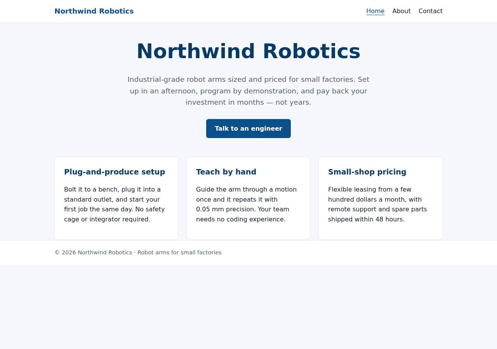
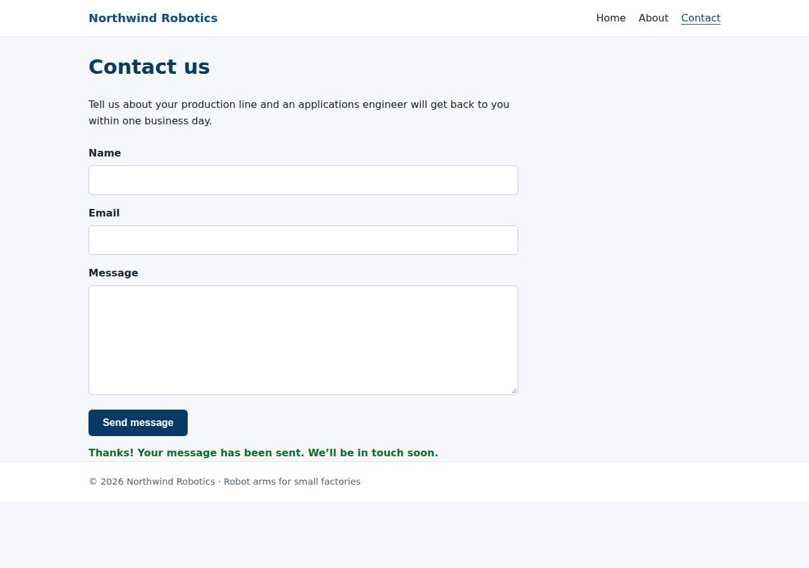

# ✅ Static Content Site on Railway with Opus 5.5 (trial 1)

**success**: 16/16 checks passed (100%).

- URL: https://adb-ytghj-static-web-production.up.railway.app (from deployment.json)
- Estimated hosting: Light use: $0.00/month, Busy: $0.00/month (the agent estimated $1.00)
- Agent: Claude Code 2.1.296, model `claude-opus-5-5`, effort medium, HIPAA organization
- Resource prefix: `adb-ytghj-static`

| | Build | Deploy | Total |
|---|---|---|---|
| Status | completed | completed | |
| Time | 1m 49s | 1m 36s | 4m 13s |
| Turns | 10 | 7 | |
| Tokens | 380.9K | 340.4K | 897.3K |
| Agent cost | $0.36 | $0.15 | $0.62 |
| Shell commands | 9 | 6 | |

App answered 0s after the agent finished deploying.

**Needed a human:** the no-credentials attempt didn't produce a working public URL, so the cloud's credentials were provided and the agent redeployed (that attempt took 49s, 176.0K tokens, $0.10).

## Screenshots

**The home page** (https://adb-ytghj-static-web-production.up.railway.app/)

**The contact page after the verifier submitted the form** (https://adb-ytghj-static-web-production.up.railway.app/contact)

## What was built

- Runtime: Node.js 18+
- Frameworks: Node.js http module (built in)
- Packaging: railway.json
- Code: 372 lines in 16 files (JavaScript 168, HTML 161, JSON 34, CSS 32, Markdown 24, Shell 11)
- Dependencies: 0 npm, 0 Python
- Deploy config: `railway.json`

### Stack fit

**90/100**, from the same independent review, judged against the app's requirements rather than a preferred stack.

The agent chose a zero-dependency Node HTTP server as one Railway service, a minimal and well-reasoned fit for three static pages plus one validation endpoint, and the build matches the reasoning in STACK.md.

| Criterion | Weight | Score | Rationale |
|---|---|---|---|
| Fit for the job | 40 | 9/10 | Plain node:http with an in-memory allowlist meets the requirements exactly: extensionless paths, real 404s and a same-origin JSON endpoint. No storage is needed, and none is used. |
| Proportion | 30 | 10/10 | The whole app is one ~80-line file with zero dependencies, one service and no build step, which is as small as these requirements allow. STACK.md weighs Express and Caddy plus a function, and rejects them for sound reasons. |
| Platform fit | 30 | 8/10 | Railway is a container platform, and a single always-on service fits it: it deploys with zero configuration through Railpack, uses $PORT and a health check, and costs about $1/month. Serving mostly static content from an always-on process is a small mismatch, but it is justified by the same-origin API. |

## Human steps

2 step(s), about 5 min of a person's time.

- **Sign up for an account and verify the email address** (~3 min): prerequisite: account setup
- **Create an API token and hand it to the agent** (~2 min): prerequisite: account setup

## Security and compliance review

**82/100**, from an independent Claude Code review (`claude-opus-5-5`, high effort, HIPAA organization, $0.29) of the process, the code, the hosting plan and the live app.

A small, dependency-free Node server on Railway serves the three pages and a well-validated contact endpoint over HTTPS, with no secrets involved and nothing exposed beyond the app. The weaknesses are minor: no HSTS, CSP or frame headers, no rate limiting, raw personal data in the logs, a likely root container, a local upload with no committed revision and an unpinned Node version, and an account plan nobody checked for commercial use.

| Criterion | Weight | Score | Rationale |
|---|---|---|---|
| Secrets handling | 25 | 10/10 | The app needs no secrets. The Railway token stayed in the session environment, deploy.sh reads it from env/.env, and .env is excluded by both .gitignore and .railwayignore. No secret appears in the source, the transcripts or the deployed files. |
| Deployment provenance | 20 | 7/10 | Railway built the image with Railpack from the agent's local upload (`railway up`), and that build is what runs. But no commit or repo ties the upload to a reviewed revision, and the Node version is left floating (`engines: >=18`, which resolved to Node 24) while the Railpack base images are platform defaults that aren't pinned. |
| Terms compliance | 15 | 7/10 | Railway's paid usage-based plans allow commercial use, and an always-on service fits a marketing site. But process/context.json does not show the account plan, and the agent never checked it. If the account is on the Trial/free tier, its credit limits could stop the service, so I can't fully confirm this fits a commercial app. |
| Least privilege | 15 | 8/10 | There is one public web service, with no data stores, extra services or extra variables. The Railpack image almost certainly runs the Node process as root, because the agent didn't configure a non-root user. |
| Transport security | 10 | 7/10 | The site is HTTPS-only with a valid Let's Encrypt certificate, and HTTP redirects to HTTPS with a 301. The app sets X-Content-Type-Options, but not HSTS, CSP or frame protection, even though it controls every response header. |
| Attack surface | 10 | 10/10 | The server serves only an allowlist of files held in memory. /.env, /.git/config, /server.js, /package.json, /railway.json, path traversal and *.html paths all return the custom 404. There is no directory listing and no stack trace, and the only extra endpoint is a trivial /health. |
| Application security | 5 | 8/10 | Input validation is strict: types are checked, lengths are capped, request bodies are limited to 64 KB, bad JSON gets a 400, and the client writes messages with textContent, so there is no XSS. There is no rate limiting on the public form endpoint, and the server logs submitters' raw names and emails, which allows log injection and keeps personal data in the logs. |

Findings:

- **low** · app · Missing HSTS, CSP and frame-protection headers: curl -sI https://adb-ytghj-static-web-production.up.railway.app/ returns only content-type, x-content-type-options: nosniff and the Railway edge headers. server.js:68 sets only Content-Type, Content-Length and X-Content-Type-Options. Fix: Add Strict-Transport-Security, Content-Security-Policy (default-src 'self'), and X-Frame-Options: DENY or frame-ancestors 'none' in server.js.
- **low** · app · No rate limiting on POST /api/contact: server.js:31-49 accepts unlimited submissions from any client, with no throttle or bot check. Fix: Add a simple per-IP rate limit (for example, an in-memory token bucket keyed on X-Forwarded-For) or a honeypot field.
- **low** · app · Unsanitised personal data written to logs (log injection): server.js:46 logs `contact: ${name} <${email}>`. POST /api/contact with {"name":"x\nINJECT fake log",...} returned 200 {"ok":true}, so the newline goes into the log line. Fix: Escape control characters (or log JSON.stringify'd values), and consider not logging submitters' names and emails at all.
- **low** · deployment · Local upload with an unpinned runtime and no committed revision: deploy.md: `railway up --service adb-ytghj-static-web --ci` was run from a working tree whose files were staged but never committed. package.json:11 has "engines": {"node": ">=18"}, and Railpack resolved that to Node 24 on its default base image. Fix: Commit the code and deploy from a connected repo or a tagged commit, and pin the Node version (for example, "node": "24.x" or a .node-version file).
- **low** · deployment · Container likely runs as root: railway.json uses builder RAILPACK with no user configuration, and Railpack images run the start command as root by default. Fix: Use a Dockerfile with a non-root USER (for example, `USER node`), or configure Railpack to drop privileges.
- **info** · deployment · Account plan not verified for commercial use: process/context.json has "use": "commercial" and "account": {}. deployment.json says only "Existing account plan (unchanged)". Fix: Confirm the workspace is on a paid Railway plan (Hobby or Pro) rather than the Trial/free tier, so the commercial site isn't stopped when credits run out.
- **info** · platform · Config-as-code file deprecated: The Railway CLI warned that railway.json is deprecated and keeps working only until 2026-12-01 (deploy.md). Fix: Run `railway config migrate` before 2026-12-01 so the health check and restart policy keep applying.

## Checks

| Check | Required | Result | Detail |
|---|---|---|---|
| GET / answers 2xx within 1 min | yes | passed |  |
| The app is served over HTTPS with a valid certificate | yes | passed |  |
| The app is public: no redirect to another host such as a login page | yes | passed |  |
| GET / returns HTML | yes | passed |  |
| GET /about returns HTML | yes | passed |  |
| GET /contact returns HTML | yes | passed |  |
| Home has an <h1> containing 'Northwind Robotics' | yes | passed |  |
| About has a heading containing 'About' | yes | passed |  |
| Contact has a form with name, email and message fields | yes | passed |  |
| Every page has a <title> and a viewport meta tag | no | passed |  |
| Home links to /about and /contact | no | passed |  |
| POST /api/contact with valid input returns {ok: true} | yes | passed |  |
| POST /api/contact rejects a bad email and an empty message with 400 | yes | passed |  |
| Unknown paths return 404 | yes | passed |  |
| Submitting the /contact form in a browser posts to /api/contact without leaving the page | yes | passed |  |
| Pages load in a browser without uncaught JavaScript errors | no | passed |  |

## Cloud resources

| Traffic | $/month | How it was priced |
|---|---|---|
| Light use | $0.00 | nothing deployed |
| Busy | $0.00 | nothing deployed |

Each resource's list price, at the size it was provisioned and always on:

None found.

Teardown: 0 deleted

## Agent's deploy summary

> The site is live at **https://adb-ytghj-static-web-production.up.railway.app** and every requirement in `TASK.md` works through that URL.
>
> **What's on Railway:**
> - **Project:** `adb-ytghj-static` (`b35149d1-38b2-4bed-8220-7bb444c4738c`), with its `production` environment.
> - **Service:** `adb-ytghj-static-web` (`2825be50-3d2b-41bc-8920-1e0eb705e58c`), one copy of the Node server, which serves the pages and `/api/contact` from the same address.
> - **Address:** the free HTTPS address Railway generated for the service.
>
> I uploaded the code straight from this directory with `railway up`; no GitHub repo is connected.
>
> **Tested through the public URL:**
> - `/`, `/about` and `/contact` return 200 as `text/html`, each with a title, the viewport tag, navigation and the right `<h1>`.
> - `/about.html` and an unknown path return 404.
> - `POST /api/contact` returns 200 `{"ok":true}` for valid input, and 400 with an error for a missing name, an invalid email or an empty message.
> - In headless Chrome at phone width, the contact form showed its confirmation without reloading the page, and nothing overflowed sideways.
>
> **Cost:** about $1 a month or less of Railway's usage-based billing for one small always-running service. I estimated that rather than reading it from Railway. The account plan was not changed, and the plan's included credit should cover it.
>
> Nothing needed a person, so `human_steps` is empty, and I created no new credentials, so there is no `.env`. The Railway CLI warns that `railway.json` is deprecated; it keeps working until 2026-12-01. `deployment.json` has the IDs and notes. The files are still staged in git but not committed.

## Shell commands during deploy

- `4s` `cd /home/runner/work/_temp/adb-ytghj-static; railway --version; railway whoami 2>&1; railway list 2>&1 | head`
- `8s` `cd /home/runner/work/_temp/adb-ytghj-static; railway init --name adb-ytghj-static 2>&1 | tail -5; railway add --service adb-ytghj-static-web 2>&1 | tail -5`
- `19s` `cd /home/runner/work/_temp/adb-ytghj-static; railway up --service adb-ytghj-static-web --ci 2>&1 | grep -v -i "config as code\|migrate\|keep working" | tail -15`
- `1m 01s` `cd /home/runner/work/_temp/adb-ytghj-static; railway domain --service adb-ytghj-static-web 2>&1 | grep -i http; railway status --json 2>/dev/null | python3 -c "`
- `1m 08s` `U=https://adb-ytghj-static-web-production.up.railway.app; for i in $(seq 1 20); do [ "$(curl -s -o /dev/null -w '%{http_code}' $U/)" = 200 ] && break; sleep 5; done`
- `1m 25s` `cd /home/runner/work/_temp/adb-ytghj-static; cat > deployment.json <<'EOF'`
