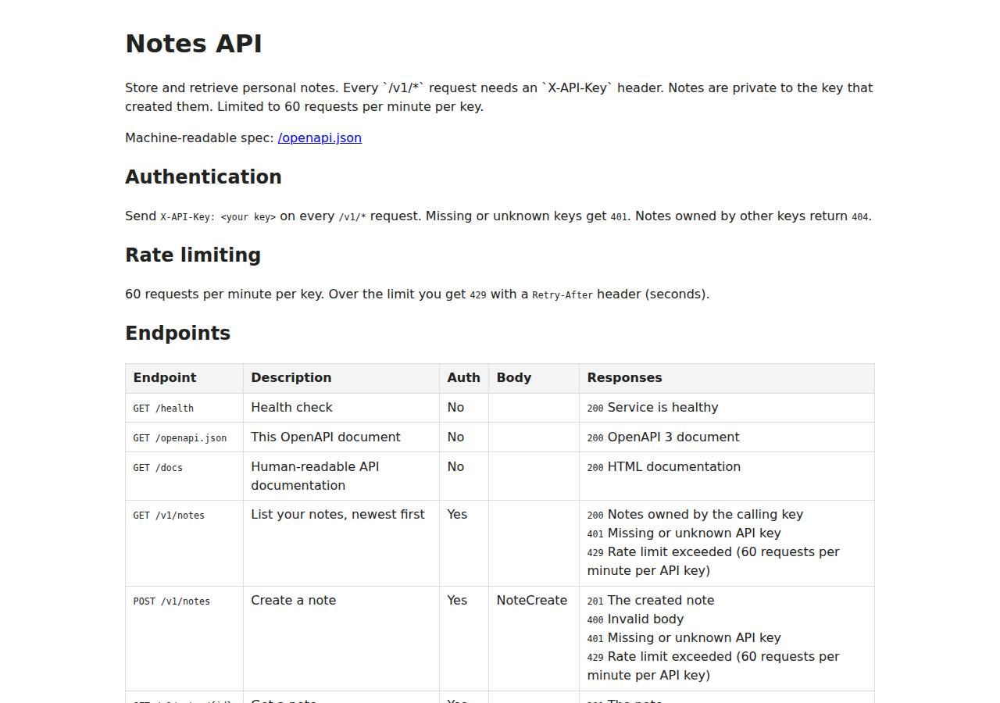

# ✅ API / Backend Service on Render with Opus 5.5 (trial 1)

**success**: 20/20 checks passed (100%).

- URL: https://adb-1slea-api-web.onrender.com (from deployment.json)
- Estimated hosting: Light use: $0.00/month, Busy: $7.13/month (the agent estimated $0.00)
- Agent: Claude Code 2.1.296, model `claude-opus-5-5`, effort medium, HIPAA organization
- Resource prefix: `adb-1slea-api`

| | Build | Deploy | Total |
|---|---|---|---|
| Status | completed | completed | |
| Time | 2m 34s | 3m 58s | 8m 18s |
| Turns | 12 | 11 | |
| Tokens | 496.1K | 741.8K | 1.63M |
| Agent cost | $0.56 | $0.38 | $1.26 |
| Shell commands | 11 | 10 | |

App answered 0s after the agent finished deploying.

**Needed a human:** the no-credentials attempt didn't produce a working public URL, so the cloud's credentials were provided and the agent redeployed (that attempt took 1m 47s, 395.8K tokens, $0.32).

## Screenshots

**The API documentation at /docs** (https://adb-1slea-api-web.onrender.com/docs)

## What was built

- Runtime: Node.js 20+
- Frameworks: Express
- Data: PostgreSQL (Render Postgres, free)
- Libraries: node-postgres
- Packaging: Render Blueprint (render.yaml)
- Hosting: Render web service (free, built from render-examples/express-hello-world)
- Code: 689 lines in 15 files (JavaScript 600, Shell 89, Markdown 50, JSON 40, YAML 21)
- Dependencies: 2 npm, 0 Python
- Deploy config: `render.yaml`

### Stack fit

**80/100**, from the same independent review, judged against the app's requirements rather than a preferred stack.

Node/Express with Render Postgres is a simple, well-reasoned stack that fits this API. Its weak points are the expiring free database and a deployment that sidesteps Render's normal repo-driven builds.

| Criterion | Weight | Score | Rationale |
|---|---|---|---|
| Fit for the job | 40 | 8/10 | Express plus pg on managed Postgres suits a small authenticated JSON API with per-key data and a tag filter (TEXT[] with a GIN index). An in-memory rate limiter is fine for one instance. The free database expiring weakens the durability requirement. |
| Proportion | 30 | 9/10 | There are two runtime dependencies, a hand-written OpenAPI spec and HTML docs, and no extra services or frameworks, which matches the reasoning in STACK.md. |
| Platform fit | 30 | 7/10 | A Render web service with a health check and managed Postgres over the internal URL is a natural fit. But building from a borrowed example repo works against Render's git-based deploy model, and the render.yaml Blueprint the agent wrote was never actually used. |

## Human steps

2 step(s), about 5 min of a person's time.

- **Sign up for an account and verify the email address** (~3 min): prerequisite: account setup
- **Create an API token and hand it to the agent** (~2 min): prerequisite: account setup

Reported but not needed, since the deployment worked without them: Optional: connect a Git provider (GitHub/GitLab) to the Render team in the dashboard, push this repository as adb-1slea-; Before 2026-11-13, upgrade adb-1slea-api-db to a paid Postgres plan (e.g. basic-256mb, about $6/month) if the API should

## Security and compliance review

**71/100**, from an independent Claude Code review (`claude-opus-5-5`, high effort, HIPAA organization, $0.40) of the process, the code, the hosting plan and the live app.

The Notes API handles secrets carefully and the code is clean: parameterized SQL, owner-scoped access, input limits and no exposed files. Two deployment choices are the main problems. Production is built from Render's public example repo, with this app's code unpacked from a base64 env var, so the running code has no owner-controlled source of record. And the free Postgres expires on 2026-11-13, taking the 'persistent' notes with it. Smaller issues are missing security headers, a database open to outside connections by default, and no rate limit on unauthenticated requests.

| Criterion | Weight | Score | Rationale |
|---|---|---|---|
| Secrets handling | 25 | 9/10 | API keys and the DB connection string are kept only in Render service env vars and read from process.env. The transcripts never print them: the agent used a umask-077 temp file, deleted it afterwards and checked API_KEYS with cmp. No secrets are in the source. The one weak spot is a deploy script that can source a local .env and push secrets as plain env values instead of using Render's fromDatabase/secret-file wiring. |
| Deployment provenance | 20 | 4/10 | The live service builds from a third-party repo (render-examples/express-hello-world, unpinned main branch). Its build command deletes that code and unpacks this app from a base64 tarball stored in an env var. The real source exists only as unpushed local commits, so nothing the owner controls in version control shows what runs. Dependencies are lockfile-installed with npm ci, but NODE_VERSION floats on major 20. |
| Terms compliance | 15 | 6/10 | The use is personal, which Render's free tier allows. Sleeping after 15 minutes idle is tolerable for friends' scripts. But the free Postgres expires on 2026-11-13 and its data is then deleted, which conflicts with the requirement that notes persist. The agent did disclose this and give an upgrade step. |
| Least privilege | 15 | 7/10 | Render's native Node runtime runs the app without the agent managing a container, and the app connects over the internal URL. However, the Postgres was created without an ipAllowList, so on Render's default its external endpoint accepts connections from any IP that has the password. The app also connects as the database owner. |
| Transport security | 10 | 8/10 | HTTPS works with a valid Google Trust Services certificate, and HTTP gets a 301 redirect. There is no HSTS, X-Content-Type-Options, frame protection or CSP. The app could have added these (e.g. with helmet) but did not. |
| Attack surface | 10 | 9/10 | Probes for .env, .git/config, package.json, src files, /admin and /debug all return a JSON 404. Malformed JSON gets a clean 400 with no stack trace, and x-powered-by is disabled. Only the documented endpoints are exposed. |
| Application security | 5 | 8/10 | The app validates input with type and length limits, uses parameterized SQL, scopes every note by owner (other keys get 404), and escapes the docs HTML. Rate limiting works per key. Minor issues: requests with missing or invalid keys are never rate-limited, the raw API key is stored as the owner value, and the counters live in memory. |

Findings:

- **medium** · deployment · Production builds from a third-party example repo with source smuggled in via env var: process/resources.json: source https://github.com/render-examples/express-hello-world; app/scripts/deploy.sh:28-30 BUILD_CMD='rm -f app.js yarn.lock package.json && echo "$APP_SOURCE_B64" | base64 -d | tar xz && npm ci --omit=dev', branch main (deploy.sh:16), commits local only (deploy.md final message) Fix: Push the code to a repo the owner controls (or deploy a pinned image from an owned registry), connect it to the service and pin builds to commits; drop the APP_SOURCE_B64 tarball.
- **medium** · deployment · Free Render Postgres expires in 30 days, losing persistent notes: process/resources.json: postgres plan free, expires_at 2026-11-13T23:47:23Z; TASK.md requires a database that survives restarts and redeploys Fix: Upgrade to a paid Postgres plan (e.g. basic-256mb) before expiry, or choose a durable store that does not expire.
- **low** · deployment · Postgres external access not restricted: app/scripts/deploy.sh:47-48 POST /postgres with no ipAllowList (Render default allows 0.0.0.0/0); connection-info exposes externalConnectionString (deploy.md) Fix: Set the database ipAllowList to empty (internal-only) or to specific admin IPs, and use a non-owner role for the app.
- **low** · deployment · Runtime version not pinned exactly: app/scripts/deploy.sh:58 NODE_VERSION "20"; app/package.json engines ">=20", deps with ^ ranges (lockfile used via npm ci) Fix: Pin NODE_VERSION to an exact release (e.g. 20.x.y) and keep package-lock.json committed in an owned repo.
- **low** · app · No security headers: curl -D- https://adb-1slea-api-web.onrender.com/docs: no Strict-Transport-Security, X-Content-Type-Options, X-Frame-Options or Content-Security-Policy Fix: Add helmet or set HSTS, nosniff, frame-ancestors and a restrictive CSP in app.js.
- **low** · app · Unauthenticated and invalid-key requests are not rate-limited: app/src/app.js:67-72 returns 401 before rateLimiter.hit, so key guessing and 401 floods are unlimited Fix: Add a per-IP limiter for unauthenticated/failed-auth requests.
- **low** · app · Raw API key stored as note owner in database: app/src/app.js:90 INSERT ... owner = req.apiKey; app/src/db.js owner TEXT Fix: Store a hash (e.g. SHA-256) or a key identifier instead of the plaintext key.
- **info** · platform · Free web service sleeps when idle: process/deployment.json notes: sleeps after 15 minutes idle, cold start up to ~1 minute Fix: Acceptable for personal use; upgrade to a paid instance if callers need consistent latency.
- **info** · app · No exposed files or debug endpoints: GET /.env, /.git/config, /package.json, /src/app.js, /admin, /debug -> 404 {"error":"No route for GET ..."}; malformed JSON -> 400 without stack trace Fix: None.

## Checks

| Check | Required | Result | Detail |
|---|---|---|---|
| GET /health answers 2xx within 1 min | yes | passed |  |
| The app is served over HTTPS with a valid certificate | yes | passed |  |
| The app is public: no redirect to another host such as a login page | yes | passed |  |
| GET /health returns {status: ok} | yes | passed |  |
| GET /openapi.json is an OpenAPI 3 document covering /v1/notes | yes | passed |  |
| GET /docs serves human-readable documentation | no | passed |  |
| Requests without an API key get 401 | yes | passed |  |
| Requests with an unknown API key get 401 | yes | passed |  |
| POST /v1/notes creates a note | yes | passed |  |
| Invalid notes are rejected with 400 | yes | passed |  |
| GET /v1/notes/{id} returns the note | yes | passed |  |
| GET /v1/notes lists notes and filters by tag | yes | passed |  |
| Notes are listed newest first | no | passed |  |
| PATCH /v1/notes/{id} updates only the given fields | yes | passed |  |
| Notes are private to the API key that created them | yes | passed |  |
| DELETE /v1/notes/{id} removes the note | yes | passed |  |
| Notes are still there a minute later | yes | passed |  |
| Exceeding 60 requests/minute returns 429 | yes | passed |  |
| 429 responses include a Retry-After header | no | passed |  |
| One key hitting its limit doesn't throttle other keys | yes | passed |  |

## Cloud resources

| Traffic | $/month | How it was priced |
|---|---|---|
| Light use | $0.00 | fixed monthly prices; 0.04 GB out of the Hobby workspace's 5 GB; free instances awake 10 h of 750 free hours |
| Busy | $7.13 | fixed monthly prices; 52.6 GB out of the Hobby workspace's 5 GB, 47.6 GB billed (with a payment method on file; without one Render suspends the services instead); free instances awake 730 h of 750 free hours |

Each resource's list price, at the size it was provisioned and always on:

| Kind | Name | Plan | $/month | How it was priced |
|---|---|---|---|---|
| service | adb-1slea-api-web | free | $0.00 | free x 1 instance(s) |
| postgres | adb-1slea-api-db | free | $0.00 | Postgres free |

Teardown: 2 deleted

## Agent's deploy summary

> The Notes API is live at **https://adb-1slea-api-web.onrender.com**. Every requirement in `TASK.md` passed when tested through that URL with the `BENCH_API_KEYS` keys.
>
> **What's deployed** (both free plans, $0/month, Oregon region):
>
> | Resource | Name | ID |
> |---|---|---|
> | Web service (Node) | `adb-1slea-api-web` | `srv-db819je89jmc73bqeam0` |
> | PostgreSQL 16 | `adb-1slea-api-db` | `dpg-db8192uq1p3s7396h1gg-a` |
>
> The service's `API_KEYS` matches `BENCH_API_KEYS` exactly; I compared them without printing either value.
>
> **What I tested through the public URL:**
> - `/health`, `/openapi.json` and `/docs` respond without a key.
> - A missing or unknown key gets a 401.
> - Create, list (with the `?tag=` filter), get, update and delete all work, and bad input gets a 400.
> - A note can't be read, changed or deleted with the other key (404).
> - After 60 requests in a minute the next one gets a 429 with `Retry-After`, while the other key keeps working.
> - A note created before a clean redeploy was still there afterwards.
>
> **One workaround to know about:** there were still no GitHub credentials, and Render's Node services build from a git repo. So the service builds from Render's own public example repo (`render-examples/express-hello-world`). Its build command deletes the example code and unpacks this app's code from an env var on the service (`APP_SOURCE_B64`). Everything runs on Render. The catch is that auto-deploy is off, so changes go live only by rerunning `scripts/deploy.sh`.
>
> I updated that script to use this same approach when no repo is set. I haven't rerun the updated version, so it's only been syntax-checked. If you rerun it, it overwrites `deployment.json` without the human steps or notes.
>
> **Limitations (non-blocking `human_steps` in `deployment.json`):**
> - **The free database expires on 2026-11-13.** Upgrading to the smallest paid plan, about $6 a month, needs a payment method on the account.
> - **Proper auto-deploys need a git repo.** A person would connect GitHub or GitLab to the Render team and push this repo as `adb-1slea-api`.
> - **The free web service sleeps after 15 minutes without traffic**, so the first request after that can take up to about a minute.
> - **Rate-limit counts reset** whenever the service restarts or redeploys.
>
> I didn't create any new credentials, so `.env` wasn't needed. Both commits are local only.

## Shell commands during deploy

- `9s` `env | grep -iE "render|bench|gh_|github_token|gitlab" | sed -E 's/=.*/=<set>/'; gh auth status 2>&1 | head -2; git status --short; git log --oneline | head`
- `27s` `cd /tmp && rm -rf ehw && git clone -q --depth 1 https://github.com/render-examples/express-hello-world ehw && ls ehw && git -C ehw branch --show-current`
- `32s` `r() { curl -sS -X "$1" "https://api.render.com/v1$2" -H "Authorization: Bearer $RENDER_API_KEY" -H 'Accept: application/json' -H 'Content-Type: application/json' ${3:+-d "$3"}; }`
- `40s` `r() { curl -sS -X "$1" "https://api.render.com/v1$2" -H "Authorization: Bearer $RENDER_API_KEY" -H 'Accept: application/json' ${3:+-d "$3"}; }`
- `1m 39s` `umask 077 && H=(-H "Authorization: Bearer $RENDER_API_KEY" -H 'Accept: application/json' -H 'Content-Type: application/json')`
- `1m 50s` `H=(-H "Authorization: Bearer $RENDER_API_KEY" -H 'Accept: application/json')`
- `2m 26s` `U=https://adb-1slea-api-web.onrender.com; IFS=, read -r K1 K2 _ <<<"$BENCH_API_KEYS"`
- `2m 35s` `H=(-H "Authorization: Bearer $RENDER_API_KEY" -H 'Accept: application/json' -H 'Content-Type: application/json'); S=srv-db819je89jmc73bqeam0`
- `3m 26s` `curl -sS -H "Authorization: Bearer $RENDER_API_KEY" -H 'Accept: application/json' "https://api.render.com/v1/services/srv-db819je89jmc73bqeam0/env-vars?limit=20" | jq -r '.[].envVar | select(.key=="AP`
- `3m 47s` `python3 - <<'EOF'`
