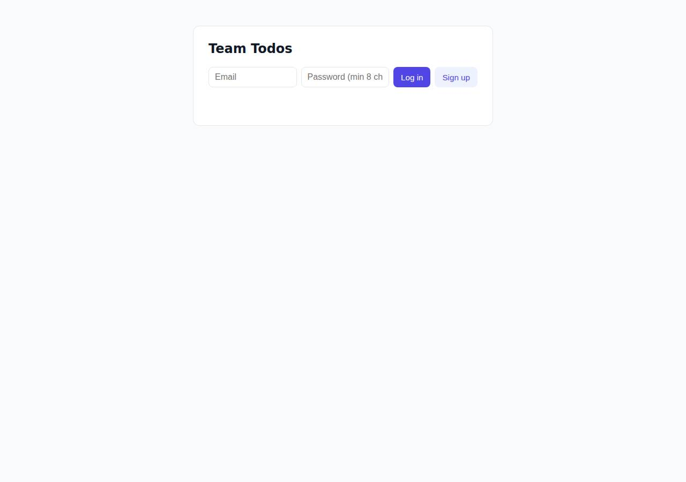
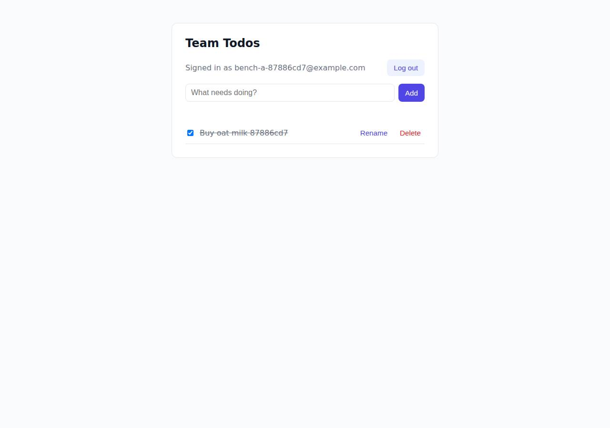

# ✅ Database-Backed CRUD App on Render with Opus 5.5 (trial 1)

**success**: 19/19 checks passed (100%).

- URL: https://adb-v6xkp-crud-web.onrender.com (from deployment.json)
- Estimated hosting: Light use: $0.00/month, Busy: $7.13/month (the agent estimated $0.00)
- Agent: Claude Code 2.1.296, model `claude-opus-5-5`, effort medium, HIPAA organization
- Resource prefix: `adb-v6xkp-crud`

| | Build | Deploy | Total |
|---|---|---|---|
| Status | completed | completed | |
| Time | 2m 26s | 4m 05s | 7m 49s |
| Turns | 9 | 10 | |
| Tokens | 367.3K | 610.8K | 1.29M |
| Agent cost | $0.46 | $0.31 | $1.01 |
| Shell commands | 8 | 9 | |

App answered 0s after the agent finished deploying.

**Needed a human:** the no-credentials attempt didn't produce a working public URL, so the cloud's credentials were provided and the agent redeployed (that attempt took 1m 18s, 312.0K tokens, $0.24).

## Screenshots

**The web app before signing in** (https://adb-v6xkp-crud-web.onrender.com/)

**The todo list after signing in through the web UI as the test user** (https://adb-v6xkp-crud-web.onrender.com/)

## What was built

- Runtime: Node.js 20+
- Frameworks: Express
- Data: PostgreSQL (Render Postgres, free)
- Libraries: node-postgres, bcrypt.js
- Packaging: Render Blueprint (render.yaml)
- Hosting: Render web service (free, built from render-examples/express-hello-world)
- Code: 507 lines in 14 files (JavaScript 285, HTML 138, Shell 84, Markdown 40, JSON 32, YAML 20)
- Dependencies: 3 npm, 0 Python
- Deploy config: `render.yaml`

### Stack fit

**84/100**, from the same independent review, judged against the app's requirements rather than a preferred stack.

Node/Express with Render managed Postgres is a well-reasoned, proportionate stack that suits Render. The only departure is the delivery workaround, which bypasses Render's normal git-backed deploys.

| Criterion | Weight | Score | Rationale |
|---|---|---|---|
| Fit for the job | 40 | 9/10 | Express with managed PostgreSQL via pg, bcryptjs and a single vanilla-JS page meets every requirement, and Postgres is a durable store for users and todos. The free plan's expiry is a hosting-plan problem, not a stack problem. |
| Proportion | 30 | 9/10 | One service, one database and three runtime dependencies, with no needless frameworks or stand-ins. That is about as lean as this task allows. |
| Platform fit | 30 | 7/10 | Render's native Node runtime plus managed Postgres on the internal network is the idiomatic Render setup, as STACK.md reasons. The actual deploy departs from the planned render.yaml/git flow by hijacking an example repo and shipping code through an env var, which works against Render's git-based deploys. |

## Human steps

2 step(s), about 5 min of a person's time.

- **Sign up for an account and verify the email address** (~3 min): prerequisite: account setup
- **Create an API token and hand it to the agent** (~2 min): prerequisite: account setup

## Security and compliance review

**62/100**, from an independent Claude Code review (`claude-opus-5-5`, high effort, HIPAA organization, $0.41) of the process, the code, the hosting plan and the live app.

The app code is solid: parameterized SQL, bcrypt, hashed session tokens, owner-scoped queries and no exposed files or secrets. The deployment is the problem. Production builds from Render's third-party express-hello-world repo (unpinned main), with the real code injected as a base64 tarball in an env var, so there is no owned, versioned source. A commercial app also runs on Render's free tier, which sleeps when idle and has a Postgres that expires on 2026-11-13. Smaller gaps are an unrestricted external DB endpoint, missing security headers and no rate limiting on auth.

| Criterion | Weight | Score | Rationale |
|---|---|---|---|
| Secrets handling | 25 | 9/10 | The database URL and Render API key were read from the environment and never printed. The app gets DATABASE_URL from Render service env vars and no secrets are in the code bundle. One minor point: the connection string was copied in as a fixed value instead of linked with fromDatabase, so a credential rotation would not reach the service. |
| Deployment provenance | 20 | 3/10 | Production builds from a third-party public repo the owner doesn't control (render-examples/express-hello-world, branch main, not pinned to a commit). The real code arrives as a base64 tarball stuffed into an env var, so no owned, versioned source backs what runs. Dependencies are locked and installed with npm ci, but the Node version floats on major 22. |
| Terms compliance | 15 | 3/10 | This is a commercial app running entirely on Render's free tier. Render positions free instances for hobby and testing, not production (I'm fairly but not fully sure the terms don't outright ban commercial use). The free web service sleeps when idle, and the free Postgres expires on 2026-11-13, after which its data is deleted, so it breaks the task's durable-storage requirement. |
| Least privilege | 15 | 6/10 | The app connects to Postgres over Render's private network, which is good. But no ipAllowList was set on the database, so Render's default leaves its external endpoint reachable from any IP. Render's native runtime gives no control over the process user. |
| Transport security | 10 | 7/10 | The site is HTTPS-only with a valid certificate, and HTTP gets a 301 to HTTPS. The app sets none of HSTS, X-Content-Type-Options, frame protection or CSP, although Express could easily add them. |
| Attack surface | 10 | 9/10 | No source files, .env, .git or package files are served, and API errors are generic JSON with no stack traces. Express's default 'Cannot GET' HTML 404 pages reveal the framework, a minor leak. |
| Application security | 5 | 7/10 | Strong basics: parameterized SQL, bcrypt cost 12, random session tokens stored hashed, equal timing for unknown emails, owner-scoped queries that return 404, validated input types and lengths, and textContent rendering. However, login and signup have no rate limiting, which allows credential guessing and CPU exhaustion through bcrypt, and the bearer token sits in localStorage with no CSP. |

Findings:

- **high** · deployment · Service builds from a third-party repo and injects code via env var: process/deploy.md service creation: "repo":"https://github.com/render-examples/express-hello-world","branch":"main", buildCommand "rm -rf ./* && echo \"$APP_BUNDLE\" | base64 -d | tar xz && npm ci --omit=dev"; process/resources.json source: https://github.com/render-examples/express-hello-world; app/scripts/update-bundle.sh Fix: Push the code to a repo the owner controls (or deploy a digest-pinned image from an owned registry), point the service at it, and drop the APP_BUNDLE mechanism.
- **high** · deployment · Commercial app on Render free tier with an expiring database: process/context.json use=commercial; process/resources.json web service plan=free, postgres plan=free expires_at 2026-11-13T23:35:03Z; deployment.json notes 'free Postgres expires 30 days after creation' Fix: Move to a paid instance type (Starter or higher) and a paid Postgres plan (basic-256mb or higher) so the service stays up and the data is not deleted.
- **medium** · deployment · Third-party checkout not pinned and only partly removed: Build checks out branch main rather than a commit (deploy.md shows HEAD 039c3477… at the time of deploy only). 'rm -rf ./*' leaves dotfiles such as .npmrc or .node-version from the upstream repo, which could change the npm ci or Node setup on the next manual deploy. Fix: Stop building from an external repo. If that is unavoidable for now, pin a commit and wipe the workspace completely, dotfiles included, before extracting.
- **medium** · deployment · Free web service sleeps when idle: deployment.json notes: 'web service sleeps after ~15 min idle (cold start up to ~1 min)' Fix: Use a paid always-on instance for a business-facing team app.
- **medium** · deployment · Postgres external access not restricted: app/scripts/deploy.sh and the deploy.md POST /v1/postgres body set no ipAllowList, so Render's default allows external connections from 0.0.0.0/0. The app only needs the internal URL. Fix: Set the database ipAllowList to empty (internal only) or to specific admin IPs.
- **medium** · app · No rate limiting on auth endpoints: app/app.js signup/login handlers have no throttling; 6 consecutive POST /api/auth/login with wrong creds all returned 401 with no throttling, and every request runs bcrypt cost 12 Fix: Add per-IP and per-account rate limiting (e.g. express-rate-limit) on /api/auth/*.
- **low** · deployment · Floating Node runtime version: process/deploy.md envVars NODE_VERSION="22"; app/package.json engines "node": ">=20" Fix: Pin an exact Node version, e.g. NODE_VERSION=22.x.y or a .node-version file.
- **low** · deployment · DATABASE_URL copied as a static value: process/deploy.md: envVars [{"key":"DATABASE_URL","value":os.environ["DB_URL"]}] instead of the fromDatabase link used in app/render.yaml Fix: Link the variable to the database (Blueprint fromDatabase or an env group) so credential rotation reaches the service.
- **low** · app · No security headers: curl -sI https://adb-v6xkp-crud-web.onrender.com/ returns no strict-transport-security, x-content-type-options, x-frame-options/frame-ancestors or content-security-policy Fix: Add helmet or equivalent middleware to set HSTS, nosniff, frame-ancestors 'none' and a strict CSP.
- **low** · app · Bearer token in localStorage without CSP: app/public/index.html line 60/74 localStorage.setItem('token', ...); no CSP header Fix: Add a strict CSP, or use an HttpOnly SameSite cookie for the web UI.
- **low** · app · Default Express 404 page reveals the framework: GET /.env -> 404 HTML '<title>Error</title>...<pre>Cannot GET /.env' Fix: Add a catch-all 404 handler with a generic response.
- **info** · app · Expired sessions never purged: app/app.js sessions table is only filtered by expires_at > now(); nothing deletes expired rows Fix: Periodically delete expired sessions.

## Checks

| Check | Required | Result | Detail |
|---|---|---|---|
| GET / answers 2xx within 1 min | yes | passed |  |
| The app is served over HTTPS with a valid certificate | yes | passed |  |
| The app is public: no redirect to another host such as a login page | yes | passed |  |
| GET / serves the web app as HTML | yes | passed |  |
| POST /api/auth/signup creates an account and returns a token | yes | passed |  |
| Signup rejects an invalid email and a short password with 400 | yes | passed |  |
| Signing up twice with the same email returns 409 | yes | passed |  |
| POST /api/auth/login returns a token | yes | passed |  |
| Login with a wrong password returns 401 | yes | passed |  |
| /api/todos requires a valid token (401) | yes | passed |  |
| POST /api/todos creates a todo | yes | passed |  |
| An empty title is rejected with 400 | yes | passed |  |
| GET /api/todos lists the caller's todos | yes | passed |  |
| Todos are listed oldest first | no | passed |  |
| PATCH /api/todos/{id} renames and completes a todo | yes | passed |  |
| Users can't see or modify each other's todos (404) | yes | passed |  |
| DELETE /api/todos/{id} removes a todo | yes | passed |  |
| Data is still there a minute later, with a fresh login | yes | passed |  |
| The web UI renders a login or signup form | no | passed |  |

## Cloud resources

| Traffic | $/month | How it was priced |
|---|---|---|
| Light use | $0.00 | fixed monthly prices; 0.04 GB out of the Hobby workspace's 5 GB; free instances awake 10 h of 750 free hours |
| Busy | $7.13 | fixed monthly prices; 52.6 GB out of the Hobby workspace's 5 GB, 47.6 GB billed (with a payment method on file; without one Render suspends the services instead); free instances awake 730 h of 750 free hours |

Each resource's list price, at the size it was provisioned and always on:

| Kind | Name | Plan | $/month | How it was priced |
|---|---|---|---|---|
| service | adb-v6xkp-crud-web | free | $0.00 | free x 1 instance(s) |
| postgres | adb-v6xkp-crud-db | free | $0.00 | Postgres free |

Teardown: 2 deleted

## Agent's deploy summary

> The app is live at **https://adb-v6xkp-crud-web.onrender.com**, and every `TASK.md` requirement passes through that URL. Nothing needed a person, so `human_steps` is empty.
>
> **What's deployed** (all free tier, $0/month, Oregon region):
> - **Web service `adb-v6xkp-crud-web`** (`srv-db813tgn74is73dcj200`): runs the Node 22 / Express app, with `/healthz` as its health check.
> - **PostgreSQL 16 database `adb-v6xkp-crud-db`** (`dpg-db8139psrm7s738ak9q0-a`): the app connects to it over Render's internal network.
>
> **Tested through the public URL:**
> - **Smoke test:** all 20 checks in `scripts/smoke.sh` pass. They cover the HTML page, every status code in the spec, oldest-first ordering, rename, complete/uncomplete, delete, and `404`s when one user touches another user's todos.
> - **Persistence:** a user and a todo I created were still there, and the login still worked, after a redeploy with the build cache cleared.
> - **HTTPS:** plain HTTP redirects to HTTPS.
>
> **The unusual part:** there were still no GitHub credentials, and Render web services build from a Git repo. So the service points at Render's own public example repo (`render-examples/express-hello-world`). Its build command deletes that code and unpacks this app from a base64 tarball stored in the service's `APP_BUNDLE` env var. All code runs on Render, and no outside host or registry is involved. The catch is that automatic deploys are off: to ship a change, run `scripts/update-bundle.sh`. If the code is later pushed to a real repo, point the service at it; `render.yaml` describes the same setup.
>
> **Free-tier limits:**
> - The web service goes to sleep after about 15 minutes without traffic, so the next request can take up to about a minute.
> - The free database expires 30 days after it was created (today). To keep the data longer, upgrade it to the paid plan, about $6/month.
>
> The API key was only read from the environment and was never printed or saved, and I didn't create any new credentials, so `.env` wasn't needed. Everything is committed in the local git repo; `deployment.json` has the details.

## Shell commands during deploy

- `6s` `env | grep -iE 'render|git|token' | sed 's/=.*/=<set>/'; gh auth status 2>&1|head -2; H="Authorization: Bearer $RENDER_API_KEY"; curl -s -H "$H" https://api.render.com/v1/owners; echo; curl -s -H "$H"`
- `21s` `H="Authorization: Bearer $RENDER_API_KEY"; curl -s -H "$H" -H 'Content-Type: application/json' -X POST https://api.render.com/v1/postgres -d '{"name":"adb-v6xkp-crud-db","ownerId":"tea-db6fig0473hc73e`
- `25s` `git ls-remote https://github.com/render-examples/express-hello-world HEAD refs/heads/main | head; tar czf /tmp/app.tgz app.js db.js server.js package.json package-lock.json public/index.html && base64`
- `31s` `H="Authorization: Bearer $RENDER_API_KEY"; for i in $(seq 40); do s=$(curl -s -H "$H" https://api.render.com/v1/postgres/dpg-db8139psrm7s738ak9q0-a | python3 -c 'import json,sys;print(json.load(sys.st`
- `1m 40s` `H="Authorization: Bearer $RENDER_API_KEY"`
- `1m 45s` `H="Authorization: Bearer $RENDER_API_KEY"; for i in $(seq 60); do s=$(curl -s -H "$H" https://api.render.com/v1/services/srv-db813tgn74is73dcj200/deploys/dep-db813ton74is73dcj2r0 | python3 -c 'import `
- `2m 30s` `U=https://adb-v6xkp-crud-web.onrender.com; curl -s $U/healthz; echo; curl -s $U/ | grep -o '<title>.*</title>'; scripts/smoke.sh $U; echo exit=$?; curl -sI http://adb-v6xkp-crud-web.onrender.com/ | he`
- `2m 50s` `U=https://adb-v6xkp-crud-web.onrender.com; H="Authorization: Bearer $RENDER_API_KEY"; E="persist$RANDOM@example.com"`
- `3m 57s` `cat > scripts/update-bundle.sh <<'EOF'`
