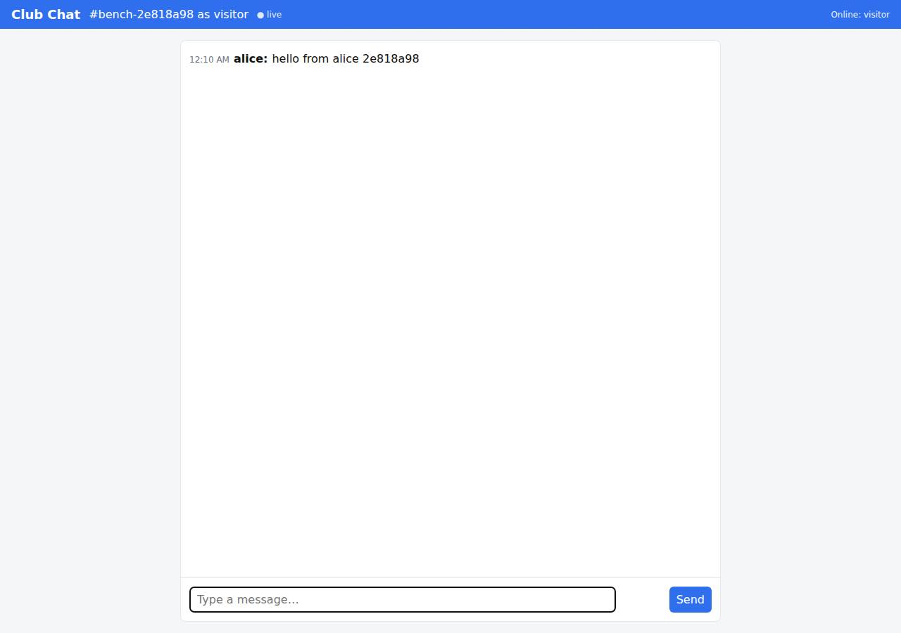

# ✅ Real-Time Collaborative App on Render with Opus 5.5 (trial 1)

**success**: 13/13 checks passed (100%).

- URL: https://adb-bklxk-realtime-web.onrender.com (from deployment.json)
- Estimated hosting: Light use: $0.00/month, Busy: $7.13/month (the agent estimated $0.00)
- Agent: Claude Code 2.1.296, model `claude-opus-5-5`, effort medium, HIPAA organization
- Resource prefix: `adb-bklxk-realtime`

| | Build | Deploy | Total |
|---|---|---|---|
| Status | completed | completed | |
| Time | 2m 28s | 4m 54s | 8m 38s |
| Turns | 12 | 12 | |
| Tokens | 446.0K | 813.4K | 1.59M |
| Agent cost | $0.52 | $0.43 | $1.23 |
| Shell commands | 7 | 11 | |

App answered 0s after the agent finished deploying.

**Needed a human:** the no-credentials attempt didn't produce a working public URL, so the cloud's credentials were provided and the agent redeployed (that attempt took 1m 17s, 329.9K tokens, $0.27).

## Screenshots

**The room the verifier's clients chatted in, with its history** (https://adb-bklxk-realtime-web.onrender.com/?room=bench-2e818a98)

## What was built

- Runtime: Node.js 22
- Frameworks: Node.js http module (built in)
- Data: PostgreSQL (Render Postgres, free)
- Libraries: ws, node-postgres
- Packaging: Render Blueprint (render.yaml)
- Hosting: Render web service (free, running the prebuilt image node:22-alpine)
- Code: 746 lines in 14 files (JavaScript 578, HTML 141, Markdown 41, JSON 29, Shell 27, YAML 26)
- Dependencies: 2 npm, 0 Python
- Deploy config: `render.yaml`

### Stack fit

**74/100**, from the same independent review, judged against the app's requirements rather than a preferred stack.

A minimal Node + ws + Postgres stack on a single Render web service fits a hobby-club chat app well. The odd image-runtime deployment and the expiring free database are where it falls short of the platform's strengths.

| Criterion | Weight | Score | Rationale |
|---|---|---|---|
| Fit for the job | 40 | 8/10 | Node's http module plus ws, with Postgres for history, suits a real-time chat app: WebSockets for live delivery and a durable store for history. Durability is undercut only by choosing the expiring free database plan. |
| Proportion | 30 | 8/10 | There are just two dependencies and one service plus a database, with no framework. The SSE endpoints and in-memory fallback add a bit of extra surface, but the spec allows SSE. |
| Platform fit | 30 | 6/10 | A long-running Render web service fits WebSockets well. But the build left STACK.md's plan of the native Node runtime with npm ci for a stock image with an env-var bundle and eval boot, which works against Render's build-and-deploy model. STACK.md also describes an in-memory ring alongside Postgres that the code doesn't implement. |

## Human steps

2 step(s), about 5 min of a person's time.

- **Sign up for an account and verify the email address** (~3 min): prerequisite: account setup
- **Create an API token and hand it to the agent** (~2 min): prerequisite: account setup

## Security and compliance review

**70/100**, from an independent Claude Code review (`claude-opus-5-5`, high effort, HIPAA organization, $0.42) of the process, the code, the hosting plan and the live app.

The chat app is solid: input is validated, SQL is parameterized, the UI is XSS-safe, Postgres is private, it's served only over HTTPS and no secrets leaked. The main weakness is provenance: the code is a locally built bundle passed in an env var and run with eval on a floating node:22-alpine image as root, with no tie to a source repo or pinned inputs. The free Postgres plan also expires in 30 days, which will take the app's persistent history with it.

| Criterion | Weight | Score | Rationale |
|---|---|---|---|
| Secrets handling | 25 | 9/10 | No credentials in source, the bundle or committed files. The Render API key stayed in an env var, the DB connection string was masked in output and passed through a temp file that was then deleted, and the app reads DATABASE_URL from a Render service env var. The only gap is that it's a plain env var, not one linked through fromDatabase or an env group. |
| Deployment provenance | 20 | 4/10 | Production code doesn't come from a source the owner controls. It's a locally built esbuild bundle shipped as a base64 env var and run with `node -e eval(process.env.BOOT)`, so Render can't tie the running code to any commit. The base image is a floating tag (node:22-alpine), esbuild is fetched with `npx -y esbuild@0.24`, and dependencies use caret ranges with no lockfile in the delivered sources. |
| Terms compliance | 15 | 6/10 | Render's free tier is fine for a personal hobby-club app, and sleeping when idle is tolerable for this use. But the free Postgres instance expires on 2026-11-14 (30 days), and the app's persistent history depends on it, so the app will lose its data store unless someone upgrades. The agent did disclose this. |
| Least privilege | 15 | 7/10 | Postgres has an empty IP allow list and the app uses the internal connection string. The container, however, runs the stock node image as root and writes the app to /app at startup. The app also connects with the database owner role, and its pg client would set rejectUnauthorized:false if it were ever pointed at an external host. |
| Transport security | 10 | 8/10 | HTTPS is served with a valid Google Trust Services certificate, HTTP gets a 301 redirect to HTTPS, and the client uses wss://. The app sets none of HSTS, CSP, X-Content-Type-Options or frame protection, though it easily could have. |
| Attack surface | 10 | 9/10 | Probes for /.env, /.git/config, /package.json, /server.js and /admin all return JSON 404s, there are no stack traces, and only / and the API are served. /healthz is public but harmless. |
| Application security | 5 | 7/10 | Inputs are validated (1-1000 character text, name and room limits, 16 KB body and WebSocket payload caps), SQL is parameterized, and the UI renders messages with textContent. There is no rate limiting or flood protection on POST or WebSocket messages, and the WebSocket upgrade doesn't check Origin. |

Findings:

- **medium** · deployment · App code shipped in an env var and run with eval, not from a tracked source: process/deploy.md: service created with image docker.io/library/node:22-alpine and env var APP_BUNDLE (base64 tarball from scripts/build-bundle.sh), then PATCHed with dockerCommand `node -e eval(process.env.BOOT)`; app/scripts/boot.js:4-5 unpacks and runs it. The commit 39cbc33 exists only in the local repo. Fix: Deploy from a Git repo the owner controls (render.yaml Blueprint with the native Node runtime), or from an image built from a Dockerfile in such a repo and pushed to an owner-controlled registry, so each deploy maps to a commit.
- **medium** · deployment · Free Postgres expires after 30 days, taking chat history with it: process/resources.json: postgres adb-bklxk-realtime-db plan free, expires_at 2026-11-14T00:05:53Z; app/store.js:30-35 relies on it for history. Fix: Upgrade the database to a paid plan (basic-256mb) before it expires, or tell the club that history is temporary.
- **low** · deployment · Unpinned base image and build tools: process/deploy.md imagePath docker.io/library/node:22-alpine (no digest); app/scripts/build-bundle.sh:7 `npx -y esbuild@0.24`; app/package.json:14-15 `pg ^8.23.1`, `ws ^8.22.0`, and no package-lock.json in app/. Fix: Pin the image by digest, pin esbuild to an exact version as a devDependency, and commit package-lock.json, building with npm ci.
- **low** · deployment · Container runs as root: Stock node:22-alpine image defaults to root, and app/scripts/boot.js:4 creates and writes /app at runtime with no USER change. Fix: Use a Dockerfile with `USER node`, or the native Node runtime, so the process doesn't run as root.
- **low** · app · No rate limiting on message posting: app/server.js:140-152 (POST) and 210-229 (WebSocket) accept unlimited messages per client. The agent posted 55 messages in a loop without being throttled (process/deploy.md). Fix: Add per-connection and per-IP message rate limits, and cap room or database growth.
- **low** · app · WebSocket upgrade doesn't check Origin: Upgrade to /ws?room=review-probe&user=rev with `Origin: https://evil.example` returned 101. app/server.js:188-202 has no Origin check. Fix: Reject upgrades whose Origin isn't the app's own host.
- **low** · app · No security headers: GET / returns only content-type, cache-control and Cloudflare/Render headers: no Strict-Transport-Security, Content-Security-Policy, X-Content-Type-Options or X-Frame-Options (app/server.js:117). Fix: Set HSTS, a restrictive CSP, X-Content-Type-Options: nosniff and frame-ancestors 'none' on responses.
- **info** · deployment · DATABASE_URL set as a literal env var: process/deploy.md: the internal connection string was fetched from the API and set as envVars DATABASE_URL (output masked, /tmp/svc.json removed afterwards). Fix: Prefer linking with fromDatabase in a Blueprint, so the credential is managed and rotated by Render.

## Checks

| Check | Required | Result | Detail |
|---|---|---|---|
| GET / answers 2xx within 1 min | yes | passed |  |
| The app is served over HTTPS with a valid certificate | yes | passed |  |
| The app is public: no redirect to another host such as a login page | yes | passed |  |
| GET / serves the chat UI as HTML | yes | passed |  |
| deployment.json declares a supported transport (websocket or sse) | no | passed |  |
| Clients connect over websocket | yes | passed |  |
| A message reaches another client in the same room within 5 s | yes | passed |  |
| The sender receives its own message too | no | passed |  |
| Messages never reach clients in other rooms | yes | passed |  |
| Five users posting at the same time all see every message within 10 s | yes | passed |  |
| GET /api/rooms/<room>/messages returns recent messages | yes | passed |  |
| Messages over 1000 characters are rejected | no | passed |  |
| The chat UI loads in a browser without errors | no | passed |  |

## Cloud resources

| Traffic | $/month | How it was priced |
|---|---|---|
| Light use | $0.00 | fixed monthly prices; 0.04 GB out of the Hobby workspace's 5 GB; free instances awake 10 h of 750 free hours |
| Busy | $7.13 | fixed monthly prices; 52.6 GB out of the Hobby workspace's 5 GB, 47.6 GB billed (with a payment method on file; without one Render suspends the services instead); free instances awake 730 h of 750 free hours |

Each resource's list price, at the size it was provisioned and always on:

| Kind | Name | Plan | $/month | How it was priced |
|---|---|---|---|---|
| service | adb-bklxk-realtime-web | free | $0.00 | free x 1 instance(s) |
| postgres | adb-bklxk-realtime-db | free | $0.00 | Postgres free |

Teardown: 2 deleted

## Agent's deploy summary

> The chat app is live at **https://adb-bklxk-realtime-web.onrender.com**, and every `TASK.md` requirement passed when I tested through that public URL. The WebSocket address is `wss://adb-bklxk-realtime-web.onrender.com/ws`.
>
> **What I created (both free, $0 a month):**
> - **Web service** `adb-bklxk-realtime-web` (`srv-db81i9u89jmc73brdkeg`).
> - **Postgres database** `adb-bklxk-realtime-db` (`dpg-db81hodg1s2s738m5a9g-a`). It accepts connections only from inside Render, and chat history is stored there.
>
> **How it's deployed:** there were no GitHub credentials, so there was no Git repo for Render to build from. Instead, the service runs the official `node:22-alpine` image, which Render pulls itself; nothing was pushed to another registry. The app is packed into a single file and sent as the env var `APP_BUNDLE`, and a small startup script (`scripts/boot.js`, sent as `BOOT`) unpacks and starts it. To redeploy, run `scripts/deploy.sh`. `render.yaml` still works as a Git-based setup if a repo is connected later.
>
> **Tested on the public URL:**
> - The page loads.
> - 20 messages sent at once over WebSocket reached every client in the room, including the sender, in under half a second.
> - Rooms stay separate.
> - Invalid messages get `400` over HTTP and are ignored over WebSocket.
> - `POST` returns `201` and the message is broadcast.
> - History returns at most 50 messages, oldest first, and was still there after a restart.
> - The SSE stream works.
>
> **What didn't work:** my first start command was a quoted `sh -c '…'`, which Render didn't parse correctly. Switching to the `BOOT` script fixed it.
>
> **Limits of the free tier:**
> - The service sleeps after 15 minutes idle. The next visit takes about a minute to start, open chats drop, and the page reconnects by itself.
> - The free database expires after 30 days unless it's upgraded, at about $6 a month.
>
> Nothing needed a person, so `human_steps` is empty. I didn't create any new credentials, so there was nothing to put in `.env`. No secrets are in committed files.

## Shell commands during deploy

- `8s` `cd /home/runner/work/_temp/adb-bklxk-realtime; test -n "$RENDER_API_KEY" && echo key-set; gh auth status 2>&1 | head -2; env | grep -iE 'github|gitlab|token' | sed 's/=.*/=***/'`
- `29s` `cd /home/runner/work/_temp/adb-bklxk-realtime; mkdir -p /tmp/bundle && npx -y esbuild@0.24 server.js --bundle --platform=node --target=node22 --minify --external:pg-native --outfile=/tmp/bundle/server`
- `37s` `cd /home/runner/work/_temp/adb-bklxk-realtime; H=(-H "Authorization: Bearer $RENDER_API_KEY" -H "Accept: application/json" -H "Content-Type: application/json")`
- `48s` `cd /home/runner/work/_temp/adb-bklxk-realtime; cat > scripts/build-bundle.sh <<'EOF'`
- `1m 46s` `cd /home/runner/work/_temp/adb-bklxk-realtime; H=(-H "Authorization: Bearer $RENDER_API_KEY" -H "Accept: application/json" -H "Content-Type: application/json")`
- `1m 54s` `H=(-H "Authorization: Bearer $RENDER_API_KEY" -H "Accept: application/json")`
- `2m 42s` `cd /home/runner/work/_temp/adb-bklxk-realtime; cat > scripts/boot.js <<'EOF'`
- `2m 49s` `H=(-H "Authorization: Bearer $RENDER_API_KEY" -H "Accept: application/json")`
- `3m 09s` `cd /home/runner/work/_temp/adb-bklxk-realtime; node scripts/smoke.js https://adb-bklxk-realtime-web.onrender.com; node scripts/smoke.js https://adb-bklxk-realtime-web.onrender.com | tail -1`
- `3m 20s` `U=https://adb-bklxk-realtime-web.onrender.com; R=cap-$RANDOM`
- `4m 46s` `cd /home/runner/work/_temp/adb-bklxk-realtime; cat > scripts/deploy.sh <<'EOF'`
