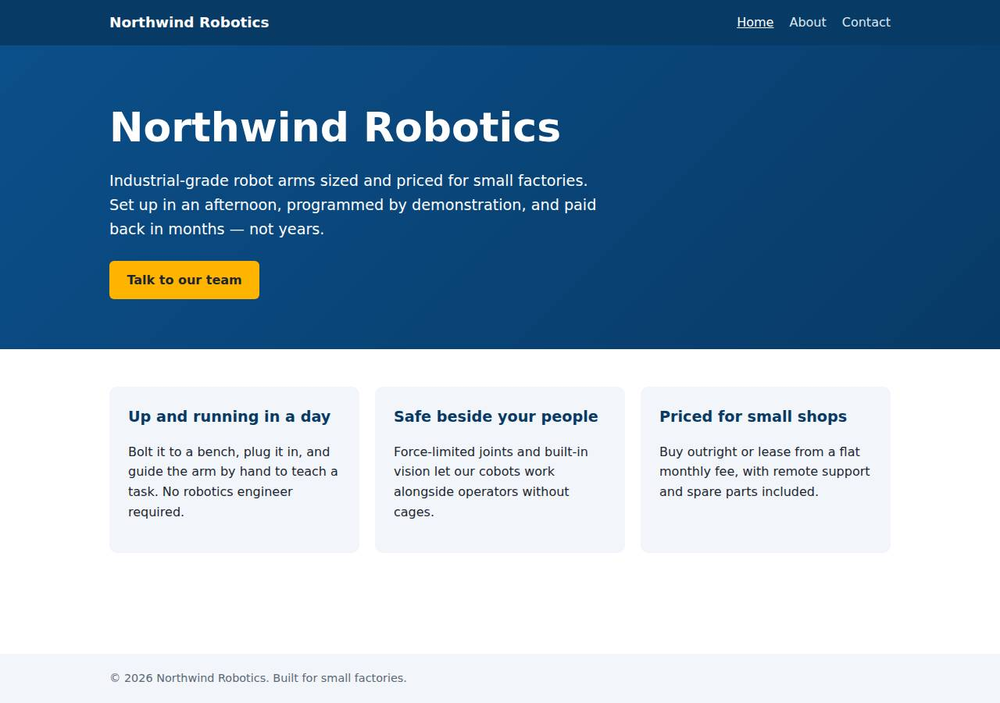
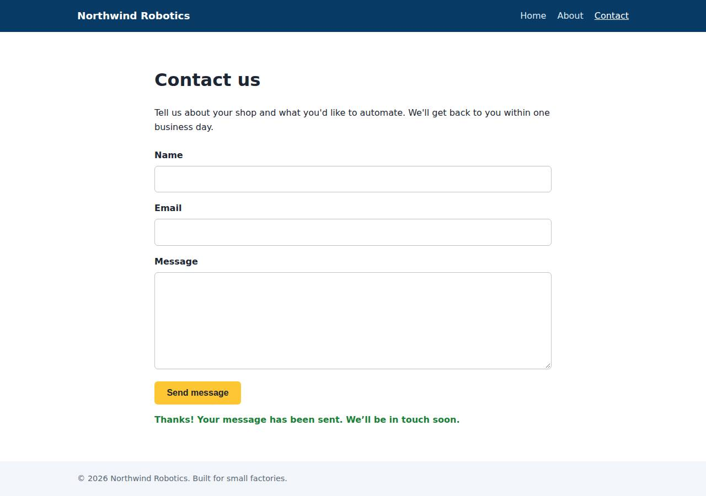

# ✅ Static Content Site on Render with Opus 5.5 (trial 1)

**success**: 16/16 checks passed (100%).

- URL: https://adb-xbmk6-static-web.onrender.com (from deployment.json)
- Estimated hosting: Light use: $0.00/month, Busy: $7.13/month (the agent estimated $0.00)
- Agent: Claude Code 2.1.296, model `claude-opus-5-5`, effort medium, HIPAA organization
- Resource prefix: `adb-xbmk6-static`

| | Build | Deploy | Total |
|---|---|---|---|
| Status | completed | completed | |
| Time | 1m 34s | 1m 49s | 4m 12s |
| Turns | 11 | 12 | |
| Tokens | 377.0K | 666.4K | 1.33M |
| Agent cost | $0.37 | $0.44 | $1.00 |
| Shell commands | 9 | 11 | |

App answered 0s after the agent finished deploying.

**Needed a human:** the no-credentials attempt didn't produce a working public URL, so the cloud's credentials were provided and the agent redeployed (that attempt took 49s, 284.1K tokens, $0.18).

## Screenshots

**The home page** (https://adb-xbmk6-static-web.onrender.com/)

**The contact page after the verifier submitted the form** (https://adb-xbmk6-static-web.onrender.com/contact)

## What was built

- Runtime: Node.js 22
- Frameworks: Node.js http module (built in)
- Packaging: Render Blueprint (render.yaml)
- Hosting: Render web service (free, running the prebuilt image node:22-alpine)
- Code: 515 lines in 17 files (JavaScript 211, HTML 157, Shell 116, CSS 31, Markdown 30, JSON 29, YAML 13)
- Dependencies: 0 npm, 0 Python
- Deploy config: `render.yaml`

### Stack fit

**81/100**, from the same independent review, judged against the app's requirements rather than a preferred stack.

A dependency-free Node web service is a well-reasoned, proportionate choice for three static pages plus a same-origin JSON endpoint. Its platform fit suffers from the Secret Files and image workaround and the free sleeping instance, both departures from the native Node service described in STACK.md.

| Criterion | Weight | Score | Rationale |
|---|---|---|---|
| Fit for the job | 40 | 9/10 | A single Node server using the built-in http module serves the three static pages and the same-origin /api/contact endpoint exactly as TASK.md requires, with no data store because none is needed. |
| Proportion | 30 | 9/10 | There are zero npm dependencies, one file of server code and plain HTML/CSS/JS. That is about as simple as a static site with one endpoint can be. |
| Platform fit | 30 | 6/10 | STACK.md planned Render's native Node runtime, which is a reasonable fit. The build departed from it: an image-backed service with the code smuggled in as Secret Files, which works against Render's normal Git-based build. It also uses an always-on-style container on a sleeping free tier where static hosting could serve most of the content. |

## Human steps

2 step(s), about 5 min of a person's time.

- **Sign up for an account and verify the email address** (~3 min): prerequisite: account setup
- **Create an API token and hand it to the agent** (~2 min): prerequisite: account setup

Reported but not needed, since the deployment worked without them: Optional: push this repo to a Git provider repo named adb-xbmk6-static, connect it to Render in the dashboard, and switc

## Security and compliance review

**72/100**, from an independent Claude Code review (`claude-opus-5-5`, high effort, HIPAA organization, $0.32) of the process, the code, the hosting plan and the live app.

The Northwind Robotics site is a small, dependency-free Node server with sound input validation and nothing exposed beyond its routes, served over HTTPS with a valid certificate and no leaked secrets. The main weaknesses are in the deployment: the code was pushed into a node:22-alpine container (unpinned tag, running as root) as Render Secret Files rather than built from source control, and this commercial site runs on Render's free tier, which sleeps when idle. The app also sets no security headers.

| Criterion | Weight | Score | Rationale |
|---|---|---|---|
| Secrets handling | 25 | 9/10 | The app needs no secrets. The Render API key was read from the environment or a .env file that git ignores, and it never shows up in commands, output or deployed files. The only minor leak is the account owner's email address, which was printed in an API response in the deploy transcript. |
| Deployment provenance | 20 | 5/10 | Production runs code that was uploaded as Render Secret Files from the agent's local working tree, not built from a repository the owner controls. The base image is the floating tag node:22-alpine with no digest, so each deploy can pull a different image. Zero npm dependencies limits the supply-chain risk. |
| Terms compliance | 15 | 5/10 | A commercial marketing site runs on Render's free web-service instance. Render positions that tier for hobby and preview use, not production, and it sleeps after 15 idle minutes, which means 30-60 s cold starts for visitors. I'm not aware of Render's terms banning commercial use on the free tier, but it is a poor fit for a business site that should stay up. |
| Least privilege | 15 | 7/10 | There are no data stores and only one public service, which is appropriate. However, the container runs node:22-alpine with its default root user, because the dockerCommand is 'node /etc/secrets/server.js' with no user set. |
| Transport security | 10 | 7/10 | The site is HTTPS-only: HTTP gets a 301 redirect, and the Google Trust Services certificate for onrender.com is valid. The app sets none of HSTS, X-Content-Type-Options, frame protection or CSP, though it could easily have done so in server.js. |
| Attack surface | 10 | 10/10 | Only the explicitly routed pages, assets, /api/contact and a harmless /healthz respond. /.env, /.git/config, /server.js, /package.json and traversal attempts return 404 or 400, with no stack traces. |
| Application security | 5 | 9/10 | The contact endpoint checks types, rejects non-object JSON, validates email, caps the body at 64 KB (returning 413) and stores nothing. The client writes messages with textContent, so there is no XSS path. There is no rate limiting, but abuse has little impact because nothing is stored or sent. |

Findings:

- **medium** · deployment · App code delivered as Secret Files, not built from source control: app/scripts/deploy-image.sh lines 13-18 and 31-38 upload server.js and the HTML/CSS/JS through the Render API as secretFiles, and the service runs 'node /etc/secrets/server.js'. process/deploy.md: the services API showed the service has no repo, and the local git repo has no remote. Fix: Push the code to a Git repo the owner controls and deploy the native Node service (or a static site) from it with render.yaml. Alternatively, build and push a versioned image. That way production is traceable to a commit.
- **medium** · deployment · Base image uses a floating tag with no digest: app/scripts/deploy-image.sh line 25: imagePath "docker.io/library/node:22-alpine". process/resources.json shows source docker.io/library/node:22-alpine. Fix: Pin the image by digest (node:22-alpine@sha256:...), or build from a Dockerfile with a pinned base image.
- **medium** · deployment · Commercial site on Render free instance, which sleeps when idle: process/context.json shows use: commercial. process/resources.json shows plan: free. process/deployment.json notes: 'The free plan sleeps after 15 minutes idle, so the first request after that takes about 30-60s'. Fix: Use a paid always-on instance (Starter) for a business site, or serve the pages from Render's static site hosting, which doesn't sleep.
- **low** · deployment · Container runs as root: app/scripts/deploy-image.sh lines 25-30: the official node:22-alpine image, whose default user is root, is started with dockerCommand 'node /etc/secrets/server.js' and no user switch. Fix: Use a Dockerfile with 'USER node', or the native Node runtime, which doesn't run the app as root in a container the agent configures.
- **low** · app · No security headers: curl -I https://adb-xbmk6-static-web.onrender.com/ returns only content-type, server, vary and the Render/Cloudflare headers. There is no Strict-Transport-Security, X-Content-Type-Options, X-Frame-Options/frame-ancestors or Content-Security-Policy. server.js line 95 writeHead sets only Content-Type and Content-Length. Fix: Add HSTS, X-Content-Type-Options: nosniff, a restrictive CSP (default-src 'self'; frame-ancestors 'none') and Referrer-Policy in the handler.
- **info** · deployment · Account owner email printed in the deploy transcript: process/deploy.md: the output of 'curl .../v1/owners?limit=1 | head -c 200' includes the owner's email. Fix: Filter API responses with jq to the fields you need before printing them.
- **info** · app · No rate limiting on contact endpoint: server.js handleContact (lines 41-66) accepts unlimited POSTs. Submissions aren't stored or emailed, so the impact is minimal. Fix: If submissions are later stored or emailed, add per-IP rate limiting or a honeypot field.

## Checks

| Check | Required | Result | Detail |
|---|---|---|---|
| GET / answers 2xx within 1 min | yes | passed |  |
| The app is served over HTTPS with a valid certificate | yes | passed |  |
| The app is public: no redirect to another host such as a login page | yes | passed |  |
| GET / returns HTML | yes | passed |  |
| GET /about returns HTML | yes | passed |  |
| GET /contact returns HTML | yes | passed |  |
| Home has an <h1> containing 'Northwind Robotics' | yes | passed |  |
| About has a heading containing 'About' | yes | passed |  |
| Contact has a form with name, email and message fields | yes | passed |  |
| Every page has a <title> and a viewport meta tag | no | passed |  |
| Home links to /about and /contact | no | passed |  |
| POST /api/contact with valid input returns {ok: true} | yes | passed |  |
| POST /api/contact rejects a bad email and an empty message with 400 | yes | passed |  |
| Unknown paths return 404 | yes | passed |  |
| Submitting the /contact form in a browser posts to /api/contact without leaving the page | yes | passed |  |
| Pages load in a browser without uncaught JavaScript errors | no | passed |  |

## Cloud resources

| Traffic | $/month | How it was priced |
|---|---|---|
| Light use | $0.00 | fixed monthly prices; 0.04 GB out of the Hobby workspace's 5 GB; free instances awake 10 h of 750 free hours |
| Busy | $7.13 | fixed monthly prices; 52.6 GB out of the Hobby workspace's 5 GB, 47.6 GB billed (with a payment method on file; without one Render suspends the services instead); free instances awake 730 h of 750 free hours |

Each resource's list price, at the size it was provisioned and always on:

| Kind | Name | Plan | $/month | How it was priced |
|---|---|---|---|---|
| service | adb-xbmk6-static-web | free | $0.00 | free x 1 instance(s) |

Teardown: 1 deleted

## Agent's deploy summary

> The site is live at **https://adb-xbmk6-static-web.onrender.com** and every requirement in `TASK.md` works through that URL.
>
> **What's running:** one free Render web service, `adb-xbmk6-static-web` (`srv-db80vqlg1s2s738k8k5g`), costing $0 a month. Nothing else was created.
>
> **How it's deployed, which is unusual:** Render normally builds from a Git repo, but no Git provider was linked to the account and I had no credentials for one. Instead:
> - The service runs the official public `node:22-alpine` image. It's only pulled from Docker Hub; nothing was pushed to another registry.
> - The app files are uploaded as Render Secret Files and started with `node /etc/secrets/server.js`.
> - To change the site, edit the files and re-run `scripts/deploy-image.sh`. It updates the files and redeploys; there's no push-to-deploy.
>
> **Checked through the public URL:**
> - **Pages:** `/`, `/about` and `/contact` return 200 `text/html` with a title, viewport tag and navigation links.
> - **404s:** unknown paths and the `.html` versions of the pages return 404.
> - **Contact endpoint:** `POST /api/contact` returns 200 `{"ok":true}` for valid input, and 400 with an error message for a missing name, bad email or empty message.
> - **Form in a browser:** in headless Chromium at phone width, the form on `/contact` showed the confirmation without reloading the page, and the page didn't scroll sideways.
>
> **Changes:**
> - The server now reads its page directory from a `PUBLIC_DIR` setting.
> - I renamed `404.html` to `not-found.html` because Secret File names can't start with a digit.
> - The local tests still pass, and the changes are committed.
>
> **Limitation:** the free plan puts the service to sleep after 15 minutes without traffic, so the first request after that takes about 30–60 seconds.
>
> One optional step is listed in `deployment.json`: connect a Git repo to Render to get push-to-deploy. `render.yaml` and `scripts/deploy.sh` are ready for that, and the site works without it.

## Shell commands during deploy

- `7s` `A="Authorization: Bearer $RENDER_API_KEY"; curl -sS -H "$A" https://api.render.com/v1/owners | jq '[.[].owner|{id,name,type}]'; curl -sS -H "$A" "https://api.render.com/v1/services?limit=50" | jq '[.[`
- `22s` `sed -i "s|^const PUBLIC_DIR = path.join(__dirname, 'public');|const PUBLIC_DIR = process.env.PUBLIC_DIR \|\| path.join(__dirname, 'public');|" server.js && grep -n PUBLIC_DIR server.js | head -2 && np`
- `33s` `cat > scripts/deploy-image.sh <<'EOF'`
- `40s` `sed -i 's|SVC=$(curl -fsS "${auth\[@\]}" -X POST "$API/services" -d "$body" \| jq -r .\.service\.id.)|resp=$(curl -sS "${auth[@]}" -X POST "$API/services" -d "$body"); SVC=$(jq -r ".service.id // empt`
- `43s` `A="Authorization: Bearer $RENDER_API_KEY"; curl -sS -H "$A" "https://api.render.com/v1/owners?limit=1" | head -c 200; echo; curl -sS -H "$A" "https://api.render.com/v1/services?name=adb-xbmk6-static-w`
- `47s` `A="Authorization: Bearer $RENDER_API_KEY"; S=srv-db80vqlg1s2s738k8k5g; curl -sS -H "$A" "https://api.render.com/v1/services/$S/deploys?limit=3" | jq '[.[].deploy|{id,status,trigger,createdAt}]'; curl `
- `51s` `A="Authorization: Bearer $RENDER_API_KEY"; S=srv-db80vqlg1s2s738k8k5g; for f in 404.html styles.css contact.js; do jq -n --rawfile c public/$f '{content:$c}' | curl -sS -H "$A" -H "Content-Type: appli`
- `56s` `git mv public/404.html public/not-found.html && sed -i "s|'404.html'|'not-found.html'|" server.js && sed -i 's|--rawfile n public/404.html|--rawfile n public/not-found.html|; s|{name:"404.html",conten`
- `1m 23s` `B=https://adb-xbmk6-static-web.onrender.com; scripts/verify.sh $B; for p in /styles.css /contact.js /about.html /index.html; do curl -s -o /dev/null -w "$p %{http_code} %{content_type}\n" $B$p; done; `
- `1m 29s` `cd /tmp/pw && sed -i 's|http://localhost:3123|https://adb-xbmk6-static-web.onrender.com|g' t.js && node t.js`
- `1m 40s` `cat > deployment.json <<'EOF'`
