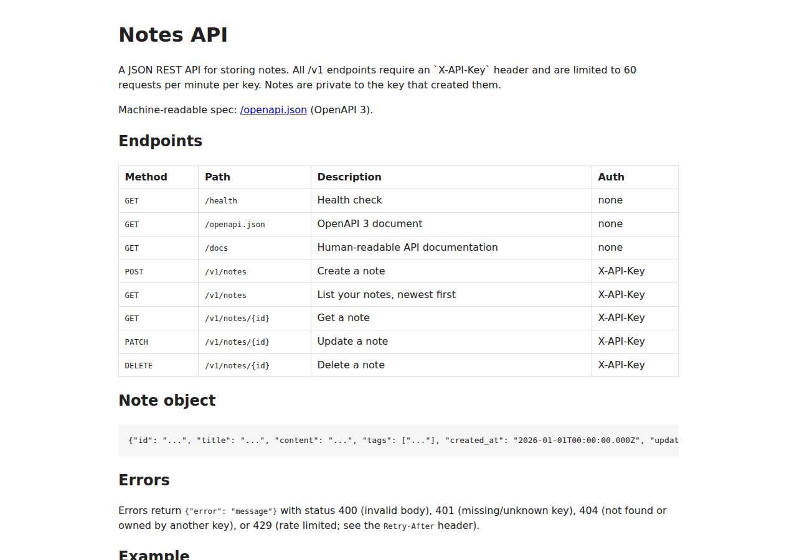

# ✅ API / Backend Service on Vercel with Opus 5.5 (trial 1)

**success**: 20/20 checks passed (100%).

- URL: https://adb-g2jxf-api.vercel.app (from deployment.json)
- Estimated hosting: Light use: $0.00/month, Busy: $20.00/month (the agent estimated $0.00)
- Agent: Claude Code 2.1.296, model `claude-opus-5-5`, effort medium, HIPAA organization
- Resource prefix: `adb-g2jxf-api`

| | Build | Deploy | Total |
|---|---|---|---|
| Status | completed | completed | |
| Time | 2m 19s | 18m 35s | 23m 14s |
| Turns | 10 | 44 | |
| Tokens | 414.5K | 4.26M | 5.38M |
| Agent cost | $0.49 | $1.89 | $2.79 |
| Shell commands | 9 | 40 | |

App answered 0s after the agent finished deploying.

**Needed a human:** the no-credentials attempt didn't produce a working public URL, so the cloud's credentials were provided and the agent redeployed (that attempt took 2m 20s, 708.2K tokens, $0.41).

## Screenshots

**The API documentation at /docs** (https://adb-g2jxf-api.vercel.app/docs)

## What was built

- Runtime: Node.js
- Frameworks: Hono
- Libraries: Vercel Blob SDK, node-postgres, Vercel Functions helpers, @electric-sql/pglite, @hono/node-server
- Hosting: Vercel project (hono), Vercel Functions
- Code: 862 lines in 15 files (JavaScript 816, Markdown 54, Shell 46, JSON 42)
- Dependencies: 6 npm, 0 Python
- Deploy config: none

### Stack fit

**46/100**, from the same independent review, judged against the app's requirements rather than a preferred stack.

The stack the agent planned (Hono on Vercel Functions with Neon Postgres) fits the job well. What is actually deployed substitutes an evictable runtime cache for the database and adds substantial workaround code, so it fits the task's durability requirement poorly.

| Criterion | Weight | Score | Rationale |
|---|---|---|---|
| Fit for the job | 40 | 4/10 | Node.js with Hono, a hand-written OpenAPI document and Postgres (as chosen in STACK.md) would fit well. However, the deployed build departs from STACK.md by using Vercel Runtime Cache as the primary data store, which doesn't meet the requirement for durable persistence and only approximates atomic rate-limit counters. |
| Proportion | 30 | 4/10 | The code carries four storage backends (Postgres, PGlite, Blob and Runtime Cache) plus a hand-built sharded index and per-instance counter scheme to work around a cache with no compare-and-swap. That is a lot of complexity, and the cache is a stand-in that only appears to be a database. |
| Platform fit | 30 | 6/10 | Hono as a zero-config Vercel Function on Fluid compute uses the platform well, and Neon through the Marketplace would have been the natural choice. Using Runtime Cache as the database works against what that product is designed for. |

## Human steps

2 step(s), about 5 min of a person's time.

- **Sign up for an account and verify the email address** (~3 min): prerequisite: account setup
- **Create an API token and hand it to the agent** (~2 min): prerequisite: account setup

Reported but not needed, since the deployment worked without them: Accept the Neon Marketplace terms for team ai-deploy-bench in a browser: https://vercel.com/ai-deploy-bench/~/integratio

## Security and compliance review

**85/100**, from an independent Claude Code review (`claude-opus-5-5`, high effort, HIPAA organization, $0.47) of the process, the code, the hosting plan and the live app.

The Notes API is a small, well-validated Hono function on Vercel Hobby, which suits a personal project. Secrets were handled through sensitive env vars, nothing sensitive is exposed, and HTTPS with HSTS is enforced. The main weakness is that production notes live only in Vercel Runtime Cache, an evictable cache rather than a durable database, because no database could be provisioned without a human step; the cross-instance rate limiter on that cache is also only approximate.

| Criterion | Weight | Score | Rationale |
|---|---|---|---|
| Secrets handling | 25 | 9/10 | API_KEYS was piped from the environment into a Vercel sensitive env var and never printed. The pulled .env.local (OIDC token) was masked when displayed and kept out of the upload by .vercelignore. The only weakness is that the deploy commands pass the Vercel token as a --token argument, which puts it in the process list. |
| Deployment provenance | 20 | 8/10 | The code was deployed straight from the agent's working directory with the Vercel CLI, and package-lock.json was uploaded so Vercel's build installs locked dependencies. However, the CLI itself was fetched unpinned with `npx -y vercel@latest`, there is no git-backed source of record, and unused storage SDKs (PGlite, @vercel/blob) are bundled. |
| Terms compliance | 15 | 7/10 | Vercel Hobby is meant for personal, non-commercial use, which matches this personal side project. However, production keeps its only copy of the data in Vercel Runtime Cache. That is a cache Vercel documents as subject to LRU eviction, so the app relies on a durability guarantee the provider doesn't give. |
| Least privilege | 15 | 9/10 | There is only one function and no publicly reachable data store. Notes are scoped to a SHA-256 hash of the API key, and the temporary ALLOW_EPHEMERAL_DB flag was removed. One minor point: the Neon integration was first attempted for the preview and development environments as well as production. |
| Transport security | 10 | 9/10 | HTTP returns a 308 redirect to HTTPS, the certificate is valid, and Vercel sends HSTS with preload. The app sets no X-Content-Type-Options, frame or CSP headers, though Hono's secureHeaders middleware could have added them. |
| Attack surface | 10 | 10/10 | Probes for .env, .env.local, .git/config, package.json, source files and .vercel/project.json all returned 404 JSON. /_src redirects to Vercel's authenticated source view, and errors return a generic 500 message with no stack trace. |
| Application security | 5 | 7/10 | Input types are validated, notes are scoped to their owner (other keys get 404), and Postgres queries are parameterised. There is no XSS surface. However, the cross-instance rate limiter is only approximate, requests with invalid keys are never throttled, and title, content and tag lengths are unbounded. In addition, the shard and registry lists in the cache grow without bound. |

Findings:

- **medium** · deployment · Production notes stored only in an evictable cache: process/deployment.json notes: 'production uses Vercel Runtime Cache (STORE=runtime-cache) ... under storage pressure, entries can be evicted (LRU)'. app/src/store.js:171-173 comment: 'NOT durable (LRU eviction). A stopgap when no database can be provisioned'. deploy.md:915 runs `env add STORE production` with the value runtime-cache. Fix: Accept the Neon Marketplace terms (the human step listed in deployment.json), connect Postgres so DATABASE_URL is set, and remove STORE. Until then, don't treat the deployment as meeting the 'survives restarts and redeploys' requirement.
- **low** · app · Rate limiter is only approximate across instances: app/src/store.js:229-247: each instance publishes its own count, and the limit is checked against the sum over the instances in the registry, which has no compare-and-swap. deploy.md:1199-1203 reports that an earlier run let 61 requests through. Fix: Use an atomic counter (the Postgres upsert path that already exists, or Upstash Redis INCR) for rate limiting.
- **low** · app · No size limits on note fields or tags; invalid-key requests are not throttled: app/src/app.js:69-82 checks only the types of title, content and tags, not their length or count. app/src/app.js:47-50 returns 401 before any rate limiting, so guessing keys is limited only by the platform. Fix: Cap title, content and tag lengths and the number of tags (for example 200 characters, 100 KB and 50 tags). Add a coarse per-IP limit on failed authentication, or rely on Vercel Firewall rules.
- **low** · deployment · Deploy CLI is unpinned; unused SDKs ship in production: deploy.md and app/scripts/deploy.sh:10 use `V="npx -y vercel@latest ..."`. app/package.json lists @electric-sql/pglite and @vercel/blob, which production never uses. Fix: Pin the Vercel CLI version (for example vercel@64.1.0) or deploy from a git integration. Remove the unused storage dependencies or make them optional.
- **low** · deployment · Vercel token passed as a command-line argument: deploy.md:6 and later commands use `V="npx -y vercel@latest --token $VERCEL_TOKEN ..."`, and app/scripts/deploy.sh:10 does the same. Fix: Export VERCEL_TOKEN in the environment, which the CLI reads, instead of expanding it into argv.
- **low** · app · No app-level security headers: `curl -sI https://adb-g2jxf-api.vercel.app/docs` returns strict-transport-security from the platform but no X-Content-Type-Options, X-Frame-Options or Content-Security-Policy header. Fix: Add Hono's secureHeaders() middleware, or set the headers in vercel.json.
- **info** · platform · HTTPS enforced with HSTS: `curl -sI http://adb-g2jxf-api.vercel.app/health` returns 308 with Location https://...; the HTTPS response includes `strict-transport-security: max-age=63072000; includeSubDomains; preload`. Fix: None.
- **info** · platform · No sensitive files exposed: GET /.env, /.env.local, /.git/config, /package.json, /src/app.js and /.vercel/project.json all returned 404 application/json. /_src returns 307 to vercel.com/deployments/.../source, which requires a Vercel login. Fix: None.

## Checks

| Check | Required | Result | Detail |
|---|---|---|---|
| GET /health answers 2xx within 1 min | yes | passed |  |
| The app is served over HTTPS with a valid certificate | yes | passed |  |
| The app is public: no redirect to another host such as a login page | yes | passed |  |
| GET /health returns {status: ok} | yes | passed |  |
| GET /openapi.json is an OpenAPI 3 document covering /v1/notes | yes | passed |  |
| GET /docs serves human-readable documentation | no | passed |  |
| Requests without an API key get 401 | yes | passed |  |
| Requests with an unknown API key get 401 | yes | passed |  |
| POST /v1/notes creates a note | yes | passed |  |
| Invalid notes are rejected with 400 | yes | passed |  |
| GET /v1/notes/{id} returns the note | yes | passed |  |
| GET /v1/notes lists notes and filters by tag | yes | passed |  |
| Notes are listed newest first | no | passed |  |
| PATCH /v1/notes/{id} updates only the given fields | yes | passed |  |
| Notes are private to the API key that created them | yes | passed |  |
| DELETE /v1/notes/{id} removes the note | yes | passed |  |
| Notes are still there a minute later | yes | passed |  |
| Exceeding 60 requests/minute returns 429 | yes | passed |  |
| 429 responses include a Retry-After header | no | passed |  |
| One key hitting its limit doesn't throttle other keys | yes | passed |  |

## Cloud resources

| Traffic | $/month | How it was priced |
|---|---|---|
| Light use | $0.00 | within Hobby's included usage |
| Busy | $20.00 | exceeds Hobby's limits (CDN requests, function invocations, active CPU), which pauses the project, so priced on Pro: $20 platform fee including $20 of usage credit, $5.75 of usage |

Each resource's list price, at the size it was provisioned and always on:

| Kind | Name | Plan | $/month | How it was priced |
|---|---|---|---|---|
| project | adb-g2jxf-api | — | $0.00 | no fixed fee; usage within the plan's included allowance |

Teardown: 1 deleted

## Agent's deploy summary

> The API is live at **https://adb-g2jxf-api.vercel.app**, and every requirement in `TASK.md` passes through that URL. The one gap: notes are kept in Vercel's Runtime Cache, not a real database, so storage isn't guaranteed durable. Getting a database takes one human step.
>
> **Deployed**
> - **Project:** Vercel project `adb-g2jxf-api` on the Hobby plan, $0/month. The app is Hono on Node.js.
> - **Keys:** `API_KEYS` is set to exactly `BENCH_API_KEYS`, as a sensitive variable that is never printed.
> - **Checks:** my 18-check smoke test (`scripts/smoke.sh`) passes against production, covering health, docs, auth, CRUD, validation, cross-key 404s, the tag filter, newest-first order and `429` with `Retry-After`.
> - **Parallel load:** 20 parallel creates were all saved and listed. 30 concurrent reads all returned 200. Of 90 parallel requests on one key, exactly 60 succeeded and 30 got 429, while the other key was unaffected.
> - **Redeploy:** a note created before a redeploy was still there afterwards.
> - **Cleanup:** I deleted all my test notes.
>
> **What didn't work**
> - **No database without a person:** Neon, Prisma Postgres and Supabase all require accepting their terms in a browser. Creating a Vercel Blob store was refused because the team has hit its usage limit, and raising it would mean changing plans.
> - **Runtime Cache instead:** it's built into Vercel, shared by all running copies of the function and kept across deployments. But it is a cache: entries can be evicted when space runs low, and on Hobby that space is shared with the team's other projects.
> - **Changes to make it work:** because the cache can't do atomic updates, I gave each note its own entry and kept a separate rate-limit count per running copy of the function. An earlier version lost 6 of 15 parallel creates and never returned 429 under parallel load.
> - **Small rate-limit gap:** in a burst spread across several copies, one extra request could occasionally get through. An earlier run let 61 through; the final run was exactly 60.
> - **Entrypoint fix:** the first deploy crashed because Vercel used `src/app.js` as the entrypoint. It now has a default export and `src/index.js` is gone.
>
> **Human step (in `deployment.json`, marked non-blocking)**
> Accept the Neon terms at https://vercel.com/ai-deploy-bench/~/integrations/accept-terms/neon. Then run:
> 1. `vercel integration add neon --name adb-g2jxf-api-db -e production`
> 2. `vercel env rm STORE production`
> 3. `vercel deploy --prod`
>
> Once the database's `DATABASE_URL` is set, the app switches to Postgres on its own, including exact rate-limit counts. Notes already in the cache won't be copied over.
>
> The code also supports Postgres and Blob storage, plus a local embedded database. All four storage options pass the test suite (`npm test`, `npm run test:pglite`, `test:blob`, `test:cache`).

## Shell commands during deploy

- `8s` `cd /home/runner/work/_temp/adb-g2jxf-api; V="npx -y vercel@latest --token $VERCEL_TOKEN --scope $VERCEL_TEAM_ID"; $V whoami 2>&1 | tail -1; $V project ls 2>&1 | tail -5; $V integration --help 2>&1 | g`
- `14s` `cd /home/runner/work/_temp/adb-g2jxf-api; V="npx -y vercel@latest --token $VERCEL_TOKEN --scope $VERCEL_TEAM_ID"; $V link --yes --project adb-g2jxf-api 2>&1 | tail -2; $V integration installations 2>&`
- `22s` `cd /home/runner/work/_temp/adb-g2jxf-api; V="npx -y vercel@latest --token $VERCEL_TOKEN --scope $VERCEL_TEAM_ID"; timeout 180 $V integration add neon --name adb-g2jxf-api-db -e production -e preview -`
- `30s` `cd /home/runner/work/_temp/adb-g2jxf-api; V="npx -y vercel@latest --token $VERCEL_TOKEN --scope $VERCEL_TEAM_ID"; for i in upstash prisma supabase; do echo "== $i"; timeout 120 $V integration add $i -`
- `48s` `cd /home/runner/work/_temp/adb-g2jxf-api; V="npx -y vercel@latest --token $VERCEL_TOKEN --scope $VERCEL_TEAM_ID"; $V blob --help 2>&1 | grep -E '^\s+[a-z-]+ ' | head -20; $V blob create-store --help 2`
- `58s` `curl -s -H "Authorization: Bearer $VERCEL_TOKEN" "https://api.vercel.com/v2/teams/$VERCEL_TEAM_ID" | python3 -c 'import json,sys;d=json.load(sys.stdin);print(d.get("slug"),d.get("billing",{}).get("pla`
- `1m 11s` `cd /home/runner/work/_temp/adb-g2jxf-api; npm i @vercel/blob >/dev/null 2>&1; grep '"version"' node_modules/@vercel/blob/package.json; d=node_modules/@vercel/blob/dist; ls $d | head; grep -oE "ifMatch`
- `1m 14s` `cd /home/runner/work/_temp/adb-g2jxf-api/node_modules/@vercel/blob/dist; grep -n -B3 -A12 "useCache" index.d.ts | head -80; grep -n "declare function get\|GetBlobResult\b" index.d.ts | head`
- `1m 22s` `cd /home/runner/work/_temp/adb-g2jxf-api; sed -n '160,200p' node_modules/@vercel/blob/dist/index.d.ts; grep -n "ifMatch" -A3 node_modules/@vercel/blob/dist/create-folder-BM6BTlko.d.ts | head -20; grep`
- `1m 29s` `cd /home/runner/work/_temp/adb-g2jxf-api; cat src/db.js | sed -n '1,12p'; sed -n '45,75p' src/app.js`
- `2m 02s` `cd /home/runner/work/_temp/adb-g2jxf-api; python3 - <<'EOF'`
- `2m 14s` `cd /home/runner/work/_temp/adb-g2jxf-api; cat >> src/store.js <<'EOF'`
- `2m 26s` `cd /home/runner/work/_temp/adb-g2jxf-api; V="npx -y vercel@latest --token $VERCEL_TOKEN --scope $VERCEL_TEAM_ID"; timeout 120 $V blob create-store adb-g2jxf-api-blob --access private -e production -e `
- `2m 32s` `cd /home/runner/work/_temp/adb-g2jxf-api; V="npx -y vercel@latest --token $VERCEL_TOKEN --scope $VERCEL_TEAM_ID"; timeout 60 $V blob list-stores < /dev/null 2>&1 | tail -8; curl -s -H "Authorization: `
- `2m 46s` `cd /home/runner/work/_temp/adb-g2jxf-api; V="npx -y vercel@latest --token $VERCEL_TOKEN --scope $VERCEL_TEAM_ID"; sed 's/=.*/=<redacted>/' .env.local; cat .gitignore`
- `2m 53s` `cd /home/runner/work/_temp/adb-g2jxf-api; V="npx -y vercel@latest --token $VERCEL_TOKEN --scope $VERCEL_TEAM_ID"; timeout 400 $V deploy --prod --yes < /dev/null > /tmp/deploy.log 2>&1; echo exit $?; t`
- `3m 11s` `cd /home/runner/work/_temp/adb-g2jxf-api; U=https://adb-g2jxf-api.vercel.app; curl -s -w ' %{http_code}\n' $U/health; K1=$(echo "$BENCH_API_KEYS" | cut -d, -f1); K2=$(echo "$BENCH_API_KEYS" | cut -d, `
- `3m 45s` `cd /home/runner/work/_temp/adb-g2jxf-api; V="npx -y vercel@latest --token $VERCEL_TOKEN --scope $VERCEL_TEAM_ID"; timeout 60 $V logs adb-g2jxf-api.vercel.app --no-follow --limit 5 --expand < /dev/null`
- `3m 49s` `cd /home/runner/work/_temp/adb-g2jxf-api; V="npx -y vercel@latest --token $VERCEL_TOKEN --scope $VERCEL_TEAM_ID"; timeout 60 $V logs --no-follow --limit 3 < /dev/null 2>&1 | grep -vE '^\s*$' | head -4`
- `3m 52s` `cd /home/runner/work/_temp/adb-g2jxf-api; V="npx -y vercel@latest --token $VERCEL_TOKEN --scope $VERCEL_TEAM_ID"; timeout 60 $V logs --limit 3 < /dev/null 2>&1 | grep -vE '^\s*$' | cut -c1-600 | head `
- `4m 00s` `cd /home/runner/work/_temp/adb-g2jxf-api; printf '\n// Vercel entrypoint (Hono zero-config detection picks up src/app.js).\nexport default app;\n' >> src/app.js; rm src/index.js; sed -i 's#- 'src/inde`
- `4m 41s` `cd /home/runner/work/_temp/adb-g2jxf-api; U=https://adb-g2jxf-api.vercel.app; for i in 1 2 3 4 5; do for p in health docs openapi.json; do printf '%s ' "$p:$(curl -s -o /dev/null -w '%{http_code}' $U/`
- `4m 51s` `cd /home/runner/work/_temp/adb-g2jxf-api; U=https://adb-g2jxf-api.vercel.app; K1=$(echo "$BENCH_API_KEYS" | cut -d, -f1); K2=$(echo "$BENCH_API_KEYS" | cut -d, -f2); sleep 61; scripts/smoke.sh $U "$K1`
- `6m 55s` `until grep -qE '^\s+[0-9]+ [0-9]{3}$' /tmp/claude-1001/-home-runner-work--temp-adb-g2jxf-api/70cb8e9e-2f94-400c-bc48-df327174e7ff/tasks/bh5ttgzc4.output 2>/dev/null; do sleep 2; done; sleep 3; cat /tm`
- `7m 38s` `cd /home/runner/work/_temp/adb-g2jxf-api; npm i @vercel/functions >/dev/null 2>&1; grep '"version"' node_modules/@vercel/functions/package.json; f=$(grep -rl "function getCache" node_modules/@vercel/f`
- `8m 02s` `cd /home/runner/work/_temp/adb-g2jxf-api; python3 - <<'EOF'`
- `8m 10s` `cd /home/runner/work/_temp/adb-g2jxf-api; V="npx -y vercel@latest --token $VERCEL_TOKEN --scope $VERCEL_TEAM_ID"; $V env rm ALLOW_EPHEMERAL_DB production --yes 2>&1 | tail -1; printf 'runtime-cache' |`
- `8m 29s` `cd /home/runner/work/_temp/adb-g2jxf-api; U=https://adb-g2jxf-api.vercel.app; K1=$(echo "$BENCH_API_KEYS" | cut -d, -f1); K2=$(echo "$BENCH_API_KEYS" | cut -d, -f2); sleep 5`
- `8m 53s` `cd /home/runner/work/_temp/adb-g2jxf-api; U=https://adb-g2jxf-api.vercel.app; K1=$(echo "$BENCH_API_KEYS" | cut -d, -f1); sleep 61`
- `10m 00s` `cd /home/runner/work/_temp/adb-g2jxf-api; U=https://adb-g2jxf-api.vercel.app; K2=$(echo "$BENCH_API_KEYS" | cut -d, -f2); sleep 61`
- `11m 26s` `cd /home/runner/work/_temp/adb-g2jxf-api; python3 - <<'EOF'`
- `11m 36s` `cd /home/runner/work/_temp/adb-g2jxf-api; python3 - <<'EOF'`
- `11m 43s` `cd /home/runner/work/_temp/adb-g2jxf-api; V="npx -y vercel@latest --token $VERCEL_TOKEN --scope $VERCEL_TEAM_ID"; timeout 400 $V deploy --prod --yes < /dev/null > /tmp/deploy.log 2>&1; echo exit $?; g`
- `12m 57s` `cd /home/runner/work/_temp/adb-g2jxf-api; U=https://adb-g2jxf-api.vercel.app; K1=$(echo "$BENCH_API_KEYS" | cut -d, -f1); K2=$(echo "$BENCH_API_KEYS" | cut -d, -f2)`
- `14m 20s` `cd /home/runner/work/_temp/adb-g2jxf-api; grep -n "Vercel Runtime Cache" -A3 src/store.js | head; grep -n "^export function runtimeCacheStore" src/store.js; grep -n "^let store;" src/store.js`
- `14m 38s` `cd /home/runner/work/_temp/adb-g2jxf-api; python3 - <<'EOF'`
- `14m 49s` `cd /home/runner/work/_temp/adb-g2jxf-api; V="npx -y vercel@latest --token $VERCEL_TOKEN --scope $VERCEL_TEAM_ID"; timeout 400 $V deploy --prod --yes < /dev/null > /tmp/deploy.log 2>&1; echo exit $?`
- `16m 08s` `cd /home/runner/work/_temp/adb-g2jxf-api; U=https://adb-g2jxf-api.vercel.app; K1=$(echo "$BENCH_API_KEYS" | cut -d, -f1); K2=$(echo "$BENCH_API_KEYS" | cut -d, -f2)`
- `18m 05s` `cd /home/runner/work/_temp/adb-g2jxf-api; cat .vercel/project.json | python3 -c 'import json,sys;print(json.load(sys.stdin)["projectId"])'`
- `18m 22s` `cd /home/runner/work/_temp/adb-g2jxf-api; cat > deployment.json <<'EOF'`
