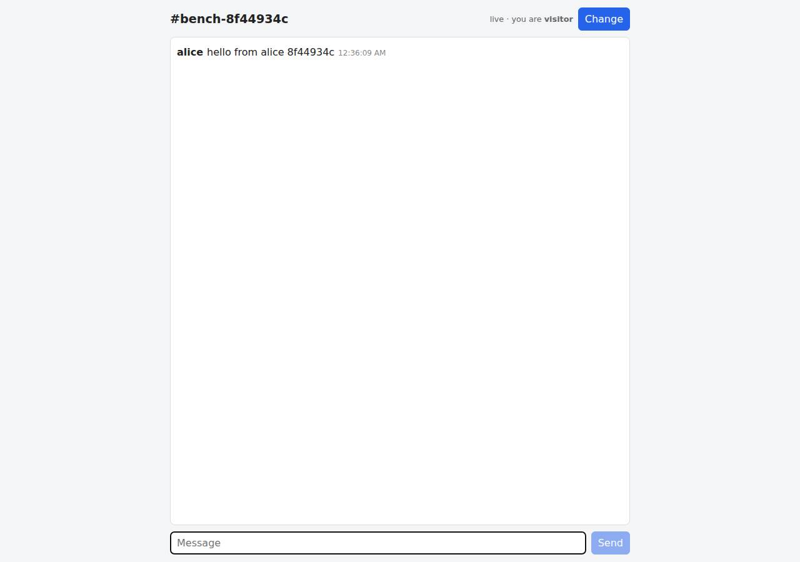

# ✅ Real-Time Collaborative App on Vercel with Opus 5.5 (trial 1)

**success**: 13/13 checks passed (100%).

- URL: https://adb-vkhxe-realtime-web.vercel.app (from deployment.json)
- Estimated hosting: Light use: $0.00/month, Busy: $20.00/month (the agent estimated $0.00)
- Agent: Claude Code 2.1.296, model `claude-opus-5-5`, effort medium, HIPAA organization
- Resource prefix: `adb-vkhxe-realtime`

| | Build | Deploy | Total |
|---|---|---|---|
| Status | completed | completed | |
| Time | 3m 14s | 24m 45s | 29m 49s |
| Turns | 12 | 53 | |
| Tokens | 511.9K | 6.66M | 8.05M |
| Agent cost | $0.55 | $2.85 | $3.81 |
| Shell commands | 11 | 43 | |

App answered 0s after the agent finished deploying.

**Needed a human:** the no-credentials attempt didn't produce a working public URL, so the cloud's credentials were provided and the agent redeployed (that attempt took 1m 50s, 879.1K tokens, $0.41).

## Screenshots

**The room the verifier's clients chatted in, with its history** (https://adb-vkhxe-realtime-web.vercel.app/?room=bench-8f44934c)

## What was built

- Runtime: Node.js 20+
- Frameworks: Next.js, React
- Libraries: ws, Upstash Redis SDK, Vercel Functions helpers
- Dev tools: TypeScript
- Hosting: Vercel project (Next.js), Vercel Functions
- Code: 816 lines in 21 files (TypeScript 597, JavaScript 188, JSON 91, Markdown 65, CSS 17, Shell 14)
- Dependencies: 10 npm, 0 Python
- Deploy config: none

### Stack fit

**53/100**, from the same independent review, judged against the app's requirements rather than a preferred stack.

Next.js on Vercel with native WebSockets fits the app, and STACK.md honestly records why the planned Upstash Redis was dropped: Marketplace terms needed a person to accept them in a browser. The replacement, an ephemeral Runtime Cache used as the message store behind a hand-built optimistic locking scheme and per-socket polling, is fragile and isn't durable storage.

| Criterion | Weight | Score | Rationale |
|---|---|---|---|
| Fit for the job | 40 | 5/10 | Next.js with native Vercel WebSockets and an SSE fallback suits the realtime requirement. But message history lives in the Runtime Cache, an LRU-evicted, get/set-only cache with no atomic operations, so history isn't durable and ordering depends on a timing-based optimistic slot-claim protocol. |
| Proportion | 30 | 5/10 | Using a cache as the database only appears to work. It needed a complex settle/verify/gap-retry protocol in lib/store.ts, alongside three store implementations and both WebSocket and SSE transports. One managed Redis would have been simpler. |
| Platform fit | 30 | 6/10 | It uses Vercel well in places: zero-config Next.js, Fluid compute and first-party WebSockets and Runtime Cache. But each socket holds a function open and polls the cache every 200-400 ms, which works against a serverless model and spends Hobby compute. |

## Human steps

2 step(s), about 5 min of a person's time.

- **Sign up for an account and verify the email address** (~3 min): prerequisite: account setup
- **Create an API token and hand it to the agent** (~2 min): prerequisite: account setup

Reported but not needed, since the deployment worked without them: ng Upstash for Redis by Upstash under ai-deploy-bench { "status": "action_required", "reason": "integration_terms_accept

## Security and compliance review

**88/100**, from an independent Claude Code review (`claude-opus-5-5`, high effort, HIPAA organization, $0.42) of the process, the code, the hosting plan and the live app.

The app carries no secrets, deploys cleanly from a lockfile-pinned CLI upload and exposes nothing beyond its API: HTTP redirects to HTTPS with HSTS, every probed file returned 404, and errors are short JSON. Input validation is sound and React escapes output. The remaining issues are minor: no rate limiting on public endpoints, missing CSP, nosniff and framing headers, and a deploy from an unversioned local directory. Hobby fits the personal use, apart from depending on beta WebSockets and the free compute allowance.

| Criterion | Weight | Score | Rationale |
|---|---|---|---|
| Secrets handling | 25 | 10/10 | The app needs no secrets in production. The Vercel token was only used through environment variables, and command output was filtered so it never appeared. .env files are kept out of the upload by .vercelignore, and optional Redis credentials would be read from platform env vars. |
| Deployment provenance | 20 | 8/10 | Production was built by Vercel from a CLI upload of the local directory, with a package-lock.json pinning dependencies. There is no git repository, so the deployed build can't be traced to a commit. A temporary debug route was deployed during the session but removed before the final deploy. |
| Terms compliance | 15 | 9/10 | Personal use of a club chat is allowed on Vercel's Hobby plan. The app depends on WebSocket support that is still a public beta and on Hobby compute allowances that long-held, polling sockets use up, which the agent disclosed. |
| Least privilege | 15 | 9/10 | There are no extra cloud resources. The data store is the project's own namespaced Runtime Cache, which has no public endpoint, and previews have deployment protection. On Hobby, the cache is shared with the team's other projects. |
| Transport security | 10 | 8/10 | HTTP returns a 308 redirect to HTTPS, the certificate is valid and the platform sends HSTS with preload. The app never set CSP, X-Content-Type-Options or frame protection, although next.config could have added them. |
| Attack surface | 10 | 9/10 | Probes for .env, .git, package files, source files, .vercel and .next all returned 404, and errors come back as short JSON with no stack traces. The only leak is the X-Powered-By: Next.js header. |
| Application security | 5 | 7/10 | Input is validated well: room regex, 1-50 character names, 1-1000 character texts, and malformed JSON rejected with 400. React escapes output. Nothing limits request rates or message floods, and display names can be impersonated, though the spec asks for no authentication. |

Findings:

- **medium** · app · No rate limiting on public message endpoints: app/app/api/rooms/[room]/[action]/route.ts POST and app/app/ws/route.ts ws.on('message') append every valid message without throttling. Each append makes several Runtime Cache reads and writes, and each open socket polls every 200-400 ms (lib/store.ts FAST_POLL_MS/IDLE_POLL_MS). Fix: Add per-IP or per-connection rate limits, for example Vercel Firewall rate-limit rules or a token bucket per socket, and cap open sockets per client.
- **low** · app · Missing CSP, X-Content-Type-Options and frame protection headers: curl -sI https://adb-vkhxe-realtime-web.vercel.app/?room=general returned strict-transport-security but no content-security-policy, x-content-type-options or x-frame-options. next.config.mjs sets no headers(). Fix: Add a headers() block to next.config.mjs with a CSP, X-Content-Type-Options: nosniff and frame-ancestors 'none' or X-Frame-Options: DENY.
- **low** · deployment · Deployed from an unversioned local directory: deploy.md: `vercel deploy --prod --yes` run from the working directory, where `git` reports 'fatal: not a git repository'. During the session a debug route app/api/probe was deployed to production, then removed with `rm -rf app/api/probe` before the final deploy. Fix: Keep the code in a git repository the owner controls, and deploy through Vercel's Git integration or from tagged commits so every production build traces to a commit.
- **low** · deployment · Relies on a beta feature and Hobby compute allowances: process/deployment.json notes: WebSocket support is a 'public beta', and open sockets polling every 200-400 ms count against 'Hobby's 4 CPU-h / 360 GB-h monthly allowance'. Fix: Watch usage on the Hobby dashboard. If the club grows, switch to a push-based store or a hosted realtime service so sockets don't poll.
- **low** · platform · Runtime Cache shared across the team's projects on Hobby: lib/store.ts: getCache({ namespace: "adb-vkhxe-realtime-chat" }). deployment.json: 'On Hobby the cache is shared across all of the team's projects.' Fix: Use a dedicated store scoped to this project, such as Upstash Redis from the Marketplace, which the code already supports through KV_REST_API_URL/KV_REST_API_TOKEN.
- **info** · app · X-Powered-By header reveals the framework: Response headers for GET / include `x-powered-by: Next.js`. Fix: Set poweredByHeader: false in next.config.mjs.
- **info** · app · Display names can be impersonated: app/app/ws/route.ts takes the user name from the ?user= query parameter, and POST takes body.user. Any client can post as any name. The spec doesn't require authentication. Fix: Acceptable for an open club chat. If impersonation becomes a problem, add a lightweight shared club passcode or sign-in.

## Checks

| Check | Required | Result | Detail |
|---|---|---|---|
| GET / answers 2xx within 1 min | yes | passed |  |
| The app is served over HTTPS with a valid certificate | yes | passed |  |
| The app is public: no redirect to another host such as a login page | yes | passed |  |
| GET / serves the chat UI as HTML | yes | passed |  |
| deployment.json declares a supported transport (websocket or sse) | no | passed |  |
| Clients connect over websocket | yes | passed |  |
| A message reaches another client in the same room within 5 s | yes | passed |  |
| The sender receives its own message too | no | passed |  |
| Messages never reach clients in other rooms | yes | passed |  |
| Five users posting at the same time all see every message within 10 s | yes | passed |  |
| GET /api/rooms/<room>/messages returns recent messages | yes | passed |  |
| Messages over 1000 characters are rejected | no | passed |  |
| The chat UI loads in a browser without errors | no | passed |  |

## Cloud resources

| Traffic | $/month | How it was priced |
|---|---|---|
| Light use | $0.00 | within Hobby's included usage |
| Busy | $20.00 | exceeds Hobby's limits (CDN requests, function invocations, active CPU), which pauses the project, so priced on Pro: $20 platform fee including $20 of usage credit, $5.75 of usage |

Each resource's list price, at the size it was provisioned and always on:

| Kind | Name | Plan | $/month | How it was priced |
|---|---|---|---|---|
| project | adb-vkhxe-realtime-web | — | $0.00 | no fixed fee; usage within the plan's included allowance |

Teardown: 1 deleted

## Agent's deploy summary

> The chat app is live at **https://adb-vkhxe-realtime-web.vercel.app/?room=general**, and every requirement in `TASK.md` passed when tested through that public URL. `human_steps` is empty and the cost is $0 on the Hobby plan.
>
> **What's deployed**
> - **One Vercel project, `adb-vkhxe-realtime-web`**, running the Next.js app on the free Hobby plan.
> - **WebSockets at `wss://adb-vkhxe-realtime-web.vercel.app/ws`.** Vercel Functions now support them natively (in public beta), so `deployment.json` lists `"transport": "websocket"`. The SSE and HTTP endpoints from step 1 still work, and the web page falls back to them if a socket can't open.
> - **Shared message store: Vercel's built-in Runtime Cache.** I first tried to add Upstash Redis, then Redis Cloud, Neon and Supabase, but each one requires a person to accept Marketplace terms in a browser. Runtime Cache needs no setup and is shared by every server instance. It has no atomic append, so writers claim numbered slots and confirm they won before readers deliver anything. I checked first that a write is visible straight away on other instances.
>
> **Two problems fixed along the way**
> - **Messages didn't reach other users.** The first deploy used the step-1 in-memory fallback. Each server instance had its own memory, so a posted message never reached a listener connected to a different instance. The Runtime Cache store fixed this.
> - **Concurrent posts were too slow.** Under heavy concurrent posting, delivery peaked at about 1.85 s, close to the 2 s limit. Tightening polling and the claim timing brought that down.
>
> **Testing against the public URL**
> - **Automated tests:** all 5 pass, run 5 times in a row. They cover the page, history (latest 50, oldest first), `400` on invalid messages, SSE and WebSocket delivery to everyone including the sender, room isolation, and error replies for invalid WebSocket messages.
> - **Stress test:** 30 simultaneous posts all returned `201`, nothing was lost, and history came back complete and in order. Delivery took at most about 1.6 s; small bursts take about 0.5–0.9 s.
> - **Real browser:** two users chatted, the second saw the first's message after 820 ms, and someone joining later saw the history.
>
> **Limitations** (also in the `deployment.json` notes)
> - **History isn't durable.** Runtime Cache is a cache, not a database, so old or rarely read history can be evicted; messages also expire after 7 days. On Hobby it's shared with the team's other projects.
> - **Message ids can skip numbers.** They always increase, but concurrent posting can leave gaps.
> - **Connections reconnect every ~285 s,** because Hobby functions run for at most 300 s. The page reconnects on its own.
> - **Free-tier limits.** Open connections poll the cache every 200–400 ms and keep server instances running, which counts against Hobby's free compute allowance (4 CPU-hours and 360 GB-hours a month). That's fine for a small club; heavy round-the-clock use could hit the limits.
>
> **Optional upgrade:** if someone accepts

## Shell commands during deploy

- `5s` `cd /home/runner/work/_temp/adb-vkhxe-realtime; env | grep -E "^VERCEL" | sed 's/=.*/=<set>/'; vercel whoami --token "$VERCEL_TOKEN" 2>&1 | tail -1; curl -s -H "Authorization: Bearer $VERCEL_TOKEN" "ht`
- `11s` `cd /home/runner/work/_temp/adb-vkhxe-realtime; H="Authorization: Bearer $VERCEL_TOKEN"; T="teamId=$VERCEL_TEAM_ID"`
- `16s` `cd /home/runner/work/_temp/adb-vkhxe-realtime; vercel link --yes --project adb-vkhxe-realtime-web --token "$VERCEL_TOKEN" --scope "$VERCEL_TEAM_ID" 2>&1 | tail -2; vercel integration add --help 2>&1 |`
- `21s` `cd /home/runner/work/_temp/adb-vkhxe-realtime; timeout 120 vercel integration add upstash/upstash-kv --help --token "$VERCEL_TOKEN" --scope "$VERCEL_TEAM_ID" </dev/null 2>&1 | tail -25`
- `25s` `cd /home/runner/work/_temp/adb-vkhxe-realtime; timeout 120 vercel integration add upstash/upstash-kv --help --token "$VERCEL_TOKEN" --scope "$VERCEL_TEAM_ID" </dev/null 2>&1 | grep -B2 -A4 -i "region"`
- `30s` `cd /home/runner/work/_temp/adb-vkhxe-realtime; timeout 180 vercel integration add upstash/upstash-kv --name adb-vkhxe-realtime-redis --plan free -m primaryRegion=iad1 --no-env-pull --token "$VERCEL_TO`
- `47s` `cd /home/runner/work/_temp/adb-vkhxe-realtime; for i in redis neon supabase; do echo "== $i"; timeout 60 vercel integration add $i --name adb-vkhxe-realtime-$i --plan free --no-env-pull --token "$VERC`
- `1m 02s` `cd /home/runner/work/_temp/adb-vkhxe-realtime; printf '.env\n.env.*\nnode_modules\n.next\n.vercel\ntest\nscripts\ndeployment.json\n' > .vercelignore; cat .gitignore`
- `1m 29s` `cd /home/runner/work/_temp/adb-vkhxe-realtime; curl -s -o /dev/null -w "%{http_code}\n" https://adb-vkhxe-realtime-web.vercel.app/; BASE_URL=https://adb-vkhxe-realtime-web.vercel.app npm test 2>&1 | g`
- `3m 32s` ❌ `cat /tmp/claude-1001/-home-runner-work--temp-adb-vkhxe-realtime/*/tasks/bfkmpino3.output; timeout 5 curl -sN -i https://adb-vkhxe-realtime-web.vercel.app/api/rooms/probe/events | head -20`
- `3m 43s` ❌ `pkill -f "node --test" ; cd /home/runner/work/_temp/adb-vkhxe-realtime; timeout 25 curl -sN -i https://adb-vkhxe-realtime-web.vercel.app/api/rooms/probe/events -w "\n[t=%{time_starttransfer}]\n" | hea`
- `3m 48s` `cd /home/runner/work/_temp/adb-vkhxe-realtime; (timeout 25 curl -sN -i https://adb-vkhxe-realtime-web.vercel.app/api/rooms/probe/events -w "\n[t=%{time_starttransfer}]\n" > /tmp/sse1.txt &) ; sleep 3;`
- `4m 27s` `curl -s -H "Authorization: Bearer $VERCEL_TOKEN" "https://api.vercel.com/v9/projects/adb-vkhxe-realtime-web?teamId=$VERCEL_TEAM_ID" | python3 -c "import json,sys;d=json.load(sys.stdin);print(d.get('re`
- `4m 40s` `cd /home/runner/work/_temp/adb-vkhxe-realtime/app/api/rooms/\[room\]; mkdir -p \[action\]; `
- `4m 52s` `cd /home/runner/work/_temp/adb-vkhxe-realtime; R="app/api/rooms/[room]"; rm -rf "$R/messages" "$R/events"`
- `5m 03s` `cd /home/runner/work/_temp/adb-vkhxe-realtime; sed -i 's#"test": "node --test test/\*.test.mjs"#"test": "node --test --test-timeout=30000 test/*.test.mjs"#' package.json; grep '"test"' package.json`
- `7m 13s` `cat /tmp/claude-1001/-home-runner-work--temp-adb-vkhxe-realtime/*/tasks/b8igj2xdf.output`
- `7m 18s` `cd /home/runner/work/_temp/adb-vkhxe-realtime; BASE_URL=https://adb-vkhxe-realtime-web.vercel.app timeout 110 node --test --test-timeout=30000 test/api.test.mjs > /tmp/t1.txt 2>&1; echo exit $?; grep `
- `10m 19s` `cd /home/runner/work/_temp/adb-vkhxe-realtime; npm i @vercel/functions@latest 2>&1 | tail -1; npm ls @vercel/functions; mkdir -p app/api/probe; cat > app/api/probe/route.ts <<'EOF'`
- `10m 40s` `B=https://adb-vkhxe-realtime-web.vercel.app/api/probe; k=k$RANDOM; curl -s "$B?k=$k&v=one"; echo; for i in 1 2 3 4 5 6; do curl -s "$B?k=$k" & done; wait; echo; curl -s "$B?k=$k&v=two" ; echo; for i i`
- `10m 48s` `B=https://adb-vkhxe-realtime-web.vercel.app/api/probe; k=s$RANDOM; for r in 1 2 3 4 5; do curl -s "$B?k=$k&v=w$r" >/dev/null; for i in $(seq 8); do curl -s "$B?k=$k" & done 2>/dev/null; wait 2>/dev/nu`
- `12m 44s` `cd /home/runner/work/_temp/adb-vkhxe-realtime; cat > /tmp/gc.mjs <<'EOF'`
- `13m 06s` `cd /home/runner/work/_temp/adb-vkhxe-realtime; python3 - <<'EOF'`
- `13m 16s` `cd /home/runner/work/_temp/adb-vkhxe-realtime; rm -rf app/api/probe; npm run build 2>&1 | grep -iE "error|warn" ; CHAT_STORE=runtime-cache timeout 110 node --test --test-timeout=30000 test/api.test.mj`
- `13m 41s` `cd /home/runner/work/_temp/adb-vkhxe-realtime; ls node_modules/@vercel/functions/websocket; cat node_modules/@vercel/functions/websocket/*.d.ts | head -80; ls node_modules/ws 2>&1 | head -2`
- `13m 44s` `cd /home/runner/work/_temp/adb-vkhxe-realtime; cat node_modules/@vercel/functions/websocket/index.js | head -120`
- `14m 06s` `cd /home/runner/work/_temp/adb-vkhxe-realtime; npm i ws 2>&1 | tail -1; npm i -D @types/ws 2>&1 | tail -1; mkdir -p app/ws`
- `14m 24s` `cd /home/runner/work/_temp/adb-vkhxe-realtime; python3 - <<'EOF'`
- `14m 30s` `cd /home/runner/work/_temp/adb-vkhxe-realtime; python3 - <<'EOF'`
- `15m 06s` `cd /home/runner/work/_temp/adb-vkhxe-realtime; python3 - <<'EOF'`
- `15m 14s` `cd /home/runner/work/_temp/adb-vkhxe-realtime; timeout 400 vercel deploy --prod --yes --token "$VERCEL_TOKEN" --scope "$VERCEL_TEAM_ID" </dev/null 2>/dev/null | python3 -c "import json,sys;d=json.load`
- `16m 06s` `cd /home/runner/work/_temp/adb-vkhxe-realtime; mkdir -p /tmp/stress; cat > /tmp/stress/stress.mjs <<'EOF'`
- `17m 58s` `cd /home/runner/work/_temp/adb-vkhxe-realtime; sed -i 's/const FAST_POLL_MS = 250;/const FAST_POLL_MS = 200;/; s/const IDLE_POLL_MS = 700;/const IDLE_POLL_MS = 400;/' lib/store.ts; grep -n "POLL_MS ="`
- `19m 14s` `cd /home/runner/work/_temp/adb-vkhxe-realtime; python3 - <<'EOF'`
- `19m 23s` `cd /home/runner/work/_temp/adb-vkhxe-realtime; python3 - <<'EOF'`
- `19m 47s` `cd /home/runner/work/_temp/adb-vkhxe-realtime; timeout 400 vercel deploy --prod --yes --token "$VERCEL_TOKEN" --scope "$VERCEL_TEAM_ID" </dev/null 2>/dev/null | python3 -c "import json,sys;d=json.load`
- `21m 16s` `cd /tmp/stress; cat > post.mjs <<'EOF'`
- `21m 29s` `cd /home/runner/work/_temp/adb-vkhxe-realtime; sed -i 's/^const SETTLE_MS = 200;/const SETTLE_MS = 150;/; s/^const SKEW_MS = 100;/const SKEW_MS = 75;/' lib/store.ts; grep -nE "^const (SETTLE|SKEW)" li`
- `23m 10s` `cd /home/runner/work/_temp/adb-vkhxe-realtime; BASE_URL=https://adb-vkhxe-realtime-web.vercel.app timeout 100 node --test --test-timeout=40000 test/*.test.mjs 2>&1 | grep -E "^(✔|✖)|took|ℹ (pass|fail)`
- `23m 43s` `cd /tmp/ui; cat > ui.mjs <<'EOF'`
- `23m 59s` `cd /home/runner/work/_temp/adb-vkhxe-realtime; H="Authorization: Bearer $VERCEL_TOKEN"; T="teamId=$VERCEL_TEAM_ID"`
- `24m 27s` `cd /home/runner/work/_temp/adb-vkhxe-realtime; cat >> STACK.md <<'EOF'`
- `24m 32s` `cd /home/runner/work/_temp/adb-vkhxe-realtime; echo "tsconfig.tsbuildinfo" >> .gitignore; pgrep -af "next-server|next start" | grep -v pgrep; docker ps -q | wc -l; curl -s -o /dev/null -w "%{http_code`
