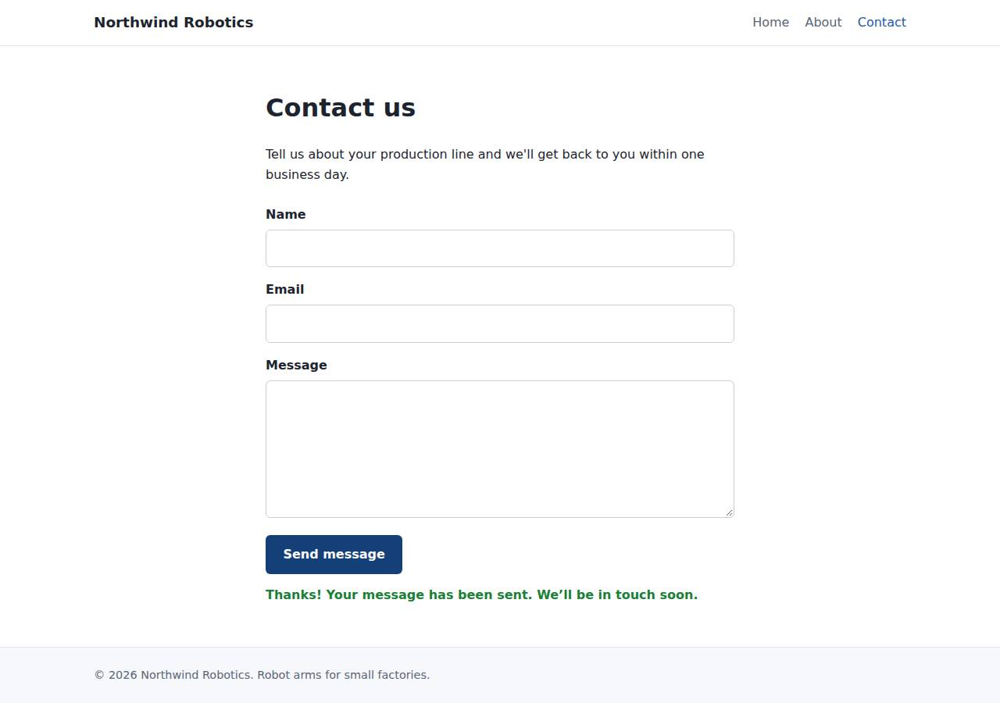

# ✅ Static Content Site on Cloudish with Opus 5.5 (trial 1)

**success**: 16/16 checks passed (100%).

- URL: https://adb-rnoc2-static-web.on.do.cloudish.ai (from deployment.json)
- Estimated hosting: Light use: $0.11/month, Busy: $7.84/month (the agent estimated $7.84)
- Agent: Claude Code 2.1.296, model `claude-opus-5-5`, effort medium, HIPAA organization
- Resource prefix: `adb-rnoc2-static`

| | Build | Deploy | Total |
|---|---|---|---|
| Status | completed | completed | |
| Time | 1m 47s | 2m 12s | 3m 59s |
| Turns | 10 | 15 | |
| Tokens | 384.5K | 830.3K | 1.21M |
| Agent cost | $0.37 | $0.36 | $0.73 |
| Shell commands | 9 | 14 | |

App answered 0s after the agent finished deploying.

## Screenshots

**The home page** (https://adb-rnoc2-static-web.on.do.cloudish.ai/)

**The contact page after the verifier submitted the form** (https://adb-rnoc2-static-web.on.do.cloudish.ai/contact)

## What was built

- Stack: —
- Code: 399 lines in 14 files (JavaScript 187, HTML 166, CSS 38, JSON 23, Docker 8, Markdown 7)
- Dependencies: 0 npm, 0 Python
- Deploy config: `Dockerfile`, `.dockerignore`

## Human steps

None: the agent needed no human setup at all.

Reported but not needed, since the deployment worked without them: Claim the Cloudish API key 'adb-rnoc2-static' and add credits (mint a fresh claim link with GET https://cloudish.ai/api/

## Security and compliance review

**82/100**, from an independent Claude Code review (`claude-opus-5-5`, high effort, HIPAA organization, $0.35) of the process, the code, the hosting plan and the live app.

Northwind Robotics is a small, dependency-free Node.js server deployed to Cloudish. The build and deploy were handled cleanly: the API key stayed in a gitignored .env outside the build context, the container runs as non-root, the route allowlist exposes nothing beyond the app, and HTTPS uses a valid certificate with an HTTP redirect. The main problem is compliance: a commercial site is running on an unclaimed key with a free credit grant that will run out in about 9 hours. Smaller issues are the floating base image tag, missing app-level security headers and no rate limiting on the contact endpoint.

| Criterion | Weight | Score | Rationale |
|---|---|---|---|
| Secrets handling | 25 | 10/10 | The Cloudish API key was written only to a gitignored .env, excluded from the uploaded tarball and from .dockerignore, and never printed in the transcripts. The app itself needs no secrets. |
| Deployment provenance | 20 | 8/10 | Cloudish built the image on its own servers from the agent's local source tarball, and the running image (builds/93:10dec3ec2f0c) matches that build. The app has no dependencies, but the base image is the floating tag node:22-alpine, not a digest, and the source isn't in a repository the owner controls. |
| Terms compliance | 15 | 4/10 | This is a business's app, but it runs on an unclaimed key with a free 0.1-credit grant that covers about 9.3 running hours, after which the site stops serving. The agent disclosed this but marked claiming the key and adding credits as non-blocking. I'm not certain what Cloudish's terms say about commercial use on unclaimed keys, but the account isn't owned by the business and the hosting can't stay up as it is. |
| Least privilege | 15 | 9/10 | The container runs as the non-root node user, with no volume, no env secrets and one replica. Public access is appropriate for a marketing site. A full node image, npm included, is used where a slimmer runtime would do. |
| Transport security | 10 | 8/10 | The site serves a valid Let's Encrypt certificate over TLS 1.3, HTTP redirects to HTTPS with a 308, and the platform adds HSTS. The app sets no X-Content-Type-Options, frame protection or CSP, although server.js could easily set them. |
| Attack surface | 10 | 10/10 | An explicit route allowlist means .env, .git, source files, the Dockerfile and README all return 404, path traversal gets a 400, and there are no directory listings or stack traces. The only extra endpoint is a harmless /healthz. |
| Application security | 5 | 7/10 | Input validation is sound: it type-checks fields, validates the email, rejects non-object JSON and caps the body at 64 KB. The client renders responses with textContent, so there's no XSS. There's no rate limiting on the public contact endpoint, oversized bodies drop the connection (the proxy returns 502, not 413), and submitter emails are logged. |

Findings:

- **high** · deployment · Commercial site runs on an unclaimed free credit grant that runs out in hours: process/deployment.json: plan "unclaimed key, free 0.1-credit grant"; deploy.md /api/v1/me: "About 9.3 running hours of credits left... Apps on this key stop serving at a zero balance"; process/context.json use=commercial, balance_usd 0.099; human_steps marked "blocking": false Fix: Have the business claim the key, or deploy under an account the business owns, and fund it with credits before launch. Treat this as a blocking step for a commercial site.
- **low** · deployment · Scale-to-zero causes cold starts on a public marketing site: process/deployment.json notes: "The app sleeps after the idle timeout... first request after idling has a cold start of a few seconds" Fix: Accept the cold-start latency knowingly, or keep a warm replica if the business needs consistent response times.
- **low** · deployment · Base image not pinned by digest: app/Dockerfile:1 `FROM node:22-alpine` Fix: Pin the base image to a specific version and digest (node:22.x-alpine@sha256:...) and update it on purpose.
- **low** · deployment · Deployed from a local tarball, not owner-controlled source control: deploy.md: `tar ... -czf /tmp/context.tar.gz . && curl -X POST https://cloudish.ai/api/v1/projects ... -F context=@/tmp/context.tar.gz`; the workspace isn't a git repo Fix: Commit the source to a repository the owner controls and deploy from a tagged commit, so the deployed code can be traced.
- **low** · app · Missing security headers (CSP, X-Content-Type-Options, frame protection): GET / response headers: only content-type, content-length, cache-control and strict-transport-security (added by the platform); app/server.js:35 sets no security headers Fix: Have sendFile/sendJson set Content-Security-Policy (default-src 'self'), X-Content-Type-Options: nosniff, and X-Frame-Options: DENY or frame-ancestors 'none'.
- **low** · app · No rate limiting on public contact endpoint: app/server.js:53-64 accepts any number of POST /api/contact requests; each valid one is logged Fix: Add simple per-IP rate limiting and a honeypot field or similar anti-spam measure, in the app or at the platform edge.
- **low** · app · Oversized body returns 502 instead of 413: POST /api/contact with a 70 KB body -> 502 {"error":"the application is not reachable"}; app/server.js:45 calls req.destroy() before the 413 response is sent Fix: Stop reading the body (pause or drain it) and send the 413 response before closing the connection.
- **info** · app · Submitter email addresses written to logs: app/server.js:62 `console.log(`contact submission from ${body.email.trim()}`)` Fix: Don't log personal data, or mask it, unless there is a retention policy for it.
- **info** · deployment · Runtime image includes npm and other unused tooling: app/Dockerfile:1 uses the full node:22-alpine image for a dependency-free server Fix: Consider a distroless or slimmer Node runtime image to reduce what's in the container.

## Checks

| Check | Required | Result | Detail |
|---|---|---|---|
| GET / answers 2xx within 1 min | yes | passed |  |
| The app is served over HTTPS with a valid certificate | yes | passed |  |
| The app is public: no redirect to another host such as a login page | yes | passed |  |
| GET / returns HTML | yes | passed |  |
| GET /about returns HTML | yes | passed |  |
| GET /contact returns HTML | yes | passed |  |
| Home has an <h1> containing 'Northwind Robotics' | yes | passed |  |
| About has a heading containing 'About' | yes | passed |  |
| Contact has a form with name, email and message fields | yes | passed |  |
| Every page has a <title> and a viewport meta tag | no | passed |  |
| Home links to /about and /contact | no | passed |  |
| POST /api/contact with valid input returns {ok: true} | yes | passed |  |
| POST /api/contact rejects a bad email and an empty message with 400 | yes | passed |  |
| Unknown paths return 404 | yes | passed |  |
| Submitting the /contact form in a browser posts to /api/contact without leaving the page | yes | passed |  |
| Pages load in a browser without uncaught JavaScript errors | no | passed |  |

## Cloud resources

| Traffic | $/month | How it was priced |
|---|---|---|
| Light use | $0.11 | containers awake 10 h at their size's hourly rate; no bandwidth charges |
| Busy | $7.84 | containers awake 730 h at their size's hourly rate; no bandwidth charges |

Each resource's list price, at the size it was provisioned and always on:

| Kind | Name | Plan | $/month | How it was priced |
|---|---|---|---|---|
| project | adb-rnoc2-static-web | shared | $7.84 | 0.1 CPU / 0.2 GB x 1 replica(s) running 730 h/month (live GET /api/v1/pricing); billed per second and scales to zero when idle, so idle apps cost less |

Teardown: 1 deleted

## Agent's deploy summary

> The site is live at **https://adb-rnoc2-static-web.on.do.cloudish.ai**, and every requirement in `TASK.md` passed when I tested it through that URL.
>
> **What I set up on Cloudish:**
> - **API key `adb-rnoc2-static`:** I created it myself and saved it only in `.env`. That file is gitignored and was left out of what I uploaded.
> - **App `adb-rnoc2-static-web`:** Cloudish built it from the Dockerfile on its own servers and runs it as one container at the cheapest size ("shared"). It has a valid HTTPS certificate. It shuts down when idle and starts again on the next request, which takes a few seconds.
>
> **What I tested through the public URL:**
> - `/`, `/about` and `/contact` each return 200 with `text/html`, and have a title, the viewport tag, links to all three pages and the right headings.
> - `/contact` has the form with `name`, `email`, a `message` textarea and a submit button.
> - Unknown paths, including `/about.html`, return 404.
> - `POST /api/contact` returns `200 {"ok":true}` for valid input, and 400 with an error message for a missing name, bad email or empty message.
> - In headless Chrome, the form submitted and showed the confirmation without reloading the page.
>
> **Cost:** at most about $7.84/month, and only if the app runs around the clock. Cloudish only bills while it's running, so a low-traffic site should cost much less.
>
> **What still needs a person (not blocking yet):** the free credits cover only about 9.3 hours of running time. When they run out, the site stops serving until someone claims the key and adds credits. That step is listed under `human_steps` in `deployment.json`. The claim link has to be created with the saved key and expires after 30 minutes, so create it right before handing it over.
>
> Everything else worked; the only snag was a certificate error for about a minute right after I gave the app its readable address, which cleared up on its own.

## Shell commands during deploy

- `2s` `curl -sL https://cloudish.ai/skill.md`
- `6s` `ls -a && (grep -q CLOUDISH_API_KEY .env 2>/dev/null && echo have key || {`
- `8s` `set -a && . ./.env && set +a && tar --exclude='.env*' --exclude='.git' --exclude='node_modules' -czf /tmp/context.tar.gz . && tar tzf /tmp/context.tar.gz | head -20 && curl -s -X POST https://cloudish`
- `13s` `. ./.env && for i in $(seq 40); do s=$(curl -s https://cloudish.ai/api/v1/images/builds/238 -H "Authorization: Bearer $CLOUDISH_API_KEY" | jq -r .build.status); echo $s; [ "$s" = succeeded -o "$s" = f`
- `56s` `. ./.env && curl -s https://cloudish.ai/api/v1/projects/adb-rnoc2-static/adb-rnoc2-static-web -H "Authorization: Bearer $CLOUDISH_API_KEY" | jq '{subdomain, app: (.app // .apps)}'`
- `58s` `. ./.env && curl -s https://cloudish.ai/api/v1/projects/adb-rnoc2-static/adb-rnoc2-static-web -H "Authorization: Bearer $CLOUDISH_API_KEY" | jq 'del(.project.owner)' | head -80`
- `1m 00s` `. ./.env && curl -s -X PUT https://cloudish.ai/api/v1/projects/adb-rnoc2-static/adb-rnoc2-static-web/subdomain -H "Authorization: Bearer $CLOUDISH_API_KEY" -H "content-type: application/json" -d '{"la`
- `1m 04s` ❌ `U=https://adb-rnoc2-static-web.on.do.cloudish.ai; sleep 5`
- `1m 12s` `curl -s -o /dev/null -w "%{http_code}\n" https://9a2d5ef2a5b66fbb6382fa1e3d68745b.on.do.cloudish.ai/; curl -sv https://adb-rnoc2-static-web.on.do.cloudish.ai/ 2>&1 | grep -iE 'subject|issuer|SSL|error`
- `1m 15s` `for i in $(seq 30); do c=$(curl -s -o /dev/null -w "%{http_code}" https://adb-rnoc2-static-web.on.do.cloudish.ai/); echo "$i $c"; [ "$c" = 200 ] && break; sleep 20; done; curl -sv https://adb-rnoc2-st`
- `1m 39s` `U=https://adb-rnoc2-static-web.on.do.cloudish.ai`
- `1m 45s` `mkdir -p /tmp/pw && cd /tmp/pw && npm i -s playwright-core >/dev/null 2>&1 && cat > t.mjs <<'EOF'`
- `1m 50s` `curl -sL https://cloudish.ai/credits.md | grep -iE -m8 'usd|\$|dollar'; curl -sL https://cloudish.ai/instances.md | grep -iE -m8 'shared|usd|\$'`
- `2m 00s` `cat > deployment.json <<'EOF'`
