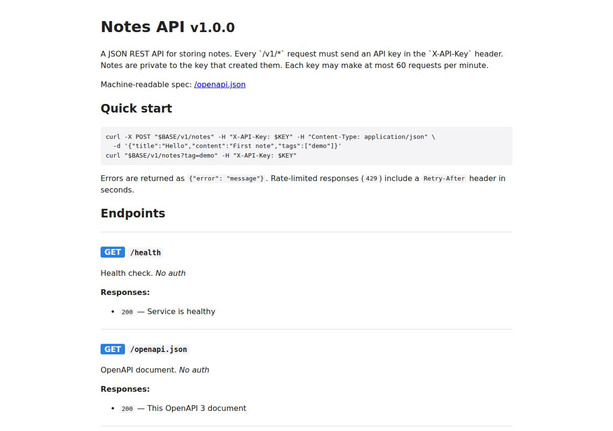

# ✅ API / Backend Service on DigitalOcean with Opus 5.5 (trial 1)

**success**: 20/20 checks passed (100%).

- URL: https://adb-5ye5p-api-bo8ea.ondigitalocean.app (from deployment.json)
- Estimated hosting: Light use: $12.00/month, Busy: $12.00/month (the agent estimated $12.00)
- Agent: Claude Code 2.1.296, model `claude-opus-5-5`, effort medium, HIPAA organization
- Resource prefix: `adb-5ye5p-api`

| | Build | Deploy | Total |
|---|---|---|---|
| Status | completed | completed | |
| Time | 2m 43s | 8m 12s | 10m 55s |
| Turns | 16 | 10 | |
| Tokens | 558.9K | 555.3K | 1.11M |
| Agent cost | $0.57 | $0.43 | $1.00 |
| Shell commands | 10 | 9 | |

App answered 0s after the agent finished deploying.

## Screenshots

**The API documentation at /docs** (https://adb-5ye5p-api-bo8ea.ondigitalocean.app/docs)

## What was built

- Stack: `express`, `pg`
- Code: 533 lines in 12 files (JavaScript 523, YAML 33, Markdown 32, JSON 31, Docker 10)
- Dependencies: 2 npm, 0 Python
- Deploy config: `Dockerfile`, `.dockerignore`, `.do/app.yaml`

## Human steps

3 step(s), about 7 min of a person's time.

- **Sign up for an account and verify the email address** (~3 min): prerequisite: account setup
- **Add a payment method to the account** (~2 min): prerequisite: account setup
- **Create an API token and hand it to the agent** (~2 min): prerequisite: account setup

## Security and compliance review

**87/100**, from an independent Claude Code review (`claude-opus-5-5`, high effort, HIPAA organization, $0.31) of the process, the code, the hosting plan and the live app.

The deployment is well built: secrets go through App Platform's encrypted SECRET env vars and never reach source or logs, the container runs as non-root, the database uses TLS with CA verification, all SQL is parameterized with owner scoping, and the live site exposes nothing beyond the required endpoints. The weaknesses are minor: the base image and deployed tag aren't pinned by digest, doctl was installed without a checksum, no security headers are set, and the dev database can't be network-restricted.

| Criterion | Weight | Score | Rationale |
|---|---|---|---|
| Secrets handling | 25 | 10/10 | API_KEYS is injected as an App Platform SECRET (encrypted EV[...] in the live spec) via a umask-077 temp copy of the spec that was deleted afterwards, DB credentials come from bindable variables, and no key appears in source, the image build context or the transcripts. |
| Deployment provenance | 20 | 7/10 | The image was built from the reviewed source with npm ci against a lockfile and pushed to the owner's own DOCR registry, but the base image (node:22-alpine) isn't pinned by digest, the deployed tag (v1) is mutable, and doctl was downloaded with no checksum check. |
| Terms compliance | 15 | 9/10 | This is a personal app on a paid App Platform Basic instance with an App Platform dev database. That fits DigitalOcean's terms for this use, and the service is always on, not a sleeping or expiring free tier. The dev database has no backups, which the agent disclosed. (The account plan wasn't readable from context.json; judged from DigitalOcean's standard pay-as-you-go terms.) |
| Least privilege | 15 | 8/10 | The container runs as the non-root node user, there's only one public component, and the database is reached over TLS with CA verification. The App Platform dev database can't be restricted with trusted sources, though, so its endpoint can be reached from the internet with credentials. |
| Transport security | 10 | 8/10 | HTTP redirects to HTTPS with a 301, and the Google Trust Services certificate is valid until Dec 2026. The app sends no HSTS, X-Content-Type-Options, frame-protection or CSP headers, even though it could have set them in Express. |
| Attack surface | 10 | 10/10 | Probes for /.env, /.git/config, /package.json, /src/app.js, /Dockerfile, /admin and /debug all returned 404. Errors come back as generic JSON with no stack traces, and the only unauthenticated endpoints are the ones the spec requires (/health, /docs, /openapi.json). |
| Application security | 5 | 9/10 | All SQL is parameterized, every query on a note is scoped to the owner (other keys get 404), input types are validated, and rate limiting is per key and stored in Postgres. Minor gaps: there are no length or count limits on note fields beyond the 1 MB body cap, and keys are compared without constant-time comparison. |

Findings:

- **low** · deployment · Base image and deployed image tag not pinned by digest: app/Dockerfile:1 `FROM node:22-alpine`; process/resources.json shows the service image as DOCR tag `v1` (a mutable tag); deploy.md: `docker build ... -t registry.digitalocean.com/adb-5ye5p-api/adb-5ye5p-api-web:v1` Fix: Pin the base image by digest (node:22-alpine@sha256:...), and deploy by image digest or a unique immutable tag for each build.
- **low** · deployment · doctl CLI downloaded without integrity verification: process/deploy.md line 4: `curl -sL https://github.com/digitalocean/doctl/releases/download/v1.146.0/doctl-1.146.0-linux-amd64.tar.gz | tar xz && sudo mv doctl /usr/local/bin/` Fix: Check the release's published SHA256 checksum before installing it.
- **low** · deployment · Dev database endpoint can't be network-restricted: app/.do/app.yaml: `databases: - name: adb-5ye5p-api-db ... production: false` (an App Platform dev database, which doesn't support trusted sources) Fix: For stronger isolation, use a managed PostgreSQL cluster with trusted sources limited to the app (the agent already noted this option).
- **low** · app · No security response headers: `curl -sD - https://adb-5ye5p-api-bo8ea.ondigitalocean.app/docs` returned no Strict-Transport-Security, X-Content-Type-Options, X-Frame-Options or Content-Security-Policy header; app/src/app.js:102-110 sets none Fix: Add helmet (or set the headers by hand) for HSTS, nosniff, frame-ancestors/X-Frame-Options and a restrictive CSP on /docs.
- **info** · app · No limits on field length or note count: app/src/app.js:34-60 validates types but not lengths; the only cap is `express.json({ limit: '1mb' })` at line 114, and the dev database has 1 GB of storage Fix: Cap title, content and tag lengths and the number of tags, and optionally set a per-key quota on stored notes.
- **info** · app · API key compared without constant-time comparison: app/src/app.js:65 `if (!apiKeys().has(key))` Fix: Compare SHA-256 hashes of keys, or use crypto.timingSafeEqual; the risk over the network is negligible.
- **info** · deployment · Dev database has no backups: process/deployment.json notes: 'The dev database has no backups or high availability' Fix: Acceptable for a personal project. Move to a managed cluster if the data matters.

## Checks

| Check | Required | Result | Detail |
|---|---|---|---|
| GET /health answers 2xx within 1 min | yes | passed |  |
| The app is served over HTTPS with a valid certificate | yes | passed |  |
| The app is public: no redirect to another host such as a login page | yes | passed |  |
| GET /health returns {status: ok} | yes | passed |  |
| GET /openapi.json is an OpenAPI 3 document covering /v1/notes | yes | passed |  |
| GET /docs serves human-readable documentation | no | passed |  |
| Requests without an API key get 401 | yes | passed |  |
| Requests with an unknown API key get 401 | yes | passed |  |
| POST /v1/notes creates a note | yes | passed |  |
| Invalid notes are rejected with 400 | yes | passed |  |
| GET /v1/notes/{id} returns the note | yes | passed |  |
| GET /v1/notes lists notes and filters by tag | yes | passed |  |
| Notes are listed newest first | no | passed |  |
| PATCH /v1/notes/{id} updates only the given fields | yes | passed |  |
| Notes are private to the API key that created them | yes | passed |  |
| DELETE /v1/notes/{id} removes the note | yes | passed |  |
| Notes are still there a minute later | yes | passed |  |
| Exceeding 60 requests/minute returns 429 | yes | passed |  |
| 429 responses include a Retry-After header | no | passed |  |
| One key hitting its limit doesn't throttle other keys | yes | passed |  |

## Cloud resources

| Traffic | $/month | How it was priced |
|---|---|---|
| Light use | $12.00 | fixed monthly prices; 0.0373 GiB out of a 50 GiB allowance |
| Busy | $12.00 | fixed monthly prices; 49 GiB out of a 50 GiB allowance |

Each resource's list price, at the size it was provisioned and always on:

| Kind | Name | Plan | $/month | How it was priced |
|---|---|---|---|---|
| app | adb-5ye5p-api | adb-5ye5p-api-web: apps-s-1vcpu-0.5gb x 1, adb-5ye5p-api-db: dev database | $12.00 | adb-5ye5p-api-web: apps-s-1vcpu-0.5gb x 1; adb-5ye5p-api-db: dev database |
| registry | adb-5ye5p-api | starter | $0.00 | Container Registry starter tier (one per account) |

Teardown: 2 deleted

## Agent's deploy summary

> The Notes API is live at **https://adb-5ye5p-api-bo8ea.ondigitalocean.app**, and every requirement in `TASK.md` worked when I tested it through that URL.
>
> **What's deployed** (about $12/month, all named `adb-5ye5p-api…`):
> - **Web service:** App Platform app `adb-5ye5p-api` (id `4518b2b9-…`), the smallest Basic size, $5/month. It runs the Docker image from step 1 and gets HTTPS from the default `ondigitalocean.app` domain.
> - **Database:** an App Platform dev PostgreSQL 16 database, `adb-5ye5p-api-db`, $7/month. This was the cheapest option that keeps data across restarts and redeploys.
> - **Image registry:** a DigitalOcean Container Registry, `adb-5ye5p-api`, on the free Starter plan.
> - **API keys:** `API_KEYS` is set as an encrypted secret holding exactly the 2 keys in `BENCH_API_KEYS`. The keys don't appear in any file in the project.
>
> **What I tested on the live URL:**
> - `/health`, `/openapi.json` and the `/docs` HTML page all return 200.
> - A missing or wrong key gets 401.
> - Creating, listing (including the `tag` filter), reading, updating and deleting notes all work, and bad input gets 400.
> - One key can't see another key's notes: it gets 404.
> - **Rate limit:** in one minute, one key got 59 successes, then `429` with a `Retry-After` header. The other key kept working, and the limited key worked again once the minute was up. The first request had already used one of the 60, so 59 is the full allowance.
> - **Data survives a redeploy:** a note I created was still there after a full redeploy.
> - I deleted all my test notes afterwards.
>
> **Things to know:**
> - The dev database has no backups and no failover. A managed PostgreSQL cluster (from $15/month) would add those if the app needs them later.
> - The rate limit uses fixed one-minute windows, and requests that get blocked still count toward the current minute.
> - **Changes to the project:** I changed `.do/app.yaml` to deploy the image from the registry, and updated the README's deploy section to match.
> - **No `.env` needed:** I didn't create any new credentials, so I didn't write a `.env` file.
> - **Nothing needs a person:** `human_steps` in `deployment.json` is empty.

## Shell commands during deploy

- `7s` `which doctl || (cd /tmp && curl -sL https://github.com/digitalocean/doctl/releases/download/v1.146.0/doctl-1.146.0-linux-amd64.tar.gz | tar xz && sudo mv doctl /usr/local/bin/); doctl version; doctl a`
- `14s` `doctl registry create adb-5ye5p-api --subscription-tier starter --region nyc3 && doctl registry login >/dev/null && docker build -q -t registry.digitalocean.com/adb-5ye5p-api/adb-5ye5p-api-web:v1 . &&`
- `59s` ❌ `cat > .do/app.yaml <<'EOF'`
- `1m 03s` `sed -i 's/      registry_type: DOCR/      registry_type: DOCR\n      registry: adb-5ye5p-api/' .do/app.yaml && umask 077 && K="$BENCH_API_KEYS" node -e 'const fs=require("fs");fs.writeFileSync("/tmp/a`
- `1m 09s` `until s=$(doctl apps get 4518b2b9-bf7b-4cfd-8a07-3f89e2f6364d --format DefaultIngress,ActiveDeployment.ID,InProgressDeployment.Phase --no-header 2>/dev/null); echo "$s" | grep -q https || doctl apps l`
- `6m 36s` `B=https://adb-5ye5p-api-bo8ea.ondigitalocean.app; K1=$(echo "$BENCH_API_KEYS"|cut -d, -f1); K2=$(echo "$BENCH_API_KEYS"|cut -d, -f2); echo "nkeys=$(echo "$BENCH_API_KEYS"|tr , '\n'|wc -l)"`
- `6m 46s` `B=https://adb-5ye5p-api-bo8ea.ondigitalocean.app; K1=$(echo "$BENCH_API_KEYS"|cut -d, -f1); K2=$(echo "$BENCH_API_KEYS"|cut -d, -f2)`
- `7m 30s` `sleep 20; B=https://adb-5ye5p-api-bo8ea.ondigitalocean.app; K2=$(echo "$BENCH_API_KEYS"|cut -d, -f2); curl -s -w " %{http_code}\n" $B/v1/notes -H "X-API-Key: $K2"; doctl apps get 4518b2b9-bf7b-4cfd-8a`
- `8m 03s` `rm -f /tmp/adb-spec.yaml && cat > deployment.json <<'EOF'`
