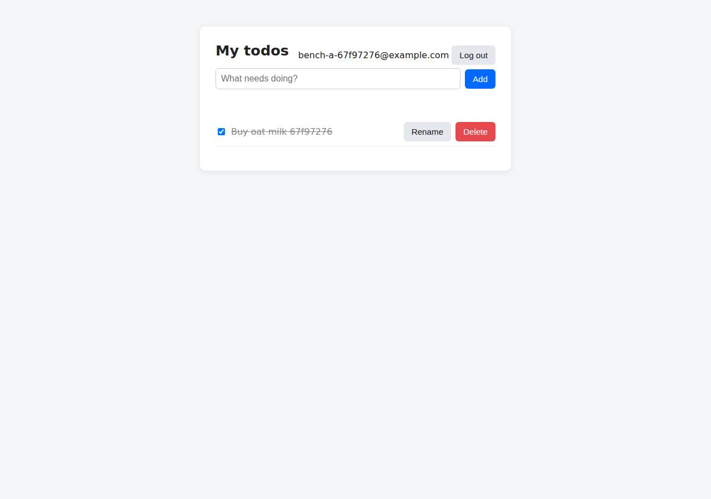

# ✅ Database-Backed CRUD App on DigitalOcean with Opus 5.5 (trial 1)

**success**: 19/19 checks passed (100%).

- URL: https://adb-dwnn0-crud-7929w.ondigitalocean.app (from deployment.json)
- Estimated hosting: Light use: $12.00/month, Busy: $12.00/month (the agent estimated $12.00)
- Agent: Claude Code 2.1.296, model `claude-opus-5-5`, effort medium, HIPAA organization
- Resource prefix: `adb-dwnn0-crud`

| | Build | Deploy | Total |
|---|---|---|---|
| Status | completed | completed | |
| Time | 2m 06s | 11m 57s | 14m 03s |
| Turns | 9 | 10 | |
| Tokens | 357.5K | 499.6K | 857.1K |
| Agent cost | $0.43 | $0.38 | $0.81 |
| Shell commands | 8 | 9 | |

App answered 0s after the agent finished deploying.

## Screenshots

**The web app before signing in** (https://adb-dwnn0-crud-7929w.ondigitalocean.app/)

**The todo list after signing in through the web UI as the test user** (https://adb-dwnn0-crud-7929w.ondigitalocean.app/)

## What was built

- Stack: `bcryptjs`, `express`, `jsonwebtoken`, `pg`
- Code: 451 lines in 13 files (JavaScript 386, HTML 55, JSON 33, YAML 29, Markdown 22, Docker 10)
- Dependencies: 5 npm, 0 Python
- Deploy config: `Dockerfile`, `.dockerignore`, `.do/app.yaml`

## Human steps

3 step(s), about 7 min of a person's time.

- **Sign up for an account and verify the email address** (~3 min): prerequisite: account setup
- **Add a payment method to the account** (~2 min): prerequisite: account setup
- **Create an API token and hand it to the agent** (~2 min): prerequisite: account setup

## Security and compliance review

**78/100**, from an independent Claude Code review (`claude-opus-5-5`, high effort, HIPAA organization, $0.37) of the process, the code, the hosting plan and the live app.

The app is cleanly built: parameterized SQL, bcrypt, hashed session tokens, owner-scoped queries, a non-root container, and runtime database secrets injected through App Platform bindable variables, served over valid HTTPS with an HTTP redirect and no exposed files. The main weaknesses are provenance (an image built locally and deployed by the mutable tag v1 on a floating node:22-alpine base) and the choice of an App Platform dev database for a commercial app, which is likely internet-reachable and has no production backups. Smaller gaps are missing security headers and no rate limiting on the auth endpoints.

| Criterion | Weight | Score | Rationale |
|---|---|---|---|
| Secrets handling | 25 | 9/10 | No credentials in source, image or transcripts. The database URL and CA cert are injected at runtime through App Platform bindable variables (${db.DATABASE_URL}, ${db.CA_CERT}), and .env/.git/node_modules are kept out of the build context. Minor: the DOCR docker login on the build host stays valid for 30 days. |
| Deployment provenance | 20 | 6/10 | Production runs an image built from the local workspace and pushed to the owner's private DOCR, but it was deployed by the mutable tag v1 rather than a digest. The base image node:22-alpine is a floating tag, and no source repository or CI ties the image to a commit. Dependencies use npm ci with a lockfile, which helps. |
| Terms compliance | 15 | 8/10 | DigitalOcean's paid App Platform Basic tier and DOCR allow commercial use and stay up without sleeping. The data store is an App Platform dev database, which DigitalOcean positions for development rather than production: one node, limited, with no managed backups or failover. That is a poor fit for a business app, but not a terms violation. |
| Least privilege | 15 | 7/10 | The container runs as the non-root node user and the registry is private. The App Platform dev PostgreSQL database cannot be limited to trusted sources, so as far as I know it is reachable from the internet with credentials. The app also connects as the database's owner role and creates its own schema. |
| Transport security | 10 | 8/10 | HTTPS uses a valid Google Trust Services certificate, and HTTP gets a 301 redirect to HTTPS. The app sets none of HSTS, CSP, X-Content-Type-Options or frame protection, though it easily could have (for example with helmet). |
| Attack surface | 10 | 9/10 | Only the public/ directory is served. Probes for /.env, /.git/config, /package.json, /src/app.js, /Dockerfile and /.do/app.yaml all return 404, and errors produce generic JSON with no stack traces. Minor: the X-Powered-By: Express header is sent and /healthz is public. |
| Application security | 5 | 7/10 | The app has parameterized SQL, bcrypt with cost 12, hashed opaque session tokens, owner-scoped queries, input type checks, a 100kb body limit, a timing-equalized login and textContent-based rendering. The auth endpoints have no rate limiting or lockout, which leaves them open to credential stuffing and signup spam. |

Findings:

- **medium** · deployment · Image deployed by mutable tag, built from unversioned local workspace: process/deploy.md: `docker build -q -t registry.digitalocean.com/adb-dwnn0-crud/adb-dwnn0-crud-web:v1 . && docker push ...`; app/.do/app.yaml line 11 `tag: v1`; process/resources.json spec image tag "v1" with no digest; no remote git source or CI. Fix: Build from a pushed git commit (App Platform GitHub source or CI), and deploy the image by digest (image.digest) or by immutable commit-SHA tags.
- **medium** · deployment · Commercial app relies on an App Platform dev database: app/.do/app.yaml lines 26-29 `databases: - name: adb-dwnn0-crud-db engine: PG production: false`; process/deployment.json plan 'dev database (512 MB RAM, 1 GB storage)'. The agent's own notes say a managed cluster would be the production option. Fix: For a business's app, use a managed PostgreSQL cluster (production: true / cluster_name) with automated backups and point-in-time recovery.
- **medium** · deployment · Dev database likely publicly reachable and used with owner privileges: app/.do/app.yaml dev database (production: false). App Platform dev databases do not support trusted sources, so the DB endpoint accepts connections from any IP that has the credentials. app/src/db.js lines 22-46 run CREATE TABLE at startup as the app's single DB user. Fix: Use a managed cluster with trusted sources limited to the app (or VPC), and give the runtime a role limited to DML, with migrations run under a separate role.
- **medium** · app · No rate limiting on login/signup: 8 consecutive POST /api/auth/login with wrong credentials all returned 401 with no 429 or delay. app/src/app.js lines 75-109 have no limiter. Fix: Add per-IP and per-account rate limiting (e.g. express-rate-limit backed by the DB or Redis) on /api/auth/*.
- **low** · deployment · Floating base image tag: app/Dockerfile line 1: `FROM node:22-alpine` (no @sha256 digest). Fix: Pin the base image by digest (node:22-alpine@sha256:...) and update it deliberately, e.g. with Dependabot or Renovate.
- **low** · app · TLS verification silently disabled if CA cert is missing: app/src/db.js lines 11-13: `process.env.DATABASE_CA_CERT ? {ca, rejectUnauthorized: true} : { rejectUnauthorized: false }`. In the current deployment DATABASE_CA_CERT is set, so verification is active. Fix: Fail closed: refuse to start when sslmode requires TLS but no CA is available, or fall back to the system trust store instead of disabling verification.
- **low** · app · bcrypt input above 72 bytes is truncated: app/src/app.js line 83 allows passwords up to 1024 chars, but bcrypt only uses the first 72 bytes. Fix: Reject passwords over 72 bytes, or pre-hash them (e.g. HMAC-SHA256) before bcrypt, or switch to argon2id.
- **low** · app · Missing security headers: `curl -sI https://adb-dwnn0-crud-7929w.ondigitalocean.app/` returns no Strict-Transport-Security, Content-Security-Policy, X-Content-Type-Options or X-Frame-Options. Fix: Add helmet (or set the headers by hand) with HSTS, a strict CSP (script-src 'self'), nosniff and frame-ancestors 'none'.
- **low** · app · Framework fingerprinting header: Response header `x-powered-by: Express` on GET /. Fix: app.disable('x-powered-by') or use helmet.
- **low** · deployment · Long-lived registry login on build host: process/deploy.md: `doctl registry login` -> 'Login valid for 30 days'. Fix: Use `doctl registry login --expiry-seconds 600` for one-off pushes, or push from CI with scoped, short-lived credentials.
- **info** · platform · HTTPS with valid certificate and HTTP redirect: `curl -sI http://adb-dwnn0-crud-7929w.ondigitalocean.app/` -> `HTTP/1.1 301` Location https://...; certificate CN=ondigitalocean.app, issuer Google Trust Services WE1, valid until Dec 22 2026. Fix: None required.
- **info** · deployment · No sensitive files exposed: GET /.env, /.git/config, /package.json, /src/app.js, /Dockerfile, /.do/app.yaml all -> 404; malformed JSON -> 400 {"error":"invalid JSON"}; app/.dockerignore excludes .git, test, node_modules. Fix: None required.

## Checks

| Check | Required | Result | Detail |
|---|---|---|---|
| GET / answers 2xx within 1 min | yes | passed |  |
| The app is served over HTTPS with a valid certificate | yes | passed |  |
| The app is public: no redirect to another host such as a login page | yes | passed |  |
| GET / serves the web app as HTML | yes | passed |  |
| POST /api/auth/signup creates an account and returns a token | yes | passed |  |
| Signup rejects an invalid email and a short password with 400 | yes | passed |  |
| Signing up twice with the same email returns 409 | yes | passed |  |
| POST /api/auth/login returns a token | yes | passed |  |
| Login with a wrong password returns 401 | yes | passed |  |
| /api/todos requires a valid token (401) | yes | passed |  |
| POST /api/todos creates a todo | yes | passed |  |
| An empty title is rejected with 400 | yes | passed |  |
| GET /api/todos lists the caller's todos | yes | passed |  |
| Todos are listed oldest first | no | passed |  |
| PATCH /api/todos/{id} renames and completes a todo | yes | passed |  |
| Users can't see or modify each other's todos (404) | yes | passed |  |
| DELETE /api/todos/{id} removes a todo | yes | passed |  |
| Data is still there a minute later, with a fresh login | yes | passed |  |
| The web UI renders a login or signup form | no | passed |  |

## Cloud resources

| Traffic | $/month | How it was priced |
|---|---|---|
| Light use | $12.00 | fixed monthly prices; 0.0373 GiB out of a 50 GiB allowance |
| Busy | $12.00 | fixed monthly prices; 49 GiB out of a 50 GiB allowance |

Each resource's list price, at the size it was provisioned and always on:

| Kind | Name | Plan | $/month | How it was priced |
|---|---|---|---|---|
| app | adb-dwnn0-crud | adb-dwnn0-crud-web: apps-s-1vcpu-0.5gb x 1, adb-dwnn0-crud-db: dev database | $12.00 | adb-dwnn0-crud-web: apps-s-1vcpu-0.5gb x 1; adb-dwnn0-crud-db: dev database |
| registry | adb-dwnn0-crud | starter | $0.00 | Container Registry starter tier (one per account) |

Teardown: 2 deleted

## Agent's deploy summary

> The app is live over HTTPS at **https://adb-dwnn0-crud-7929w.ondigitalocean.app**, and every requirement in `TASK.md` passed when I tested it through that URL. Plain HTTP redirects to HTTPS.
>
> **What's deployed (about $12/month):**
> - **Container registry:** `adb-dwnn0-crud`, on the free starter plan. I built the Docker image locally and pushed it there as `adb-dwnn0-crud-web:v1`.
> - **App Platform app:** `adb-dwnn0-crud`, with one web service, `adb-dwnn0-crud-web`, on the smallest Basic size ($5/month). It runs the image from the registry.
> - **Database:** `adb-dwnn0-crud-db`, an App Platform dev PostgreSQL database ($7/month). The app checks the database's CA certificate when it connects. A dev database is the cheapest real Postgres option; a managed cluster costs about $15/month and would be the upgrade for production use.
>
> **What I tested through the public URL:**
> - `GET /` returns the HTML page.
> - Signup returns 201, 400 for a bad email or a short password, and 409 for an email already registered.
> - Login returns 200, and 401 for a wrong password.
> - Todo calls without a token return 401.
> - Creating a todo works, and an empty title returns 400.
> - The todo list comes back oldest first.
> - Renaming and completing a todo with a PATCH works.
> - Deleting returns 204.
> - A second user gets 404 when trying to change or delete the first user's todo, and sees an empty list.
>
> **Not tested:** I didn't trigger a redeploy on DigitalOcean to show that data survives it. The data lives in a separate Postgres database, so it should, and in step 1 todos survived a local container restart. I also only tested the web UI through the API, not by clicking through it in a browser.
>
> No steps need a person, and I didn't create any new credentials, so `.env` is empty. `.do/app.yaml` is updated to deploy from the registry, and `deployment.json` is written. Both are committed to the local git repo.
>
> To ship a new version: push a new image tag, update the tag in `.do/app.yaml`, then run `doctl apps update c1f09f8f-a626-47f8-80af-433ac623216d --spec .do/app.yaml`.

## Shell commands during deploy

- `6s` `which doctl || (cd /tmp && curl -sL https://github.com/digitalocean/doctl/releases/download/v1.146.0/doctl-1.146.0-linux-amd64.tar.gz | tar xz && sudo mv doctl /usr/local/bin/); doctl version; doctl a`
- `16s` `doctl registry create adb-dwnn0-crud --subscription-tier starter --region nyc3 && doctl registry login >/dev/null && docker build -q -t registry.digitalocean.com/adb-dwnn0-crud/adb-dwnn0-crud-web:v1 .`
- `41s` ❌ `cat > .do/app.yaml <<'EOF'`
- `46s` `doctl registry repository list-tags adb-dwnn0-crud-web; sleep 20; doctl apps create --spec .do/app.yaml --format ID --no-header`
- `1m 12s` `A=c1f09f8f-a626-47f8-80af-433ac623216d; for i in $(seq 60); do p=$(doctl apps get-deployment $A $(doctl apps get $A --format InProgressDeployment,ActiveDeployment --no-header | awk '{print $1}') --for`
- `11m 15s` `tail -5 /tmp/claude-1001/-home-runner-work--temp-adb-dwnn0-crud/6e95cd5a-549d-4a12-947f-aefa01d7d027/tasks/beerl9v26.output; doctl apps list-deployments c1f09f8f-a626-47f8-80af-433ac623216d --format I`
- `11m 25s` `A=c1f09f8f-a626-47f8-80af-433ac623216d; U=$(doctl apps get $A --format DefaultIngress --no-header); echo $U; J='content-type: application/json'`
- `11m 35s` `A=c1f09f8f-a626-47f8-80af-433ac623216d; U=$(doctl apps get $A --format DefaultIngress --no-header); echo $U; J='content-type: application/json'`
- `11m 49s` `doctl databases list --format ID,Name,Size 2>&1 | head; cat > deployment.json <<'EOF'`
