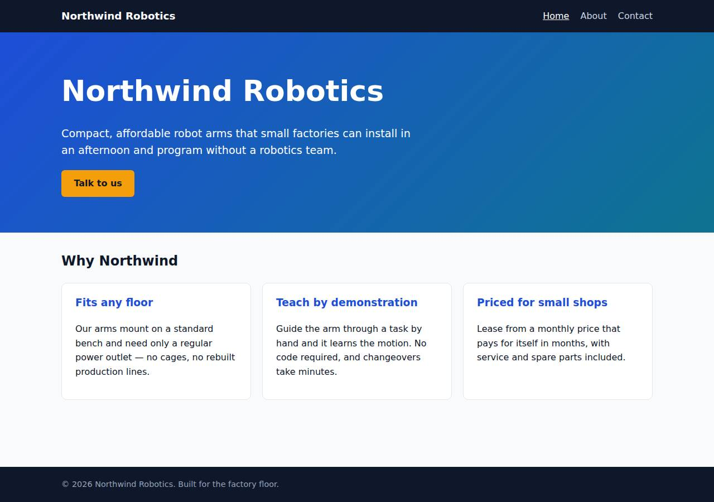
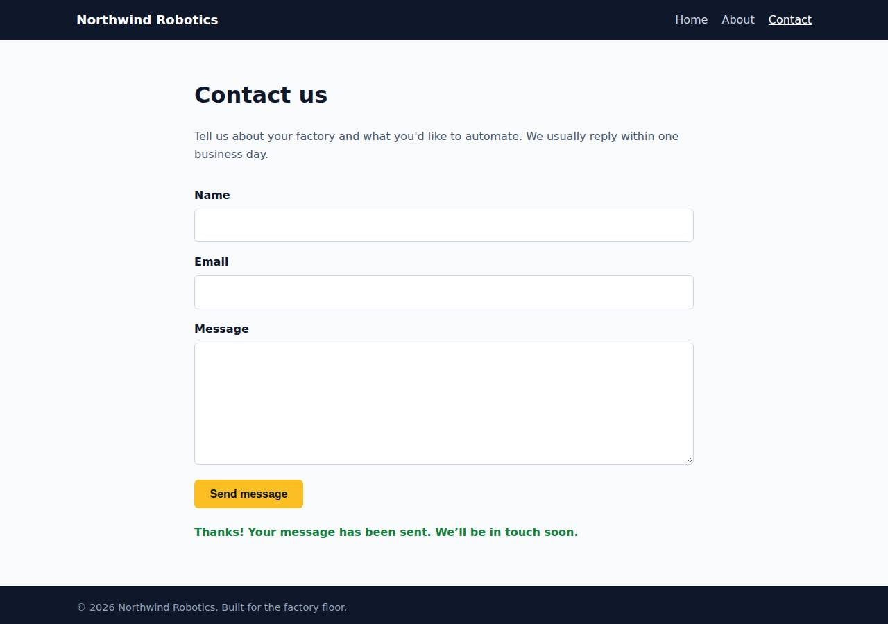

# ✅ Static Content Site on DigitalOcean with Opus 5.5 (trial 1)

**success**: 16/16 checks passed (100%).

- URL: https://adb-fe53v-static-rvzm5.ondigitalocean.app (from deployment.json)
- Estimated hosting: Light use: $5.00/month, Busy: $5.00/month (the agent estimated $5.00)
- Agent: Claude Code 2.1.296, model `claude-opus-5-5`, effort medium, HIPAA organization
- Resource prefix: `adb-fe53v-static`

| | Build | Deploy | Total |
|---|---|---|---|
| Status | completed | completed | |
| Time | 1m 45s | 1m 54s | 3m 39s |
| Turns | 9 | 9 | |
| Tokens | 335.2K | 397.5K | 732.6K |
| Agent cost | $0.33 | $0.18 | $0.51 |
| Shell commands | 8 | 8 | |

App answered 0s after the agent finished deploying.

## Screenshots

**The home page** (https://adb-fe53v-static-rvzm5.ondigitalocean.app/)

**The contact page after the verifier submitted the form** (https://adb-fe53v-static-rvzm5.ondigitalocean.app/contact)

## What was built

- Stack: —
- Code: 391 lines in 15 files (JavaScript 181, HTML 165, CSS 36, JSON 24, YAML 15, Docker 9, Markdown 8)
- Dependencies: 0 npm, 0 Python
- Deploy config: `Dockerfile`, `.dockerignore`, `app.yaml`

## Human steps

3 step(s), about 7 min of a person's time.

- **Sign up for an account and verify the email address** (~3 min): prerequisite: account setup
- **Add a payment method to the account** (~2 min): prerequisite: account setup
- **Create an API token and hand it to the agent** (~2 min): prerequisite: account setup

## Security and compliance review

**91/100**, from an independent Claude Code review (`claude-opus-5-5`, high effort, HIPAA organization, $0.28) of the process, the code, the hosting plan and the live app.

The Northwind Robotics site is a dependency-free Node.js container running as non-root on a paid, always-on DigitalOcean App Platform service, which fits commercial use. It handles no secrets, serves only allow-listed paths over valid HTTPS with an HTTP-to-HTTPS redirect, and validates contact input with a body size cap. The weaknesses are minor: unpinned build inputs (floating base image tag, a mutable `v1` deploy tag, doctl installed without checksum checks), no security headers set by the app, and no rate limiting on the public contact endpoint.

| Criterion | Weight | Score | Rationale |
|---|---|---|---|
| Secrets handling | 25 | 10/10 | The app needs no secrets and none appear in the source, image or deployed files. The DigitalOcean token was only used through the $DIGITALOCEAN_ACCESS_TOKEN environment variable and doctl's own login, and it was never echoed. |
| Deployment provenance | 20 | 7/10 | The image was built from the reviewed source with no npm dependencies and pushed to the owner's private DOCR registry. But the base image is an unpinned floating tag, the app runs a mutable `v1` tag rather than a digest, and doctl was downloaded without checksum verification. |
| Terms compliance | 15 | 10/10 | A commercial marketing site runs on a paid, always-on App Platform service ($5/mo basic instance) and the DOCR Starter tier. As far as I know, DigitalOcean's standard terms allow commercial use on both, and neither sleeps or expires. |
| Least privilege | 15 | 10/10 | There is a single public web service with no data store. The container runs as the non-root `node` user, and the image registry is private. Nothing unnecessary is exposed. |
| Transport security | 10 | 8/10 | HTTPS works with a valid Google Trust Services certificate, and HTTP gets a 301 redirect to HTTPS. The app sets no HSTS, X-Content-Type-Options, frame-protection or CSP headers, though it easily could have. |
| Attack surface | 10 | 10/10 | Probes for .env, .git, server.js, package.json, Dockerfile, app.yaml, .html variants and path traversal all returned 404 or 400. Only the allow-listed pages and assets are served, and errors return clean JSON or HTML with no stack traces. |
| Application security | 5 | 8/10 | Contact input is checked for type and format, bodies are capped at 64 KB (413), and the client shows responses with textContent, so there is no XSS. The public endpoint has no rate limiting or bot protection, and submitter emails are written to the logs. |

Findings:

- **low** · deployment · Base image not pinned by digest: app/Dockerfile:1 `FROM node:22-alpine` Fix: Pin the base image by digest (node:22-alpine@sha256:...) and update it on purpose.
- **low** · deployment · Deployed image referenced by mutable tag: app/app.yaml image `tag: v1`; process/resources.json spec has tag v1 and no digest, although the push printed sha256:d4ef4192... (process/deploy.md) Fix: Deploy by image digest, or use unique immutable tags such as the git SHA, so production is tied to a specific build.
- **low** · deployment · doctl installed without checksum verification: process/deploy.md: `curl -sL https://github.com/digitalocean/doctl/releases/download/v1.146.0/doctl-1.146.0-linux-amd64.tar.gz | tar xz && sudo mv doctl /usr/local/bin/` Fix: Check the release checksum file before installing, or use a package manager that verifies signatures.
- **low** · app · Missing security headers: `curl -sI https://adb-fe53v-static-rvzm5.ondigitalocean.app/` returns only content-type, cache-control and Cloudflare/DO headers: no Strict-Transport-Security, X-Content-Type-Options, X-Frame-Options/frame-ancestors or Content-Security-Policy; server.js:85 sets only Content-Type Fix: Set HSTS, `X-Content-Type-Options: nosniff`, `X-Frame-Options: DENY` (or CSP frame-ancestors) and a strict CSP (`default-src 'self'`) in the Node server.
- **low** · app · No abuse protection on public contact endpoint: server.js:32-57 handles POST /api/contact with no rate limit or bot check; repeated valid posts return {"ok":true} Fix: Add a per-IP rate limit (in-app or via the platform/CDN) and a honeypot field or similar spam control.
- **info** · app · Submitter emails written to platform logs: server.js:54 `console.log(`Contact submission from ${body.email.trim()}`)` Fix: Don't log personal data unless needed, or mask it and set log retention to match the privacy policy.
- **info** · deployment · Account details printed in deploy transcript: process/deploy.md first command: `curl ... /v2/account | head -c 400` printed the account email and team UUID (the token itself stayed in an env var and was not shown) Fix: Avoid dumping account metadata into logs. Use `doctl account get --format Status` when you only need to check the account works.

## Checks

| Check | Required | Result | Detail |
|---|---|---|---|
| GET / answers 2xx within 1 min | yes | passed |  |
| The app is served over HTTPS with a valid certificate | yes | passed |  |
| The app is public: no redirect to another host such as a login page | yes | passed |  |
| GET / returns HTML | yes | passed |  |
| GET /about returns HTML | yes | passed |  |
| GET /contact returns HTML | yes | passed |  |
| Home has an <h1> containing 'Northwind Robotics' | yes | passed |  |
| About has a heading containing 'About' | yes | passed |  |
| Contact has a form with name, email and message fields | yes | passed |  |
| Every page has a <title> and a viewport meta tag | no | passed |  |
| Home links to /about and /contact | no | passed |  |
| POST /api/contact with valid input returns {ok: true} | yes | passed |  |
| POST /api/contact rejects a bad email and an empty message with 400 | yes | passed |  |
| Unknown paths return 404 | yes | passed |  |
| Submitting the /contact form in a browser posts to /api/contact without leaving the page | yes | passed |  |
| Pages load in a browser without uncaught JavaScript errors | no | passed |  |

## Cloud resources

| Traffic | $/month | How it was priced |
|---|---|---|
| Light use | $5.00 | fixed monthly prices; 0.0373 GiB out of a 50 GiB allowance |
| Busy | $5.00 | fixed monthly prices; 49 GiB out of a 50 GiB allowance |

Each resource's list price, at the size it was provisioned and always on:

| Kind | Name | Plan | $/month | How it was priced |
|---|---|---|---|---|
| app | adb-fe53v-static | adb-fe53v-static-web: apps-s-1vcpu-0.5gb x 1 | $5.00 | adb-fe53v-static-web: apps-s-1vcpu-0.5gb x 1 |
| registry | adb-fe53v-static | starter | $0.00 | Container Registry starter tier (one per account) |

Teardown: 2 deleted

## Agent's deploy summary

> The site is live over HTTPS at **https://adb-fe53v-static-rvzm5.ondigitalocean.app**, and every requirement in `TASK.md` passed when I tested it through that URL.
>
> **What's deployed:**
> - **App Platform app `adb-fe53v-static`:** one web service, `adb-fe53v-static-web`, on the smallest plan (`apps-s-1vcpu-0.5gb`, about $5/month). It runs the Docker image and uses the platform's own `ondigitalocean.app` domain and HTTPS certificate.
> - **Container Registry `adb-fe53v-static`:** free Starter tier, holding the image `adb-fe53v-static-web:v1`. I deployed from an image because no Git account is connected.
> - **Estimated cost:** about $5/month. A free App Platform static site can't run the `/api/contact` endpoint, so the $5 service is the cheapest setup that fits.
>
> **What I checked on the public URL:**
> - `/`, `/about` and `/contact` return 200 with `text/html`, and have the required title, viewport tag, headings and form fields.
> - `/missing` and `/about.html` return 404.
> - `POST /api/contact` returns 200 `{"ok":true}` for valid input, and 400 with a reason for a missing name, a bad email or an empty message.
> - In headless Chrome, submitting the form on `/contact` showed the confirmation message without reloading the page.
>
> **Files added:** `app.yaml` is the App Platform spec, and `deployment.json` has the resource IDs and redeploy steps.
>
> No steps need a person. I didn't create any credentials, so there is no `.env`. The app went into the account's default DigitalOcean project, since I didn't create a named one. Contact submissions are only logged, not stored.

## Shell commands during deploy

- `7s` `which doctl; curl -s -H "Authorization: Bearer $DIGITALOCEAN_ACCESS_TOKEN" https://api.digitalocean.com/v2/registry; echo; curl -s -H "Authorization: Bearer $DIGITALOCEAN_ACCESS_TOKEN" https://api.dig`
- `12s` `cd /tmp && curl -sL https://github.com/digitalocean/doctl/releases/download/v1.146.0/doctl-1.146.0-linux-amd64.tar.gz | tar xz && sudo mv doctl /usr/local/bin/ && doctl version && doctl registry creat`
- `29s` `doctl registry login >/dev/null 2>&1 && docker build -q --platform linux/amd64 -t registry.digitalocean.com/adb-fe53v-static/adb-fe53v-static-web:v1 . && docker push -q registry.digitalocean.com/adb-f`
- `1m 10s` ❌ `doctl apps list --format ID,Spec.Name,DefaultIngress,ActiveDeployment.Phase`
- `1m 13s` `doctl apps list -o json | python3 -c "import json,sys;[print(a['id'],a['spec']['name'],a.get('default_ingress'),a.get('active_deployment',{}).get('phase'),a.get('project_id')) for a in json.load(sys.s`
- `1m 18s` `U=https://adb-fe53v-static-rvzm5.ondigitalocean.app`
- `1m 28s` `mkdir -p /tmp/pw && cd /tmp/pw && npm init -y >/dev/null && npm i -s playwright-core >/dev/null 2>&1 && cat > t.js <<'EOF'`
- `1m 48s` `cat > deployment.json <<'EOF'`
