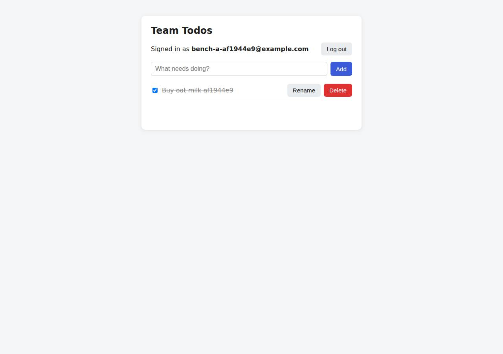

# ✅ Database-Backed CRUD App on Render with Opus 5.5 (trial 1)

**success**: 19/19 checks passed (100%).

- URL: https://adb-9mnhm-crud-web.onrender.com (from deployment.json)
- Estimated hosting: Light use: $0.00/month, Busy: $7.13/month (the agent estimated $0.00)
- Agent: Claude Code 2.1.296, model `claude-opus-5-5`, effort medium, HIPAA organization
- Resource prefix: `adb-9mnhm-crud`

| | Build | Deploy | Total |
|---|---|---|---|
| Status | completed | completed | |
| Time | 1m 58s | 10m 41s | 12m 39s |
| Turns | 11 | 15 | |
| Tokens | 435.0K | 792.0K | 1.23M |
| Agent cost | $0.44 | $0.54 | $0.98 |
| Shell commands | 8 | 14 | |

App answered 0s after the agent finished deploying.

## Screenshots

**The web app before signing in** (https://adb-9mnhm-crud-web.onrender.com/)

**The todo list after signing in through the web UI as the test user** (https://adb-9mnhm-crud-web.onrender.com/)

## What was built

- Stack: `bcryptjs`, `express`, `pg`
- Code: 441 lines in 10 files (JavaScript 301, HTML 140, JSON 34, YAML 20, Markdown 13)
- Dependencies: 3 npm, 0 Python
- Deploy config: `render.yaml`

## Human steps

2 step(s), about 5 min of a person's time.

- **Sign up for an account and verify the email address** (~3 min): prerequisite: account setup
- **Create an API token and hand it to the agent** (~2 min): prerequisite: account setup

Reported but not needed, since the deployment worked without them: Optionally push this directory to a Git repo and connect GitHub/GitLab to the Render workspace, then switch the service ; Before the free Postgres expires (30 days after creation), upgrade adb-9mnhm-crud-db to a paid plan (e.g. basic-256mb, ~

## Security and compliance review

**62/100**, from an independent Claude Code review (`claude-opus-5-5`, high effort, HIPAA organization, $0.38) of the process, the code, the hosting plan and the live app.

The app code is solid: queries are parameterized, passwords use bcrypt, tokens are hashed, users can only reach their own todos, and the live site serves HTTPS with nothing sensitive exposed. The deployment is weaker. A commercial app runs on Render free plans, and the free database expires on 2026-11-13, taking the data with it. The database is open to the internet, and the code was shipped as a secret-file tarball on an unpinned node:22-alpine image that runs npm ci as root at every start, so the running code can't be traced to source.

| Criterion | Weight | Score | Rationale |
|---|---|---|---|
| Secrets handling | 25 | 9/10 | The Render API key came from the environment and never appeared in transcripts. DATABASE_URL was given to the service as a Render env var and read through process.env, and the uploaded bundle left out .env. Minor point: the external DB connection string was also written to a local .env on the runner. |
| Deployment provenance | 20 | 4/10 | Production code is a base64 tarball uploaded as a Render secret file and unpacked at container start, so there is no source repo or build record linking it to reviewed sources. The base image is the floating tag node:22-alpine with no digest, and npm ci pulls dependencies from the registry on every boot. The lockfile does pin versions. |
| Terms compliance | 15 | 3/10 | This is a commercial app on Render's free web and Postgres plans. Render says free instances are for hobby and testing, not production. The free database expires on 2026-11-13 and takes the persistent data the app needs with it, and the free web service sleeps when idle. |
| Least privilege | 15 | 5/10 | The Postgres instance was created with no IP allow list, so it accepts connections from the internet (the agent connected from the CI runner using the external URL). The container runs as root in the stock node image, and the app connects as the database owner. |
| Transport security | 10 | 7/10 | HTTPS works with a valid certificate, and HTTP gets a 301 redirect to HTTPS. The app sets no HSTS, X-Content-Type-Options, frame protection or CSP, though it could have added them in Express. |
| Attack surface | 10 | 9/10 | Requests for .env, .git, package.json, source files and the bundle all return 404, and errors return generic messages. The only leak is the X-Powered-By: Express header. |
| Application security | 5 | 7/10 | Queries are parameterized, passwords use bcrypt cost 12, tokens are random and stored hashed, ownership is checked, input is validated, and the UI renders with textContent. There is no rate limiting on login or signup, and the bearer token is kept in localStorage while no CSP is set. |

Findings:

- **high** · deployment · Commercial app on Render free plans; free Postgres expires: process/context.json use=commercial; process/resources.json: service plan 'free', postgres plan 'free' with expires_at 2026-11-13T02:14:22Z; deployment.json notes 'Free Postgres expires after 30 days' and 'Free web service spins down when idle' Fix: Use paid Render plans (e.g. Starter web service and a Basic Postgres) for a business's app, so data persists past 30 days and the service doesn't sleep.
- **medium** · deployment · Postgres reachable from the public internet: process/deploy.md line 87 area: POST /v1/postgres body has no ipAllowList (Render's default allows 0.0.0.0/0); deploy.md line 245: the agent connects from the GitHub runner with EXTERNAL_DATABASE_URL Fix: Set the database's ipAllowList to empty (internal-only) or to specific admin IPs. The app already uses the internal connection string.
- **medium** · deployment · Code delivered as an opaque secret-file tarball, not from source control: process/deploy.md: tar czf /tmp/app.tgz ... | base64 uploaded as secretFiles app.tgz.b64; start.sh runs 'base64 -d /etc/secrets/app.tgz.b64 | tar xz; npm ci; exec node src/server.js'. render.yaml (runtime node, Git build) does not match what is deployed. Fix: Deploy from a Git repo the owner controls (Blueprint/render.yaml) or a pinned image built in CI and pushed to a registry the owner controls, so every deploy traces back to a commit.
- **medium** · deployment · Unpinned base image; dependencies installed at runtime on every start: process/deploy.md: image.imagePath 'docker.io/library/node:22-alpine' (tag, no digest); start.sh runs 'npm ci --omit=dev' at container boot Fix: Pin the base image by digest and install dependencies at build time, so the running artifact is immutable and reproducible.
- **low** · deployment · Container runs as root: The stock node:22-alpine image runs as root by default; dockerCommand 'sh /etc/secrets/start.sh' never switches user (no USER node) Fix: Run as the non-root 'node' user, e.g. with a Dockerfile containing USER node.
- **low** · app · Missing security headers: curl -sI https://adb-9mnhm-crud-web.onrender.com/ returns no Strict-Transport-Security, X-Content-Type-Options, X-Frame-Options or Content-Security-Policy Fix: Add helmet (or set the headers by hand) in src/app.js, including HSTS and a strict CSP.
- **low** · app · No rate limiting on auth endpoints: app/src/app.js lines 109-141: signup and login have no throttling or lockout Fix: Add per-IP and per-account rate limiting (e.g. express-rate-limit) to /api/auth/*.
- **low** · app · Bearer token stored in localStorage: app/public/index.html line 57/71: localStorage.setItem('token', t); an HttpOnly cookie is also set Fix: Rely on the HttpOnly cookie for the browser UI, or add a strict CSP to limit the impact of any XSS.
- **low** · deployment · DB TLS verification disabled for external connections: app/src/db.js line 10: ssl: { rejectUnauthorized: false } Fix: Verify the server certificate, or use only the internal connection over Render's private network.
- **info** · app · X-Powered-By header discloses framework: curl -sI / shows 'x-powered-by: Express' Fix: Add app.disable('x-powered-by').
- **info** · deployment · External DB connection string written to local .env: process/deploy.md line 99: writes DATABASE_URL and EXTERNAL_DATABASE_URL to .env (gitignored; not in the uploaded tarball) Fix: Avoid saving production credentials on build machines. If you do, delete them after the deploy.

## Checks

| Check | Required | Result | Detail |
|---|---|---|---|
| GET / answers 2xx within 1 min | yes | passed |  |
| The app is served over HTTPS with a valid certificate | yes | passed |  |
| The app is public: no redirect to another host such as a login page | yes | passed |  |
| GET / serves the web app as HTML | yes | passed |  |
| POST /api/auth/signup creates an account and returns a token | yes | passed |  |
| Signup rejects an invalid email and a short password with 400 | yes | passed |  |
| Signing up twice with the same email returns 409 | yes | passed |  |
| POST /api/auth/login returns a token | yes | passed |  |
| Login with a wrong password returns 401 | yes | passed |  |
| /api/todos requires a valid token (401) | yes | passed |  |
| POST /api/todos creates a todo | yes | passed |  |
| An empty title is rejected with 400 | yes | passed |  |
| GET /api/todos lists the caller's todos | yes | passed |  |
| Todos are listed oldest first | no | passed |  |
| PATCH /api/todos/{id} renames and completes a todo | yes | passed |  |
| Users can't see or modify each other's todos (404) | yes | passed |  |
| DELETE /api/todos/{id} removes a todo | yes | passed |  |
| Data is still there a minute later, with a fresh login | yes | passed |  |
| The web UI renders a login or signup form | no | passed |  |

## Cloud resources

| Traffic | $/month | How it was priced |
|---|---|---|
| Light use | $0.00 | fixed monthly prices; 0.04 GB out of the Hobby workspace's 5 GB; free instances awake 10 h of 750 free hours |
| Busy | $7.13 | fixed monthly prices; 52.6 GB out of the Hobby workspace's 5 GB, 47.6 GB billed (with a payment method on file; without one Render suspends the services instead); free instances awake 730 h of 750 free hours |

Each resource's list price, at the size it was provisioned and always on:

| Kind | Name | Plan | $/month | How it was priced |
|---|---|---|---|---|
| service | adb-9mnhm-crud-web | free | $0.00 | free x 1 instance(s) |
| postgres | adb-9mnhm-crud-db | free | $0.00 | Postgres free |

Teardown: 2 deleted

## Agent's deploy summary

> The app is live at **https://adb-9mnhm-crud-web.onrender.com** and costs $0 a month.
>
> **What's running on Render:**
> - **Web service** `adb-9mnhm-crud-web` (`srv-db7ebb7avr4c73ftvb1g`), free plan.
> - **PostgreSQL 16** `adb-9mnhm-crud-db` (`dpg-db7eavivcj2c73db3fs0-a`), free plan. The service connects over Render's internal network. The connection strings are saved only in `.env`.
>
> **How the code gets there:** there were no GitHub credentials, so Render couldn't build from a repo. Instead the service runs the official `node:22-alpine` image (pulled from Docker Hub), and the app is uploaded to Render as a secret file. A start script, also a secret file, unpacks it, runs `npm ci` and starts the server.
>
> **Tested through the public URL:**
> - `GET /` returns the web page.
> - Signup returns 201, and 400 or 409 for the error cases. Login returns 200, and 401 for wrong credentials.
> - Listing todos (oldest first), creating, renaming, completing and uncompleting, and deleting all work, as do the 400, 401 and 404 errors.
> - A second user sees an empty list and gets 404 on the first user's todos.
> - Data survived a redeploy: the next todo got ID 3, after the two created before it.
>
> **What didn't work:** I tried to confirm directly in the database that passwords are stored as bcrypt hashes. Connecting from outside Render failed with "connection terminated", so I didn't check it on the deployed database. It is covered by the local test from step 1.
>
> **Limitations:**
> - **Free database expiry:** Render's free PostgreSQL expires 30 days after creation. To keep the data longer, upgrade it to a paid plan (about $6 a month). This is listed as a non-blocking human step.
> - **Idle spin-down:** the free web service sleeps when idle, so the first request after a quiet period takes about a minute.
> - **Updating the code:** to ship changes, rebuild the app archive, upload it again as the secret file and trigger a deploy. The steps are in `deployment.json`.
>
> **Optional human step:** for normal builds and auto-deploys, push this directory to a Git repo, connect it in the Render dashboard and deploy from it; the included `render.yaml` defines both services. I listed this as non-blocking too.

## Shell commands during deploy

- `6s` `env | cut -d= -f1 | grep -iE 'render|git|gh_|token' ; which gh render; git status 2>&1 | head -2; head -c 0 src/app.js; grep -n "cookie\|BCRYPT" src/app.js | head`
- `13s` `gh auth status 2>&1 | head -3; curl -s -H "Authorization: Bearer $RENDER_API_KEY" https://api.render.com/v1/owners; echo; curl -s -H "Authorization: Bearer $RENDER_API_KEY" "https://api.render.com/v1/`
- `22s` `curl -s -XPOST -H "Authorization: Bearer $RENDER_API_KEY" -H 'content-type: application/json' https://api.render.com/v1/postgres -d '{"name":"adb-9mnhm-crud-db","ownerId":"tea-db6fig0473hc73eb9aeg","p`
- `26s` `tar czf /tmp/app.tgz package.json package-lock.json src public && base64 -w0 /tmp/app.tgz > /tmp/app.tgz.b64 && wc -c /tmp/app.tgz.b64`
- `30s` `for i in $(seq 1 40); do s=$(curl -s -H "Authorization: Bearer $RENDER_API_KEY" https://api.render.com/v1/postgres/dpg-db7eavivcj2c73db3fs0-a | node -pe 'JSON.parse(require("fs").readFileSync(0)).stat`
- `1m 08s` `set -a && . ./.env && set +a && node -e '`
- `1m 13s` `for i in $(seq 1 50); do s=$(curl -s -H "Authorization: Bearer $RENDER_API_KEY" https://api.render.com/v1/services/srv-db7ebb7avr4c73ftvb1g/deploys/dep-db7ebbfavr4c73ftvca0 | node -pe 'JSON.parse(requ`
- `8m 27s` `curl -s -H "Authorization: Bearer $RENDER_API_KEY" "https://api.render.com/v1/logs?ownerId=tea-db6fig0473hc73eb9aeg&resource=srv-db7ebb7avr4c73ftvb1g&limit=40&direction=backward" | node -e 'const j=JS`
- `8m 36s` `H="Authorization: Bearer $RENDER_API_KEY"; S=https://api.render.com/v1/services/srv-db7ebb7avr4c73ftvb1g`
- `8m 42s` `for i in $(seq 1 50); do s=$(curl -s -H "Authorization: Bearer $RENDER_API_KEY" https://api.render.com/v1/services/srv-db7ebb7avr4c73ftvb1g/deploys/dep-db7eeraj9qps73c4vhk0 | node -pe 'JSON.parse(requ`
- `9m 12s` `B=https://adb-9mnhm-crud-web.onrender.com; J='content-type: application/json'`
- `9m 35s` ❌ `S=https://api.render.com/v1/services/srv-db7ebb7avr4c73ftvb1g; H="Authorization: Bearer $RENDER_API_KEY"`
- `10m 16s` `B=https://adb-9mnhm-crud-web.onrender.com; T=$(curl -s -XPOST $B/api/auth/signup -H 'content-type: application/json' -d '{"email":"probe'$RANDOM'x@example.com","password":"password1"}' | node -pe 'JSO`
- `10m 31s` `cat > deployment.json <<'EOF'`
