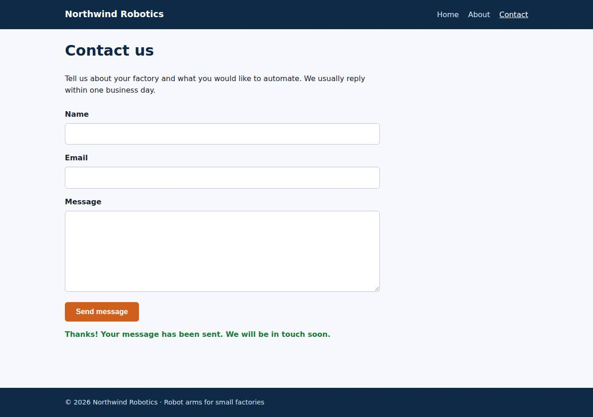

# ✅ Static Content Site on Render with Opus 5.5 (trial 1)

**success**: 16/16 checks passed (100%).

- URL: https://adb-1ywvf-static-web.onrender.com (from deployment.json)
- Estimated hosting: Light use: $0.00/month, Busy: $7.13/month (the agent estimated $0.00)
- Agent: Claude Code 2.1.296, model `claude-opus-5-5`, effort medium, HIPAA organization
- Resource prefix: `adb-1ywvf-static`

| | Build | Deploy | Total |
|---|---|---|---|
| Status | completed | completed | |
| Time | 1m 20s | 1m 22s | 2m 42s |
| Turns | 9 | 7 | |
| Tokens | 332.8K | 310.9K | 643.6K |
| Agent cost | $0.44 | $0.18 | $0.61 |
| Shell commands | 8 | 6 | |

App answered 0s after the agent finished deploying.

## Screenshots

**The home page** (https://adb-1ywvf-static-web.onrender.com/)

**The contact page after the verifier submitted the form** (https://adb-1ywvf-static-web.onrender.com/contact)

## What was built

- Stack: —
- Code: 344 lines in 14 files (JavaScript 163, HTML 136, CSS 33, JSON 21, Shell 12, YAML 8, Markdown 6)
- Dependencies: 0 npm, 0 Python
- Deploy config: `render.yaml`

## Human steps

2 step(s), about 5 min of a person's time.

- **Sign up for an account and verify the email address** (~3 min): prerequisite: account setup
- **Create an API token and hand it to the agent** (~2 min): prerequisite: account setup

## Security and compliance review

**72/100**, from an independent Claude Code review (`claude-opus-5-5`, high effort, HIPAA organization, $0.28) of the process, the code, the hosting plan and the live app.

The Northwind Robotics site is a small, dependency-free Node server on Render: allowlisted routes, solid input validation, HTTPS with an HTTP-to-HTTPS redirect, and no leaked secrets or exposed files. The main weaknesses are provenance and compliance: Render records the service's source as a third-party example repo, while the code that actually runs is an opaque base64 tarball in an env var, and a commercial site is hosted on a free plan that sleeps when idle. Minor gaps are the missing security headers and no rate limiting on the contact endpoint.

| Criterion | Weight | Score | Rationale |
|---|---|---|---|
| Secrets handling | 25 | 10/10 | The app needs no secrets. The Render API key was only ever used through $RENDER_API_KEY in curl headers, and the agent masked env values when it listed them (`sed 's/=.*/=***/'`). No credentials appear in the source, deploy.sh, the tarball held in APP_TGZ_B64, or the live site. |
| Deployment provenance | 20 | 4/10 | Render records the service's source as a third-party public repo (render-examples/express-hello-world, branch main, not pinned to a commit). The code that actually runs is an opaque base64 tarball in an env var that the build command unpacks, so the deployed code can't be traced to any version-controlled source the owner controls. The runtime is pinned only to NODE_VERSION=22, a major version, and there are no dependencies. |
| Terms compliance | 15 | 4/10 | This is a business's marketing site running on a Render free web service. Render says free instances are for hobby/testing use, not production, and they spin down after 15 minutes idle, so visitors can wait 30-60s on a cold start. I'm not aware of a clause that strictly bans commercial use on the free tier, but the sleep behavior and lack of an SLA don't suit a public business site. |
| Least privilege | 15 | 9/10 | There is a single managed Node web service with no data stores, no extra public resources and no added permissions. The process runs in Render's managed native runtime, so the container user can't be controlled. Health check and auto-deploy settings are reasonable (autoDeploy=no). |
| Transport security | 10 | 7/10 | HTTPS is served with a valid Google Trust Services certificate, and plain HTTP gets a 301 redirect to HTTPS. However, the app sets none of HSTS, X-Content-Type-Options, frame protection or CSP, even though for a Node web service only the app could add them. |
| Attack surface | 10 | 9/10 | The server uses an allowlist of routes. Requests for /.env, /.git/config, /package.json, /server.js, /render.yaml and /deploy.sh all return 404, there is no directory listing, and errors don't leak stack traces. The only extra endpoint is /healthz, which returns 'ok' and is harmless. |
| Application security | 5 | 7/10 | Input is validated for type, email format and length, the body is capped at 20KB, malformed JSON returns a clean 400, and the client renders server text with textContent, so there's no XSS sink. The contact endpoint has no rate limiting or bot protection, and the logs write user-supplied name/email unsanitized. |

Findings:

- **medium** · deployment · Service built from third-party repo; real code smuggled in via env-var tarball: process/deploy.md: POST /v1/services body sets "repo":"https://github.com/render-examples/express-hello-world","branch":"main" and buildCommand "find . -mindepth 1 -maxdepth 1 ! -name .git -exec rm -rf {} + && echo \"$APP_TGZ_B64\" | base64 -d | tar xz && npm install"; process/resources.json source=https://github.com/render-examples/express-hello-world Fix: Push the app to a repository the owner controls and point the Render service at it, pinned to a branch or commit, with auto-deploy from that repo. Alternatively, deploy a pinned, digest-referenced image from an owner-controlled registry. Remove the APP_TGZ_B64 mechanism.
- **medium** · deployment · Commercial site on Render free tier that sleeps when idle: process/context.json use=commercial; process/resources.json plan=free; process/deployment.json notes: 'Free instances sleep after ~15 min idle, so the first request after that can take ~30-60s' Fix: Use a paid instance type (e.g. Starter) for a business's public site so it stays up and runs under production-appropriate terms, or host the static pages on Render Static Sites with the API on a paid instance.
- **low** · deployment · Node runtime pinned only to a major version: process/deploy.md envVars: {"key":"NODE_VERSION","value":"22"}; app/package.json engines "node": ">=18" Fix: Pin an exact Node version (e.g. 22.x.y) through NODE_VERSION or .node-version so builds are reproducible.
- **low** · app · No security headers (HSTS, nosniff, frame protection, CSP): curl -sI https://adb-1ywvf-static-web.onrender.com/ -> only content-type, rndr-id, server: cloudflare, vary, x-render-origin-server, cf-* headers; app/server.js send() sets only Content-Type, Content-Length and extra headers Fix: Add Strict-Transport-Security, X-Content-Type-Options: nosniff, X-Frame-Options: DENY (or CSP frame-ancestors 'none'), a restrictive Content-Security-Policy (default-src 'self') and Referrer-Policy in send().
- **low** · app · Contact endpoint has no rate limiting or anti-spam control: app/server.js handleContact(): accepts every valid POST and logs it; POST /api/contact with {"name":"<script>","email":"a@b.co","message":"x"} -> 200 {"ok":true} Fix: Add simple per-IP rate limiting and a honeypot field or similar bot check.
- **info** · app · User input written to logs unsanitized: app/server.js line ~52: console.log(`Contact submission from ${data.name.trim()} <${data.email.trim()}>`) – name may contain newlines/control chars Fix: Strip control characters, or log structured JSON (JSON.stringify) so user input can't forge log lines.
- **info** · app · Allowlisted routing; no sensitive files exposed: GET /.env, /.git/config, /package.json, /server.js, /render.yaml, /deploy.sh -> 404; /healthz -> 200 'ok' Fix: None required.

## Checks

| Check | Required | Result | Detail |
|---|---|---|---|
| GET / answers 2xx within 1 min | yes | passed |  |
| The app is served over HTTPS with a valid certificate | yes | passed |  |
| The app is public: no redirect to another host such as a login page | yes | passed |  |
| GET / returns HTML | yes | passed |  |
| GET /about returns HTML | yes | passed |  |
| GET /contact returns HTML | yes | passed |  |
| Home has an <h1> containing 'Northwind Robotics' | yes | passed |  |
| About has a heading containing 'About' | yes | passed |  |
| Contact has a form with name, email and message fields | yes | passed |  |
| Every page has a <title> and a viewport meta tag | no | passed |  |
| Home links to /about and /contact | no | passed |  |
| POST /api/contact with valid input returns {ok: true} | yes | passed |  |
| POST /api/contact rejects a bad email and an empty message with 400 | yes | passed |  |
| Unknown paths return 404 | yes | passed |  |
| Submitting the /contact form in a browser posts to /api/contact without leaving the page | yes | passed |  |
| Pages load in a browser without uncaught JavaScript errors | no | passed |  |

## Cloud resources

| Traffic | $/month | How it was priced |
|---|---|---|
| Light use | $0.00 | fixed monthly prices; 0.04 GB out of the Hobby workspace's 5 GB; free instances awake 10 h of 750 free hours |
| Busy | $7.13 | fixed monthly prices; 52.6 GB out of the Hobby workspace's 5 GB, 47.6 GB billed (with a payment method on file; without one Render suspends the services instead); free instances awake 730 h of 750 free hours |

Each resource's list price, at the size it was provisioned and always on:

| Kind | Name | Plan | $/month | How it was priced |
|---|---|---|---|---|
| service | adb-1ywvf-static-web | free | $0.00 | free x 1 instance(s) |

Teardown: 1 deleted

## Agent's deploy summary

> The site is live at **https://adb-1ywvf-static-web.onrender.com**, and every requirement in `TASK.md` passed when I tested it through that public HTTPS URL.
>
> **What's deployed:** one Render web service, `adb-1ywvf-static-web` (`srv-db7e8javcj2c73dar9t0`), on the free plan in Oregon. Cost is $0/month.
>
> **One unusual thing about the setup:** Render only builds from a Git repo, and no GitHub credentials were available here. So the service points at Render's public example repo (`render-examples/express-hello-world`) just to get a build started. The build then deletes that code and unpacks this app from a base64 tarball stored in the environment variable `APP_TGZ_B64`. That means pushing code won't redeploy anything. To ship a change, run `./deploy.sh`, which repacks the app, updates the variable and starts a deploy. If you'd rather have normal push-to-deploy, someone can put this code in a repo and point the service at it. That's optional, so `human_steps` is empty.
>
> **What I checked on the live URL:**
> - `/`, `/about` and `/contact` return 200 as `text/html`, each with a title, a viewport meta tag and navigation.
> - `/nope` and `/about.html` return 404.
> - `POST /api/contact` returns 200 with `{"ok":true}` for valid input, and 400 with an error message for a missing name, a bad email or an empty message.
> - In a headless browser, submitting the contact form showed the confirmation without reloading the page.
>
> **Limitation:** free instances go to sleep after about 15 minutes with no traffic, so the first request after that can take 30–60 seconds.
>
> Nothing failed. `deployment.json` is written in the project folder.

## Shell commands during deploy

- `5s` `env | grep -iE 'render|github|gh_|token' | sed 's/=.*/=***/'; which render gh; curl -s -H "Authorization: Bearer $RENDER_API_KEY" https://api.render.com/v1/owners | head -c 600; echo; curl -s -H "Auth`
- `17s` `tar czf /tmp/app.tgz package.json server.js public && base64 -w0 /tmp/app.tgz > /tmp/app.b64 && wc -c /tmp/app.b64; git ls-remote https://github.com/render-examples/express-hello-world HEAD`
- `23s` `cd /tmp && python3 - <<'EOF' > /tmp/body.json`
- `28s` `for i in $(seq 1 40); do s=$(curl -s -H "Authorization: Bearer $RENDER_API_KEY" https://api.render.com/v1/services/srv-db7e8javcj2c73dar9t0/deploys/dep-db7e8jivcj2c73darapg | python3 -c 'import json,s`
- `1m 03s` `U=https://adb-1ywvf-static-web.onrender.com`
- `1m 15s` `cat > deploy.sh <<'EOF'`
