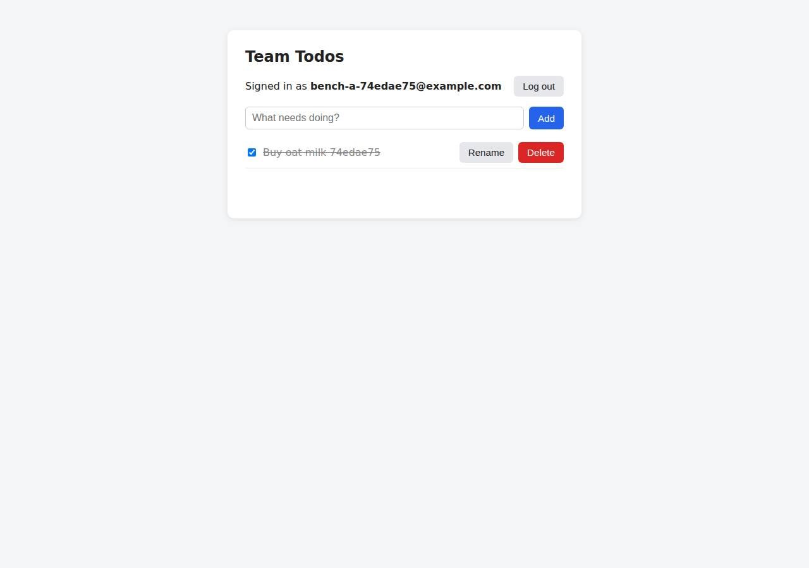

# ✅ Database-Backed CRUD App on Vercel with Opus 5.5 (trial 1)

**success**: 19/19 checks passed (100%).

- URL: https://adb-fbt4r-crud.vercel.app (from deployment.json)
- Estimated hosting: Light use: $20.00/month, Busy: $20.00/month (the agent estimated $0.00)
- Agent: Claude Code 2.1.296, model `claude-opus-5-5`, effort medium, HIPAA organization
- Resource prefix: `adb-fbt4r-crud`

| | Build | Deploy | Total |
|---|---|---|---|
| Status | completed | completed | |
| Time | 2m 11s | 4m 33s | 6m 43s |
| Turns | 10 | 23 | |
| Tokens | 404.8K | 1.38M | 1.78M |
| Agent cost | $0.45 | $0.75 | $1.20 |
| Shell commands | 9 | 22 | |

App answered 0s after the agent finished deploying.

## Screenshots

**The web app before signing in** (https://adb-fbt4r-crud.vercel.app/)

**The todo list after signing in through the web UI as the test user** (https://adb-fbt4r-crud.vercel.app/)

## What was built

- Stack: `@vercel/blob`, `bcryptjs`, `express`, `pg`
- Code: 593 lines in 15 files (JavaScript 462, HTML 131, JSON 44, Markdown 25)
- Dependencies: 4 npm, 0 Python
- Deploy config: `vercel.json`

## Human steps

2 step(s), about 5 min of a person's time.

- **Sign up for an account and verify the email address** (~3 min): prerequisite: account setup
- **Create an API token and hand it to the agent** (~2 min): prerequisite: account setup

Reported but not needed, since the deployment worked without them: Optional: accept the Neon Marketplace terms at https://vercel.com/ai-deploy-bench/~/integrations/accept-terms/neon, then; 21.0) > Installing Neon by Neon under ai-deploy-bench { "status": "action_required", "reason": "integration_terms_accept

## Security and compliance review

**68/100**, from an independent Claude Code review (`claude-opus-5-5`, high effort, HIPAA organization, $0.48) of the process, the code, the hosting plan and the live app.

The app itself is solid: bcrypt passwords, hashed 256-bit session tokens, every todo scoped to its owner, a private Blob store, and the secret read from Vercel environment variables, with HTTPS/HSTS from the platform. The biggest problem is compliance: a commercial app is hosted on Vercel's Hobby plan, which is limited to non-commercial use. The deployment also serves all server-side source files publicly (/src/app.js, /server.js, /src/store/*), and smaller gaps include no auth rate limiting, missing security headers and an unpinned CLI-upload deploy.

| Criterion | Weight | Score | Rationale |
|---|---|---|---|
| Secrets handling | 25 | 9/10 | The Blob read-write token is a Vercel project environment variable read through process.env, and .vercelignore keeps .env/.env.local out of the upload (probe returned 404). The only small leaks are the truncated token prefix that `vercel env ls` printed into the log and the Vercel token passed as a CLI argument. |
| Deployment provenance | 20 | 7/10 | The code in production matches the reviewed source and was deployed from the agent's workspace with a package-lock.json and the Node major version pinned. But dependencies use caret ranges, the CLI ran as an unpinned `npx vercel@latest`, and the deploy was a local CLI upload, not a build from an owner-controlled git repo. |
| Terms compliance | 15 | 2/10 | context.json says the use is commercial, but the team is on Vercel's Hobby plan. Hobby's terms limit it to personal, non-commercial use, so a business's app needs Pro. The agent recorded the plan as 'Hobby (free)' and never mentioned the restriction. |
| Least privilege | 15 | 8/10 | The Blob store holding users, sessions and todos was created with private access, and no other resources were provisioned. The read-write token is scoped to all environments (Production, Preview, Development) instead of Production only, and the unused Postgres path turns off TLS certificate verification. |
| Transport security | 10 | 8/10 | Only HTTPS is served, with a valid certificate. HTTP gets a 308 redirect to HTTPS, and HSTS with preload is set. The app could have added X-Content-Type-Options, frame protection and a CSP in Express or vercel.json, but didn't. |
| Attack surface | 10 | 5/10 | All server-side source files are publicly downloadable as static files (/src/app.js, /server.js, /src/store/*.js) because Vercel serves uploaded files before applying the catch-all rewrite. No secrets are in them, but this exposes the whole backend logic and storage layout. /.env, /.git and package files return 404, and errors don't leak stack traces. |
| Application security | 5 | 7/10 | Passwords are hashed with bcrypt and session tokens are 256-bit values stored only as SHA-256 hashes. Input is validated, every todo is scoped to its owner, and the UI renders titles with textContent, so XSS doesn't work. There is no rate limiting on login or signup, and the token is kept in localStorage. |

Findings:

- **high** · deployment · Commercial app hosted on Vercel Hobby (personal, non-commercial plan): process/context.json: "use": "commercial", team_plans: {"team_U2tHOV4fpUx18nl9EpcRQ4hO": "hobby"}; process/deployment.json resources[0].plan: "Hobby (free)". Vercel's Hobby plan is limited to personal, non-commercial use under its fair-use and terms rules. Fix: Move the project to a Vercel Pro (or Enterprise) team before using it for a business, or pick a provider and plan that allows commercial use. Flag the plan restriction to the owner in deployment.json.
- **medium** · deployment · Server-side source code publicly served as static files: GET https://adb-fbt4r-crud.vercel.app/src/app.js -> 200 application/javascript (full Express app); /server.js -> 200; /src/store/blob.js, /src/store/pg.js, /src/store/pg-pool.js, /src/store/index.js -> 200. vercel.json only rewrites /(.*) -> /api, and Vercel serves filesystem files before applying rewrites. .vercelignore excludes only .env*, node_modules, test, TASK.md and deployment.json. Fix: Move server code out of the publicly served root (for example lib/ referenced only through includeFiles), set an empty public output directory, or add src/ and server.js to .vercelignore and bundle them into the function. Then check that /src/app.js returns 404.
- **low** · app · No rate limiting on authentication endpoints: app/src/app.js POST /api/auth/login and /api/auth/signup have no throttling. Six consecutive failed logins for the same email all returned 401 with no slowdown or lockout. Fix: Add per-IP and per-account rate limiting (for example Vercel WAF rate-limit rules or a KV-backed limiter) on login and signup.
- **low** · app · Missing security headers (CSP, X-Content-Type-Options, frame protection): curl -sI https://adb-fbt4r-crud.vercel.app/ returns only strict-transport-security among security headers. There is no content-security-policy, x-content-type-options or x-frame-options. app/src/app.js sets no headers apart from disabling x-powered-by. Fix: Set Content-Security-Policy (including frame-ancestors 'none'), X-Content-Type-Options: nosniff and Referrer-Policy through helmet or a headers block in vercel.json.
- **low** · deployment · Unpinned deploy tooling and deployment from a local upload: process/deploy.md: every deploy ran `npx -y vercel@latest ... deploy --prod --yes` from the local directory, with no git integration. app/package.json uses caret ranges ("express": "^5.3.0", "@vercel/blob": "^2.8.1"). The build restored a cache from an earlier deployment. Fix: Deploy from a git repository the owner controls through Vercel's Git integration, pin the Vercel CLI version, commit package-lock.json and use npm ci.
- **low** · deployment · Blob read-write token exposed to Preview and Development environments: process/deploy.md `vercel env ls`: BLOB_READ_WRITE_TOKEN ... environments: Production, Preview, Development. The production data store is reachable from preview builds and from the local .env.local the CLI pulled. Fix: Limit the production store token to the Production environment and give preview/development a separate store.
- **low** · app · Postgres TLS certificate verification disabled: app/src/store/pg-pool.js: ssl: { rejectUnauthorized: false } for non-local connection strings. This path is unused in the current Blob deployment but would be active once DATABASE_URL is set. Fix: Verify the server certificate (rejectUnauthorized: true, with the provider CA if needed).
- **info** · deployment · Token prefix printed in transcript; Vercel token passed on the command line: process/deploy.md line ~430: `vercel env ls` output shows `BLOB_READ_WRITE_TOKEN eyJ2IjoidjIiLCJjIj…` (a truncated, non-usable prefix). Commands pass `--token $VERCEL_TOKEN` as an argument. Neither exposes a complete secret. Fix: Use the VERCEL_TOKEN environment variable instead of --token, and don't print environment listings into logs.
- **info** · app · Health endpoint discloses storage backend: GET /api/health -> 200 {"ok":true,"storage":"vercel-blob"} Fix: Return only {ok:true} publicly, or require auth for diagnostic details.
- **info** · app · Session token stored in localStorage: app/src/index.html lines 51 and 67: localStorage.getItem/setItem('token'). Any XSS would expose the token, though titles are rendered with textContent and a stored '' title is inert. Fix: Consider an HttpOnly, Secure, SameSite cookie for the web UI, together with a CSP.

## Checks

| Check | Required | Result | Detail |
|---|---|---|---|
| GET / answers 2xx within 1 min | yes | passed |  |
| The app is served over HTTPS with a valid certificate | yes | passed |  |
| The app is public: no redirect to another host such as a login page | yes | passed |  |
| GET / serves the web app as HTML | yes | passed |  |
| POST /api/auth/signup creates an account and returns a token | yes | passed |  |
| Signup rejects an invalid email and a short password with 400 | yes | passed |  |
| Signing up twice with the same email returns 409 | yes | passed |  |
| POST /api/auth/login returns a token | yes | passed |  |
| Login with a wrong password returns 401 | yes | passed |  |
| /api/todos requires a valid token (401) | yes | passed |  |
| POST /api/todos creates a todo | yes | passed |  |
| An empty title is rejected with 400 | yes | passed |  |
| GET /api/todos lists the caller's todos | yes | passed |  |
| Todos are listed oldest first | no | passed |  |
| PATCH /api/todos/{id} renames and completes a todo | yes | passed |  |
| Users can't see or modify each other's todos (404) | yes | passed |  |
| DELETE /api/todos/{id} removes a todo | yes | passed |  |
| Data is still there a minute later, with a fresh login | yes | passed |  |
| The web UI renders a login or signup form | no | passed |  |

## Cloud resources

| Traffic | $/month | How it was priced |
|---|---|---|
| Light use | $20.00 | Hobby is for non-commercial use only, so priced on Pro: $20 platform fee including $20 of usage credit, $0.00 of usage |
| Busy | $20.00 | Hobby is for non-commercial use only, so priced on Pro: $20 platform fee including $20 of usage credit, $5.75 of usage |

Each resource's list price, at the size it was provisioned and always on:

| Kind | Name | Plan | $/month | How it was priced |
|---|---|---|---|---|
| project | adb-fbt4r-crud | — | $0.00 | no fixed fee; usage within the plan's included allowance |
| blob_store | adb-fbt4r-crud-blob | — | $0.00 | usage-billed; free within plan allowance |

Teardown: 2 deleted

## Agent's deploy summary

> The app is live at **https://adb-fbt4r-crud.vercel.app**, but it stores its data in Vercel Blob (Vercel's file storage) rather than a managed Postgres database. Every Vercel Marketplace database (Neon, Supabase, Prisma Postgres, Turso, Aurora DSQL) needs someone to accept its terms in a browser, which I can't do. Every requirement in `TASK.md` passed when tested through the public URL.
>
> **What's deployed** (all free, $0/month):
> - **Project `adb-fbt4r-crud`:** the Express app running as one Vercel function, on the free Hobby plan.
> - **Blob store `adb-fbt4r-crud-blob`:** private storage holding the users, login sessions and todos. The data is durable: a todo I created before a redeploy was still there afterwards.
>
> **Code changes for this step:** I split storage into two interchangeable backends in `src/store/`. If `DATABASE_URL` is set the app uses Postgres; otherwise it uses Blob. On Blob:
> - Writes check that the data hasn't changed since it was read and retry if it has, so simultaneous requests don't overwrite each other.
> - A user record can't be overwritten, so two signups with the same email can't both succeed.
> - Todo IDs are UUID strings.
>
> `GET /api/health` reports which backend is active. The local tests pass on both backends.
>
> **How I tested the live site:**
> - **API:** a script ran 30 checks covering every endpoint and error code, oldest-first ordering, one user being unable to see or change another's todos, 5 parallel creates, 3 simultaneous signups with one email (exactly one succeeded), and logout revoking the token.
> - **Web UI:** a headless browser signed up, added, completed, uncompleted, renamed and deleted a todo, reloaded the page, and logged out.
>
> **Limitations:**
> - API calls take about 0.2–0.3 seconds because each one makes several round trips to Blob. That's fine for small teams but slower than Postgres would be.
> - To move to Postgres (optional, listed under `human_steps` in `deployment.json`): accept the Neon terms at https://vercel.com/ai-deploy-bench/~/integrations/accept-terms/neon, run the `vercel integration add neon …` command recorded there, and redeploy. Data already in Blob would not be copied over.
>
> The Blob token is saved in `.env` (and in `.env.local`, which the Vercel CLI wrote). `.vercelignore` keeps both out of deployments, and `.gitignore` covers them as well. The local Postgres container is stopped.

## Shell commands during deploy

- `5s` `cd /home/runner/work/_temp/adb-fbt4r-crud; npx -y vercel@latest --version 2>&1 | tail -1; curl -s -H "Authorization: Bearer $VERCEL_TOKEN" "https://api.vercel.com/v1/integrations/configurations?view=a`
- `27s` `cd /home/runner/work/_temp/adb-fbt4r-crud; npx -y vercel@latest integration --help 2>&1 | head -40; npx -y vercel@latest integration add --help 2>&1 | head -40`
- `32s` `cd /home/runner/work/_temp/adb-fbt4r-crud; export VERCEL_ORG_ID=$VERCEL_TEAM_ID; V="npx -y vercel@latest --token $VERCEL_TOKEN --scope $VERCEL_TEAM_ID"`
- `38s` `cd /home/runner/work/_temp/adb-fbt4r-crud; echo ".env*" >> .gitignore; V="npx -y vercel@latest --token $VERCEL_TOKEN --scope $VERCEL_TEAM_ID"`
- `42s` `cd /home/runner/work/_temp/adb-fbt4r-crud; V="npx -y vercel@latest --token $VERCEL_TOKEN --scope $VERCEL_TEAM_ID"`
- `48s` `cd /home/runner/work/_temp/adb-fbt4r-crud; V="npx -y vercel@latest --token $VERCEL_TOKEN --scope $VERCEL_TEAM_ID"`
- `1m 02s` `cd /home/runner/work/_temp/adb-fbt4r-crud; V="npx -y vercel@latest --token $VERCEL_TOKEN --scope $VERCEL_TEAM_ID"; $V blob --help 2>&1 | sed -n 1,40p`
- `1m 05s` `cd /home/runner/work/_temp/adb-fbt4r-crud; V="npx -y vercel@latest --token $VERCEL_TOKEN --scope $VERCEL_TEAM_ID"; $V blob create-store --help 2>&1 | sed -n 3,25p`
- `1m 11s` `cd /home/runner/work/_temp/adb-fbt4r-crud; V="npx -y vercel@latest --token $VERCEL_TOKEN --scope $VERCEL_TEAM_ID"; timeout 120 $V blob create-store adb-fbt4r-crud-blob --access private --yes </dev/nul`
- `1m 17s` `cd /home/runner/work/_temp/adb-fbt4r-crud; sed 's/=.*/=***/' .env.local; npm i @vercel/blob >/dev/null 2>&1; grep '"version"' node_modules/@vercel/blob/package.json; grep -o 'ifMatch[^;]\{0,80\}' -r n`
- `1m 20s` `cd /home/runner/work/_temp/adb-fbt4r-crud/node_modules/@vercel/blob/dist; grep -n 'ifMatch\|ifNoneMatch\|etag\|declare function get\b\|declare function get(' create-folder-BM6BTlko.d.ts index.d.ts | h`
- `1m 22s` `cd /home/runner/work/_temp/adb-fbt4r-crud/node_modules/@vercel/blob/dist; sed -n 140,240p index.d.ts`
- `1m 54s` `cd /home/runner/work/_temp/adb-fbt4r-crud; mkdir -p src/store; git init -q 2>/dev/null; mv src/db.js src/store/pg-pool.js`
- `2m 13s` `cd /home/runner/work/_temp/adb-fbt4r-crud; rm -rf .git; grep -n 'declare function del' -A0 node_modules/@vercel/blob/dist/index.d.ts`
- `2m 16s` `cd /home/runner/work/_temp/adb-fbt4r-crud; docker start todo-pg >/dev/null; sleep 2`
- `2m 32s` `cd /home/runner/work/_temp/adb-fbt4r-crud; printf '.env\n.env.*\nnode_modules\ntest\nTASK.md\ndeployment.json\n' > .vercelignore`
- `2m 49s` `cd /home/runner/work/_temp/adb-fbt4r-crud; V="npx -y vercel@latest --token $VERCEL_TOKEN --scope $VERCEL_TEAM_ID"; $V deploy --prod --yes 2>&1 | grep -v '^\s*$' | head -40`
- `3m 23s` `mkdir -p /tmp/smoke; cat > /tmp/smoke/smoke.mjs <<'EOF'`
- `3m 37s` `cd /home/runner/work/_temp/adb-fbt4r-crud; B=https://adb-fbt4r-crud.vercel.app`
- `3m 57s` `cd /tmp/smoke && npm init -y >/dev/null && npm i playwright >/dev/null 2>&1 && npx playwright install chromium >/dev/null 2>&1; cat > ui.mjs <<'EOF'`
- `4m 20s` `cd /home/runner/work/_temp/adb-fbt4r-crud; grep '^BLOB_READ_WRITE_TOKEN=' .env.local > .env; chmod 600 .env`
- `4m 23s` `for i in 1 2 3; do curl -s -o /dev/null -w '%{time_total}\n' https://adb-fbt4r-crud.vercel.app/api/todos -H "authorization: Bearer $(cat /tmp/smoke/t)"; done`
