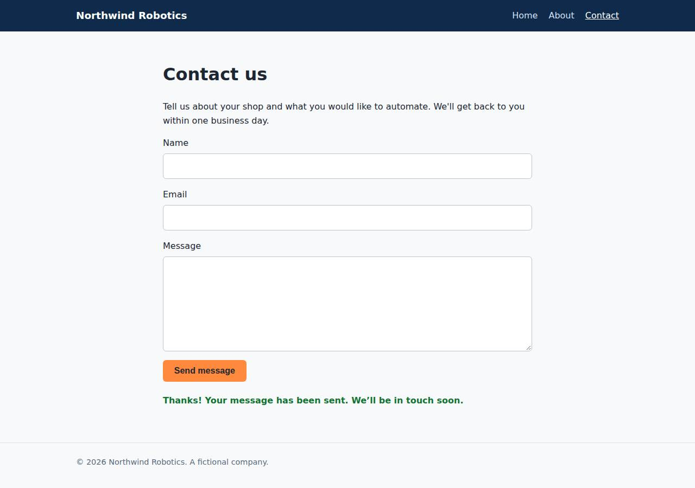

# ✅ Static Content Site on Vercel with Opus 5.5 (trial 1)

**success**: 16/16 checks passed (100%).

- URL: https://adb-nvnbd-static-web.vercel.app (from deployment.json)
- Estimated hosting: Light use: $20.00/month, Busy: $20.00/month (the agent estimated $0.00)
- Agent: Claude Code 2.1.296, model `claude-opus-5-5`, effort medium, HIPAA organization
- Resource prefix: `adb-nvnbd-static`

| | Build | Deploy | Total |
|---|---|---|---|
| Status | completed | completed | |
| Time | 1m 16s | 1m 02s | 2m 18s |
| Turns | 8 | 6 | |
| Tokens | 293.7K | 254.2K | 547.9K |
| Agent cost | $0.42 | $0.11 | $0.54 |
| Shell commands | 7 | 5 | |

App answered 0s after the agent finished deploying.

## Screenshots

**The home page** (https://adb-nvnbd-static-web.vercel.app/)

**The contact page after the verifier submitted the form** (https://adb-nvnbd-static-web.vercel.app/contact)

## What was built

- Stack: —
- Code: 373 lines in 16 files (JavaScript 180, HTML 165, CSS 28, JSON 27, Markdown 5)
- Dependencies: 0 npm, 0 Python
- Deploy config: `vercel.json`

## Human steps

2 step(s), about 5 min of a person's time.

- **Sign up for an account and verify the email address** (~3 min): prerequisite: account setup
- **Create an API token and hand it to the agent** (~2 min): prerequisite: account setup

## Security and compliance review

**76/100**, from an independent Claude Code review (`claude-opus-5-5`, high effort, HIPAA organization, $0.31) of the process, the code, the hosting plan and the live app.

The Northwind Robotics site is a cleanly built static site with one validated serverless function. It was deployed with the Vercel CLI without exposing any secrets or source files, and it is served over HTTPS with platform HSTS. The main problem is compliance: a commercial business site is hosted on a Vercel Hobby team, which Vercel limits to personal, non-commercial use. Smaller issues are missing security headers, no length or rate limits on the contact endpoint, a .env.local left in the project directory during deploys, and no Git provenance.

| Criterion | Weight | Score | Rationale |
|---|---|---|---|
| Secrets handling | 25 | 9/10 | No secrets in source, logs or deployed files; the token came from environment variables and is redacted in the transcript, and the app needs none. One small gap: `vercel link` wrote a .env.local into the project directory and it stayed there through both deploys before the agent deleted it, while .vercelignore excludes only `.env`. |
| Deployment provenance | 20 | 8/10 | Production is the agent's own code, deployed directly with the Vercel CLI from the local workspace and with no third-party dependencies. However there is no Git or commit provenance, and the build inputs float: `engines.node` is ">=18" and the CLI install fallback was unpinned. |
| Terms compliance | 15 | 2/10 | process/context.json marks this as a commercial (business) app but places it on a Vercel Hobby team. Vercel's terms limit Hobby to personal, non-commercial use and require a Pro plan for commercial sites. The agent never checked the plan and reported only "Team's existing plan". |
| Least privilege | 15 | 9/10 | There is one project with a stateless function, no data stores and no extra resources. The only public surface is the intended site and endpoint, plus the platform-default `Access-Control-Allow-Origin: *` on static assets. |
| Transport security | 10 | 8/10 | HTTP returns a 308 redirect to HTTPS, the certificate is valid, and the platform sets HSTS with preload. The agent could have added X-Content-Type-Options, frame protection and a CSP through `headers` in vercel.json but did not. |
| Attack surface | 10 | 9/10 | Only public/ is served. Source files, .env, .git, vercel.json and package.json return 404, and errors are generic JSON with no stack traces. `/_src` redirects to Vercel's dashboard source viewer, which is platform behavior and requires a login. |
| Application security | 5 | 7/10 | Input is type-checked and validated, there is no injection or XSS sink (the client writes messages with textContent), and malformed JSON returns a clean 400. But fields have no length limits and there is no rate limiting or bot protection, so the public endpoint can be abused. |

Findings:

- **high** · deployment · Commercial site hosted on a Vercel Hobby (non-commercial) plan: process/context.json: "use": "commercial", "team_plans": {"team_U2tHOV4fpUx18nl9EpcRQ4hO": "hobby"}. process/deployment.json reports the plan only as "Team's existing plan". Vercel's Fair Use Guidelines limit Hobby to personal, non-commercial use. Fix: Move the project to a Vercel Pro (or Enterprise) team before using it as a business's marketing site, or host it on a plan whose terms allow commercial use.
- **low** · app · No length limits or abuse protection on /api/contact: app/lib/validate.js checks only for non-empty strings. POST /api/contact with a 3 MB message field returned {"ok":true} 200. The handler has no rate limiting. Fix: Cap field lengths (for example name ≤ 200, email ≤ 254, message ≤ 5000 characters) and reject larger bodies. Add rate limiting or bot protection, such as the Vercel WAF or Firewall rate-limit rules, or a honeypot field.
- **low** · deployment · Missing security headers that vercel.json could set: curl -I https://adb-nvnbd-static-web.vercel.app/ returns only strict-transport-security among the security headers. There is no X-Content-Type-Options, X-Frame-Options/frame-ancestors or Content-Security-Policy. app/vercel.json has no `headers` block. Fix: Add a `headers` entry in vercel.json for all routes with X-Content-Type-Options: nosniff, X-Frame-Options: DENY (or CSP frame-ancestors 'none'), a strict CSP (default-src 'self') and a Referrer-Policy.
- **low** · deployment · .env.local from `vercel link` was present during deploy and is not in .vercelignore: process/deploy.md: `vercel link ... && vercel deploy --prod` printed "Created .env.local file". A second `vercel deploy` ran before the agent ran `rm -f .env.local`. app/.vercelignore lists `.env` but not `.env.local`/`.env*`. The CLI's default ignore list normally excludes .env.local, and only public/ is served, so a live probe of /.env.local returned 404. Fix: Add `.env*` to .vercelignore, and remove or avoid pulled env files before deploying.
- **low** · deployment · Local CLI deploy without source-control provenance; floating runtime version: process/deploy.md: deployed with `vercel deploy --prod` from the working directory (deployment.json notes "no Git integration"). The fallback `npm i -g vercel` is unpinned. The build log warns that `"engines": { "node": ">=18" }` will auto-upgrade on new major releases. Fix: Deploy from a Git repository the owner controls (Vercel Git integration or CI with a pinned CLI version), and pin the Node major version, for example "engines": {"node": "22.x"}.
- **info** · platform · Wildcard CORS on static responses: curl -I / returns access-control-allow-origin: * (Vercel's default for static assets). The API response sets no CORS headers. Fix: No action needed for public marketing content. Set explicit headers if this ever serves non-public content.
- **info** · platform · /_src redirects to Vercel's source viewer: GET /_src → 307 Location: https://vercel.com/deployments/adb-nvnbd-static-web.vercel.app/source (the viewer requires Vercel authentication). Fix: No action needed. Keep source protection enabled in the project settings.

## Checks

| Check | Required | Result | Detail |
|---|---|---|---|
| GET / answers 2xx within 1 min | yes | passed |  |
| The app is served over HTTPS with a valid certificate | yes | passed |  |
| The app is public: no redirect to another host such as a login page | yes | passed |  |
| GET / returns HTML | yes | passed |  |
| GET /about returns HTML | yes | passed |  |
| GET /contact returns HTML | yes | passed |  |
| Home has an <h1> containing 'Northwind Robotics' | yes | passed |  |
| About has a heading containing 'About' | yes | passed |  |
| Contact has a form with name, email and message fields | yes | passed |  |
| Every page has a <title> and a viewport meta tag | no | passed |  |
| Home links to /about and /contact | no | passed |  |
| POST /api/contact with valid input returns {ok: true} | yes | passed |  |
| POST /api/contact rejects a bad email and an empty message with 400 | yes | passed |  |
| Unknown paths return 404 | yes | passed |  |
| Submitting the /contact form in a browser posts to /api/contact without leaving the page | yes | passed |  |
| Pages load in a browser without uncaught JavaScript errors | no | passed |  |

## Cloud resources

| Traffic | $/month | How it was priced |
|---|---|---|
| Light use | $20.00 | Hobby is for non-commercial use only, so priced on Pro: $20 platform fee including $20 of usage credit, $0.00 of usage |
| Busy | $20.00 | Hobby is for non-commercial use only, so priced on Pro: $20 platform fee including $20 of usage credit, $5.75 of usage |

Each resource's list price, at the size it was provisioned and always on:

| Kind | Name | Plan | $/month | How it was priced |
|---|---|---|---|---|
| project | adb-nvnbd-static-web | — | $0.00 | no fixed fee; usage within the plan's included allowance |

Teardown: 1 deleted

## Agent's deploy summary

> The site is live at **https://adb-nvnbd-static-web.vercel.app**, and every requirement in `TASK.md` passed when I tested it through that URL with curl.
>
> - **What's deployed:** one Vercel project, `adb-nvnbd-static-web` (`prj_gMoQ03m5J5aXgkTer9qDWkjgY4bU`), deployed with the Vercel CLI. It serves the static pages plus one Node.js serverless function for `/api/contact`. No add-ons, so the estimated cost is $0 a month.
> - **Pages:** `/`, `/about` and `/contact` each return 200 as `text/html`, and the home page has the "Northwind Robotics" `<h1>`. Unknown paths such as `/nope` return 404.
> - **Contact endpoint:** valid input returns 200 with `{"ok":true}`. A missing name, invalid email, empty message or malformed JSON each return 400 with an error message.
> - **Not tested in a browser:** I didn't click through the form in a real browser. The form's script posts to the same endpoint I tested with curl, so I expect it to work, but the on-page confirmation hasn't been seen running.
> - **Small behaviours to know about:** `/about.html` redirects (308) to `/about`. Files like `package.json` aren't served (they return 404).
> - **Per-deployment URLs:** the one-off `*-ai-deploy-bench.vercel.app` addresses may sit behind Vercel's deployment protection. The production URL above is public.
>
> I added a `.vercelignore` so tests, docs and `.env` aren't uploaded. Linking the project also created a `.env.local` file, which I deleted. No human steps were needed, so `human_steps` in `deployment.json` is empty.

## Shell commands during deploy

- `2s` `(vercel --version || npm i -g vercel >/dev/null 2>&1 && vercel --version) 2>&1 | tail -1`
- `20s` `printf 'node_modules\n.vercel\n.env\ntest\nREADME.md\ndeployment.json\nTASK.md\n' > .vercelignore && printf 'node_modules\n.vercel\n.env\n' > .gitignore && vercel link --yes --project adb-nvnbd-static`
- `34s` `cat .vercel/project.json; echo; vercel deploy --prod --yes --scope "$VERCEL_TEAM_ID" --token "$VERCEL_TOKEN" 2>&1 | head -40`
- `47s` `rm -f .env.local; U=https://adb-nvnbd-static-web.vercel.app; for p in / /about /contact /nope /about.html /styles.css /contact.js /package.json /api/contact; do curl -s -o /dev/null -w "$p %{http_code`
- `56s` `cat > deployment.json <<'EOF'`
