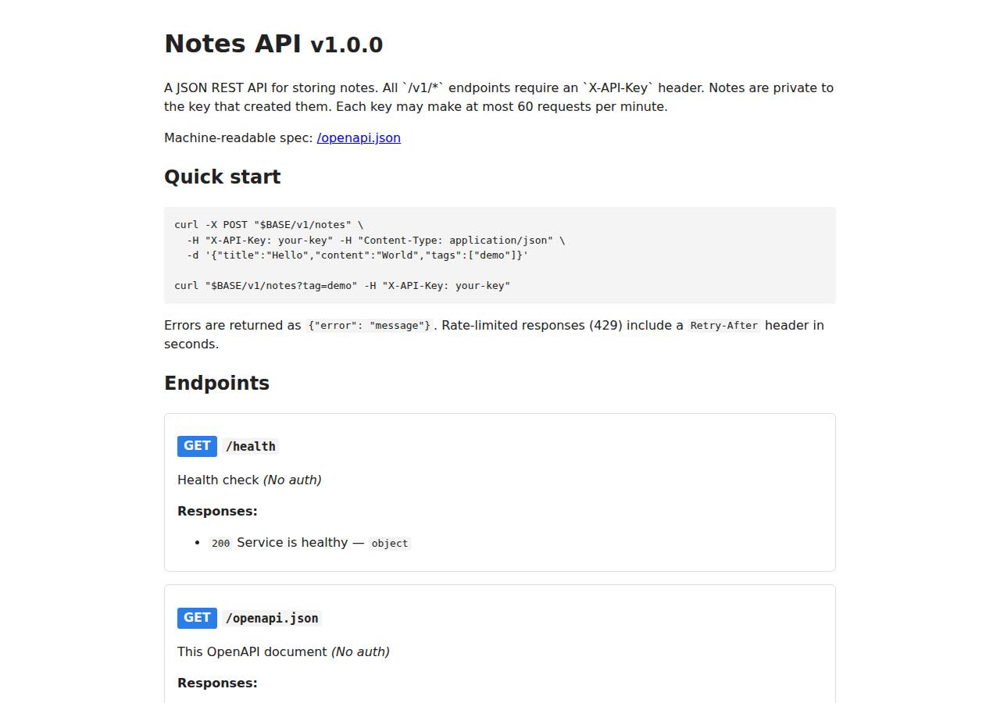

# ✅ API / Backend Service on Railway with Opus 5.5 (trial 1)

**success**: 20/20 checks passed (100%).

- URL: https://adb-xaw13-api-web-production.up.railway.app (from deployment.json)
- Estimated hosting: Light use: $10.56/month, Busy: $52.64/month (the agent estimated $5.00)
- Agent: Claude Code 2.1.296, model `claude-opus-5-5`, effort medium, HIPAA organization
- Resource prefix: `adb-xaw13-api`

| | Build | Deploy | Total |
|---|---|---|---|
| Status | completed | completed | |
| Time | 2m 52s | 3m 25s | 7m 24s |
| Turns | 12 | 11 | |
| Tokens | 491.2K | 669.6K | 1.48M |
| Agent cost | $0.54 | $0.29 | $1.01 |
| Shell commands | 11 | 10 | |

App answered 0s after the agent finished deploying.

**Needed a human:** the no-credentials attempt didn't produce a working public URL, so the cloud's credentials were provided and the agent redeployed (that attempt took 1m 07s, 316.0K tokens, $0.18).

## Screenshots

**The API documentation at /docs** (https://adb-xaw13-api-web-production.up.railway.app/docs)

## What was built

- Runtime: Node.js 20+
- Frameworks: Express
- Libraries: node-postgres
- Packaging: railway.json
- Code: 566 lines in 15 files (JavaScript 547, Markdown 45, JSON 40, Shell 19)
- Dependencies: 2 npm, 0 Python
- Deploy config: `railway.json`

### Stack fit

**90/100**, from the same independent review, judged against the app's requirements rather than a preferred stack.

Node.js 22 with Express and Railway Postgres fits a small, persistent, key-authenticated notes API well and stays minimal. STACK.md compares sensible alternatives and the build mostly follows it.

| Criterion | Weight | Score | Rationale |
|---|---|---|---|
| Fit for the job | 40 | 9/10 | Express and pg suit a small JSON CRUD API, and managed Postgres with a volume meets the requirement that data survive restarts and redeploys. The in-memory rate limiter works for the single replica, which deployment.json says to keep. |
| Proportion | 30 | 9/10 | Two runtime dependencies, no ORM, one table and a hand-written OpenAPI document make this about as small as the requirements allow. STACK.md mentions a CDN-hosted Redoc page, but the build serves self-contained HTML instead, which is simpler still. |
| Platform fit | 30 | 9/10 | This uses what Railway does well: a Railpack-detected long-running Node service, a one-click Postgres template linked by variable reference, and a health check in railway.json. railway.json is deprecated config-as-code, but it keeps working until December 2026. |

## Human steps

3 step(s), about 7 min of a person's time.

- **Sign up for an account and verify the email address** (~3 min): prerequisite: account setup
- **Create an API token and hand it to the agent** (~2 min): prerequisite: account setup
- **Add a payment method to the account** (~2 min): resources: paid resources: adb-xaw13-api

## Security and compliance review

**82/100**, from an independent Claude Code review (`claude-opus-5-5`, high effort, HIPAA organization, $0.37) of the process, the code, the hosting plan and the live app.

The Notes API on Railway is built and deployed carefully. API keys went to Railway variables through stdin, the database URL is a private-network variable reference, every query is parameterized with per-key ownership checks, and the live service exposes no files, debug endpoints or stack traces. The main weaknesses: the Postgres template's public TCP proxy was probably left enabled, the Node runtime, base image and CLI versions aren't pinned, security headers are missing, and failed key guesses aren't rate limited.

| Criterion | Weight | Score | Rationale |
|---|---|---|---|
| Secrets handling | 25 | 9/10 | API_KEYS was piped to `railway variable set --stdin` and never printed, DATABASE_URL is a Railway variable reference, and .env is excluded by both .gitignore and .railwayignore. One small issue: the Railway account token was interpolated into a curl Authorization header on the command line for the GraphQL rename, though it was masked and never echoed. |
| Deployment provenance | 20 | 7/10 | Local source was deployed with `railway up` and built by Railpack. The live app matches the source, and a package-lock.json existed locally and was uploaded. However, the Node runtime is only constrained by `engines: >=20`, Railpack picks the base image, there is no git-backed source of record, and the CLI was installed with an unpinned `npm i -g @railway/cli`. |
| Terms compliance | 15 | 9/10 | This is a personal side project on a usage-based Railway plan, which allows personal use and keeps services running without sleeping. The Postgres service has a persistent volume. The exact plan tier isn't visible, so I'm not certain of its terms. |
| Least privilege | 15 | 7/10 | The app reaches Postgres over the private network and runs from a Railpack image. The Railway Postgres template normally also creates a public TCP proxy (DATABASE_PUBLIC_URL), and the agent didn't remove it. The app connects as the template's postgres superuser, and the container probably runs as root under Railpack's defaults. |
| Transport security | 10 | 8/10 | HTTPS uses a valid Let's Encrypt certificate, and HTTP gets a 301 redirect to HTTPS. Responses have no HSTS, X-Content-Type-Options, frame protection or CSP; the app could have added these, for example with helmet. |
| Attack surface | 10 | 9/10 | Probes for .env, .git, package.json, source files and admin paths all return the app's JSON 404. Malformed JSON gets a clean 400 with no stack trace, and x-powered-by is disabled. Only the documented public endpoints (/health, /docs, /openapi.json) answer without a key. |
| Application security | 5 | 8/10 | Every query is parameterized, input types are validated, ownership is enforced in each WHERE clause (other keys get 404), the HTML docs escape their output, and the body size is capped at 1 MB. The rate limiter runs only after authentication, so failed key guesses are never throttled. Raw API keys are also stored as owner_key in the database instead of a hash. |

Findings:

- **medium** · deployment · Postgres probably reachable through a public TCP proxy: deploy.md: `railway add --database postgres` creates Railway's PostgreSQL template, which by default includes a public TCP proxy (DATABASE_PUBLIC_URL). No later step removes it. The app needs only the private DATABASE_URL (deployment.json notes). Fix: Delete the TCP proxy on the Postgres service so the database is reachable only over Railway's private network.
- **low** · deployment · App uses the database superuser, and the container probably runs as root: app/deploy.sh:17 sets DATABASE_URL to `${{adb-xaw13-api-db.DATABASE_URL}}` (the template's postgres user). The Railpack build sets no non-root user. Fix: Create a role limited to the notes table for the app, and run the container as a non-root user.
- **low** · deployment · Runtime and tooling versions not pinned: app/package.json:11-13 `"node": ">=20"`. app/railway.json uses the RAILPACK builder with its default base image. app/deploy.sh:12 `npm i -g @railway/cli` has no version. The deploy came from a local `railway up` with no tracked git source. Fix: Pin the Node major version (engines or .node-version), pin the CLI version, and deploy from a git repository the owner controls so each deployment traces to a commit.
- **low** · app · Failed API key attempts are not rate limited: app/src/app.js:58-65: the auth middleware returns 401 before `v1.use(rateLimit)`, and the limiter is keyed on a valid req.apiKey. Requests with unknown keys are never counted. Fix: Add a per-IP limiter in front of authentication, or count failed attempts per IP.
- **low** · app · Raw API keys stored in the database: app/src/app.js:77 inserts req.apiKey into owner_key, and app/src/db.js:16 defines `owner_key TEXT`. Anyone who can read the database sees valid credentials. Fix: Store a SHA-256 or HMAC of the key as the owner identifier.
- **low** · app · Security headers missing: `curl -sI https://adb-xaw13-api-web-production.up.railway.app/health` returned content-type, etag, server and x-railway-* headers, but no Strict-Transport-Security, X-Content-Type-Options, X-Frame-Options or Content-Security-Policy. Fix: Add helmet or set these headers in Express middleware.
- **info** · deployment · Account token passed on a command line: deploy.md: `curl -s https://backboard.railway.com/graphql/v2 -H "Authorization: Bearer $RAILWAY_API_TOKEN" ...` was used for the service rename. The value is expanded from the environment and was not printed. Fix: Pass the header from a file (curl -H @file) or use the CLI, so the token doesn't appear in process arguments.
- **info** · platform · HTTPS with HTTP redirect provided by Railway's edge: `curl -sI http://.../health` returned 301 to https. The certificate is CN=*.up.railway.app, issued by Let's Encrypt YE2 and valid until Dec 26 2026. Fix: None needed.

## Checks

| Check | Required | Result | Detail |
|---|---|---|---|
| GET /health answers 2xx within 1 min | yes | passed |  |
| The app is served over HTTPS with a valid certificate | yes | passed |  |
| The app is public: no redirect to another host such as a login page | yes | passed |  |
| GET /health returns {status: ok} | yes | passed |  |
| GET /openapi.json is an OpenAPI 3 document covering /v1/notes | yes | passed |  |
| GET /docs serves human-readable documentation | no | passed |  |
| Requests without an API key get 401 | yes | passed |  |
| Requests with an unknown API key get 401 | yes | passed |  |
| POST /v1/notes creates a note | yes | passed |  |
| Invalid notes are rejected with 400 | yes | passed |  |
| GET /v1/notes/{id} returns the note | yes | passed |  |
| GET /v1/notes lists notes and filters by tag | yes | passed |  |
| Notes are listed newest first | no | passed |  |
| PATCH /v1/notes/{id} updates only the given fields | yes | passed |  |
| Notes are private to the API key that created them | yes | passed |  |
| DELETE /v1/notes/{id} removes the note | yes | passed |  |
| Notes are still there a minute later | yes | passed |  |
| Exceeding 60 requests/minute returns 429 | yes | passed |  |
| 429 responses include a Retry-After header | no | passed |  |
| One key hitting its limit doesn't throttle other keys | yes | passed |  |

## Cloud resources

| Traffic | $/month | How it was priced |
|---|---|---|
| Light use | $10.56 | memory billed all month, CPU for ~10 h of activity, 0.04 GB egress at $0.05/GB |
| Busy | $52.64 | memory billed all month, CPU for ~730 h of activity, 52.6 GB egress at $0.05/GB |

Each resource's list price, at the size it was provisioned and always on:

| Kind | Name | Plan | $/month | How it was priced |
|---|---|---|---|---|
| project | adb-xaw13-api | 2 service(s) + 0.081 GB volume | $50.01 | 2 service(s) at the assumed 1 vCPU / 0.5 GB each, always on; usage is metered per second so a mostly idle service costs less than this list price |

Teardown: 1 deleted, left over: adb-xaw13-api

## Agent's deploy summary

> The Notes API is live at **https://adb-xaw13-api-web-production.up.railway.app**, and every requirement in `TASK.md` passed when I tested it through that URL.
>
> **What's deployed** (Railway project `adb-xaw13-api`):
> - **`adb-xaw13-api-web`:** the Node/Express app, one instance, deployed from local source with `railway up`. It uses a Railway-generated HTTPS address.
> - **`adb-xaw13-api-db`:** Railway Postgres with persistent storage. The app connects to it over Railway's private network through `DATABASE_URL`.
> - **`API_KEYS`:** set to exactly the keys in `BENCH_API_KEYS`. It went in through stdin and was never printed.
> - **Cost:** roughly $5 a month for light traffic on usage-based pricing; the plan's included usage may cover it. No human steps were needed.
>
> **Tested through the public URL:**
> - `/health`, `/openapi.json` and `/docs` all return `200`.
> - A missing or unknown key gets `401`.
> - Create, list, get, update and delete all work, and bad input (empty title, wrong types) gets `400`.
> - The note list is newest first, and the `?tag=` filter works.
> - The second key gets `404` when it tries to read, change or delete the first key's notes.
> - Request 61 within a minute gets `429` with `Retry-After`, while the other key keeps working.
> - A note created before a redeploy was still there afterwards.
>
> **Things to know:**
> - **Rate limiter:** it keeps its counts in the app's memory, so they reset on each redeploy, and the web service must stay at one instance.
> - **Database name:** the Postgres template ignored the name I gave it and called the service "Postgres", so I renamed it through Railway's GraphQL API. `deploy.sh` doesn't include that rename step.
> - **Config file:** the Railway CLI warns that `railway.json` is deprecated. It keeps working until 2026-12-01; after that the config needs migrating with `railway config migrate`.
> - **Test data:** the notes I created during testing have been deleted.

## Shell commands during deploy

- `5s` `sed -i '/^RAILWAY_API_TOKEN=$/d' .env && cat .env && railway whoami 2>&1; railway list 2>&1 | head`
- `9s` `railway init --name adb-xaw13-api --json 2>&1 | tail -5 && railway add --database postgres --service adb-xaw13-api-db --json 2>&1 | tail -5; railway add --service adb-xaw13-api-web --json 2>&1 | tail `
- `19s` `railway service --help 2>&1 | sed -n '1,30p'`
- `22s` `curl -s https://backboard.railway.com/graphql/v2 -H "Authorization: Bearer $RAILWAY_API_TOKEN" -H 'Content-Type: application/json' -d '{"query":"mutation { serviceUpdate(id: \"375f4b0f-daeb-401c-974b-`
- `27s` `W=adb-xaw13-api-web`
- `56s` `railway domain --service adb-xaw13-api-web --json 2>&1 | grep -v -i 'config as code\|migrate\|keep working'; sleep 20; railway service status --all 2>&1 | grep -v -i 'config as code\|migrate\|keep wor`
- `1m 33s` `cat > /tmp/smoke.sh <<'EOF'`
- `1m 49s` `B=https://adb-xaw13-api-web-production.up.railway.app; K2=$(cut -d, -f2 <<<"$BENCH_API_KEYS")`
- `3m 08s` `railway deployment list --service adb-xaw13-api-web 2>&1 | grep -vi 'config as code\|migrate\|keep working' | head -5; railway status --json 2>/dev/null | python3 -c 'import json,sys;d=json.load(sys.s`
- `3m 18s` `cat > deployment.json <<'EOF'`
