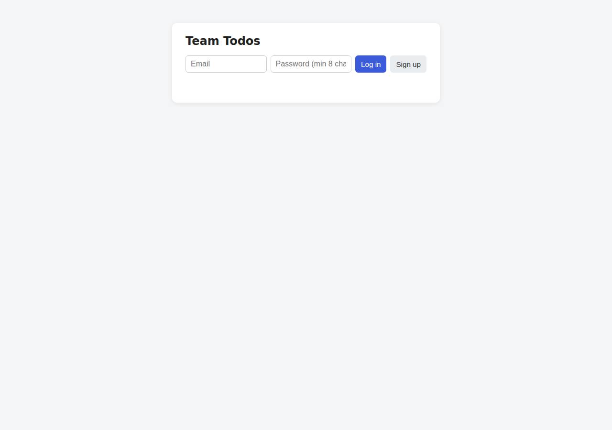
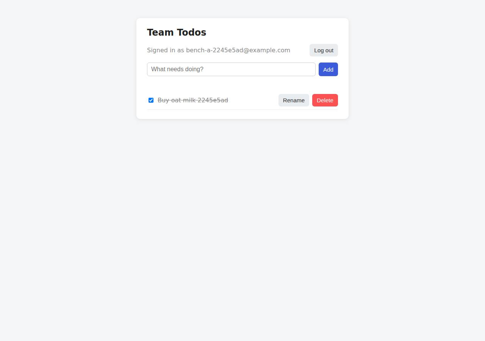

# ✅ Database-Backed CRUD App on Railway with Opus 5.5 (trial 1)

**success**: 19/19 checks passed (100%).

- URL: https://adb-sufaa-crud-web-production.up.railway.app (from deployment.json)
- Estimated hosting: Light use: $10.55/month, Busy: $52.63/month (the agent estimated $3.00)
- Agent: Claude Code 2.1.296, model `claude-opus-5-5`, effort medium, HIPAA organization
- Resource prefix: `adb-sufaa-crud`

| | Build | Deploy | Total |
|---|---|---|---|
| Status | completed | completed | |
| Time | 2m 49s | 2m 57s | 6m 48s |
| Turns | 12 | 20 | |
| Tokens | 488.8K | 1.26M | 2.24M |
| Agent cost | $0.48 | $0.48 | $1.19 |
| Shell commands | 11 | 19 | |

App answered 0s after the agent finished deploying.

**Needed a human:** the no-credentials attempt didn't produce a working public URL, so the cloud's credentials were provided and the agent redeployed (that attempt took 1m 03s, 493.6K tokens, $0.23).

## Screenshots

**The web app before signing in** (https://adb-sufaa-crud-web-production.up.railway.app/)

**The todo list after signing in through the web UI as the test user** (https://adb-sufaa-crud-web-production.up.railway.app/)

## What was built

- Runtime: Node.js 20+
- Frameworks: Express
- Libraries: node-postgres, bcrypt.js
- Code: 441 lines in 9 files (JavaScript 287, HTML 137, Markdown 41, JSON 31, Shell 17)
- Dependencies: 3 npm, 0 Python
- Deploy config: none

### Stack fit

**90/100**, from the same independent review, judged against the app's requirements rather than a preferred stack.

Node/Express 5 with Railway's managed Postgres is a simple, well-sized stack for a multi-user CRUD app, and it uses Railway's strengths (managed DB, private networking, Railpack builds). STACK.md justified the choice soundly.

| Criterion | Weight | Score | Rationale |
|---|---|---|---|
| Fit for the job | 40 | 9/10 | Railway's managed Postgres gives durable, relational storage for users and todos, and bcryptjs, pg and Express 5 (which handles async errors) cover the requirements directly. A vanilla-JS page on the same API is enough for this UI. |
| Proportion | 30 | 9/10 | There are two services, three runtime dependencies and one server file. The schema is created on startup, with no ORM, frontend framework or extra services, and nothing that only appears to work. |
| Platform fit | 30 | 9/10 | A stateless Node container built by Railpack, with a health check, restart policy, private networking and a reference variable for the DB, is the idiomatic Railway setup. STACK.md reasons about this sensibly, and the build matched it apart from moving from Express 4 to Express 5. |

## Human steps

3 step(s), about 7 min of a person's time.

- **Sign up for an account and verify the email address** (~3 min): prerequisite: account setup
- **Create an API token and hand it to the agent** (~2 min): prerequisite: account setup
- **Add a payment method to the account** (~2 min): resources: paid resources: adb-sufaa-crud

## Security and compliance review

**80/100**, from an independent Claude Code review (`claude-opus-5-5`, high effort, HIPAA organization, $0.41) of the process, the code, the hosting plan and the live app.

The app has clean secrets handling: Postgres is private and reached through a Railway reference variable, queries are parameterized, passwords use bcrypt, session tokens are stored hashed, and todos are correctly scoped to their owner. The live site is HTTPS-only and exposes nothing beyond the app. The weaknesses are minor: no rate limiting on login or signup, no security headers, an unpinned Node runtime and DB image deployed from a local directory, a superuser DB connection with a probably-root container, and a Railway plan tier that couldn't be checked against commercial use.

| Criterion | Weight | Score | Rationale |
|---|---|---|---|
| Secrets handling | 25 | 10/10 | No credentials appear in source, logs or deployed files. DATABASE_URL is a Railway reference variable (${{adb-sufaa-crud-db.DATABASE_URL}}) read from process.env, and when the agent checked the variable it printed only the hostname. |
| Deployment provenance | 20 | 7/10 | The service was deployed straight from the agent's own source with `railway up` and built by Railpack, and a package-lock.json pins the dependencies. But the Node runtime is unpinned (engines >=20, which resolved to Node 24), the Railpack builder image is chosen by the platform, and Postgres uses the floating template tag postgres-ssl:18. Deploying from a local directory also leaves no commit to trace the running build back to. |
| Terms compliance | 15 | 7/10 | The project sits on the account's existing usage-based Railway plan with an always-on service and a managed Postgres, and as far as I know Railway's paid plans allow commercial use. The exact plan tier couldn't be read (context.json has an empty account), so I can't rule out a trial or Hobby tier that is less suited to a business app. |
| Least privilege | 15 | 7/10 | Postgres is reached only over the private network (postgres.railway.internal) and has no public URL, and only the web service has a public domain. The app connects as the template's default superuser, and the Railpack container most likely runs as root. |
| Transport security | 10 | 8/10 | HTTPS works with a valid Let's Encrypt certificate, and HTTP gets a 301 redirect to HTTPS. Neither the app nor the platform sends HSTS, X-Content-Type-Options, frame protection or a CSP, and the app could easily have added them. |
| Attack surface | 10 | 9/10 | Only public/ is served statically, and source files, .env, .git and package files all return 404. Errors come back as generic JSON with no stack traces. The only extras are /healthz, which reveals nothing, and Express's default 'Cannot GET' page. |
| Application security | 5 | 7/10 | All queries are parameterized and every todo query is scoped by user_id. Passwords are hashed with bcrypt, tokens are random and stored only as SHA-256 hashes with a 30-day expiry and logout revocation, and titles are rendered with textContent. Login and signup have no rate limiting, titles have no length cap, and the token lives in localStorage. |

Findings:

- **medium** · app · No rate limiting on login or signup: server.js:104-131 has no limiter. Five wrong-password POST /api/auth/login requests in a row all returned 401 with no throttling or lockout. Fix: Add per-IP and per-account rate limiting (e.g. express-rate-limit) on /api/auth/*, plus an account backoff.
- **low** · app · No security headers: curl -sI / returns only cache-control, content-type, etag, server: railway-hikari and similar; there is no Strict-Transport-Security, X-Content-Type-Options, X-Frame-Options/frame-ancestors or Content-Security-Policy. Fix: Add helmet (or set the headers by hand) with HSTS, nosniff, frame-ancestors 'none' and a CSP that fits the inline script.
- **low** · deployment · Runtime and database image not pinned: package.json engines is "node": ">=20" (Railpack resolved Node 24). The DB source image is ghcr.io/railwayapp-templates/postgres-ssl:18 (deploy.md service list). The code was deployed from a local directory with `railway up`, not from a tracked commit. Fix: Pin the Node version (e.g. engines "24.x" or .node-version), and deploy from a git repo or commit SHA so the build can be traced.
- **low** · deployment · App uses the database superuser and probably a root container: DATABASE_URL references the template's default postgres credentials (deploy.sh line 12). No Dockerfile or user setting exists, so Railpack's default image (root) runs the service. Fix: Create a limited DB role for the app that owns only its tables, and run the container as a non-root user (custom Dockerfile with USER node).
- **low** · app · Todo title length is unbounded: server.js:147-148 only trims and checks that the title isn't empty, so any title up to the 100kb JSON body limit is stored. Fix: Cap the title length (e.g. 500 characters) and the number of todos per user.
- **info** · app · Bearer token kept in localStorage: public/index.html:57,72 stores the token in localStorage. Titles are rendered with textContent (line 111), and a stored  title came back as inert text, so there is no XSS today. Fix: Consider an HttpOnly, Secure, SameSite cookie for the web UI, plus a CSP, to limit the damage of any future XSS.
- **info** · deployment · Plan tier not verifiable: process/context.json has "use": "commercial" and "account": {}. deployment.json describes only an 'existing usage-based plan'. Fix: Confirm the account is on a paid Railway plan (Pro for a business with a team), not a trial that runs out.
- **info** · app · Default Express 404 page: GET /nonexistent returns the HTML page 'Cannot GET /nonexistent', which hints at Express but leaks no stack trace or version. Fix: Add a generic catch-all 404 handler.

## Checks

| Check | Required | Result | Detail |
|---|---|---|---|
| GET / answers 2xx within 1 min | yes | passed |  |
| The app is served over HTTPS with a valid certificate | yes | passed |  |
| The app is public: no redirect to another host such as a login page | yes | passed |  |
| GET / serves the web app as HTML | yes | passed |  |
| POST /api/auth/signup creates an account and returns a token | yes | passed |  |
| Signup rejects an invalid email and a short password with 400 | yes | passed |  |
| Signing up twice with the same email returns 409 | yes | passed |  |
| POST /api/auth/login returns a token | yes | passed |  |
| Login with a wrong password returns 401 | yes | passed |  |
| /api/todos requires a valid token (401) | yes | passed |  |
| POST /api/todos creates a todo | yes | passed |  |
| An empty title is rejected with 400 | yes | passed |  |
| GET /api/todos lists the caller's todos | yes | passed |  |
| Todos are listed oldest first | no | passed |  |
| PATCH /api/todos/{id} renames and completes a todo | yes | passed |  |
| Users can't see or modify each other's todos (404) | yes | passed |  |
| DELETE /api/todos/{id} removes a todo | yes | passed |  |
| Data is still there a minute later, with a fresh login | yes | passed |  |
| The web UI renders a login or signup form | no | passed |  |

## Cloud resources

| Traffic | $/month | How it was priced |
|---|---|---|
| Light use | $10.55 | memory billed all month, CPU for ~10 h of activity, 0.04 GB egress at $0.05/GB |
| Busy | $52.63 | memory billed all month, CPU for ~730 h of activity, 52.6 GB egress at $0.05/GB |

Each resource's list price, at the size it was provisioned and always on:

| Kind | Name | Plan | $/month | How it was priced |
|---|---|---|---|---|
| project | adb-sufaa-crud | 2 service(s) | $50.00 | 2 service(s) at the assumed 1 vCPU / 0.5 GB each, always on; usage is metered per second so a mostly idle service costs less than this list price |

Teardown: 1 deleted

## Agent's deploy summary

> The app is live on Railway at **https://adb-sufaa-crud-web-production.up.railway.app**. Every requirement in `TASK.md` passed when tested through that public URL.
>
> **What's running** (Railway project `adb-sufaa-crud`, production environment):
> - **`adb-sufaa-crud-web`:** the Node/Express app, built from this directory with `railway up`, with an HTTPS address on Railway's own domain. It has a health check at `/healthz` and restarts automatically if it crashes.
> - **`adb-sufaa-crud-db`:** Railway's managed Postgres 18 on a 500 MB volume. The web service connects to it over Railway's internal network using a variable reference, so no database password is stored in any file.
>
> **What I tested through the public URL:**
> - **Test suite:** the full API test suite passed. I changed it so it can target a deployed URL (`TEST_BASE_URL=<url> npm test`). It covers signup and login, every error code (400, 401, 404, 409), create/rename/complete/delete, oldest-first ordering, and users not seeing each other's todos.
> - **Web UI:** a headless Chrome session signed up, added, completed, renamed and deleted todos, then logged out.
> - **Persistence:** I created a todo, redeployed the web service, logged in again, and the todo was still there.
>
> **Changes from the earlier plan:**
> - Railway's CLI created the database service as "Postgres", so I renamed it to `adb-sufaa-crud-db` through Railway's API.
> - Railway warned that `railway.json` is deprecated and stops working on 2026-12-01. I deleted it and set the health check and restart policy directly on the service instead. `deploy.sh` now records the exact setup commands, but I haven't re-run it from scratch.
>
> **Cost:** about $3 a month on the account's existing usage-based plan. That's my estimate for a small, mostly idle app plus the database, and it will grow with traffic.
>
> Nothing needed a person, so `human_steps` in `deployment.json` is empty. I used the provided token and created no new credentials, so there is no `.env`. `deployment.json` has the resource IDs and notes.

## Shell commands during deploy

- `3s` `test -n "$RAILWAY_API_TOKEN" && echo token-set; railway whoami 2>&1; railway list --json 2>&1 | head -30`
- `7s` `railway init --name adb-sufaa-crud --json 2>&1 | tail -5 && railway add --database postgres --service adb-sufaa-crud-db 2>&1 | tail -5; railway status --json 2>&1 | node -e 'const s=JSON.parse(require`
- `16s` `railway service --help 2>&1 | sed -n '1,30p'`
- `18s` `railway api --help 2>&1 | head -25`
- `22s` `railway api 'mutation { serviceUpdate(id: "d837b58f-00ff-4536-8b22-af630aa4ff2c", input: {name: "adb-sufaa-crud-db"}) { id name } }' 2>&1 | tail -3`
- `25s` `railway service list --json 2>/dev/null; railway config migrate --help 2>&1 | head -25`
- `31s` `rm railway.json && railway add --service adb-sufaa-crud-web --variables 'DATABASE_URL=${{adb-sufaa-crud-db.DATABASE_URL}}' 2>&1 | tail -3; railway service list --json 2>/dev/null | node -e 'for(const `
- `36s` `railway api 'mutation { serviceInstanceUpdate(serviceId: "9cf891c8-b8a6-4bc7-862c-540f64e6a1dd", environmentId: "ba95e605-7be5-4d6c-868a-df23a7d8fcef", input: {healthcheckPath: "/healthz", healthcheck`
- `41s` `railway variable list --service adb-sufaa-crud-web --json 2>/dev/null | node -e 'const u=new URL(JSON.parse(require("fs").readFileSync(0)).DATABASE_URL);console.log("db host:",u.hostname)'; railway up`
- `1m 11s` `railway domain --service adb-sufaa-crud-web --json 2>&1 | grep -v -i 'config as code\|migrate\|keep working'; sleep 20; railway logs --service adb-sufaa-crud-web 2>&1 | tail -5`
- `1m 41s` `python3 - <<'EOF'`
- `1m 49s` `U=https://adb-sufaa-crud-web-production.up.railway.app; sed -i "s#http://localhost:3456/#$U/#" /tmp/e2e/e2e.js && node /tmp/e2e/e2e.js`
- `1m 56s` ❌ `sleep 60; railway service list --json 2>/dev/null | node -e 'for(const s of JSON.parse(require("fs").readFileSync(0)))console.log(s.name,s.latestDeployment.status,s.latestDeployment.createdAt)'; U=htt`
- `1m 59s` `railway service list --json 2>/dev/null | node -e 'for(const s of JSON.parse(require("fs").readFileSync(0)))console.log(s.name,s.latestDeployment.status,s.latestDeployment.createdAt)'`
- `2m 03s` `until railway service list --json 2>/dev/null | grep -A3 '"adb-sufaa-crud-web"' | grep -q '"status": "SUCCESS"\|"status": "FAILED"\|"status": "CRASHED"'; do sleep 5; done; railway service list --json `
- `2m 09s` `st(){ railway service list --json 2>/dev/null | node -e 'const s=JSON.parse(require("fs").readFileSync(0)).find(s=>s.name=="adb-sufaa-crud-web");console.log(s.latestDeployment.status)'; }; until [[ "$`
- `2m 26s` `railway usage --json 2>&1 | grep -v -i 'config as code\|migrate\|keep working' | head -30`
- `2m 43s` `cat > deploy.sh <<'EOF'`
- `2m 49s` `python3 - <<'EOF'`
