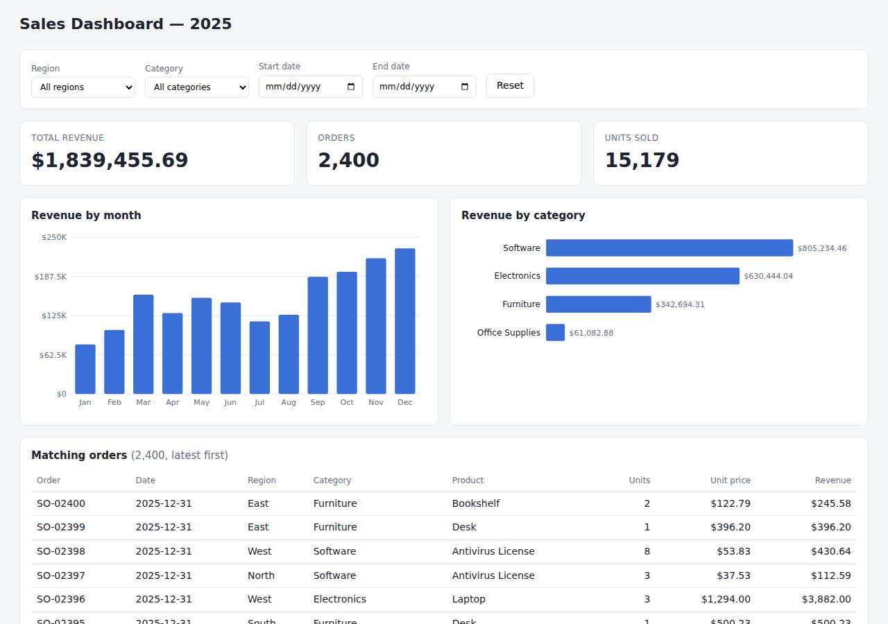

# ✅ Data / Visualization App on Railway with Opus 5.5 (trial 1)

**success**: 12/12 checks passed (100%).

- URL: https://adb-unbc1-dataviz-web-production.up.railway.app (from deployment.json)
- Estimated hosting: Light use: $5.28/month, Busy: $27.63/month (the agent estimated $1.00)
- Agent: Claude Code 2.1.296, model `claude-opus-5-5`, effort medium, HIPAA organization
- Resource prefix: `adb-unbc1-dataviz`

| | Build | Deploy | Total |
|---|---|---|---|
| Status | completed | completed | |
| Time | 1m 45s | 1m 11s | 3m 29s |
| Turns | 11 | 8 | |
| Tokens | 426.1K | 407.3K | 1.06M |
| Agent cost | $0.42 | $0.16 | $0.70 |
| Shell commands | 10 | 7 | |

App answered 0s after the agent finished deploying.

**Needed a human:** the no-credentials attempt didn't produce a working public URL, so the cloud's credentials were provided and the agent redeployed (that attempt took 33s, 231.1K tokens, $0.12).

## Screenshots

**The dashboard** (https://adb-unbc1-dataviz-web-production.up.railway.app/)

## What was built

- Runtime: Node.js 20+
- Frameworks: Node.js http module (built in)
- Packaging: railway.json
- Code: 371 lines in 12 files (JavaScript 183, HTML 176, JSON 33, Markdown 18, Shell 12)
- Dependencies: 0 npm, 0 Python
- Deploy config: `railway.json`

### Stack fit

**90/100**, from the same independent review, judged against the app's requirements rather than a preferred stack.

A zero-dependency Node.js server with in-memory CSV data and inline SVG charts is a well-reasoned, minimal stack for a small read-only dashboard, and it fits Railway's container model well. The build matched STACK.md.

| Criterion | Weight | Score | Rationale |
|---|---|---|---|
| Fit for the job | 40 | 9/10 | Holding 2,400 read-only rows in memory and aggregating them in integer cents fits the job exactly. node:http covers the small API, and hand-drawn SVG charts with fetch-based updates cover the dashboard needs with no CDN. |
| Proportion | 30 | 10/10 | One process and no npm dependencies, database or build step: as simple as the requirements allow, and STACK.md gives sound reasons for rejecting pandas and Postgres. |
| Platform fit | 30 | 8/10 | A single always-on container serving a dynamic API plus one HTML page suits Railway's service model, and Railpack auto-detects it. The deprecated railway.json config and the CLI-upload delivery work but don't use Railway's git-based deploys. |

## Human steps

3 step(s), about 7 min of a person's time.

- **Sign up for an account and verify the email address** (~3 min): prerequisite: account setup
- **Create an API token and hand it to the agent** (~2 min): prerequisite: account setup
- **Add a payment method to the account** (~2 min): resources: paid resources: adb-unbc1-dataviz

## Security and compliance review

**74/100**, from an independent Claude Code review (`claude-opus-5-5`, high effort, HIPAA organization, $0.36) of the process, the code, the hosting plan and the live app.

A small zero-dependency Node.js dashboard on one Railway service. Secrets were handled cleanly, the site is HTTPS-only with a valid certificate, and nothing beyond the app is exposed. The main weaknesses are an app bug where a request for `//` crashes the process (an unauthenticated DoS made worse by a 5-retry restart cap), a deploy from an unversioned local upload with unpinned base image and Node version, missing security headers, a container that probably runs as root, and a plan that wasn't checked for commercial use.

| Criterion | Weight | Score | Rationale |
|---|---|---|---|
| Secrets handling | 25 | 10/10 | The app needs no secrets. The Railway token stayed in the environment, never showed up in commands or output, and .env is excluded by both .gitignore and .railwayignore. |
| Deployment provenance | 20 | 6/10 | The live build is the code that was built: a CLI upload from the agent's working directory, with zero npm dependencies. However, no repo or commit records what was shipped, the Railpack base image and Node version (engines ">=20") are unpinned, and deploy.sh installs the Railway CLI without a version. |
| Terms compliance | 15 | 6/10 | This is a commercial app on an always-on, usage-billed Railway service that doesn't sleep. The account plan wasn't readable, though: the agent assumed Hobby without checking it, and Railway positions Hobby for personal and side projects (it isn't clearly prohibited for business use) and the Trial for evaluation, so Pro is the safe tier for a business app. I'm not certain how Railway's current terms treat commercial use on Hobby. |
| Least privilege | 15 | 7/10 | There's a single public web service and no data store or extra services. The Railpack-built container most likely runs as root, though, and nothing in the config sets a non-root user. |
| Transport security | 10 | 7/10 | The site is HTTPS only: plain HTTP gets a 301 redirect, and the certificate is a valid Let's Encrypt one. HSTS, X-Content-Type-Options, frame protection and CSP are all missing, and the app could easily have set them in its send() helper. |
| Attack surface | 10 | 9/10 | Source files, .env, .git, the raw CSV and admin paths all return a JSON 404 with no stack traces and no directory listings. The only extras are /health (which shows the row count) and /api/orders, which publishes the full order data by design. |
| Application security | 5 | 4/10 | Input validation is good: strict date checks, exact-match filters, page_size capped at 200, and output is HTML-escaped before innerHTML. But `new URL(req.url, ...)` isn't guarded, so a request target like `//` throws an uncaught exception that crashes the process. With a restart policy capped at 5 retries, a handful of anonymous requests could take the service down. There's also no rate limiting. |

Findings:

- **high** · app · Unhandled URL parse error crashes the server (unauthenticated DoS): app/server.js:25 `const url = new URL(req.url, 'http://localhost');` runs with no try/catch. Running the app locally, `curl --path-as-is http://localhost:3999//` returned 000, the process exited with 'TypeError: Invalid URL ... input: "//"', and a follow-up /health got no response. app/railway.json sets restartPolicyType ON_FAILURE with restartPolicyMaxRetries 5. Not sent to production, to avoid taking the live service down. Fix: Wrap URL parsing in try/catch and return 400, or parse req.url with a safe fallback. Add a process-level error boundary, and use restartPolicyType ALWAYS or a higher retry cap.
- **medium** · deployment · Deployed from an unversioned local upload with unpinned build inputs: process/deploy.md: `railway up --service adb-unbc1-dataviz-web --ci` with no GitHub repo connected. app/railway.json uses builder RAILPACK with its default base image. app/package.json has `"engines": { "node": ">=20" }`. app/deploy.sh runs `npm i -g @railway/cli` with no version. Fix: Deploy from a git repo the owner controls (Railway's GitHub integration) so every deploy maps to a commit. Pin the Node major version (e.g. .node-version or engines "22.x"), consider a Dockerfile with a digest-pinned base image, and pin the CLI version.
- **medium** · deployment · Plan not verified for commercial use: process/context.json shows use "commercial" and an empty account object. process/deployment.json gives the plan as "account's existing plan (usage-based)", and the notes assume 'covered by the Hobby plan's included usage'. Fix: Confirm the workspace is on a paid plan suited to business use (Railway Pro for commercial or team apps), not Trial or a personal Hobby workspace.
- **low** · app · No security headers: `curl -sI https://adb-unbc1-dataviz-web-production.up.railway.app/` returned only cache-control, content-type, date, server and x-railway-* headers: no Strict-Transport-Security, X-Content-Type-Options, X-Frame-Options/frame-ancestors or Content-Security-Policy. app/server.js:20 writeHead sets only Content-Type and Cache-Control. Fix: Add HSTS, `X-Content-Type-Options: nosniff`, `X-Frame-Options: DENY` (or CSP frame-ancestors 'none') and a CSP in send(); the page is self-contained, so a strict CSP is feasible.
- **low** · deployment · Container likely runs as root: app/railway.json builds with Railpack's default image (the build log in process/deploy.md shows apt packages being installed), and no non-root user is configured anywhere. Fix: Use a Dockerfile based on node:<pinned>-slim with `USER node`, or a Railpack option that runs as non-root.
- **low** · app · No rate limiting on public API endpoints: app/server.js:24-48: /api/summary and /api/orders filter and sort all 2,400 rows on every request, with no throttling. Fix: The cost is small, but consider simple per-IP rate limiting or caching responses by filter key.
- **info** · platform · Malformed percent-encoding returns a Railway edge 502: GET /% and GET /%zz returned 502 'upstream error'. GET /%25 returned the app's 404. Fix: Platform behaviour; no action needed.
- **info** · app · Health endpoint shows the row count: GET /health returned 200 {"status":"ok","rows":2400} Fix: Harmless here; return only a status if you want minimal disclosure.

## Checks

| Check | Required | Result | Detail |
|---|---|---|---|
| GET / answers 2xx within 1 min | yes | passed |  |
| The app is served over HTTPS with a valid certificate | yes | passed |  |
| The app is public: no redirect to another host such as a login page | yes | passed |  |
| GET / serves the dashboard as HTML | yes | passed |  |
| GET /api/summary (no filters) matches the dataset | yes | passed |  |
| GET /api/summary (region=West) matches the dataset | yes | passed |  |
| GET /api/summary (category=Electronics) matches the dataset | yes | passed |  |
| GET /api/summary (region=East, category=Furniture, start=2025-03-01, end=2025-06-30) matches the dataset | yes | passed |  |
| GET /api/summary (region=Atlantis) matches the dataset | yes | passed |  |
| The dashboard renders a chart (SVG or canvas) in a browser | yes | passed |  |
| The dashboard shows at least two charts | no | passed |  |
| The dashboard has filter controls | no | passed |  |

## Cloud resources

| Traffic | $/month | How it was priced |
|---|---|---|
| Light use | $5.28 | memory billed all month, CPU for ~10 h of activity, 0.04 GB egress at $0.05/GB |
| Busy | $27.63 | memory billed all month, CPU for ~730 h of activity, 52.6 GB egress at $0.05/GB |

Each resource's list price, at the size it was provisioned and always on:

| Kind | Name | Plan | $/month | How it was priced |
|---|---|---|---|---|
| project | adb-unbc1-dataviz | 1 service(s) | $25.00 | 1 service(s) at the assumed 1 vCPU / 0.5 GB each, always on; usage is metered per second so a mostly idle service costs less than this list price |

Teardown: 1 deleted

## Agent's deploy summary

> The dashboard is live on Railway at **https://adb-unbc1-dataviz-web-production.up.railway.app**, and every requirement in `TASK.md` works through that address.
>
> **What I deployed:** the project `adb-unbc1-dataviz` with one service, `adb-unbc1-dataviz-web`. Railway built the Node.js app from an upload of the local code made with the CLI, and the HTTPS address is a free `*.up.railway.app` domain that Railway generated. There's no database, because the CSV is loaded into memory. Running cost should be roughly $1 a month (my estimate, since Railway bills by usage), which the account's plan should cover.
>
> **What I checked through the public URL:**
> - **`/api/summary` with no filters:** $1,839,455.69 revenue, 2,400 orders and 15,179 units, matching the local run.
> - **Filters:** region, category and dates combined gave the same results as locally, including inclusive dates.
> - **Edge cases:** a filter with no matches returns zeros and empty arrays, and a malformed date returns a `400` error.
> - **`/api/orders` and `/api/options`:** pagination works and the filter options are correct.
> - **Dashboard in a headless browser:** the KPI tiles, both charts and the table ("Page 1 of 48") all filled in from the live API. The page drew 18 bars where I expected 16 (12 months plus 4 categories), and I didn't look into why.
>
> Nothing needed a person, so `human_steps` in `deployment.json` is empty. I didn't create any new credentials, so there is no `.env` file.
>
> **Things to know:**
> - **Redeploys:** the service isn't connected to a GitHub repo. To ship changes, run `railway up --service adb-unbc1-dataviz-web` again.
> - **Config file deprecation:** Railway's CLI says the `railway.json` config format is deprecated. It keeps working until 2026-12-01; `railway config migrate` converts it to the new format.

## Shell commands during deploy

- `3s` `cd /home/runner/work/_temp/adb-unbc1-dataviz; [ -n "$RAILWAY_API_TOKEN" ] && echo token set; railway whoami 2>&1 | head -3; railway list 2>&1 | head`
- `7s` `cd /home/runner/work/_temp/adb-unbc1-dataviz; railway init --name adb-unbc1-dataviz --json 2>&1 | grep -v -i token | tail -5; railway add --service adb-unbc1-dataviz-web --json 2>&1 | tail -5`
- `11s` `cd /home/runner/work/_temp/adb-unbc1-dataviz; timeout 600 railway up --service adb-unbc1-dataviz-web --ci 2>&1 | tail -15`
- `38s` `cd /home/runner/work/_temp/adb-unbc1-dataviz; railway domain --service adb-unbc1-dataviz-web --json 2>&1 | tail -3; railway service status --service adb-unbc1-dataviz-web 2>&1 | tail -5`
- `45s` `B=https://adb-unbc1-dataviz-web-production.up.railway.app`
- `51s` `timeout 60 google-chrome --headless=new --no-sandbox --virtual-time-budget=8000 --dump-dom https://adb-unbc1-dataviz-web-production.up.railway.app/ 2>/dev/null | grep -oE 'id="kpi-[a-z]+">[^<]*|<rect `
- `1m 02s` `cd /home/runner/work/_temp/adb-unbc1-dataviz; cat > deployment.json <<'EOF'`
